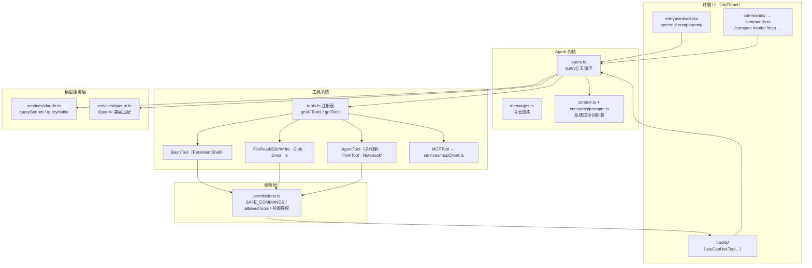

# Claude Code 架构拆解

> 生成日期：2026-09-11
>
> 代码版本（shallow clone 快照）：
> - `anon-kode` @ `442575f`（v0.0.54，来源 fork ripgrim/anon-kode，原 dnakov/anon-kode 已被 DMCA 下架）
> - `claude-code-official` @ `fb63c4a`
> - `analysis_claude_code` @ `0dcafa2`
> - `claude-code-reverse` @ `c0d99ea`
>
> 说明：Anthropic 未公开 Claude Code 核心源码。本文以 anon-kode（同一作者的完整 TypeScript 实现，架构与 Claude Code 同源）为主证据，交叉引用逆向取证资料；所有关键结论标注来源文件。

## 1. 一句话总览

Claude Code 是一个**极简内核的 coding agent harness**：一个 `while(true)` 式的"问模型 → 执行工具 → 回填结果 → 再问模型"循环（`anon-kode/src/query.ts` 的 `query()`），加上工具集、权限门、上下文管理和 MCP 扩展；**不预设工作流，让模型自己决定下一步**。

## 2. 总体架构图



## 3. Agent 主循环（核心）

全部逻辑在 `anon-kode/src/query.ts`（519 行）的 `export async function* query()`（第 128 行）——一个 **AsyncGenerator**：每产生一条消息就 `yield` 给 UI，同时把该消息累积进下一轮上下文。

### 3.1 循环步骤（对应源码行）

1. **拼装系统提示词**：`formatSystemPromptWithContext(systemPrompt, context)`（第 139 行）。`systemPrompt` 来自 `constants/prompts.ts`，`context` 由 `context.ts` 采集（KODING.md 记忆文件、目录结构、代码风格等）。
2. **调模型**：`getAssistantResponse()` → `querySonnet(...)`（第 141-154 行，实现在 `services/claude.ts`），传入 `normalizeMessagesForAPI(messages)`、`maxThinkingTokens`、`tools`、`abortController.signal`、模型（`slowAndCapableModel`）、`dangerouslySkipPermissions`。
3. **可选二元反馈**：`queryWithBinaryFeedback()`（第 75 行定义，第 156 行调用）——对模型响应做质量校验/重试的包装层。
4. **产出助手消息**并检查工具调用（第 174-181 行）：
   ```ts
   const toolUseMessages = assistantMessage.message.content.filter(_ => _.type === 'tool_use')
   if (!toolUseMessages.length) return   // 没有工具调用 = 任务收尾，循环结束
   ```
   注意源码注释：`stop_reason === 'tool_use'` 不可靠，所以**以内容块里有没有 `tool_use` 为准**。
5. **决定并发还是串行**（第 187-219 行）：**全部工具都是只读**（`isReadOnly()`）时才并发（`runToolsConcurrently`，受 `MAX_TOOL_USE_CONCURRENCY` 限制，用工具库 `all` 聚合）；只要有一个写操作就退回串行（`runToolsSerially`），保证写操作顺序确定。源码里还留了 TODO："并发条件可以放得更宽"。
6. **执行每个工具**：`runToolUse()`（第 288 行）→ `checkPermissionsAndCallTool()`（第 368 行）。
7. **结果排序回填**（第 226-235 行）：并发执行完成顺序不定，按原始 `tool_use` 的 id 顺序重排，保证 API 端 `tool_result` 与 `tool_use` 一一对应。
8. **递归下一轮**（第 237-244 行）：
   ```ts
   yield* await query([...messages, assistantMessage, ...orderedToolResults], ...)
   ```
   即把"助手消息 + 全部工具结果"追加进历史，**递归调用自身**——这就是 agent loop 的全部。
9. **中断处理**（第 162-165、221-224 行）：`abortController` 触发时产出 `INTERRUPT_MESSAGE` 并退出。

### 3.2 消息模型

`messages.ts` 定义三类消息：`UserMessage`（含 `tool_result` 内容块）、`AssistantMessage`、`ProgressMessage`。第 200-203 行注明了关键设计：**progress 消息只给 UI 看、不发给模型**，只有 user 消息（工具结果）才累积进下一轮。

## 4. 工具系统

### 4.1 定义：一个工具 = schema + 描述 + 实现

基座接口在 `anon-kode/src/Tool.ts`：

```ts
export interface Tool {
  name: string
  description?: string
  inputSchema: z.ZodObject<any>     // zod 定义入参
  inputJSONSchema?: Record<string, unknown>
  prompt: (options: { dangerouslySkipPermissions: boolean }) => Promise<string>
}
```

以 `tools/BashTool/BashTool.tsx` 为最典型样例：
- 入参 schema：`z.strictObject({ command: z.string(), timeout: z.number().optional() })`（第 21-27 行）；
- `description()`（第 40-69 行）**用 Haiku 小模型为命令生成 5-10 词的自然语言描述**（给 UI 展示"这条命令要干嘛"），失败则回退固定文案；
- 执行层用 `PersistentShell`（持久化 shell 会话，保留 cd/环境变量）；`BANNED_COMMANDS` 黑名单来自 `./prompt`；输出经 `formatOutput` 截断整理。

### 4.2 注册：静态列表 + 动态来源

`src/tools.ts`：

```ts
export const getAllTools = (): Tool[] => [AgentTool, BashTool, GlobTool, GrepTool, LSTool,
  FileReadTool, FileEditTool, FileWriteTool, NotebookReadTool, NotebookEditTool, ThinkTool,
  ...ANT_ONLY_TOOLS /* MemoryRead/Write */]

export const getTools = memoize(async (enableArchitect?) => {
  const tools = [...getAllTools(), ...(await getMCPTools())]   // ← MCP 工具动态并入
  if (enableArchitect) tools.push(ArchitectTool)
  return tools.filter(...isEnabled)
})
```

要点：**MCP 工具与内置工具在注册表层面完全同构**（`getMCPTools()` 来自 `services/mcpClient.ts`）；每个工具还有 `isEnabled()` 开关；`getReadOnlyTools()` 供并发判定与受限场景使用。

### 4.3 执行与权限

`checkPermissionsAndCallTool()`（`query.ts` 第 368 行起）串起"判定 → 询问 → 执行 → 错误格式化"（`formatError`，第 500 行）。权限判定详见下节。

## 5. 权限与安全

`src/permissions.ts` 实现了三层判定（以 Bash 为例）：

1. **白名单直接放行**：`SAFE_COMMANDS = { git status, git diff, git log, git branch, pwd, tree, date, which }`（第 19-28 行）。
2. **精确匹配授权**：`allowedTools.includes(getPermissionKey(tool, {command}, null))`——键形如 `Bash(git status)`（第 30-47 行 `bashToolCommandHasExactMatchPermission`）。
3. **前缀授权**：用户批准过 `Bash(git push)` 后，`git push origin main` 这类同前缀命令免再问（第 49-60 行 `bashToolCommandHasPermission`，前缀由 `getCommandSubcommandPrefix` 解析）。

未通过判定的调用，经由 UI 层 `hooks/useCanUseTool.ts` 弹给用户确认（允许一次 / 允许前缀 / 拒绝）。另有全局开关 `dangerouslySkipPermissions`（`query()` 透传到模型调用与工具 prompt），对应正式版的 `--dangerously-skip-permissions`。

写文件类工具（`FileEditTool`/`FileWriteTool`/`NotebookEditTool` 在 `permissions.ts` 中被单独 import，走文件系统权限判定 `utils/permissions/filesystem`），MCP server 的接入也有单独的审批 UI（`services/mcpServerApproval.tsx`）。

## 6. 上下文管理

- **环境上下文采集**（`src/context.ts`）：`getClaudeFiles()` 用 ripgrep 扫全仓库的 `KODING.md`（正式版为 CLAUDE.md），把路径清单注入系统提示词（第 24-48 行）；另有 `setContext/removeContext` 把 `codeStyle`、`directoryStructure` 等键值存入项目配置并注入（第 50-58 行）。
- **历史消息**：全量 `messages` 数组随递归累积（`query.ts` 第 238 行），发送前经 `normalizeMessagesForAPI` 归一化。
- **压缩**：`commands/compact.ts` 提供 `/compact` 命令——把历史摘要化以腾出上下文窗口；正式版中该机制自动化（自动触发微压缩/compact），`claude-code-reverse/logs/compact.log` 记录了真实压缩流程的 API 交互形态。
- **成本跟踪**：`src/cost-tracker.ts`，`/cost` 命令可查。
- **历史持久化**：`src/history.ts`、`/resume` 命令恢复会话。

## 7. 子代理与并行

- **子代理**：`tools/AgentTool/AgentTool.tsx`（`name: TOOL_NAME`，第 40 行；`async *call`，第 45 行）。实现方式极其朴素——**在隔离的消息列表里递归调用同一个 `query()`**（第 84 行 `for await (const message of query(`），只把最终结果作为工具结果返回主循环。子代理拥有独立上下文，天然不污染主对话；`isReadOnly()` 为 false（第 186 行）故不参与并发。
- **工具级并行**：只读工具并发执行（`runToolsConcurrently` + `MAX_TOOL_USE_CONCURRENCY`）。
- 正式版在此之上演进为多类型 subagent（Explore/Plan 等）与 agent teams（见 `analysis_claude_code/s06_subagent`、`s13_agent_teams`）。

## 8. 扩展机制

| 机制 | anon-kode 实现 | 说明 |
|---|---|---|
| **MCP 客户端** | `services/mcpClient.ts` + `tools/MCPTool` | 外部 MCP server 的工具并入 `getTools()` |
| **MCP 服务端** | `entrypoints/mcp.ts`（`kode mcp serve`） | 把自身暴露给 Claude Desktop 等宿主 |
| **slash 命令** | `commands/` 目录 + `commands.ts` 注册表 | `/compact` `/model` `/mcp` `/review` `/clear` `/cost` `/resume` … |
| **hooks** | `hooks/`（React 侧）；官方 repo `examples/hooks/` | UI 生命周期与工具审批钩子 |
| **配置** | `utils/config.ts`（项目/全局配置） | 模型、allowedTools、context 键值等 |
| **技能/插件** | anon-kode 时代尚未成体系；官方 repo `plugins/`（hookify、plugin-dev、feature-dev 等） | `analysis_claude_code/s07_skill_loading`、`s14_mcp_plugin` 讲了正式版形态 |

## 9. 端到端时序：用户输入"帮我修复这个 bug"

1. 用户在 ink TUI（`entrypoints/cli.tsx`）输入并回车；消息进入 `UserMessage` 列表。
2. 触发 `query()`：`context.ts` 采集 KODING.md/目录结构/代码风格 → `constants/prompts.ts` 的系统提示词被拼上环境上下文。
3. `services/claude.ts` 的 `querySonnet()` 携带全部工具 JSON Schema 调用模型（流式）。
4. 模型返回文本 + `tool_use`（例如 `Grep("error")`、`FileRead("src/foo.ts")`）——都是只读工具，走 `runToolsConcurrently` 并发执行（无需授权）。
5. 结果按 id 顺序回填为 `tool_result` 消息，递归 `query()` 再问模型。
6. 模型决定修改：返回 `FileEditTool`（`tool_use`）——非只读，`runToolsSerially` 执行；`permissions.ts` 判定未授权 → UI 弹确认（允许一次/允许本项目/拒绝）→ 用户同意后写入文件。
7. 模型可能再调 `Bash` 跑测试：如 `npm test` 不在 SAFE_COMMANDS、未授权 → 再弹确认；`git status` 之类则直接放行。
8. 模型输出最终文字、无新 `tool_use` → `query()` return，循环结束；TUI 渲染总结，`cost-tracker` 记账，`history.ts` 落盘。

## 10. 正式版 Claude Code 相对 anon-kode 的演进（逆向取证视角）

> 证据：`claude-code-reverse`（v2 动态逆向 + 抓包日志）与 `analysis_claude_code`（17 课机制拆解）。以下为资料中明确记录的方向，非逐条源码级结论。

- **上下文压缩自动化**：从手动 `/compact` 演进出自动（微）压缩，`logs/compact.log` 可见压缩时的真实 API 形态。
- **子代理体系化**：`logs/sub-agent.log` 对应 Task/subagent 工具；子代理有独立系统提示与工具子集。
- **任务/Todo 系统**：`s05_todo_write`、`s10_task_system` 显示正式版把"计划"外化为 todo/任务对象，跨轮次持久。
- **Summarize 与输出风格**：`logs/summarize.log`、`logs/output-style-*.log` 揭示摘要与 output-style（explanatory/learning 等）机制。
- **IDE 集成**：`logs/ide-integration.log` 对应 IDE 插件通道。
- **技能/插件化**：`s07_skill_loading`、`s14_mcp_plugin`、`s15_integrated_harness` 对应 Skills、MCP、插件生态（官方仓库 `plugins/` 已列出 14 个官方插件）。
- **提示词与工具定义**：`claude-code-reverse/results/prompts/`、`results/tools/` 是正式版真实提示词/工具定义的还原产物，可与 anon-kode 的 `constants/prompts.ts`、`tools/` 对照阅读——**骨架几乎一致，工程细节和规模差了一个数量级**。

## 11. 设计亮点与局限

**亮点**

1. **内核极小**：主循环 100 行上下，无状态机、无工作流引擎——"模型是司机，harness 是车"（analysis 课程反复强调的设计哲学）。
2. **并发策略保守而正确**：只读才并发、写操作串行、结果按 id 重排——简单且不会乱序。
3. **权限模型可复用**：白名单 → 精确授权 → 前缀授权三级递进，`Bash(git push)` 式键设计兼顾安全与流畅。
4. **工具与 MCP 同构**：外部工具与内置工具走同一注册表/同一循环，扩展成本极低。
5. **用小模型做杂活**：`description()` 用 Haiku 生成命令说明——省大模型 token、UI 体验好（该模式被后续各家 agent 广泛借鉴）。

**局限**

1. **上下文无自动治理**：anon-kode 时代历史全量累积，长会话必然爆窗，靠手动 `/compact`。
2. **工具结果直接回灌**：无中间摘要/筛选，大输出（如全量 grep）容易占满窗口。
3. **递归实现主循环**：深轮次会话有栈与调试上的不便（正式版改为迭代式）。
4. **权限判定基于文本匹配**：命令前缀/白名单可被 shell 技巧绕过（如 `git status && rm -rf`），正式版因此引入更严格的 shell 解析与沙箱。

## 12. 关键文件索引（精读清单）

| # | 文件 | 一句话 |
|---|---|---|
| 1 | `anon-kode/src/query.ts` | 主循环：模型↔工具往返、并发/串行、递归下一轮（第 128/247/269/288/368 行） |
| 2 | `anon-kode/src/Tool.ts` | 工具基座接口 |
| 3 | `anon-kode/src/tools.ts` | 工具注册表、MCP 工具并入、read-only 过滤 |
| 4 | `anon-kode/src/tools/BashTool/BashTool.tsx` | 最典型工具：zod schema、Haiku 描述、持久 shell |
| 5 | `anon-kode/src/tools/AgentTool/AgentTool.tsx` | 子代理：隔离消息列表递归 `query()` |
| 6 | `anon-kode/src/permissions.ts` | 权限三级判定与 allowedTools 键 |
| 7 | `anon-kode/src/context.ts` | 环境上下文与 KODING.md 记忆注入 |
| 8 | `anon-kode/src/constants/prompts.ts` | 系统提示词 |
| 9 | `anon-kode/src/messages.ts` | 三类消息与 tool_result 结构 |
| 10 | `anon-kode/src/services/claude.ts` | 模型调用（querySonnet/queryHaiku） |
| 11 | `anon-kode/src/services/mcpClient.ts` | MCP 工具动态注册 |
| 12 | `anon-kode/src/entrypoints/mcp.ts` | MCP server 模式 |
| 13 | `anon-kode/src/commands.ts` + `commands/compact.ts` | slash 命令体系与压缩命令 |
| 14 | `anon-kode/src/entrypoints/cli.tsx` | TUI 入口与流程编排 |
| 15 | `claude-code-reverse/README.zh_CN.md` | 动态逆向方法论 |
| 16 | `claude-code-reverse/logs/compact.log` / `sub-agent.log` | 正式版压缩/子代理真实 API 交互 |
| 17 | `claude-code-reverse/results/prompts/`、`results/tools/` | 正式版提示词与工具定义还原 |
| 18 | `analysis_claude_code/s01_agent_loop/README.zh.md` | 教材第 1 课：agent loop 最小实现 |
| 19 | `analysis_claude_code/s08_context_compact/README.zh.md` | 教材第 8 课：上下文压缩 |
| 20 | `claude-code-official/plugins/` | 官方插件生态（14 个插件） |
