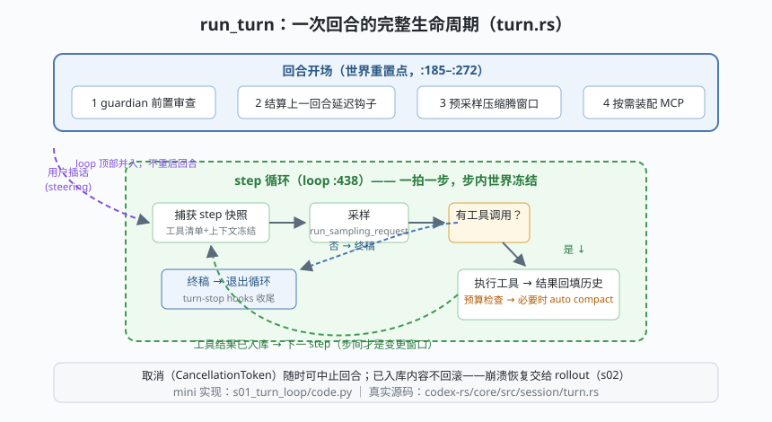

# s01: 回合循环 —— run_turn 与"步"的世界观

`s01` → [s02_rollout](../s02_rollout/) → [s03](../s03_tool_registry/) → ... → [s10](../s10_frontends/)

> Codex 内核的第一块骨头：`core/src/session/turn.rs` 的 `run_turn`（本快照约 :176）。它**不是"一个大 while 到底"**，而是回合（turn）与步（step）的两级结构：一次用户输入 = 一个回合；回合内每次采样请求 = 一步。开场四件事（guardian 审查 → 结算延迟钩子 → 预采样压缩 → 按需装配），然后进入 `loop {}`（:438）——每一拍捕获一份冻结的 step 快照，采样，执行工具，预算检查，直到模型给出无工具调用的终稿。
>
> **Codex 招牌设计**：回合是"世界重置点"，步内是"冻结快照"——同一 step 里的工具清单、系统提示、上下文是同一次请求视图，可复现、可断言；变化只发生在步与步之间。用户插话（steering，转向）在 loop 顶部并入而不是重启回合。

---

## 问题

1. **循环该多大？** 最朴素的 agent 是一个 `while True`：采样→执行→再采样，直到模型闭嘴。但"什么时候该停、什么时候能改配置、什么时候能换工具清单"全都不明确——循环里的每一拍都是混沌的世界。
2. **用户在 agent 干活时插话怎么办？** 取消重来太粗暴，忽略掉用户要骂人；插话必须在某个明确的时刻被安全地并入。
3. **上下文总会满**。不管理窗口，长任务的第 20 步就会撑爆预算——可"删历史"又违背审计（历史一动，重放就失真）。
4. **中途取消怎么办？** 已经执行了一半的工具、已经入库的消息——取消后这些状态算什么？

---

## 解决方案



Codex 的答案是把循环分层，每一层各有职责：

| 机制 | 职责 | 真实实现（codex-rs） |
|------|------|----------------------|
| **回合（turn）** | 一次用户输入的生命周期；开场四件事是固定的"世界重置点" | `session/turn.rs` `run_turn`（约 :176） |
| **步（step）** | 一次采样及其工具执行；开始前捕获冻结快照 | `capture_step_context_with_required_mcp_servers`（:272） |
| **steering 并入** | 用户插话进 `input_queue`，loop 顶部取出入库，下一采样自然可见 | `sess.input_queue.get_pending_input(...)`（:445 一带） |
| **预采样压缩** | 记录新输入**之前**先腾窗口 | `run_pre_sampling_compact`（:1247） |
| **回合中压缩** | 每步工具回填后检查预算，必要时折叠 | `run_auto_compact`（:1396） |
| **取消** | `CancellationToken` 贯穿回合，中止时已入库内容不回滚 | turn.rs 各 await 点检查取消 |

一条纪律：**回合内所有"世界可以变"的动作（并入插话、换工具、压缩）都发生在步与步的边界上**——这就是"单 while"与回合制的分水岭。

---

## 工作原理

`code.py` 用约 230 行 Python（纯标准库 asyncio）复刻这套骨架，模型由 `MockModel` 按剧本扮演（离线）。走读四个关键点：

**第 1 点：开场四件事**。`run_turn` 一进来就按序执行 guardian 前置审查、结算上一回合的延迟钩子、预采样压缩、按需装配 MCP（输入里 `@` 提及了哪个 server 才启动哪个）。对照 turn.rs :185–:272 的真实顺序——**先腾窗口、再记输入**，顺序反了就白腾了。

**第 2 点：一拍一快照**。`capture_step_context` 把系统提示、工具清单、当前历史冻结成 `StepContext`。同一步里的所有行为共享这份视图。

**第 3 点：loop 顶部并入插话**。场景 2 里第一幕采样拖 25ms，用户在第 10ms 插话——插话躺在 `asyncio.Queue`（对应 tokio mpsc）里，直到本步结束、下一拍开头被取出入库。它**不重启回合**，只让下一次采样"看得见"。

**第 4 点：预算双检查**。场景 3 里预采样压缩把 65 tok 的旧工具输出折叠掉，新输入才能进窗口；回合中再触顶时，**本回合新增的条目受保护不折叠**（模型正要看的语境不能折——真实实现由 `compact_token_budget.rs` / `retained_context.rs` 决定保留近 N 轮）。

**跑一跑**（零依赖，离线）：

```bash
python code.py
```

预期输出四个场景：① 两步完成回合（工具→终稿），历史逐条入库；② 插话在 step 2 开头被"并入"（能看到 `[turn] 并入插话（steering）`）；③ 旧工具输出被折叠为 `[auto-compact 已折叠]`，新工具结果原样保留；④ 取消令牌触发 `TurnAborted`，已入库的 1 条用户消息不回滚。

---

## 对照真实源码

| mini 实现 | Codex 真实代码（crate `codex-core`） | 学习点 |
|-----------|--------------------------------------|--------|
| `run_turn()` 开场四件事 | `core/src/session/turn.rs` `run_turn`（约 :176）、guardian（:185）、延迟钩子（:188） | 回合开场是固定协议，不是随手写的主循环 |
| `capture_step_context()` | 同文件 `capture_step_context_with_required_mcp_servers`（约 :272，定义 `session/step_context.rs`） | 步内快照冻结，行为可复现 |
| `loop {}` | 同文件 `loop {`（约 :438） | 每拍一次采样：`run_sampling_request`（约 :1554） |
| `drain_pending_input()` | 同文件 loop 顶部 `get_pending_input`（约 :445） | steering 不重启回合 |
| 预采样 / 回合中压缩 | 同文件 `run_pre_sampling_compact`（约 :1247）、`run_auto_compact`（约 :1396） | 先腾窗口再记输入；压缩随时可触发 |
| 按需装配 MCP | 同文件 `required_mcp_servers_for_input`（约 :882） | 输入提及才启动，不做全量挂载 |
| `TurnAborted` | 同文件取消路径（`TurnAborted` 错误变体） | 已入库内容不回滚，恢复靠 rollout |

> **行号以当前检出为准，上游会漂移。** turn.rs 是 3000+ 行的大文件，建议按上面的锚点用编辑器符号搜索定位；行号只当路标，函数名才是坐标。

---

## 自测

1. 为什么"工具清单在 step 内冻结"？如果允许某次工具执行中途修改当前 step 的工具清单，会破坏什么？（提示：模型签收的请求和执行的后果必须对应同一份视图。）
2. steering 为什么设计成"loop 顶部并入"而不是"立刻打断当前采样"？两种做法各自的代价是什么？
3. 取消回合时"已入库内容不回滚"——这个决定如何让 s02 的崩溃恢复成为可能？

下一课 [s02_rollout](../s02_rollout/)：历史"只增不减"的承诺如何落成 JSONL 文件，并在重启后原样重建会话。
