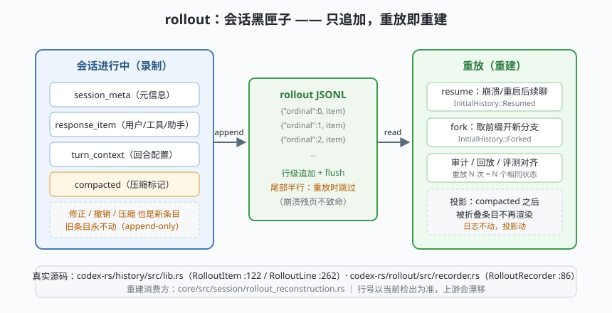

# s02: rollout —— 会话的黑匣子，日志不动投影动

[s01](../s01_turn_loop/) → **s02** → [s03_tool_registry](../s03_tool_registry/) → ...

> s01 留下一个承诺：历史只增不减，取消也不回滚。Codex 把它落成磁盘上的 rollout（会话轨迹文件）：回合进行中，每条状态（元信息、消息、工具结果、回合配置、压缩标记……）都**追加**写进一份 JSONL 文件；重启后**重放**这份文件即可确定性重建会话——resume（续聊）、fork（分叉）、审计、评测对齐全部站在它上面（`history/src/lib.rs` 的 `RolloutItem`/`RolloutLine` + `rollout/src/recorder.rs` 的 `RolloutRecorder`）。
>
> **Codex 招牌设计**：压缩也走轨迹——`Compacted` 是一条新条目而不是对旧条目的改写。**日志不动，投影动**：投影（模型真正看见的上下文）可以折叠，轨迹（真源）永远完整。

---

## 问题

1. **进程会崩**。agent 跑到第 15 步时终端被杀/Ctrl-C/断电——已完成的推理和工具调用全部蒸发？用户得从头再来？
2. **"改历史"是万恶之源**。想让上下文瘦身（压缩）、想让会话分叉（试两种方案）、想做评测回放——如果实现都靠删改内存里的历史，三件事互相打架且不可审计。
3. **写文件也会坏**。写一半时崩溃，文件尾部留下半行 JSON——重启后重放直接炸掉？
4. **哪些状态值得落盘？** UI 过渡动画、瞬时提示……什么都写会让轨迹膨胀成垃圾场。

---

## 解决方案



| 机制 | mini 版 | Codex 真实实现 |
|------|---------|----------------|
| **条目枚举** | `item(kind, …)`：session_meta / response_item / turn_context / compacted / token_usage | `history/src/lib.rs` `RolloutItem`（:122）：SessionMeta / ResponseItem / Compacted / TurnContext / TokenUsageRecord / EventMsg… |
| **行信封** | `{"timestamp", "ordinal", "item"}` | `RolloutLine`（:262）：timestamp + ordinal + `#[serde(flatten)]` item |
| **追加写** | `open(…, "a")` + flush + 单调 ordinal | `rollout/src/recorder.rs` `RolloutRecorder`（:86），tokio 异步写 + `writer_lock.rs` 文件锁 |
| **持久化策略** | ephemeral 条目不落盘 | `rollout/src/policy.rs` `is_persisted_rollout_item` 按类型与历史模式过滤 |
| **确定性重放** | 逐行解析 → `project()` 投影 | `core/src/session/rollout_reconstruction.rs`；`InitialHistory::{Resumed, Forked}` |
| **抗损** | 尾部半行跳过并计数；中间坏行上抛 | `rollout/src/reverse_jsonl_scanner.rs` 从尾部扫描恢复 |

一条铁律：**轨迹只增不减，修正也是事件**。压缩（compacted）、token 用量（token_usage）、甚至多智能体通信（InterAgentCommunication）都各自是一条轨迹条目。

---

## 工作原理

`code.py` 约 250 行，演示一条完整链路（文件写进系统临时目录，结束清理）：

**场景 1（录制）**：把 s01 那次"修复登录 bug"回合逐条落盘——注意 `ephemeral` 条目被持久化策略拦下，根本没写进文件。

**场景 2（重放续聊）**：`resume()` 读回 5 行 → `project()` 投影出 4 条可见历史；**重放两次断言结果全等**——重建必须确定性；续聊的新条目 ordinal 从 5 接续（单调不回头，乱序可检测）。

**场景 3（压缩也是条目）**：追加一条 `compacted` 后，可见历史只剩摘要，但轨迹条目 6 条全在——被折叠的原文一条没删。这就是"日志不动，投影动"：想看原文？轨迹里全在。

**场景 4（分叉与半行，失败路径）**：`fork@2` 取前缀开新分支；然后手工往文件尾部追加**半行 JSON** 模拟崩溃残页——重放跳过它、计数、照常重建；如果是**文件中部**损坏，代码选择上抛而不是静默吞（掉电可以容忍，文件被人动过必须报警）。

**跑一跑**（零依赖，离线）：

```bash
python code.py
```

预期输出四个场景，最后两行结论：**只增不减 + 确定性重放 + 行级抗损 = 会话的黑匣子**。

---

## 对照真实源码

| mini 实现 | Codex 真实代码 | 学习点 |
|-----------|---------------|--------|
| `item(kind, …)` | `codex-rs/history/src/lib.rs` `RolloutItem`（:122） | serde tagged enum ↔ 判别字段；条目即词汇表，新能力 = 新条目类型 |
| `{"timestamp","ordinal","item"}` | 同文件 `RolloutLine`（:262） | 信封与载荷分离；ordinal 支持乱序检测与排序恢复 |
| `RolloutRecorder.append()` | `codex-rs/rollout/src/recorder.rs` `RolloutRecorder`（:86）、`append_rollout_item_to_path`（:1983） | 追加写 + 文件锁（`writer_lock.rs`）防多进程互踩 |
| `is_persisted()` | `codex-rs/rollout/src/policy.rs` `is_persisted_rollout_item` | 持久化是策略不是巧合：每类条目都过一遍审查 |
| `resume()` / `project()` | `codex-rs/core/src/session/rollout_reconstruction.rs`、`InitialHistory`（history/src/lib.rs :276 一带） | 重放重建 = resume / fork 的唯一来源 |
| 半行抗损 | `codex-rs/rollout/src/reverse_jsonl_scanner.rs` | 从尾部反向扫描，找最后一条完整行 |
| 轨迹上的用量 | `codex-rs/core/src/context/rollout_budget.rs`、`state_db.rs` | token 预算与状态库也建在同一份轨迹上 |

> **行号以当前检出为准，上游会漂移**——以文件路径为锚、以类型名为坐标。另注：`history/src/lib.rs` 的 `RolloutLine` 注释特意说明它**不实现 serde Deserialize**，强制读方走 codex-rollout 的规范解析器（防嵌套小数被宽松解析破坏）——序列化与反序列化不天真对称，是持久化层的常见防御。

---

## 自测

1. 为什么"压缩"必须是一条新轨迹条目（compacted），而不能是"把旧条目删掉"？如果删了，s01 的哪两条保证会同时失效？
2. 场景 4 里"尾部半行跳过、中部坏行上抛"——为什么两种损坏的处理策略不同？
3. `fork` 之后两条分支共享同一份历史前缀。如果分支 A 继续写入原文件会发生什么？mini 版用"新文件"避免了它，真实 Codex 用什么机制隔离并发写？（提示：writer_lock.rs）

下一课 [s03_tool_registry](../s03_tool_registry/)：模型点名工具之后、真正执行之前——那道谁也绕不开的总闸。
