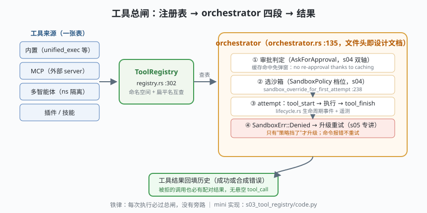

# s03: 工具编排 —— ToolRegistry 与那道总闸

[s02](../s02_rollout/) → **s03** → [s04_sandbox_axes](../s04_sandbox_axes/) → ...

> s01 循环里那行 `dispatch_tool(call)` 占位，本课正式化。Codex 的答案分两层：**注册表**（`tools/registry.rs`）——内置、MCP、多智能体、插件工具全部登记在唯一一张 `ToolRegistry`（:302）里，靠命名空间（如 `multi_agent_v1`）隔离；**编排**（`tools/orchestrator.rs`）——文件头注释就是设计文档：*"approval → select sandbox → attempt → retry with an escalated sandbox strategy on denial (no re-approval thanks to caching)"*。四段总闸，每次执行必过，没有旁路。
>
> **Codex 招牌设计**：安全不散落在各工具的 if 里，而是收敛成一道可审计的闸。被用户拒绝的调用、未知工具、沙箱拒绝——全部合成一条结构化错误结果回给模型，**日志里永远没有悬空的 tool_call**。

---

## 问题

1. **工具从哪来？** 内置的、MCP 接进来的、多智能体命名空间的、插件注册的——如果各来源各建一张表，可见性审查、生命周期、遥测就全是三套逻辑。
2. **"能不能执行"谁说了算？** 模型说能（它发的调用）、用户说能（他批准的）、沙箱说能（环境允许的）——三个"能"如何不打架，且决策有据可查？
3. **被拒的调用怎么收场？** 拒绝后如果只删调用不回结果，历史里就出现悬空 tool_call，s02 的重放直接裂开。
4. **同一命令反复弹审批**，用户会被问烦——批准过一次的决策能不能记住？

---

## 解决方案



| 机制 | mini 版 | Codex 真实实现 |
|------|---------|----------------|
| **唯一登记处** | `ToolRegistry`：`(namespace, name)` 键 + 扁平名 `"ns.tool"` 互查 | `core/src/tools/registry.rs` `ToolRegistry`（:302）；命名空间常量 `MULTI_AGENT_V1_NAMESPACE`（handlers/multi_agents_spec.rs） |
| **运行时契约** | `ToolSpec.run(args) -> ToolOutput` | `CoreToolRuntime`（registry.rs :55）：`ToolExecutor<ToolInvocation>`（codex-tools crate）+ hooks/遥测/调度追踪切面 |
| **四段总闸** | 审批 → 选沙箱 → attempt → 拒绝升级（占位） | `tools/orchestrator.rs` `run`（:135），文件头注释即上述四段 |
| **审批缓存** | `(工具, 命令指纹) → 决定` | orchestrator 缓存已批准决策（"no re-approval thanks to caching"）；execpolicy 规则表三值 `Allow/Prompt/Forbidden`（`execpolicy/src/decision.rs` :9） |
| **生命周期** | `tool_start/tool_finish/denied` 事件表 | `tools/lifecycle.rs` `notify_tool_start/finish`；`ToolDispatchTrace` 调度追踪 |
| **配对结果** | 一切路径都返回 `ToolOutput` | 被拒/未知/取消都合成错误结果，重放永远合法 |

两条铁律：**每次执行必过总闸**（审批与沙箱是两道独立的闸——用户批的是"可以做"，沙箱裁决"这个环境能不能"）；**任何路径都有配对结果**（拒绝也合成 ToolOutput）。

---

## 工作原理

`code.py` 约 270 行，五个场景：

**场景 1（注册表）**：`read_file`/`shell` 注册在全局命名空间，`spawn` 注册在 `multi_agent_v1` 命名空间——多智能体上下文可见 `multi_agent_v1.spawn`，普通上下文看不见；扁平名 `"multi_agent_v1.spawn"` 能反查；重复注册被拒（注册即可逆、但不可覆写）。

**场景 2（快乐路径）**：`read_file` 走完 审批 → 选沙箱 → attempt 三段，调度追踪里出现 `approval → tool_start → tool_finish`。

**场景 3（审批缓存）**：`npm test` 问一次用户后进缓存，第二次执行 `cached=True` 直接放行——**被问 1 次**。

**场景 4（拒绝与未知，失败路径）**：`git push --force` 被用户拒绝 → 合成错误结果；`not_a_tool` 查表失败 → 合成错误结果。没有异常逃逸到循环，没有悬空调用。

**场景 5（沙箱拒绝）**：`rm -rf /system` 用户**批准了**，但执行体抛 `SandboxDenied`（对应真实沙箱的 `SandboxErr::Denied`）——总闸第④段入口记录这次拒绝并返回"升级重试见 s05"。审批与沙箱两道闸的独立性在这里可见。

**跑一跑**（零依赖，离线）：

```bash
python code.py
```

预期输出：注册表可见性三行、每场景的执行结果、末尾一段调度追踪（ToolDispatchTrace 的 mini 版），其中能看到 `approval(cached=True)` 与 `sandbox_denied` 事件。

---

## 对照真实源码

| mini 实现 | Codex 真实代码（crate `codex-core`，另注明者除外） | 学习点 |
|-----------|------------------------------------------------------|--------|
| `ToolRegistry` | `core/src/tools/registry.rs` `ToolRegistry`（:302） | 一张表管所有来源；可见性单点可审 |
| `ToolSpec.run` | 同文件 `CoreToolRuntime`（:55，trait `ToolExecutor` 定义在 crate `codex-tools` 的 `ToolExecutor<ToolInvocation>`） | 声明（`*_spec.rs`）与实现（handlers/*.rs）分离 |
| `MULTI_AGENT_V1_NAMESPACE` | `core/src/tools/handlers/multi_agents_spec.rs` 常量，registry.rs :34 引用 | 命名空间让子代理工具与主工具隔离并存 |
| `Orchestrator.run` | `core/src/tools/orchestrator.rs` `run`（:135）；文件头 :1-8 即四段声明 | 编排器是"总闸"，不是工具的辅助函数 |
| 审批三值 | `execpolicy/src/decision.rs` `Decision::{Allow, Prompt, Forbidden}`（:9） | 规则式判定先于弹窗：能规则解决的不问人 |
| 审批缓存 | orchestrator.rs 的缓存决策传递（升级重试免重审批，:389 一带配合使用） | 批准过一次的决策有记忆 |
| `tool_start/finish` | `core/src/tools/lifecycle.rs` `notify_tool_start` / `notify_tool_finish` | 生命周期事件先于结果回填，UI 才能实时渲染 |
| `SandboxDenied` | orchestrator.rs `SandboxErr::Denied`（:352 解构处） | "策略挡了"与"命令错了"在类型上就分开 |
| 并行执行 | `core/src/tools/parallel.rs` | mini 串行；真实版有界并发（对照姊妹课程 s05 的模型序提交） |

> **行号以当前检出为准，上游会漂移。** orchestrator.rs 只有 570 行但密度极高，建议先读文件头注释再按 `run` → `run_attempt`（:52）→ `sandbox_outcome_from_tool_error`（:535）的顺序精读。

---

## 自测

1. 为什么工具注册表是"一张表 + 命名空间"，而不是每个来源一张表？举一个只有单表才能做到的审查。
2. 审批缓存按 `(工具, 命令指纹)` 记忆。如果命令是 `rm -rf /tmp/a` 与 `rm -rf /tmp/b`，指纹不同——这是防住了什么、又可能防不住什么？
3. 用户批准了命令但沙箱仍拒绝（场景 5）。为什么 Codex 把这两个决策做成两道独立的闸，而不是批准后直接放开沙箱？

下一课 [s04_sandbox_axes](../s04_sandbox_axes/)：把"审批"与"沙箱"两道闸展开成一张 3×4 判定矩阵——`AskForApproval` × `SandboxPolicy` 的双轴世界观。
