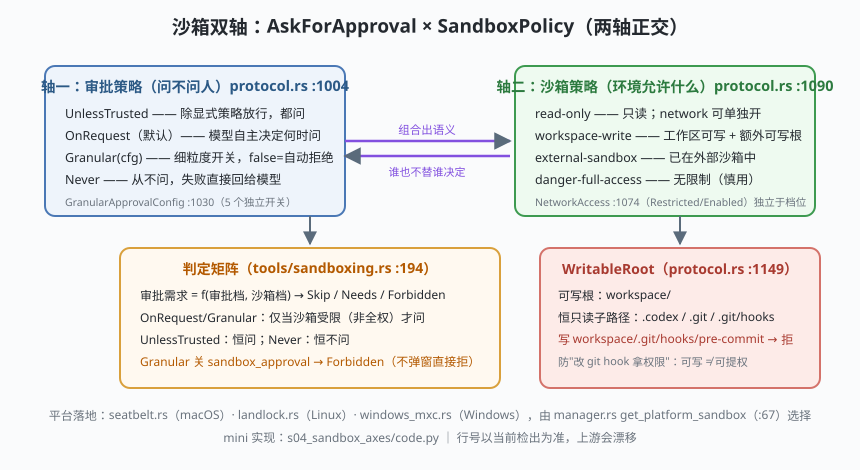

# s04: 沙箱双轴 —— AskForApproval × SandboxPolicy 判定矩阵

[s03](../s03_tool_registry/) → **s04** → [s05_escalation](../s05_escalation/) → ...

> Codex 安全模型的核心世界观是**两根正交的轴**（都在 `protocol/src/protocol.rs`）：轴一 `AskForApproval`（:1004）——审批策略，管"**问不问人**"（UnlessTrusted / OnRequest / Granular / Never）；轴二 `SandboxPolicy`（:1090）——沙箱策略，管"**环境允许什么**"（read-only / workspace-write / danger-full-access / external-sandbox），外加独立的 `NetworkAccess`（:1074）。两轴谁也不替谁决定：用户批准了命令，沙箱照样能拒；沙箱放行的命令，策略也照样要先弹窗。组合出语义，组合可枚举——这就是"可审计"的全部来源。
>
> **Codex 招牌设计**：`WritableRoot`（:1149）——可写根里的提权敏感子路径（`.codex`、`.git`、尤其 `.git/hooks`）**恒为只读**。"可写"不等于"可提权"，这一条防住的是"改 git hook 拿权限"的经典逃逸。

---

## 问题

1. **两个问题常被混成一个**。"该不该问用户"（UX/审批）与"进程能碰什么"（OS 沙箱）是两回事。混在一起写，结果是审批策略改一下，沙箱行为跟着变——没人说得清安全边界在哪。
2. **审批档位爆炸**。只读项目要严、日常开发要顺、自动化要零打扰——一个全局开关满足不了，又不能为每种命令写一条审批规则。
3. **可写根会引来提权**。工作区可写了，那 `.git/hooks` 呢？写一个 pre-commit hook，下次你 `git commit` 时恶意代码就以你的身份跑——沙箱自己开门放贼。
4. **网络要不要单独管**？只读沙箱也能 `curl` 外传数据——文件权限再严，网络一开全白搭。

---

## 解决方案



| 机制 | mini 版 | Codex 真实实现 |
|------|---------|----------------|
| **审批轴** | `AskForApproval(kind, cfg)` | `protocol.rs` `AskForApproval`（:1004）+ `GranularApprovalConfig`（:1030，5 开关：sandbox_approval / rules / skill_approval / request_permissions / mcp_elicitations） |
| **沙箱轴** | `SandboxPolicy(kind, network_access, writable_roots)` | `protocol.rs` `SandboxPolicy`（:1090：DangerFullAccess :1096 / ReadOnly :1100 / ExternalSandbox :1110 / WorkspaceWrite :1119，tagged enum 变体自带字段） |
| **判定核心** | `exec_approval_requirement()` → 免审批/需审批/禁止审批 | `core/src/tools/sandboxing.rs` `default_exec_approval_requirement`（:194）→ `ExecApprovalRequirement::{Skip, NeedsApproval, Forbidden}`（:152） |
| **第一枪旁路** | `sandbox_override_for_first_attempt()` | 同文件 :238：升级类请求可 `BypassSandboxFirstAttempt`，但有 denied-read 时强制 `NoOverride` |
| **拒读优先** | `unsandboxed_execution_allowed()` | 同文件 :275：拒读只存在于沙箱内，裸跑等于白送 |
| **恒只读子路径** | `WritableRoot.write_allowed()` | `protocol.rs` `WritableRoot`（:1149）+ `protected_metadata_names` |
| **平台实施** | `enforce()` 的 if 链 | `sandboxing/src/manager.rs` `get_platform_sandbox`（:67）分派 `seatbelt.rs`（macOS）/ `landlock.rs`+`bwrap`（Linux）/ `windows_mxc.rs`（Windows）；违规记录在 `violation.rs`（回传给模型触发 s05 的升级重试） |

一条规律：**OnRequest / Granular 只在沙箱受限（非全权）时才需要审批；UnlessTrusted 恒问；Never 恒不问**——判定是纯函数，12 格矩阵可枚举、可测试（真实仓库 `sandboxing_tests.rs` 正是这么测的）。

---

## 工作原理

`code.py` 约 250 行，四个场景：

**场景 1（判定矩阵）**：4 档审批 × 3 档沙箱打表。看两处就够：on-request 在 danger-full-access 列变"免审批"（环境已经全权，问是空转）；granular 关掉 `sandbox_approval` 后本该弹窗的两格变"禁止审批"——**置 False 不是不问，是自动拒绝**。

**场景 2（恒只读陷阱）**：workspace-write 档下 `workspace/src/login.py` 可写；`workspace/.git/hooks/pre-commit` **在工作区内却拒写**（WritableRoot 保护）；`/etc/hosts` 拒写但**可读**。

**场景 3（网络轴）**：read-only 与 workspace-write 默认都断网；`network_access=True` 才放行。文件权限与网络权限正交，别指望一档管两轴。

**场景 4（全权与边界，失败路径）**：danger-full-access + never 直通；但一旦环境带 denied-read，`sandbox_override_for_first_attempt` 拒绝裸跑——**拒读比升级更高优先级**；granular 关沙箱审批在受限沙箱下直接 Forbidden。

**跑一跑**（零依赖，离线）：

```bash
python code.py
```

预期输出：12 格判定矩阵 + 恒只读拒绝链 + 网络开关对照 + 全权档边界四段；结论行：**两轴正交组合 = 可枚举、可审计的安全语义**。

---

## 对照真实源码

| mini 实现 | Codex 真实代码 | 学习点 |
|-----------|---------------|--------|
| 两根轴的枚举 | `codex-rs/protocol/src/protocol.rs`（crate `codex-protocol`）：AskForApproval :1004、NetworkAccess :1074、SandboxPolicy :1090、WritableRoot :1149 | 全部安全语义的源头在一个文件里，先读它再读任何安全代码 |
| `exec_approval_requirement()` | `codex-rs/core/src/tools/sandboxing.rs` `default_exec_approval_requirement`（:194）、`ExecApprovalRequirement`（:152） | 判定是纯函数——同输入同输出，才能做成测试矩阵 |
| `sandbox_override_for_first_attempt()` | 同文件 :238 | "要不要绕沙箱"单独成函数：升级语义的落点 |
| `unsandboxed_execution_allowed()` | 同文件 :275 | 拒读优先于升级——安全承诺不因提权破功 |
| `WritableRoot` 保护 | `protocol.rs` :1149（注释明确点名 `.codex`、`.git`、`.git/hooks`） | 提权面在类型层建模，不靠各工具自觉 |
| 平台实施 | `codex-rs/sandboxing/src/manager.rs`（`SandboxType` :42、`get_platform_sandbox` :67、`SandboxManager` :284）+ `seatbelt.rs` / `landlock.rs` / `windows_mxc.rs` / `policy_transforms.rs` | 一套语义，三平台三后端；违规统一走 `violation.rs` |
| 网络管控 | `NetworkAccess`（protocol.rs :1074）+ crate `network-proxy` | 网络是独立轴，由代理兜底强制 |
| 配置入口 | `docs/sandbox.md`、`docs/config.md`、`docs/execpolicy.md` | 用户视角的档位说明（仓库内为索引页） |

> **行号以当前检出为准，上游会漂移**——枚举定义极少挪文件，先搜 `enum AskForApproval` / `enum SandboxPolicy` 定位。理论背景（沙箱逃逸、提权面）见 [AI应用安全手册](../../../security-handbook/AI应用安全手册.md)。

---

## 自测

1. 为什么 OnRequest 在 danger-full-access 档"免审批"？如果仍然每次都问，损失的是什么？（提示：审批的价值在"改变结果"，不在"仪式感"。）
2. Granular 的开关语义是"false = 自动拒绝"而不是"false = 不弹窗直接允许"。一字之差，安全含义差在哪？
3. `.git/hooks` 为什么比 `.git` 其他目录更危险？再想一个同样"写了之后等用户自己触发"的提权路径。

下一课 [s05_escalation](../s05_escalation/)：沙箱把命令挡下来之后——升级重试（escalation）的完整语义与边界。
