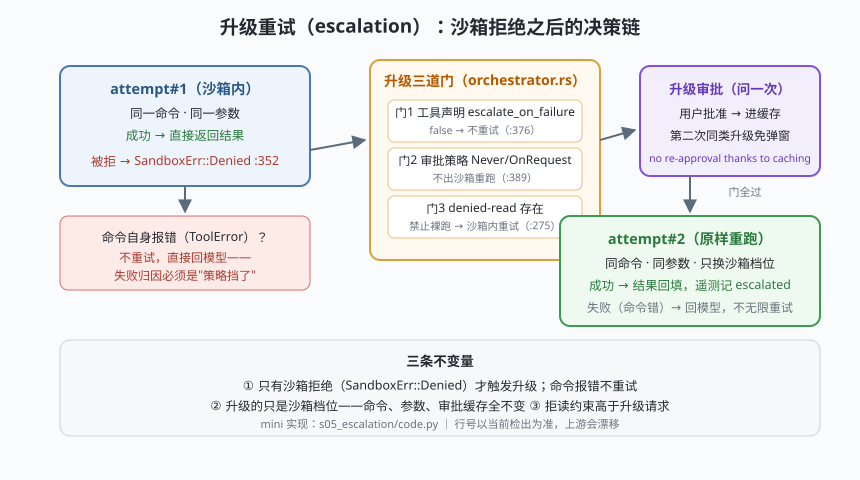

# s05: 升级重试 —— escalation 的语义与边界

[s04](../s04_sandbox_axes/) → **s05** → [s06_mcp_bridge](../s06_mcp_bridge/) → ...

> 沙箱把命令挡下来之后呢？Codex 的答案写在 `orchestrator.rs`（:300–:540）的决策链里：**升级重试（escalation，升级提权）**——第一次尝试在沙箱内；被 `SandboxErr::Denied`（:352）拒绝后，依次过三道门（工具声明 `escalate_on_failure` :376 / 审批策略 Never·OnRequest :389 / denied-read 约束 sandboxing.rs :275），全过才问一次用户，然后**原样重跑**同一命令——审批结果进缓存，同类升级不再弹窗（文件头所谓 *"no re-approval thanks to caching"*）。
>
> **Codex 招牌设计**：失败归因先行——只有"**策略挡了**"才值得升级，"命令自己错了"直接回模型。这一句区分，让重试既不骚扰用户，也不浪费一次注定失败的执行。

---

## 问题

1. **沙箱拒绝是常态不是异常**。模型不知道环境的精确边界，写工作区外、联网、装依赖都会被挡。如果每次拒绝都直接失败，agent 在严格环境里寸步难行；如果干脆不设沙箱，安全归零。
2. **反复弹窗是把用户当门铃**。同一条构建命令第一次被拒、用户批准了，第二次执行难道还要再问？
3. **升级会不会变成提权后门**？"被拒就放开跑"等于没有沙箱。什么时候**不许**升级？
4. **命令失败 ≠ 沙箱拒绝**。`deploy` 脚本 exit 1 也"失败了"，要不要也重试一次？

---

## 解决方案



| 环节 | mini 版 | Codex 真实实现（crate `codex-core`） |
|------|---------|--------------------------------------|
| **拒绝归因** | `SandboxDenied` / `ToolFailure` 两类异常 | orchestrator.rs 解构 `SandboxErr::Denied`（:352）；其他错误走 `sandbox_outcome_from_tool_error`（:535）只做遥测、不重试 |
| **门 1：工具声明** | `escalate_on_failure` 参数 | 同文件 :376 `if !tool.escalate_on_failure()` |
| **门 2：审批策略** | `env.policy in ("never","on_request")` 不出沙箱 | 同文件 :389 `wants_no_sandbox_approval`；OnRequest 仅网络审批上下文例外（:396 一带） |
| **门 3：拒读约束** | `env.denied_reads → 沙箱内降级重试` | `sandboxing.rs` `unsandboxed_execution_allowed`（:275）+ `sandbox_permissions_preserving_denied_reads`（:286） |
| **升级审批** | `Approver.ask()` 一次 + `approval_cache` | orchestrator 的已批准决策缓存；strict auto-review 下"沙箱内批准 ≠ 沙箱外授权"（:412 一带） |
| **原样重跑** | `attempt#2` 同命令同参数 | orchestrator.rs :505 一带的 escalated attempt（遥测单独计时） |
| **违规在案** | timeline 里记录拒绝详情 | `sandboxing/src/violation.rs` 违规事件（可回传模型、可触发 s03 的升级链路） |

三条不变量：**① 只有沙箱拒绝才触发升级；② 升级的只是沙箱档位——命令、参数、缓存全不变；③ 拒读约束高于升级请求**。

---

## 工作原理

`code.py` 约 280 行，把决策链做成逐门标注的 timeline。五个场景：

**场景 1（标准升级）**：`python build.py` 要写 `/usr/lib/pkg`——attempt#1 被 workspace-write 沙箱拒绝 → 三道门全过 → 问一次用户（批准）→ attempt#2 裸跑成功。用户被问 **1** 次。

**场景 2（缓存）**：同一命令再来——第 5 步直接"升级审批：缓存命中"，用户被问 **0** 次。

**场景 3（never 策略，失败路径）**：同样被拒，但门 2 拦下——不出沙箱重跑，简明拒绝信息回给模型；用户被问 **0** 次。自动化场景（never）的语义由此完整：**失败回模型，绝不打扰人**。

**场景 4（denied-read）**：`grep key /var/secrets` 被拒后，门 3 降级为沙箱内重试 → 同样被拒 → 放弃。拒读承诺不因升级破功。

**场景 5（命令自己崩）**：`flaky-deploy` exit 1——归因是"命令错了"，不走升级，直接回模型。对比场景 1-4，"沙箱拒绝"与"工具失败"在类型上就是两个东西。

**跑一跑**（零依赖，离线）：

```bash
python code.py
```

预期输出：每个场景一段编号 timeline（段①审批 → 段②选沙箱 → 段③attempt → 段④决策链），末尾五条结果行与三条不变量结论。

---

## 对照真实源码

| mini 实现 | Codex 真实代码 | 学习点 |
|-----------|---------------|--------|
| 决策链主干的顺序 | `core/src/tools/orchestrator.rs` `run`（:135）的 :300–:540 段 | 门是有顺序的：先便宜的门（纯内存判断）再贵的门（弹窗） |
| `SandboxDenied` 捕获 | 同文件 :352 `CodexErrorDetails::Sandbox(SandboxErr::Denied {...})` 解构 | 拒绝携带输出与网络策略决定，供遥测与升级判定 |
| 门 1 | 同文件 :376 `tool.escalate_on_failure()` | 升级意愿是**工具级**元数据（`apply_patch` 想升级，`plan` 不想） |
| 门 2 | 同文件 :389 `tool.wants_no_sandbox_approval(approval_policy)` | Never/OnRequest 不出沙箱重跑；OnRequest 的网络审批例外在 :396 一带 |
| 门 3 | `core/src/tools/sandboxing.rs` :275 / :286 | 拒读只在沙箱内有意义 → 裸跑被类型层拒绝 |
| 升级审批缓存 | orchestrator.rs 缓存传递（文件头 *"no re-approval thanks to caching"*）；strict auto-review 边界 :412 一带 | 缓存的是"这条命令批过"，不是"以后都批" |
| attempt#2 遥测 | 同文件 :505–:535（escalated_attempt 计时、`sandbox_outcome` 埋点） | 两次尝试分开计量：升级成功率本身是运维指标 |
| 违规记录 | `codex-rs/sandboxing/src/violation.rs` | 违规事件是升级链路的输入，也是安全审计的输出 |

> **行号以当前检出为准，上游会漂移。** 本课是 orchestrator.rs 的精读课：建议对照本页表格逐段读 :300–:540，配合 s03 的总闸全景图。安全原理延伸见 [AI应用安全手册](../../../security-handbook/AI应用安全手册.md)。

---

## 自测

1. 门 2 为什么把 OnRequest 和 Never 归为同一类"不出沙箱重跑"？OnRequest 明明允许模型主动请求审批——区别在哪一条上？
2. 审批缓存如果按 `工具名` 缓存而不是按 `(工具, 命令指纹)` 缓存，会出什么事故？
3. 场景 4 降级为"沙箱内重试"注定再被拒一次——为什么 Codex 仍然跑这一次，而不是直接报错？（提示：违规事件与失败归因对模型是两种信息。）

下一课 [s06_mcp_bridge](../s06_mcp_bridge/)：沙箱之外的能力从哪来——MCP（Model Context Protocol）的 stdio JSON-RPC 双向接入。
