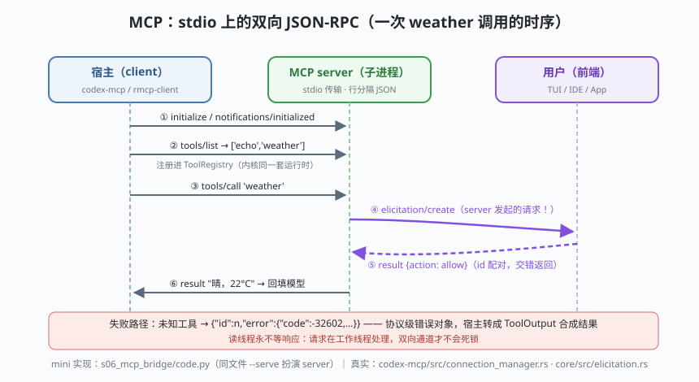

# s06: MCP 双向接入 —— 外部工具与反向征求

[s05](../s05_escalation/) → **s06** → [s07_apply_patch](../s07_apply_patch/) → ...

> MCP（Model Context Protocol，模型上下文协议）是 agent 与外部工具服务器的标准接口。Codex 的接入很有纪律：`codex-mcp` crate 的 `McpRuntime`（`codex-mcp/src/lib.rs` :23）管连接，运行期投影在 `core/src/session/mcp_runtime.rs`；**MCP 工具经 handlers/mcp.rs 以内核同一套 `CoreToolRuntime` 注册**（registry.rs :77 一带的 `mcp_server_name()` 切面）——外部工具没有任何特权；而且 `run_turn` 按 `required_mcp_servers_for_input`（turn.rs :882）**按需启动**：输入里提及的 server 才拉起。协议本身是 **stdio 上的行分隔 JSON-RPC**，并且是**双向**的——server 可以反向发起 `elicitation/create`（向用户征求输入，`core/src/elicitation.rs`）。
>
> **Codex 招牌设计**：一条通道，两个方向的请求；外部能力与内置能力同表同闸。真正的"开放生态"不破坏安全模型。

---

## 问题

1. **外部工具怎么进来？** 每个 MCP server 各写一套接入？那可见性、审批、沙箱、生命周期就要为外部工具重做一遍。
2. **进程间怎么对话？** 子进程、无 socket、跨 Windows/macOS/Linux——协议必须简单到任何语言都能实现。
3. **请求响应会交错**。连续三个 tools/call 在途，响应乱序回来——靠什么配对？
4. **server 也有话要问**。它要联网、要确认一个危险参数——它的"意见"怎么送到真正看得见用户的前端？

---

## 解决方案



| 机制 | mini 版 | Codex 真实实现 |
|------|---------|----------------|
| **stdio 行 JSON-RPC** | `LineRPC`：一行一个 JSON 对象 | `app-server-transport/src/transport/stdio.rs`（:73 逐行读）；`codex-mcp/src/connection_manager.rs`（Stdio 传输 :350 一带） |
| **双向多路复用** | `pending` 表按 id 配对；读线程 + 工作线程 | `app-server-protocol/src/rpc.rs`：`JSONRPCMessage::{Request, Notification, Response, Error}`；有趣的是 Codex 自述**不是严格 JSON-RPC 2.0**（不发 `jsonrpc` 字段，rpc.rs :1-2） |
| **能力发现** | `initialize` → `tools/list` | 同上协议层；MCP 标准方法集（`protocolVersion` 2026-07-28 亦见于 app-server README 的 codex_apps 章节） |
| **工具无特权** | tools/list 的结果"会被注册进 ToolRegistry" | `core/src/tools/handlers/mcp.rs`；MCP 工具走同一套 `CoreToolRuntime`/orchestrator（s03） |
| **按需启动** | （s01 场景 1 的 `@fs` 提及） | `core/src/session/turn.rs` `required_mcp_servers_for_input`（:882）+ `mcp_prewarm.rs` 预热 |
| **反向征求** | server 反向 `elicitation/create`，宿主剧本应答 | `core/src/elicitation.rs`；受 `GranularApprovalConfig.mcp_elicitations`（protocol.rs :1030）控制——s04 的细粒度开关在这里兑现 |
| **错误即协议** | `{"id", "error": {code, message}}` | `JSONRPCError`；app-server 对活线程误删返回 `-32600`（app-server/README.md） |

一个关键的工程认知：**读线程永不阻塞**。入站请求交给工作线程、读线程继续泵——否则"server 在等我答复、我在等 server 的下一条消息"就是死锁。

---

## 工作原理

`code.py` 一个文件扮演两个角色：直接运行是 client（宿主），以 `--serve` 再启动一份自己当 MCP server 子进程（`subprocess.Popen([sys.executable, __file__, "--serve"])`）——单文件演示两侧。

**场景 1（握手与发现）**：`initialize` + `notifications/initialized` + `tools/list`——server 报出 `['echo', 'weather']`，宿主把这批名字"登记进 ToolRegistry"。

**场景 2（普通调用）**：`tools/call echo`——一次最朴素的请求/响应。

**场景 3（双向，本课高潮）**：`tools/call weather`——server 在执行中途**反向**发起 `elicitation/create`（"查询天气需要联网，允许吗？"），宿主的 handler 剧本应答 `allow`，server 才继续执行返回结果。看时序图：④⑤ 两步的方向与前三步相反，靠 id 配对交错了两次请求。

**场景 4（协议错误，失败路径）**：调用不存在的 `deploy_prod` → server 回 `{"error": {"code": -32602, ...}}` → client 抛 `RPCError` 转成合成结果。协议错误与工具错误分层，谁也不悬空。

**跑一跑**（零依赖，离线；会创建一个真实子进程并在结束时回收）：

```bash
python code.py
```

预期输出：四个场景 + 末尾结论两行。场景 3 里能看到 `[client] ◀── server 反向征求用户` 一行——双向的直观证据。

---

## 对照真实源码

| mini 实现 | Codex 真实代码 | 学习点 |
|-----------|---------------|--------|
| `LineRPC` 传输 | `codex-rs/app-server-transport/src/transport/stdio.rs`（:73 起逐行泵）、`codex-mcp/src/connection_manager.rs`（Stdio :350 一带） | 行分隔 JSON 是最简可靠传输：EOF 自然关闭、半行自然丢弃 |
| id 配对 | `codex-rs/app-server-protocol/src/rpc.rs`（`RequestId` 支持 String/Integer） | 双向通道上 id 是唯一秩序；两端 id 空间独立 |
| "不是严格 2.0" | 同文件 :1-2 注释（不发/不要求 `jsonrpc` 字段） | 协议实用主义：骨架不变，冗余字段可省 |
| 工具注册 | `codex-rs/core/src/tools/handlers/mcp.rs`；registry.rs :77 一带 `mcp_server_name()` | 外部工具与内置工具同表同闸，无特权通道 |
| 按需启动/预热 | `core/src/session/turn.rs` :882、`session/mcp_runtime.rs`、`mcp_prewarm.rs`、`mcp_refresh.rs` | 连接是投影出来的期望态（desired state），不是全局常驻 |
| elicitation | `codex-rs/core/src/elicitation.rs`；`codex-mcp/src/elicitation.rs`；开关在 protocol.rs :1030 | server 的"意见"经宿主前端送达用户，用户决定再回流 |
| 生态反向输出 | `codex-rs/codex-mcp/src/codex_apps.rs`（`CODEX_APPS_MCP_SERVER_NAME`）+ app-server/README.md | Codex 自己也以 MCP 形式对外提供能力——协议是双向的生态接口 |

> **行号以当前检出为准，上游会漂移。** 协议背景（消息、传输、elicitation 的完整规范）见 [MCP搭建文档](../../../mcp-handbook/MCP搭建文档.md)。

---

## 自测

1. 为什么 MCP 工具要"以内核同一套 CoreToolRuntime 注册"，而不是给宿主单独写一条旁路？从 s03 的总闸视角回答。
2. 如果读线程直接同步处理入站请求（不丢给工作线程），场景 3 的 elicitation 会发生什么？画出死锁的两个等待点。
3. `mcp_elicitations=False` 时，server 的 elicitation 请求应该收到什么？对照 s04 的 Granular 语义（false = 自动拒绝，不是静默忽略）。

下一课 [s07_apply_patch](../s07_apply_patch/)：模型改代码的方式为什么是"打补丁"——apply_patch 格式、模糊定位与 code mode。
