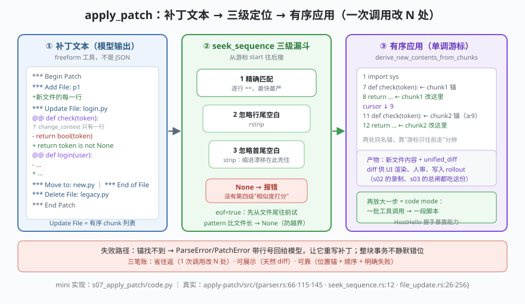

# s07: apply_patch —— 补丁式编辑、三级定位与有序 chunk

[s06](../s06_mcp_bridge/) → **s07** → [s08_multi_agents](../s08_multi_agents/) → ... → [s10_frontends](../s10_frontends/)

> 模型改代码的方式，Codex 定成了一种**自由文本协议**：`apply_patch`。它是 freeform 工具而不是 JSON 函数——`core/src/tools/handlers/apply_patch_spec.rs` :9 `create_apply_patch_freeform_tool`、:19-20 描述原文就写着 "This is a FREEFORM tool, so do not wrap the patch in JSON."，格式由文本法 `core/assets/tools/apply_patch.lark` 定义（`start: begin_patch hunk+ end_patch`，hunk 恰好三种）。
>
> 解析在 `codex-rs/apply-patch/src/`：标记常量 `parser.rs` :37-:45，`Hunk` 枚举 :66（`UpdateFile` 带 `move_path` :76 —— 重命名也是一等公民），核心结构 `UpdateFileChunk` :115（**change_context 只有一行**、`is_end_of_file` :131，注释 :69 写明"chunks 必须按文件顺序，后一块的 context 出现在前一块之后"）。定位在 `seek_sequence.rs` :12：**exact → 忽略行尾空白 → 忽略首尾空白**，三级递减严格度，带 `start` 游标与 `eof` 分支；三级都不中就返回 `None`（真实实现**没有相似度打分这一级**）。产物由 `file_update.rs` :26 `derive_new_contents_from_chunks` 推导，:256 `unified_diff_from_chunks` 反向产出 diff 给人和 UI 看。`streaming_parser.rs` :22 的 `StreamingPatchParser` 让内核 handler（`apply_patch.rs` :90）能边收 token 边应用。
>
> **Codex 招牌设计**：编辑不是散落的 read/write，而是一次**补丁事务**——而且这个事务在落盘前先过安全判定（`core/src/safety.rs` :29 `assess_patch_safety`，路由枚举 `PatchSandboxRoute` :24-27，写权限按补丁涉及路径推导 `apply_patch.rs` :238 `write_permissions_for_paths`）。s03 的总闸、s04 的双轴在"改文件"这条最危险的路径上兑现。

---

## 问题

1. **改 5 个文件要多少次往返？** "读文件 → 整份重写 → 写回"意味着 N 次 read + N 次 write，每次都要模型把整个文件复述一遍：token 爆炸，而且读完到写回之间文件可能已经变了。
2. **模型抄的上下文行缩进不对怎么办？** 补丁靠上下文行定位，模型手抖多打两个空格就整块作废？还是给一层容错？容错到哪里为止？
3. **两处同名函数，改哪一处？** 一个 `def check(token):` 出现两次，"在这个函数之后替换这行"根本不够用。
4. **谁来审这次编辑？** 改完说"改了"没用——要能渲染、能让人批、能存档重放。

---

## 解决方案



| 机制 | mini 版（`code.py`） | Codex 真实实现 |
|------|---------------------|----------------|
| **补丁语法** | 标记常量 + 逐行解析 | `assets/tools/apply_patch.lark`（文本法，非 JSON schema）；标记 `parser.rs` :37-:45 |
| **三种块** | `AddFile` / `DeleteFile` / `UpdateFile` | `Hunk` 枚举 `parser.rs` :66，UpdateFile 带 `move_path` :76（重命名） |
| **位置锚** | `UpdateChunk.change_context` 一行 | `UpdateFileChunk` :115，字段注释"usually a class, method, or function definition" |
| **有序 chunk** | `cursor` 单调前进，后块只往后搜 | `parser.rs` :69 注释：chunks in order，后一块 context 在前一块之后 |
| **三级定位** | `seek_sequence(lines, pattern, start, eof)` | `seek_sequence.rs` :12（doc comment :1-13 逐条列出三级与两个防御分支） |
| **失败即报错** | `PatchError(msg, line_number)` | `ParseError::{InvalidPatchError, InvalidHunkError{line_number}}` `parser.rs` :57 |
| **边生成边应用** | （省略，逐行解析已够演示） | `StreamingPatchParser`（`streaming_parser.rs` :22），内核 handler 持有实例 `apply_patch.rs` :90 |
| **宽松外壳剥离** | `strip_heredoc()` | `ParseMode::Lenient`（`parser.rs` :154），且 :53 `PARSE_IN_STRICT_MODE = false` —— 对所有模型都宽松 |
| **diff 展示** | `unified_diff()` 打印 | `unified_diff_from_chunks`（`file_update.rs` :256） |
| **编辑前的安全判定** | （教学未模拟） | `assess_patch_safety`（`core/src/safety.rs` :29）+ `PatchSandboxRoute`（:24-27） |

一条总纲：**补丁 = 位置锚（change_context）+ 有序变更（chunk 内 -/+）+ 一次事务**。容错是有上限的——三级定位之内尽力贴，越界就明确失败，绝不"猜个差不多的位置改下去"。

---

## 工作原理

`code.py` 手写了一个够小的解析器与定位器，八个场景：

**场景 1（一次调用三种块）**：Add `src/config.py` + Update `src/login.py`（@@ 锚 `def login`，替换第 5 行）+ Delete `src/legacy.py`——**一次工具调用**。末尾顺手打印 `unified_diff` 产物，这就是 UI 与人审看到的那份 diff。

**场景 2（Lenient 解析）**：把整段补丁包进 `<<'EOF' … EOF` 再喂进去——照样解析成功。真实动机在 `parser.rs` :154 那段长注释里：`local_shell` 不是 shell 而是 `execvpe(3)` 式的调用，heredoc 不会被展开，只会变成字面参数，于是解析器自己承担剥壳责任（gpt-4.1 的经典毛病，现在对所有模型放行）。

**场景 3（Move to）**：改 `src/config.py` 的同时 `*** Move to: src/settings.py`——重命名与内容变更在同一事务里。

**场景 4（锚不唯一）**：`login.py` 里有两个同名 `def check(token):`。只给一个 chunk 时，命中的是**游标之后第一个**同名处；第二处原样保留。锚不唯一时，位置先后就是裁决权。

**场景 5（有序 chunk）**：同一份补丁里两个 chunk 用**同一个 change_context**，各自的 `old_lines` 依次落在两处同名函数上——输出可见 chunk#1 替换第 9 行、chunk#2 替换第 13 行。这就是 `parser.rs` :69 那条"按序"不变量的兑现方式：**"第几块"这个意图是可执行的**。

**场景 6（三级定位）**：补丁里把 `    return bool(token)` 抄成两空格缩进。exact 不中、忽略行尾空白不中、忽略首尾空白命中——**第三级兜住缩进漂移**。注意真实实现到此为止：没有相似度打分，"像但不同"不配被修改。

**场景 7（失败路径）**：锚一个都不中 → `PatchError: 找不到变更上下文行 'def nonexistent():'`，整块中止。错误原样回给模型，它重写补丁；比错位修改安全得多。

**场景 8（三笔账 + code mode）**：3 个新文件 = 1 次调用。再放大一步就是 code mode（`codex-rs/code-mode*/`）：**一批工具调用变成一段脚本**，宿主经 `HostHello` 握手把能力暴露给沙箱化运行时（`code-mode-host/src/lib.rs` :281）——"声明一次、批量应用"在同一思想的更大粒度上重演。

**跑一跑**（零依赖，离线；全部文件操作发生在临时目录，结束时清理）：

```bash
python code.py
```

预期输出：八个场景 + 末尾结论两行。重点看场景 5 的两行 `chunk#1 / chunk#2`（同锚不同位）与场景 7 的 `PatchError`。

---

## 对照真实源码

| mini 实现 | Codex 真实代码 | 学习点 |
|-----------|---------------|--------|
| 标记常量与逐行解析 | `apply-patch/src/parser.rs` :37-:45 常量、:145 `parse_patch` → :193 `parse_patch_text` | 语法先用文本法写清楚，再落解析器；两处的形状必须一致 |
| `Hunk` 三 dataclass | `parser.rs` :66 `enum Hunk`（UpdateFile 含 `move_path` :76） | Rust enum 的三个变体 = 补丁的三种事务，没有第四种 |
| `UpdateChunk` | `parser.rs` :115 `UpdateFileChunk`（`change_context: Option<String>`、`is_end_of_file` :131） | 锚是"一行 + 一个方向"，不是一整块上下文窗口 |
| `cursor` 单调推进 | `parser.rs` :69 注释 + `seek_sequence` 的 `start` 形参 | 顺序不是礼貌，是语义：它消解了同名锚的歧义 |
| `seek_sequence()` 三级 | `apply-patch/src/seek_sequence.rs` :12（含空 pattern → `Some(start)`、pattern 过长 → `None` 两个防御分支） | 容错必须写成**有限的几级**，每级都可解释、可复现 |
| `strip_heredoc()` | `parser.rs` :154 `ParseMode::Lenient`、:53 恒为宽松 | 模型的坏习惯要么在协议层兜住，要么就别假装能兜住 |
| `PatchError(msg, line_number)` | `parser.rs` :57 `ParseError::InvalidHunkError { message, line_number }` | 报错带坐标，模型才可能自我修正 |
| `unified_diff()` | `file_update.rs` :256 `unified_diff_from_chunks`；:26 `derive_new_contents_from_chunks` | 新内容与 diff 是同一事务的两个投影：一个给文件系统，一个给人 |
| （未模拟）审批与沙箱 | `core/src/safety.rs` :29 `assess_patch_safety`、`PatchSandboxRoute` :24-27；`handlers/apply_patch.rs` :238 `write_permissions_for_paths` | 补丁先算安全再落盘：s03/s04/s05 的机制在这里是前置条件 |
| （未模拟）code mode | `codex-rs/code-mode/`、`code-mode-host/src/lib.rs` :281 `HostHello::new(...)`、`code-mode-runtime/` | 编辑协议的下一步是**执行协议** |

> **行号以当前检出为准，上游会漂移**（快照 `818f1cc`）。以路径与符号名为锚，行号只当路标。

---

## 自测

1. 为什么 `apply_patch` 用 freeform 文本 + Lark 文法，而不是像别的工具那样给一份 JSON schema？从"补丁本身的形状"和 token 成本两条线回答。
2. 场景 5 里如果去掉单调游标（每块都从 0 开始搜），两个 chunk 会塌成什么结果？据此说明 `parser.rs` :69 那条注释为什么是**不变量**而不是实现细节。
3. 真实实现只做三级定位、不做相似度匹配。如果加上"最相似的一行也贴上去"，会省下什么、又会赔上什么？（提示：结合 s02 的世界一致性与场景 7 的失败回路。）

下一课 [s08_multi_agents](../s08_multi_agents/)：多智能体——spawn / send / wait 三件套、agent-roles 与命名空间工具。
