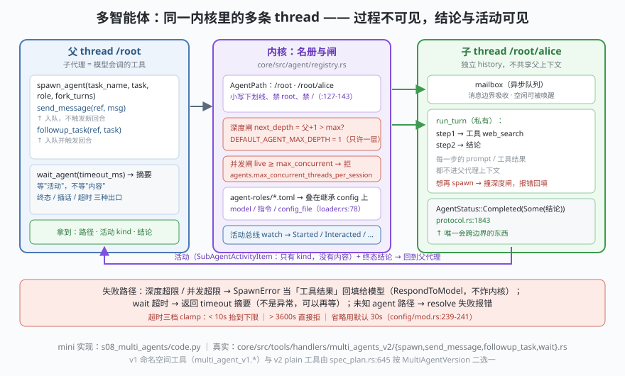

# s08: 多智能体 —— spawn / send / wait 与"过程不可见"

[s07](../s07_apply_patch/) → **s08** → [s09_app_server](../s09_app_server/) → [s10_frontends](../s10_frontends/)

> 需要"多开几个 agent"时，Codex 没有另起一套进程编排，而是**在同一个内核里多开一条 thread（会话）**，并把入口做成模型自己会调的工具：`core/src/tools/handlers/multi_agents_v2/`（feature 门 `Feature::MultiAgentV2`，装配分支在 `core/src/tools/spec_plan.rs` :645 按 `MultiAgentVersion` 二选一）。`spawn.rs` :93 `handle_spawn_agent` 起子 thread，:124 先算深度、:137 叠角色、:161 记下 `task_name`，而 :262 返回给父的只是 `HiddenMetadata { task_name }`。寻址用 `AgentPath`（`protocol/src/agent_path.rs` :15，`/root` 起，:54 `join`，:127-:143 命名校验：小写字母数字下划线、禁 `root`、禁 `/`）。
>
> **Codex 招牌设计**：跨 thread 边界只允许两样东西过去——**活动标记**（`SubAgentActivityItem`，`protocol/src/items.rs` :353：`{id, kind, agent_thread_id, agent_path}`，kind 只有 `Started / Interacted / Interrupted / Completed` 四种，`protocol/src/protocol.rs` :4333）与**终态结论**（`AgentStatus::Completed(Option<String>)`，:1843）。子代理每一步的 prompt、工具调用、中间推理都不进父上下文。想等结论？`wait_agent` 等的是**活动**不是内容（`wait.rs` :73 `subscribe_activity`、:187 `wait_for_activity`），超时三档 clamp（:53-:64，默认值来自 `config/mod.rs` :239-:241），到点返回 timeout 摘要而不是异常。

---

## 问题

1. **子代理是另一个进程，还是同一内核里的另一条 thread？** 如果是另一个进程，审批（s04）、沙箱（s04）、录制（s02）都得重做一遍；如果是同内核，跨边界传什么、不传什么？
2. **"把活派下去"和"顺手递个话"是一回事吗？** 一条消息要不要打断对方正在跑的那一轮？什么时候被读到？
3. **父代理怎么等？** 轮询名册？等多久？超时算失败还是算答案的一部分？用户中途插一句"别管那个了"怎么办？
4. **子代理能不能无限套娃？** 模型一兴奋开三层，谁兜底？

---

## 解决方案



| 机制 | mini 版（`code.py`） | Codex 真实实现 |
|------|---------------------|----------------|
| **spawn 是工具** | 模型剧本里发出 `spawn_agent` 调用 | `multi_agents_v2/spawn.rs` :93；schema 在 `multi_agents_spec.rs` :124（v2 函数工具） |
| **路径寻址** | `AgentPath.join / resolve`（相对引用可解析） | `protocol/src/agent_path.rs` :15 / :54 / :127-:143；`core/src/agent/agent_resolver.rs` :9 `resolve_agent_target` |
| **两种投递** | `send_message`（只入队）vs `followup_task`（入队并触发回合） | `send_message.rs` / `followup_task.rs`；描述原文即规范：`multi_agents_spec.rs` :200 与 :233 |
| **mailbox** | `asyncio.Queue`，回合/消息边界吸收 | tokio mpsc；空闲记录保留，可被 followup 唤醒（`agent/control/residency.rs` :238 `has_pending_mailbox_items`） |
| **等"活动"** | `wait_agent(want)` 从事件总线取 `Activity` | `wait.rs` :73 `subscribe_activity`、:187 `wait_for_activity`（`timeout_at` + `watch::changed`） |
| **超时三档** | `min 10s / max 3600s / default 30s` clamp | `wait.rs` :53-:64；常量 `config/mod.rs` :239-:241 |
| **插话提前结束** | `steer()` 投一条 `Steered` 事件 | `multi_agents_spec.rs` :283 描述："the wait also ends early when new user input is steered" |
| **名册与打断** | `list_agents` / `interrupt_agent` | `list_agents.rs` :11（plain 工具名）、`interrupt_agent.rs`；状态机 `protocol.rs` :1843 |
| **角色装配** | `AgentRole{model, instructions, config_file}` 叠在继承 config 上 | `agent-roles/src/agent_role_config.rs` :10 / :38，目录发现 `loader.rs` :78 + `discovery.rs` :7，层叠 `multi_agents_common.rs` :355 |
| **深度闸** | `next_depth = 父+1`，`depth > max` 即拒 | `core/src/agent/registry.rs` :79-:85 / :87 / :91；默认 `DEFAULT_AGENT_MAX_DEPTH = 1`（`config/mod.rs` :247）——**默认只许一层** |
| **并发闸** | `live >= max_concurrent` 即拒 | `agents.max_concurrent_threads_per_session`（`config/mod.rs` :1286） |
| **命名空间换代** | 打印 v1 / v2 两套工具名 | v1：`MULTI_AGENT_V1_NAMESPACE = "multi_agent_v1"`（`multi_agents_spec.rs` :14）挂 `spawn_agent/send_input/wait_agent/resume_agent/close_agent`；v2：plain 名 + `send_message/followup_task/interrupt_agent/list_agents`，`close/resume` 退场 |

一条总纲：**跨边界的只有活动与结论；深度与并发由内核兜底，不靠模型自觉。** 这正是 Codex 的一贯性格——多智能体不是新的特权通道，而是同一套 thread/工具/审批机制的横向复制。

---

## 工作原理

`code.py` 用 asyncio 起一个 `Kernel`（名册 + 事件总线 + 回合循环），七个场景：

**场景 1（spawn 是模型会调的一个工具）**：父代理的剧本里出现一次 `spawn_agent` 调用，内核于是开出 `/root/alice` 这条 thread。父侧只拿到三样：路径、活动序列（`Started → Completed`）、alice 的结论字符串。末尾点破"父不可见 alice 内部的 2 步"——这正是 `SubAgentActivityItem` 只有 `kind` 字段的意义。

**场景 2（两种投递）**：alice 正在采样时，`send_message` 只把消息塞进 mailbox（打印 `mailbox=1，不触发新回合`）；`followup_task` 则声明"将在消息边界或待决工具调用完成后送达"。settle 之后可见 bob 跑了 **3 个回合、6 步**：两个 mailbox 消息各起一个新回合——"递话"和"派活"的差别被跑成了可数的数字。

**场景 3（并发扇出与插话）**：一次开 carol/dave/erin 三条 thread，`wait_agent(want=3)` 直到收满三个终态；再等一次时先投一条插话，返回 `interrupted：用户插话提前结束等待`。最后 `list_agents` 打印名册（路径 / depth / role / status / steps）。

**场景 4（角色装配）**：`default` 与 `researcher` 两个角色 spawn 同一个任务，可见 `model`、注入的首条 instructions、`config_file` 都不同。真实侧角色文件由 `agents/` 目录递归发现（`*.toml`），spawn 时叠在**从父 thread 继承来的 config** 之上（provider、审批策略、沙箱、cwd 都先继承，再叠角色）。

**场景 5（深度闸，失败路径）**：heidi 的剧本里发出一次 `spawn_agent`，直接被拒——`thread spawn depth 2 exceeds limit 1`。看点是**错误怎么被处理**：它作为工具结果回填给模型（`FunctionCallError::RespondToModel` 语义），heidi 于是自己把活干完。内核不炸，回合继续。

**场景 6（并发闸 + 超时语义）**：并发上限 2 时第三个 spawn 被拒；`wait_agent(3600001)` 被上限规则直接拒；空闲 kernel 的 `wait_agent(1000)` 先被抬到下限 10s，到点返回 `timeout` 摘要——**超时是可回答的状态，不是异常**，模型可以选择再等或者改策略。

**场景 7（命名空间对照）**：把 v1（`multi_agent_v1.spawn_agent` …）与 v2（`spawn_agent / send_message / followup_task / wait_agent / list_agents / interrupt_agent`）并排打印。换代写在工具名上：v1 用 thread id + `resume/close`，v2 用 `AgentPath` + `interrupt`，并把"派任务"与"递消息"拆成两个动词。

**跑一跑**（零依赖，离线；`wait` 的真实时长按 1:1000 加速，clamp 与超时语义不变）：

```bash
python code.py
```

预期输出：七个场景 + 末尾结论两行。重点看场景 2 的"3 回合 6 步"与场景 5 的 `ERROR:` 回填行。

---

## 对照真实源码

| mini 实现 | Codex 真实代码 | 学习点 |
|-----------|---------------|--------|
| `Kernel.spawn_agent` | `core/src/tools/handlers/multi_agents_v2/spawn.rs`（:93 主流程、:124 深度、:137 角色、:161 task_name、:262 只回 HiddenMetadata） | "开子代理"是工具调用的一种，走的还是 s03 的总闸 |
| `AgentPath` | `protocol/src/agent_path.rs` :15 / :18-:19（`/root`、`/morpheus`）/ :54 / :127-:143 | 用路径而不是 id 寻址，父子关系与相对引用都在名字里 |
| `send_message` / `followup_task` | `multi_agents_v2/send_message.rs`、`followup_task.rs`；文案规范 `multi_agents_spec.rs` :200 / :233 | 触发回合与否是**语义差**，不是实现细节——所以拆成两个动词 |
| `mailbox` + 回合边界吸收 | `core/src/agent/control/residency.rs` :238（`has_pending_mailbox_items`） | 打断不是默认能力；消息默认排队到边界，才谈得上"不打断" |
| `wait_agent` | `multi_agents_v2/wait.rs` :40 / :53-:64 / :73 / :187；描述 `multi_agents_spec.rs` :283 | 等"有没有动静"，不等"内容"——所以能同时服务多个子 thread |
| `Activity(kind)` | `protocol/src/items.rs` :353 + `protocol/src/protocol.rs` :4333 | 活动是**类型的**而非内容的，父上下文才不会被子代理的过程撑爆 |
| `Agent.status` | `protocol/src/protocol.rs` :1843 `AgentStatus{PendingInit, Running, Interrupted, Completed, Errored, Shutdown, NotFound}` | 终态是数据不是日志，`wait` 才有东西可返回 |
| `AgentRole` | `agent-roles/src/{agent_role_config.rs:10, :38; loader.rs:78; discovery.rs:7}` | 角色 = 一层 config，不是新引擎——和 s10 的 profile 思路同源 |
| `Registry` 两道闸 | `core/src/agent/registry.rs` :79-:85 / :87 / :91；`core/src/config/mod.rs` :247、:1286 | 默认深度 1 是个产品决策：先证明你不需要三层 |
| v1 / v2 工具面 | `multi_agents_spec.rs` :14（namespace）；`spec_plan.rs` :645 / :671-:680 / :1303-:1341 | 同一功能两代 API 并存，靠 feature 与版本枚举切装配 |

> **行号以当前检出为准，上游会漂移**（快照 `818f1cc`）。多智能体的协作模式背景（何时该拆、怎么拆）见 [Multi-Agent协同手册](../../../multiagent-handbook/Multi-Agent协同手册.md)。

---

## 自测

1. `SubAgentActivityItem` 为什么只带 `kind` 不带内容？如果它把子代理的工具结果也带上，s01 的上下文预算和 s02 的录制会各自付出什么代价？
2. `send_message` 与 `followup_task` 的差别在"是否触发回合"。举一个会写错的情形：为什么"只是告诉它一个事实"却触发了新回合，可能是浪费而不只是浪费 token？
3. 默认 `max_depth = 1` 意味着子代理不许再开子代理。如果产品要放开到 3，`wait_agent` 的返回语义和 `list_agents` 的名册视图各需要增加什么？（提示：`AgentPath` 已经给了答案的一半。）

下一课 [s09_app_server](../s09_app_server/)：服务化——JSON-RPC over stdio 的守护进程，多前端共享一个内核。
