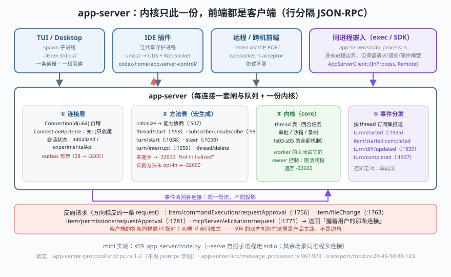

# s09: app-server —— 服务化的内核与"没有特权前端"

[s08](../s08_multi_agents/) → **s09** → [s10_frontends](../s10_frontends/)

> Codex 的 TUI、IDE 插件、桌面 App、SDK 驱动的是**同一个内核**。工程做法是把 `codex-core` 包成一个 RPC 服务器：`codex-rs/app-server/`，让它常驻的是 `app-server-daemon/`，给前端的门面是 `app-server-client/`，传输层单独成 crate `app-server-transport/`。协议是**行分隔 JSON-RPC**，而且刻意不做严格 2.0——`app-server-protocol/src/rpc.rs` :1-2 原文写着 "We do not do true JSON-RPC 2.0, as we neither send nor expect the `\"jsonrpc\": \"2.0\"` field."（`RequestId` 反而同时支持 String 与 Integer）。方法表由宏在 `protocol/common.rs` 里生成：:507 `initialize`、:559 `thread/start`、:587 `thread/unsubscribe`、:1038 `turn/start`、:1050 `turn/steer`、:1056 `turn/interrupt`；通知 :1935 `turn/started`、:1937 `turn/completed`、:1939 `turn/diff/updated`。
>
> **Codex 招牌设计**：请求/响应之外还有**反向请求**——内核要审批时向客户端发 request（:1756 `item/commandExecution/requestApproval`、:1763 `item/fileChange/requestApproval`、:1781 `item/permissions/requestApproval`、:1775 `mcpServer/elicitation/request`），而且**只送给握着用户的那条连接**。s04 的审批轴在服务层就是这么落地的：不是回调函数，是一条 RPC。

---

## 问题

1. **多个前端怎么共用一个内核？** 各自 import `codex-core`？那审批策略、沙箱、录制、并发限制就有了 N 份实现，前端立刻变成特权层。
2. **一条通道上四种消息怎么不打架？** 客户端请求、服务端响应、服务端通知（无 id，单向）、服务端反向请求——靠什么配对、谁负责排队？
3. **API 还在演进，怎么不把不稳定面暴露给所有客户端？** （真实侧满屏的 `#[experimental(...)]`）
4. **事件流爆了怎么办？** 一个前端不读 stdout，管道堵住——会不会拖死内核？

---

## 解决方案



| 机制 | mini 版（`code.py`） | Codex 真实实现 |
|------|---------------------|----------------|
| **framing** | 一行一个 JSON 对象，EOF 即断线 | `transport/stdio.rs` :73 逐行泵（`app-server-transport/src/transport/`） |
| **传输可换** | `Transport` 抽象：`StdioTransport` / `PipeTransport` | `AppServerTransport::{Stdio, UnixSocket, WebSocket, Off}`（`transport/mod.rs` :88；:103 报错文案列出 `stdio://` `unix://` `unix://PATH` `ws://IP:PORT` `off`；:123 `DEFAULT_LISTEN_URL = "stdio://"`） |
| **守护进程** | 同进程多连接（替身） | UDS 路径 `app_server_control_socket_path`（`transport/mod.rs` :67）+ 连上后跑 **WebSocket** 握手（`app-server-daemon/src/client.rs` :63/:67） |
| **连接身份** | `Connection.cid` 自增 | `ConnectionId(pub u64)`（`app-server-transport/src/outgoing_message.rs` :13） |
| **握手与能力** | `initialize` 存 `experimentalApi` 到会话 | `common.rs` :507；`capabilities.experimentalApi` → `message_processor.rs` :184 / :206 |
| **两道路拒** | 未握手 → `-32600 "Not initialized"`；实验方法未 opt-in → `-32600` | `message_processor.rs` :967 与 :973（`dispatch_initialized_client_request` :960 起） |
| **每连接一个闸** | `conn.gate_open=False` 后新 handler 不启动 | `app-server/src/connection_rpc_gate.rs` 文件头：关门"阻止已排队的 handler 启动，放行已取得令牌的跑完收尾"（鉴权归属变更时用） |
| **id 配对** | `pending` 表；两端 id 空间独立（客户端用 `1,2,…`，服务端用 `s1,s2,…`） | `rpc.rs` `RequestId::{String, Integer}`；`JSONRPCMessage::{Request, Notification, Response, Error}` |
| **通知流** | `emit()` 按 `conn.threads` 订阅集分发 | `thread/subscribe`、`thread/unsubscribe`（:587）与 `ServerNotification` 宏（:1657 起） |
| **反向请求** | `ask_client()`：内核发 request，客户端回 response | :1756 / :1763 / :1775 / :1781 四条 server→client 方法（s04 审批的服务化形态） |
| **背压** | `outbox=asyncio.Queue(maxsize=128)`，满了回 `-32001` | `CHANNEL_CAPACITY = 128`（`transport/mod.rs` :28，注释直言"128 条对交互式 CLI 足够"）；`OVERLOADED_ERROR_CODE -32001`、`INTERNAL_ERROR -32603`（:49-:50） |
| **所有权** | 删活跃 thread → `-32600` | `app-server/README.md`：`thread/archive` / `thread/delete` 删在活的内部 worker 时返回 `-32600`，"worker 的关闭由它的 owner 控制" |

一条总纲：**"没有特权前端，也没有特权内核"的实现形式就是——所有能力都必须能从一条 RPC 通道里表达出来。** 表达不出来的（比如回调闭包、共享内存）就不许存在。

---

## 工作原理

`code.py` 里同一份 `AppServer` 代码分别接两种 `Transport`：真子进程的 stdio，和同进程的内存管道。

**场景 1（真起一个子进程）**：`asyncio.create_subprocess_exec(sys.executable, __file__, "--serve")`——本文件自己扮演 app-server，走真实 stdin/stdout。依次跑：`initialize`（回 `protocolVersion` + `serverInfo`）→ `thread/start` → `turn/start`（服务端随后主动发 `item/commandExecution/requestApproval`，客户端自动回 `allow`，回合才继续）→ 事件流 `['turn/started', 'item/started', 'item/completed', 'turn/completed']` → 两条失败路径：实验方法未 opt-in、删活跃 thread 都回 `-32600`。

**场景 2（一个内核，两条连接）**：同进程 `AppServer` 上 attach 两个连接（tui / ide）。`tui` 用 `experimentalApi: True` 握手，`ide` 不带——能力差异回显在 initialize 响应里。`ide` 先 `thread/subscribe` 才能收到该 thread 的事件；两边事件列表**逐项相同**。审批请求只发给 owner 那条连接。

**场景 3（turn/steer 抢先否定审批）**：第三个客户端故意不回答审批（`auto_respond=False`，模拟"用户走开了"）。回合卡在 `asyncio.wait({ask, approval}, FIRST_COMPLETED)` 上；此时 `ide` 发 `turn/steer` → 内核把 pending 的审批 future 直接判成 `denied / steered` 并结束回合。看点：**插话不是特权调用，只是同一条 RPC 上的另一个请求**。

**场景 4（四种传输）**：`--listen stdio:// | unix:// | ws://IP:PORT | off` 逐个说明，落到具体文件。`off` 对应 `in_process.rs`——不监听但保留同一请求/通知模型，这是 s10 的入口。

**场景 5（背压）**：把 `outbox` 塞满 128 条再推一条 → 客户端收到 `{"id":"overflow","error":{"code":-32001,...}}`。设计要点：**宁可显式拒绝，不可静默丢弃**，也不可无界增长。

**场景 6（每连接一个闸）**：未握手先干活 → `Not initialized`；`gate_open=False` 后连 `initialize` 都被拒。对照真实：关闸不影响"已在跑的 handler 收尾"。

**跑一跑**（零依赖，离线；场景 1 会创建一个真实子进程并在结束时回收）：

```bash
python code.py
python code.py --serve     # 单独看服务端：自己往里喂一行 JSON 试试
```

预期输出：六个场景 + 末尾结论两行。重点看场景 3 的 `turn/steer → {'steered': True}` 与场景 5 的 `-32001`。

---

## 对照真实源码

| mini 实现 | Codex 真实代码 | 学习点 |
|-----------|---------------|--------|
| `StdioTransport` / `PipeTransport` | `app-server-transport/src/transport/{stdio.rs:73, unix_socket.rs, websocket.rs, mod.rs:88}` | 传输是**插件位**：协议与调度不认传输 |
| `AppServerClient._pump` 三分支 | `app-server-client/src/lib.rs`（:97 `AppServerEvent`、:317 `AppServerClient::{InProcess, Remote}`） | 一个门面同时管两条路；同进程也不例外 |
| `initialize` 能力协商 | `app-server-protocol/src/protocol/v1.rs` :29 `InitializeParams{client_info, capabilities}`、:46-:49 `InitializeCapabilities.experimental_api` | 能力是**声明**出来的，不是猜出来的 |
| 拒 `Not initialized` / 实验方法 | `app-server/src/message_processor.rs` :960 / :967 / :973 | 门禁在分发入口，不在每个 handler 里重复写 |
| `Connection.gate_open` | `app-server/src/connection_rpc_gate.rs`（`TaskTracker` + `accepting` 标志） | "关闸排水"是并发系统的通用安全动作 |
| `outbox` 有界 + `-32001` | `transport/mod.rs` :28 `CHANNEL_CAPACITY=128`、:49-:50 错误码 | 前端可以是慢的，但内核的队列必须有顶 |
| `emit()` 按订阅集 | `common.rs` :587 `thread/unsubscribe`、:1657 起 `ServerNotification` 宏族、`outgoing_message.rs` :13 `ConnectionId` | 事件是**按连接投影**的流，不是全局广播 |
| `ask_client()` 审批 | `common.rs` :1756/:1763/:1775/:1781 | 反向 request 让"人在环"跨进程成立（对照 s06 elicitation） |
| `thread/delete` 拒活跃 | `app-server/README.md`（-32600 段） | 生命周期归属比接口易用性优先 |
| `--serve` 自扮子进程 | `arg0/`（单一二进制多身份）+ `cli/src/main.rs` :171 `AppServer` 子命令 | 部署形态是"一个二进制，许多身份" |

> **行号以当前检出为准，上游会漂移**（快照 `818f1cc`）。方法表由宏生成，`common.rs` 的行号尤其易动——以 `=> "thread/start"` 这类字面量为锚更可靠。

---

## 自测

1. `rpc.rs` 为什么故意不发 `jsonrpc: "2.0"` 字段？省了什么、放弃了什么保证？（提示：这条通道两端都是自己的代码，而 MCP 那条不是。）
2. 场景 3 里审批的两种结局（客户端答 / 插话抢先判）都写进同一个 future。如果只有 `ask_client` 一条路，用户离开座位时回合会怎样？
3. `off` 传输（`in_process.rs`）没有进程边界，为什么还要保留请求/通知模型而不是直接调用 `codex-core` 的函数？从"s08 的子代理也要过闸"和"前端与内核各自演进"两条线回答。

下一课 [s10_frontends](../s10_frontends/)：收官装配——一个二进制的多重身份、事件投影，以及与 DeepSeek Harness 的横向比较。
