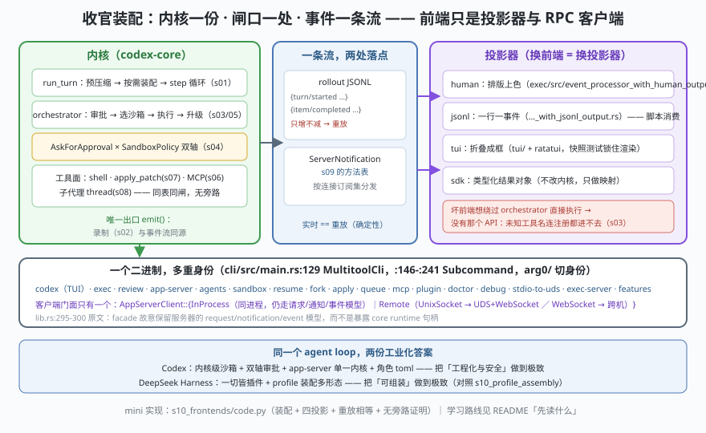

# s10: 多前端装配 —— 一个二进制、一份内核、一条事件流

[s09](../s09_app_server/) → **s10**（收官）

> 前九课把零件拆完了，这一课装回去，并回答最后一问：**同一个内核怎么长出 TUI、IDE 插件、桌面 App、SDK、`codex exec`？** 答案是三件事叠起来：① 一个二进制多重身份——`cli/src/main.rs` :129 `struct MultitoolCli`（`bin_name = "codex"` 写在 :123-:127，所以平台专属的产物名如 `codex-x86_64-unknown-linux-musl` 打印帮助时仍叫 `codex`），:146-:241 的 `enum Subcommand` 列出二十多个身份（`Agents` :149、`Exec` :153、`AppServer` :171、`RemoteControl` :174、`Sandbox` :190、`Apply` :201、`Resume` :204、`Fork` :222、`StdioToUds` :234、`ExecServer` :237…），身份切换由 `arg0/` 这条路承担；② 前端一律通过 `app-server-client` 的门面说话——`app-server-client/src/lib.rs` :317 `enum AppServerClient::{InProcess, Remote}`，:295-:300 的注释是全课最重要的一句话：**"The facade intentionally preserves the server's request/notification/event model instead of exposing direct core runtime handles."** 同进程嵌入也不许直接抓内核句柄；③ 输出侧只有一份事件流，**投影器**各自排版——`exec/src/event_processor_with_human_output.rs`（:228-:342 逐条 match `ServerNotification::*`）与 `event_processor_with_jsonl_output.rs` 是同一内核的两个读法。
>
> **Codex 招牌设计**：`tui/src/lib.rs` :31-:37 只 import `AppServerClient` / `InProcessAppServerClient` / `RemoteAppServerClient` / `RemoteAppServerEndpoint`——连官方 TUI 都是客户端。"没有特权前端"不是口号，是 import 语句层面的事实。

---

## 问题

1. **多前端怎么不裂成多份实现？** 如果每个前端各自 import `codex-core`，审批策略、沙箱、录制、并发限制就会有 N 份版本，漂移只是时间问题。
2. **"同进程嵌入"能不能省掉协议？** 省掉协议就是省掉边界：嵌入式调用会天然长出特权路径。Codex 怎么既省进程边界又不破边界？
3. **一份事件流怎么同时服务人、脚本、IDE、SDK？** 谁负责排版，谁负责字段，谁能要求内核多吐一点？
4. **换了这么多机制，回到 DeepSeek Harness 那边看，我们到底学到了什么？** 收官要能横向说话。

---

## 解决方案



| 机制 | mini 版（`code.py`） | Codex 真实实现 |
|------|---------------------|----------------|
| **一个二进制多身份** | `FRONTENDS` 字典列出八条子命令 | `cli/src/main.rs` :129 / :146-:241，`arg0/` 按 argv[0] 切身份 |
| **单一出口** | `Kernel.emit()` 同时写 rollout 与 events | 内核事件经 `session.emit_turn_item_*` 一路送到 app-server 的 `ServerNotification`（s02 / s09） |
| **四种投影** | `project_human / project_jsonl / project_tui / project_sdk` | `exec/src/event_processor_with_human_output.rs`、`event_processor_with_jsonl_output.rs`、`event_processor.rs`、`tui/`（ratatui + insta 快照） |
| **门面两种传输** | `InProcess` / `Remote` 两张说明行 | `AppServerClient::{InProcess, Remote}`（lib.rs :317），`RemoteAppServerEndpoint::{WebSocket, UnixSocket}`（remote.rs :72） |
| **同进程也不越界** | 场景 4：坏前端直接调 `orchestrate` 也必须走注册表 | lib.rs :295-:300 注释；`in_process.rs`（"transport-local but not protocol-free"） |
| **重放相等** | `[e.kind for e in events] == Kernel.replay(rollout)` | rollout JSONL 重建会话（s02）；`codex resume` / `thread/resume`（`common.rs` :565） |

一条总纲：**内核一份、闸口一处、事件一条流。** 前端是投影器与 RPC 客户端，不是第二份引擎。

---

## 工作原理

`code.py` 把九课的零件装成一台最小整机（每个零件只留形状，不重复实现细节），然后七个场景：

**场景 0（多重身份）**：打印 `codex` / `codex exec` / `codex app-server` / `codex agents` / `codex sandbox` / `codex resume` / `codex apply` / `codex stdio-to-uds` 各是什么，对应 `Subcommand` 的行号。这一屏就是"单二进制多身份"的清单。

**场景 1（装回整机）**：`Kernel` 里同时有 s01 的 `run_turn`、s03 的 `orchestrate`、s04 的双轴、s05 的升级、s06 的 MCP 工具、s07 的补丁事务、s08 的子代理 thread、s09 的事件流。跑一个真实形状的任务："ls → rm（被沙箱挡）→ 升级重试 → apply_patch → mcp.echo → spawn_agent → 交结论"，输出 13 条事件、13 行录制、`升级重试 ['shell']`——**s05 的升级在装配体里仍然按"策略挡了才升级"走**。

**场景 2（四种投影）**：同一份 `k.events` 交给四个投影器。human 只留两行关键信息；tui 折成方框；jsonl 一行一事件原样吐字段；sdk 收成 `{tools, approvals, subAgents, final}` 类型化对象。四个投影器没有一个能改内核。

**场景 3（重放）**：`实时 13 事件 ／ 重放 13 事件 → 逐条相等：True`，再把 rollout 走一遍 JSON 序列化-反序列化仍然相等。这就是 s02 "重建必须确定性"这条不变量在整机上的验收方式。

**场景 4（没有旁路）**：坏前端想调用一个不存在的"特权工具" `rm_everything`——它连注册表都进不去（`ERROR: unknown tool`），只能退回以 `shell` 工具调用的形式提出请求，于是又落回 s03 的总闸与 s04 的双轴。**这一条是"没有特权前端"的可执行证明。**

**场景 5（同进程与远程同一个门面）**：三行对照 `InProcess` / `Remote(UnixSocket)` / `Remote(WebSocket)`。真实侧 exec 与 tui 都从 `codex_app_server_client` 拿客户端（`exec/src/lib.rs` :18-:37、`tui/src/lib.rs` :31-:37 与 :3209），差别只在 endpoint。

**场景 6（横向对照收官）**：七个轴上把 Codex 与 DeepSeek Harness 并排打印——内核形态、扩展单元、装配时机、安全边界、多智能体、前端、一句话主张。**同一个 agent loop，两份工业化答案**：Codex 把工程化与安全做到极致（内核级沙箱 + 双轴审批 + 单一内核服务化），dsh 把可组装做到极致（一切皆插件 + profile 装配形态）。对照教材：[analysis_deepseek_harness/s10_profile_assembly](../../../03-deepseek-harness/analysis_deepseek_harness/s10_profile_assembly/)。

**跑一跑**（零依赖，离线）：

```bash
python code.py
```

预期输出：七个场景 + 末尾结论两行。重点看场景 3 的 `True` 与场景 4 的 `unknown tool`。

---

## 对照真实源码

| mini 实现 | Codex 真实代码 | 学习点 |
|-----------|---------------|--------|
| `FRONTENDS` 清单 | `cli/src/main.rs` :129 `MultitoolCli`、:146-:241 `enum Subcommand`、:123-:127 `bin_name` | 产品形态是**编译进同一个二进制**的子命令，不是不同程序 |
| `Kernel.emit` | `session.emit_turn_item_started/completed` → `app-server-protocol` 的 `ServerNotification` 宏族（`common.rs` :1657 起、:1935-:1940） | 录制与投影同源：一次 emit，两处落点 |
| `project_human` / `project_jsonl` | `exec/src/event_processor_with_human_output.rs`（:228-:342 match 各通知）、`event_processor_with_jsonl_output.rs` | 展示层分叉在**投影器**，不在内核；这是 `codex exec --json` 的实现位置 |
| `project_tui` | `tui/`（ratatui；样式约定见 `codex-rs/tui/styles.md`；渲染用 insta 快照锁） | UI 变更必须带快照，才能说"投影"而不是"改流" |
| `AppServerClient` 两种 | `app-server-client/src/lib.rs` :317 enum、:295-:300 门面注释、:97 `AppServerEvent`；`remote.rs` :4 "the same `AppServerEvent` surface for both in-process and remote transports"、:72 endpoint | 门面保留协议形状 ⇒ 嵌入式调用也不会漂移出一套私有语义 |
| `Kernel.replay` | rollout 重放与 `thread/resume`（`common.rs` :565）、`codex resume`（`main.rs` :204）、`MigrateRollouts`（:216） | 会话是数据，不是内存对象；所以能续、能迁、能审 |
| 场景 4 的无旁路 | `core/src/tools/orchestrator.rs`（文件头即设计文档）、`registry.rs`（:77 一带 MCP 切面） | 想要特权，就得先能绕过注册表——而注册表是唯一入口 |

> **行号以当前检出为准，上游会漂移**（快照 `818f1cc`）。`common.rs` 由宏生成、`main.rs` 常加子命令，这两处尤其只当路标。

---

## 自测

1. `AppServerClient` 为什么"故意保留 request/notification/event 模型"而不是给同进程调用开一条直接调 core 的快路径？如果开了，s03 的总闸与 s04 的双轴会在哪里出现裂缝？
2. 场景 3 里 `实时 == 重放` 是一条可以写进 CI 的断言。如果内核新增一种事件但 rollout 里没记，这条断言会怎么失败？据此说明"emit 只有一个出口"为什么是结构性的而不是风格性的。
3. 若要把本项目改造成"可组装优先"（dsh 路线）而不是"安全优先"，你最先要拆掉的是哪一件（沙箱双轴 / 单一内核 / 事件流契约）？哪一件拆了就不再是 Codex？

---

## 之后的路线（本课程的回读顺序）

1. **概念打底**（20 分钟）：[02-codex/阅读指南.md](../../阅读指南.md)——crate 导览 + 第 4 节推荐阅读路线；先建立"哪个 crate 管什么"的地图。
2. **逐课动手**：`run.bat` / `run.sh` 全跑一遍，每课按"问题 → 解决方案 → 工作原理"读，再改 `code.py` 里的参数做自己的实验（改 `max_depth`、把审批设成 `never`、给 `wait_agent` 传 0）。
3. **回真源码**：[02-codex/架构拆解.md](../../架构拆解.md) 第 11 节"关键文件索引（精读清单）"按文件排好序，配合每课的"对照真实源码"表逐条打开；检出在 [../../codex/](../../codex/)（`git log -1` 应为 `818f1cc`）。
4. **横向对照**：[analysis_deepseek_harness](../../../03-deepseek-harness/analysis_deepseek_harness/)（可组装路线，s10 同题对照）、[analysis_claude_code](../../../01-claude-code/analysis_claude_code/)（简单循环路线）、[analysis_langgraph](../../../08-langgraph/analysis_langgraph/)（图引擎路线）。
5. **方法论**：安全面读 [AI应用安全手册](../../../security-handbook/AI应用安全手册.md)，协议面读 [MCP搭建文档](../../../mcp-handbook/MCP搭建文档.md)，多智能体读 [Multi-Agent协同手册](../../../multiagent-handbook/Multi-Agent协同手册.md)。
