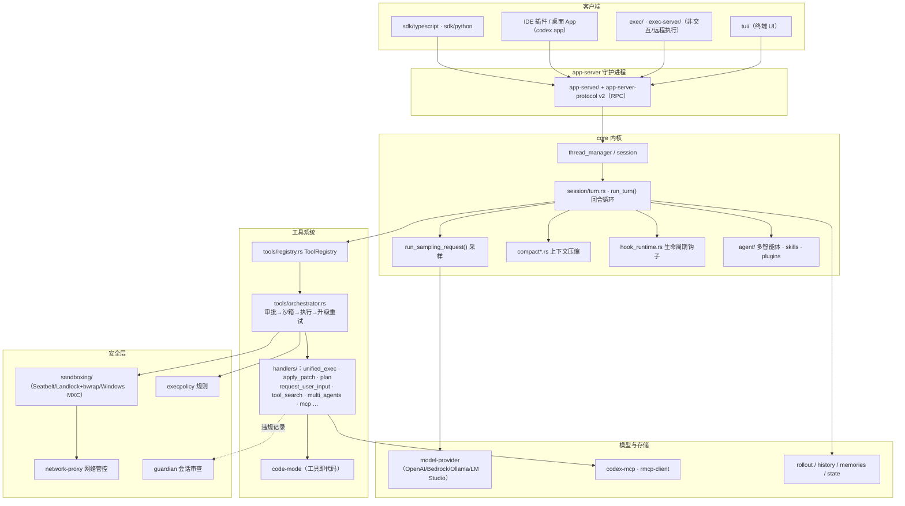

# OpenAI Codex 架构拆解（2026 版）

> 生成日期：2026-09-11 ｜ 仓库 `codex/` @ `818f1cc`
>
> 所有结论均来自本快照实际代码；关键处标注来源路径。部分官方文档已迁移至 developers.openai.com，仓库内文件仅为跳转索引，因此本文以**代码**为主证据。

## 1. 一句话总览

Codex 是一个**以 app-server 守护进程为中心、内核带有权限/沙箱双轴控制**的 coding agent：客户端（TUI/IDE/桌面/SDK）通过 RPC 驱动 `core` 中的会话回合（`run_turn`），回合内循环执行"采样 → 工具调用 → 结果回填"，而**每一次工具执行都必须穿过 `orchestrator`（审批 → 选沙箱 → 执行 → 拒绝后升级重试）**。

## 2. 总体架构图



## 3. 回合主循环（`core/src/session/turn.rs`）

### 3.1 `run_turn()`（第 163 行）

签名要素（架构含义）：

```rust
pub(crate) async fn run_turn(
    sess: Arc<Session>, turn_context: Arc<TurnContext>,
    input: Vec<TurnInput>, mcp_startup_requirements: &mut McpStartupRequirements,
    prewarmed_client_session: Option<ModelClientSession>, cancellation_token: CancellationToken,
) -> CodexResult<Option<String>>
```

开场即体现 2026 版的工程化程度：

1. **Guardian 前置审查**（第 171-173 行，`guardian::check_pending_guardian_input`）。
2. **延迟钩子结算**（第 175 行 `drain_async_hook_results`）：上一回合末尾未完成的 hook 结果在本回合用户输入前注入。
3. **采样前压缩**（第 183 行 `run_pre_sampling_compact`，定义在第 1230 行）：在记录新输入之前先腾上下文；失败时的错误处理区分 `TurnAborted`、`ToolCollision` 等（第 200-205 行），并按 provider 是否支持远程压缩（`RemoteCompactionSupport::V2`）给错误加前缀（第 211-214 行）。
4. **输入驱动的动态装配**：从用户输入提取需要的 MCP server（第 234-255 行 `required_mcp_servers_for_input`）与显式提到的插件（`collect_explicit_plugin_ids`）——**按需启动 MCP/插件，而不是全量挂载**。
5. **构建 step context**（第 258 行 `capture_step_context_with_required_mcp_servers`），随后进入回合循环（第 423 行 `loop {}`）。

### 3.2 回合内的循环

- 采样入口 `run_sampling_request()`（第 1537 行）；流式文本经 `emit_streamed_assistant_text_delta`（第 2139 行）逐段下发；`maybe_complete_plan_item_from_message` / `handle_plan_segments`（第 2076、2205 行）说明 **plan（计划模式）已内建到回合处理**。
- 工具集装配：`built_tools()`（第 1702 行）+ `prepare_tool_recommendations()`（第 1655 行）——工具列表在这一步动态生成（含 skills/plugins、MCP、code mode 等来源，见 `build_skills_and_plugins` 第 966 行、`build_extension_turn_input_items` 第 1110 行）。
- 期间的压缩与模型回退：`maybe_run_previous_model_inline_compact`（第 1298 行）、`run_auto_compact`（第 1396 行）——压缩不是一次性动作，而是回合中随时可能触发的策略。
- 回合收尾钩子：`hook_runtime.rs` 的 `run_turn_stop_hooks`（第 377 行）、`run_turn_interrupt_hooks`（第 487 行）。
- 差异追踪：`core/src/turn_diff_tracker.rs` 记录本回合文件改动（`turn_diff_display_roots`，第 786 行）。

## 4. 工具系统

### 4.1 注册表与运行时契约（`core/src/tools/registry.rs`）

- `ToolRegistry`（第 287 行）：工具注册与查找；支持命名空间（`MULTI_AGENT_V1_NAMESPACE`，第 22 行 import）。
- `CoreToolRuntime`（第 55 行）：本地工具的统一运行时契约——实现 `ToolExecutor<ToolInvocation>`，并可附带 hooks/遥测/工具搜索/参数 diff 等元数据；其中 `mcp_server_name()`（第 77 行）表明 **MCP 工具以内核同一套 runtime 注册**。
- 每个工具调用有完整生命周期：`notify_tool_start` / `notify_tool_finish`（`tools/lifecycle.rs`）、Pre/PostToolUse hooks（`run_pre_tool_use_hooks` / `run_post_tool_use_hooks`）、`on_tool_result_accepted`（第 93 行，PostToolUse 全部通过后才上报结果）、`ToolDispatchTrace` 调度追踪。
- 并行执行：`tools/parallel.rs`；批准判定：`tools/approvals.rs`（含 `ApprovalContext`）；网络审批：`tools/network_approval.rs`（`ActiveNetworkApproval`/`DeferredNetworkApproval` 支持"先挂起、稍后结算"的审批）。

### 4.2 内置工具（`core/src/tools/handlers/`）

2026 版工具面貌与早期（shell/apply_patch/plan 三件套）已大不相同：

| 类别 | 工具（handler 文件） |
|---|---|
| 执行类 | `unified_exec.rs`（统一命令执行）、`apply_patch.rs`（补丁编辑）、`sleep.rs` |
| 交互类 | `request_user_input.rs` / `request_user_input_async.rs`、`send_message_to_user_async.rs`、`request_permissions.rs` |
| 上下文类 | `new_context_window.rs`（开新上下文窗口）、`get_context_remaining.rs`（查剩余上下文） |
| 计划类 | `plan.rs`（计划模式）、`view_image.rs`（看图） |
| 发现类 | `tool_search.rs`（工具检索——工具多到需要搜索）、`current_time.rs` |
| 多智能体 | `multi_agents.rs` / `multi_agents_v2.rs`（及目录） |
| 扩展类 | `mcp.rs`、`mcp_resource.rs`、`list_available_plugins_to_install.rs`、`request_plugin_install.rs`、`extension_tools.rs`、`dynamic.rs` |

设计信号：**工具规模膨胀后，Codex 引入了 `tool_search`（按需检索工具）与统一执行入口 `unified_exec`**，并以 spec 文件（`*_spec.rs`）分离"工具声明"与"工具实现"。

### 4.3 执行编排：`tools/orchestrator.rs`

文件头注释即架构声明：

> *Approval → select sandbox → attempt → retry with an escalated sandbox strategy on denial (no re-approval thanks to caching).*

即：每个工具执行（尤其 shell）先做审批判定，再选择沙箱档位执行；若因沙箱被拒（`SandboxErr`、违规事件），可**升级沙箱策略重试且不重复弹审批**（缓存已批准决策）。关键引子：`default_exec_approval_requirement`、`sandbox_override_for_first_attempt`、`unsandboxed_execution_allowed`、`effective_network_sandbox_policy`。

### 4.4 apply-patch 原理（`apply-patch/`）

- `parser.rs` 解析补丁块（`Hunk`/`UpdateFileChunk`，`parse_patch`）；`streaming_parser.rs` 支持流式解析（模型边生成边应用）。
- `seek_sequence.rs`：**模糊定位**——当上下文行不完全匹配时按序号搜索近似位置，提升补丁鲁棒性。
- `file_update.rs`：`derive_new_contents_from_chunks` 生成新文件内容，并反向产出 `unified_diff_from_chunks`（供 UI 展示 diff）。
- 值得注意的是它通过 `codex_exec_server::ExecutorFileSystem` 抽象读写文件（`lib.rs` imports），意味着**补丁可作用于本地或远程执行环境**。

## 5. 审批与沙箱（双轴控制）

### 5.1 审批策略：`AskForApproval`（`protocol/src/protocol.rs:992`）

| 变体 | 语义 |
|---|---|
| `untrusted`（UnlessTrusted） | 面向未受信项目：除显式策略允许外，命令都要审批 |
| `on-request`（默认） | **模型自主决定何时请求审批** |
| `granular(GranularApprovalConfig)` | 细粒度开关：`sandbox_approval`（shell 审批）、`rules`（execpolicy prompt 规则）、`skill_approval`（skill 脚本）、`request_permissions`、`mcp_elicitations`——置 false 的类别直接自动拒绝 |
| `never` | 从不问用户；失败直接回给模型 |

### 5.2 沙箱策略：`SandboxPolicy`（`protocol.rs:1078`）

| 变体 | 语义 |
|---|---|
| `read-only` | 只读；`network_access` 可单独开 |
| `workspace-write` | 只读 + 当前工作区可写；可加 `writable_roots`、网络开关、`/tmp`/`TMPDIR` 排除开关 |
| `danger-full-access` | 无限制（慎用） |
| `external-sandbox` | 进程已在外部沙箱中，全盘可访问但服从网络设置 |

配套 `WritableRoot`（第 1133 行注释）：即便某目录可写，也要把 `.codex`、`.git` 尤其是 `.git/hooks` 等**可用于提权的子路径保持只读**——防"改 hook 拿权限"的经典逃逸。

### 5.3 平台落地（`sandboxing/src/lib.rs` 导出）

- macOS：`seatbelt`
- Linux：`landlock` + 系统/捆绑 `bwrap`
- Windows：`windows_mxc`（另有独立 crate `windows-sandbox-rs`：ACL/cap/deny_read/conpty）
- 统一由 `SandboxManager` 管理，`get_platform_sandbox()` 选择后端；`policy_transforms` 做策略变换；`violation.rs` 记录文件系统/网络违规事件（可回传给模型作为反馈，触发上面的"升级重试"）。
- 网络：`NetworkAccess`（Restricted/Enabled）+ `network-proxy` crate 兜底。

### 5.4 命令策略：`execpolicy/`

规则式命令判定（允许/拒绝/询问），与 `AskForApproval::Granular.rules` 联动；命令行审批与 shell 解析在 `shell-command/`、`shell-escalation/`。

## 6. 上下文与记忆

- **压缩多形态**（`core/src/compact.rs` 及 `compact_remote_v2*.rs`、`compact_token_budget.rs`）：pre-sampling（采样前）、auto（回合中自动）、previous-model inline，以及**远程压缩**（provider 能力 `remote_compaction: V2`，见 `turn.rs` 第 211 行）；埋点维度包括 `CompactionPhase/Reason/Strategy/Implementation`。
- **工具化上下文管理**：`get_context_remaining`（查余额）与 `new_context_window`（开新窗口）成为模型可主动调用的工具。
- **窗口治理**：`session/context_window.rs`、`token_budget.rs`、`rollout_budget.rs`、`retained_context.rs`。
- **记忆**：`agents_md.rs` + `agents_md_manager.rs` 注入 AGENTS.md（仓库根 `AGENTS.md` 即 Codex 开发自身用的实例）；`memories/` crate；`history`/`message-history`/`rollout` 负责轨迹录制与重建（`session/rollout_reconstruction.rs`）。
- **状态**：`state/`、`state_db`（`codex-rollout::state_db`）。

## 7. 多智能体、技能与插件

- **多智能体**：`core/src/agent/`（`registry.rs` 角色注册、`role.rs`、`control.rs`、`status.rs`）+ `session/multi_agents.rs` + 工具 `handlers/multi_agents_v2`；底层 crate `agent-roles`、`agent-identity`、`agent-graph-store`（智能体关系图）、`collaboration-mode-templates`。工具命名空间机制（`MULTI_AGENT_V1_NAMESPACE`）让子智能体的工具与主工具隔离并存。
- **技能（Skills）**：`codex-rs/skills/` + `core/src/skills.rs` + `docs/skills.md`；回合装配时经 `build_skills_and_plugins`（`turn.rs` 第 966 行）进入工具与输入项。
- **插件**：`plugin/`、`core-plugins/`、`core/src/plugins`；模型可主动发现/请求安装（`list_available_plugins_to_install`、`request_plugin_install` 工具）；`plugin_cmd.rs`、`marketplace_cmd.rs` 提供 CLI 管理。

## 8. MCP 集成

- 客户端工具：`codex-mcp`、`rmcp-client`；运行期管理在 `core/src/session/mcp.rs`、`mcp_runtime.rs`、`mcp_refresh.rs`、`mcp_prewarm.rs`（预热）。
- **按需启动**：`run_turn` 根据用户输入计算 `required_mcp_servers`（`required_mcp_servers_for_input`，第 865 行），只拉起需要的 server。
- MCP elicitation（服务端反向征求用户输入）有独立模块 `core/src/elicitation.rs`，并受 `GranularApprovalConfig.mcp_elicitations` 控制。
- 反向能力：app-server 的 README 描述了 **hosted Codex Apps MCP**（HTTP `codex_apps` server，Legacy 与 2026-07-28 协议，可用 `[features] codex_apps_mcp_2026_07_28 = true` 开启）——Codex 生态本身也在以 MCP 形式对外提供能力。

## 9. 端到端时序：用户在 TUI 输入一条任务

1. TUI 通过 `tui/src/app_server_connection.rs` 把输入发给 **app-server**（RPC v2），而非直连内核。
2. app-server 路由到目标会话（thread/session）；`run_turn` 启动（`session/turn.rs:163`）。
3. guardian 前置审查 → 结算延迟 hooks → `run_pre_sampling_compact` 视预算压缩上下文。
4. 从输入解析需要的 MCP server / 插件并确保就绪（按需启动/预热）。
5. `capture_step_context…` 组装 step：系统提示、AGENTS.md、skills/plugins、工具列表（`built_tools`）、每轮可变的上下文片段。
6. `run_sampling_request` 调模型（`ModelClientSession` → `model-provider`）；流式文本 delta 下发 UI；可能返回工具调用。
7. 工具调用进入 `ToolRegistry` → 对应 `CoreToolRuntime` handler；**执行必经 `orchestrator`**：审批（策略/缓存/必要时弹窗）→ 选定沙箱档位 → 执行（如 `unified_exec`/`apply_patch`）。
8. 若被沙箱拒绝：记录违规事件 → 按升级策略重试（不重复审批）或把失败反馈给模型。
9. 工具结果回填进历史，回到步骤 6 的循环；期间可能再次触发 auto compact 或模型内联压缩。
10. 无新工具调用 → 文本终稿；回合停止 hooks 执行；diff 追踪汇总本回合改动；事件经 app-server 推给所有订阅客户端；轨迹落盘（rollout/history）。

## 10. 设计亮点与局限

**亮点**

1. **权限/沙箱是一等公民**：不在"工具内部随手判断"，而是所有执行统一穿过 orchestrator（审批→沙箱→执行→升级重试），策略由 `AskForApproval` × `SandboxPolicy` × `NetworkAccess` 三轴组合表达，清晰可审计。
2. **守护进程化架构**：app-server 让 TUI/IDE/桌面/SDK 共享同一内核，且天然支持远程（exec-server、`--remote` 类形态）。
3. **上下文治理工具化 + 多形态压缩**：`get_context_remaining`、`new_context_window` 把上下文管理交给模型参与决策，配合 pre-sampling/auto/remote 压缩。
4. **按需装配**：MCP server、插件按输入动态拉起，避免启动即全量挂载的迟滞与风险。
5. **工具规模化的应对**：命名空间（multi-agent）、spec 与实现分离、`tool_search` 检索——大工具集的工程答案。
6. **可测试性强**：核心模块普遍配套 `*_tests.rs` 与 `test_support.rs`，行为契约明确。

**局限 / 代价**

1. **复杂度高**：100+ crate、异步事件流、多套上下文抽象（step/turn/rollout），学习曲线陡峭；对二次开发者不友好。
2. **文档外迁**：仓库内 docs 多为跳转索引，离线读文档体验差（本仓库快照尤为明显）。
3. **平台沙箱运维成本**：三平台三套后端，Windows 沙箱尤重（ACL/cap/conpty/deny_read），边缘行为需大量测试。
4. **强耦合 OpenAI 生态**：虽然 `model-provider` 支持 Bedrock/Ollama/LM Studio，但核心协议（Responses API、远程压缩、codex_apps MCP）与自家服务深度绑定。

## 11. 关键文件索引（精读清单）

| # | 文件 | 一句话 |
|---|---|---|
| 1 | `codex-rs/protocol/src/protocol.rs`（992/1078 行起） | 审批与沙箱策略枚举，全部安全语义的源头 |
| 2 | `codex-rs/core/src/session/turn.rs` | 回合主循环：`run_turn`(163) / loop(423) / 压缩(1230,1396) / 采样(1537) / 工具装配(1702) |
| 3 | `codex-rs/core/src/tools/registry.rs` | `ToolRegistry` + `CoreToolRuntime` 运行时契约 |
| 4 | `codex-rs/core/src/tools/orchestrator.rs` | 审批→沙箱→执行→升级重试（文件头注释即设计文档） |
| 5 | `codex-rs/core/src/tools/parallel.rs` | 工具并行执行 |
| 6 | `codex-rs/core/src/tools/approvals.rs` | 审批上下文与决策 |
| 7 | `codex-rs/core/src/tools/network_approval.rs` | 挂起式网络审批 |
| 8 | `codex-rs/core/src/tools/handlers/`（逐个） | 内置工具全家桶（unified_exec/apply_patch/plan/tool_search…） |
| 9 | `codex-rs/apply-patch/src/{parser,seek_sequence,file_update}.rs` | 补丁格式与模糊定位 |
| 10 | `codex-rs/sandboxing/src/{lib,manager}.rs` | 跨平台沙箱抽象与调度 |
| 11 | `codex-rs/linux-sandbox/src/{landlock,launcher}.rs` / `windows-sandbox-rs/src/` | 平台沙箱实现 |
| 12 | `codex-rs/core/src/compact.rs` | 上下文压缩核心 |
| 13 | `codex-rs/core/src/hook_runtime.rs` | Pre/PostToolUse、Pre/PostCompact、turn 终止钩子 |
| 14 | `codex-rs/core/src/agent/` + `tools/handlers/multi_agents_v2.rs` | 多智能体 |
| 15 | `codex-rs/core/src/session/mcp_runtime.rs` + `codex-mcp/` | MCP 运行期与客户端 |
| 16 | `codex-rs/app-server/src/` + `app-server-protocol/` | 守护进程与 v2 RPC |
| 17 | `codex-rs/tui/src/app_server_connection.rs` | 前端如何接入 app-server |
| 18 | `codex-rs/model-provider/src/provider.rs` | 多模型接入抽象 |
| 19 | `codex-rs/core/src/agents_md.rs` | AGENTS.md 注入 |
| 20 | `docs/config.md`（含 lifecycle hooks 说明） | 配置与托管 hooks 策略 |
