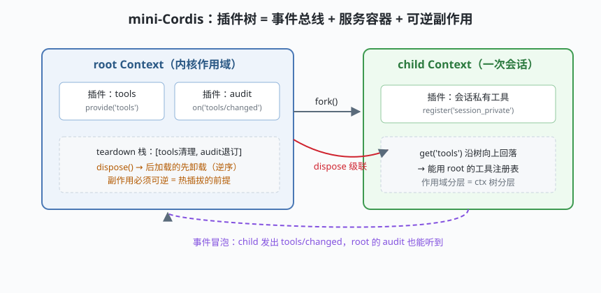

# s01: 插件内核 —— 一切皆插件的底座

`s01` → [s02_agent_loop](../s02_agent_loop/) → [s03](../s03_session_log/) → ... → [s10](../s10_profile_assembly/)

> dsh 的招牌主张：**Everything is a Plugin**。模型适配器、工具注册表、会话日志、乃至 agent loop 本身都是插件，全部可从配置替换——**不存在需要打补丁的特权内核**（`docs/architecture.zh.md`）。
>
> **Harness 层**：插件树 —— 所有行为挂载的底座。

---

## 问题

你要造一个 agent 框架，第一天就遇到三个工程问题：

1. **能力怎么挂？** 今天加 Web 搜索，明天加 MCP，后天把 agent loop 换成实验版。如果能力写死在内核里，每加一个能力都要动内核，很快变成谁都改不动的泥球。
2. **能力之间怎么见面？** 工具插件要被提示词插件看到、被执行插件调用，但两两 import 会把所有插件焊死在一起。
3. **能力怎么摘？** 一次会话结束时，它私有的工具、事件监听、后台任务必须干净回收，否则长跑进程内存越滚越大。

Cordis（dsh 构建其上的插件框架）对这三问的答案是同一句话：**把"挂能力"本身做成一个可逆的、树状的操作**。

---

## 解决方案



三个原语，一个纪律：

| 原语 | 职责 | dsh 里的对应 |
|------|------|--------------|
| **Context** | 插件的宿主：事件总线（`ctx.emit` / `ctx.on`）+ 服务容器（`ctx.provide` / `ctx.get`）+ 父子树 | `@deepseek-ai/cordis` 的 `Context`，dsh 每个会话一个 |
| **Service** | "每次注入一次"的惰性单例：第一次 `get` 才构造 | `ctx.tools` / `ctx.sessions` / `ctx.llm` / `ctx.agentLoop` 这些**能力缝（capability seam）** |
| **plugin** | `setup(ctx)` 返回清理函数：注册、监听、副作用，全部登记回收 | dsh 的 150+ 个子包，每个包导出的就是一个插件 |

一条纪律：**副作用必须可逆（reversible side effects）**。插件在 setup 里做的每件事都必须能被逆序撤销——这是"换插件不重启、卸插件不留垃圾"的全部前提。

---

## 工作原理

`code.mjs` 用约 150 行实现了 mini-Cordis，走读四个关键机制：

**第 1 步**：Context 三合一。事件表、服务表、teardown 栈挂在同一个对象上：

```js
class MiniContext {
  on(type, fn)            // 监听，返回退订函数（可逆）
  emit(type, payload)     // 事件沿树冒泡
  provide(key, factory)   // 注册惰性单例
  get(key)                // 沿树向上查找服务
  plugin(setup)           // 加载插件，登记 teardown
  dispose()               // 逆序回滚 + 级联子作用域
}
```

**第 2 步**：事件沿树冒泡。子作用域发出的 `tools/changed`，父作用域的 audit 插件也能听到——dsh 的 `agent/*` 事件（`agent/inbox/spliced`、`tool/call`……）正是靠这个机制被日志插件、UI 插件统一接收，而发出者根本不知道有谁在听。

**第 3 步**：服务沿树回落，也能被遮蔽。`child.get('tools')` 在子作用域找不到就向上查到父作用域；反过来，子作用域 `provide` 同名服务就把父级的盖住了——演示里 child 用"本地层 + 父级回落"造了一个会话私有视图，**s05 的 ScopedLayers（作用域分层）正是这个动作的正式化**。

**第 4 步**：dispose 逆序回滚。后加载的插件先卸载（栈式），再级联卸载子作用域。演示里 child 卸载后它的私有工具消失，root 的注册表毫发无损。

**跑一跑**（零依赖，离线）：

```bash
node code.mjs
```

预期输出五个阶段：装配 root → fork 出会话 → 事件冒泡被 audit 捕获 → 卸载 child 不伤 root → 卸载 root 全量回收。

---

## 对照真实源码

| mini 实现 | dsh 真实代码 / 文档 | 学习点 |
|-----------|--------------------|--------|
| `MiniContext` | `docs/cordis-primer.zh.md`（必读）、`docs/cordis-tutorial/` | service / context / 事件 / 可逆副作用的官方讲解 |
| `provide('tools')` | `packages/core/tools/src/index.ts`（`ToolRuntime` 作为 Cordis Service 注入） | 能力缝：调用方只认 `ctx.tools`，不认实现 |
| `child` 会话作用域 | `packages/core/agent-loop/src/agent.ts` 构造函数里 `createScope(loopCtx, this)` | 每个 agent loop 实例挂自己的 Scope |
| teardown 逆序 | `docs/architecture.zh.md`「新行为放哪里」一节 | 为什么插件纪律要求 setup 可逆 |
| `plugin/loaded` 等事件 | `packages/extensions/`（cordis host/client runner，用插件扩展插件） | 事件面被二次插件化 |

> 行号级精读请先看仓库 `study-cn-comments` 分支的同名中文导读注释（文件头部 `[中文导读 · 学习注释]` 块），再回上游源码验证——上游迭代快，以源码为准。

---

## 自测

1. 为什么 Cordis 要求插件 setup 的副作用**必须可逆**？如果某个插件只挂监听、不退订，破坏的是哪个使用场景？
2. "没有特权内核"在机制上靠什么保证？（提示：agent loop 自己是什么？）
3. 两个插件都想给 `ctx.tools` 注册同名工具，作用域树怎么仲裁？（往 s05 想一层）

下一课 [s02_agent_loop](../s02_agent_loop/)：在这棵插件树上挂"内核循环"本身。
