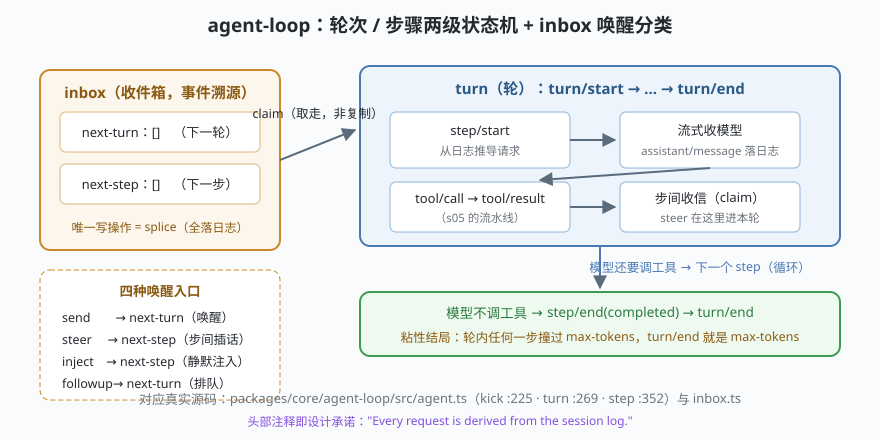

# s02: Agent Loop —— 从日志推导一切的循环

[s01](../s01_plugin_kernel/) → **s02** → [s03_session_log](../s03_session_log/) → ...

> dsh 的 agent loop（`packages/core/agent-loop`）是"没有特权内核"的内核——它自己也是一个 Cordis 插件（`ctx.agentLoop`）。它的头部注释是整个仓库最重要的设计承诺：
>
> **"Every request is derived from the session log."（每一次请求都从会话日志推导而来）**
>
> **Harness 层**：内核循环 —— 轮次 / 步骤 / 收件箱 / 唤醒。

---

## 问题

s01 里我们有了一棵会装插件、会回收副作用的树。往树上挂"agent 的心脏"时，立刻冒出四个问题：

1. **对话进行到一半，用户又插话了，怎么办？** 直接打断流式请求会丢内容；置之不理又违背用户意图。
2. **循环的状态放哪？** 如果循环自己维护一份"对话历史"内存副本，日志和内存迟早不一致，崩溃后就说不清发生过什么。
3. **一轮跑到一半被截断（max-tokens），下一轮又正常了，这轮算成功还是失败？** 统计口径漂移会让评测和监控失真。
4. **输入从哪些口进来？** 正常发送、步间插话、后台静默注入、排队追问——如果都混成一个队列，语义就糊了。

---

## 解决方案



dsh 的答案是把循环做成**两级状态机 + 事件溯源的收件箱**：

| 机制 | mini 版 | dsh 真实实现 |
|------|---------|--------------|
| **轮（turn）** | `turn/start → 步循环 → turn/end`，全部落日志 | `agent.ts` 的 `turn()`（:269）：轮次边界事件落会话日志 |
| **步（step）** | 组装请求 → 收模型 → 工具调用 → 步间收信 | `agent.ts` 的 `step()`（:352）：每步一拍 |
| **inbox** | 两条列表，唯一写操作 `splice`，每次落 `agent/inbox/spliced` 事件 | `inbox.ts`：收件箱本身是会话投影，没有内存态 |
| **唤醒** | send / steer / inject / followup 四入口 | dsh 精确分类为 `'next-turn'/'next-step'` 两目标 + 是否唤醒 |
| **粘性结局** | 撞过 `max_tokens` 就记为轮次结局，不降级 | `agent.ts`（:305-310）："max-tokens 结局是粘性的" |

---

## 工作原理

`code.mjs` 的 `MiniAgentLoop` 走读四个关键点：

**第 1 点：驱动器就是个 while 循环**（对应 dsh `kick` :225 的 `while (await this.turn())`）：

```js
async kick() {
  if (this.running) return            // 幂等：运行中重复 kick 只是排队
  this.running = true
  try { while (await this.turn()) {} } // turn 返回 true = 还有排队的 followup
  finally { this.running = false }
}
```

**第 2 点：请求不是"拼出来的"，是"从日志推导出来的"**。`deriveRequest()` 不读任何私有内存，只重放日志事件：

```js
deriveRequest() {
  for (const e of this.log.events) {
    if (e.type === 'user/message') messages.push({ role: 'user', ... })
    else if (e.type === 'assistant/message') ...
    else if (e.type === 'tool/result') ...
  }
  return { messages }
}
```

好处在故障时兑现：投影错了/进程崩了，重放日志就能重建——"日志里没有悬空流"。

**第 3 点：claim 是"取走"不是"复制"**。步边界上 `claim()` 原子取走 next-step 全部 + 至多一条 next-turn；消息从队列消失、进入会话日志，队列与日志不重复持有——一条消息一份归属。三个演示场景分别对应：

- **场景 1**：一轮两个 step——模型要工具（`tool_use`）→ 工具结果喂回 → 收尾（`end_turn`）。
- **场景 2**：`steer` 插话在 step1 工具执行期间到达，在步边界被 claim，作为追加的 `user/message` 进入**同一轮**的 step2——不打断、不丢内容、不另起一轮。
- **场景 3**：step1 撞 `max_tokens`、step2 正常完成，但 `turn/end` 的 reason 仍是 `max-tokens`——**轮次结局取轮内最坏值**，评测口径不漂移。

**跑一跑**（零依赖，离线，模型是脚本化的）：

```bash
node code.mjs
```

---

## 对照真实源码

| mini 实现 | dsh 真实代码 | 学习点 |
|-----------|-------------|--------|
| `kick()` | `packages/core/agent-loop/src/agent.ts` :225 | 驱动器 `while (await this.turn())` |
| `turn()` / `step()` | 同上 :269 / :352 | 轮次与步骤边界事件全部落日志 |
| `deriveRequest()` | 同上 :501 `prepareRequest`、:553 `buildRequest` | 请求面从 canonical header 冻结，插件可经瀑布改写 |
| `MiniInbox.splice` | `packages/core/agent-loop/src/inbox.ts` :169 | 全队列一种写操作 + 一种事件 |
| `claim()` | 同上 :111 | 取走而非复制；先 next-step 后 next-turn 的顺序可重放 |
| 粘性结局 | `agent.ts` :305-310 | max-tokens 结局的"不降级"不变量 |
| 中断的流 | `agent.ts` :402-431 catch 分支 | 已收块 settlement 成 `interrupted` 消息，或落 attempt 记录 |

> 精读顺序建议：先 `docs/agent-lifecycle.zh.md` 的时序图建立全貌，再对照 `study-cn-comments` 分支的 `agent.ts` / `inbox.ts` 中文导读注释逐段读源码。

---

## 自测

1. 为什么"请求从日志推导"优于"循环自己维护对话数组"？说出两个故障场景。
2. `send` 与 `steer` 都会唤醒循环，差别是什么？如果用户在模型收尾（`end_turn`）之后才 steer，这条插话会落在哪一轮？
3. 场景 3 里为什么 step2 正常完成也不能把轮次结局改回 `completed`？

下一课 [s03_session_log](../s03_session_log/)：把 mini 日志升级成"仅追加 + 可持久化 + 可投影重建"的真源。
