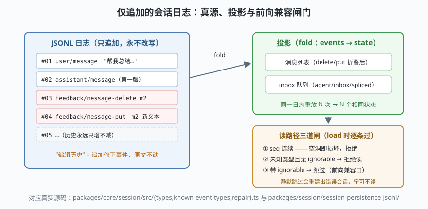

# s03: 会话日志 —— 仅追加的真源

[s02](../s02_agent_loop/) → **s03** → [s04_system_prompt](../s04_system_prompt/) → ...

> s02 的循环敢说"请求从日志推导"，前提是日志本身可靠。dsh 的会话层（`packages/core/session`）为此立了一条铁律：
>
> **日志只追加，永不改写。修正 = 追加一条新事件（`feedback/message-delete` / `feedback/message-put`），投影负责折叠出"当前状态"。**
>
> **Harness 层**：事件溯源 —— 真源、持久化、投影、前向兼容。

---

## 问题

1. **编辑历史怎么办？** 用户改了 AI 的一条回复。直接改文件，"发生过什么"就再也说不清了；审计、回放、评测全部失真。
2. **崩溃后怎么恢复？** 对话进行到一半进程死了，重启后凭什么重建现场？
3. **软件在升级，日志是旧的怎么办？** 新版 harness 引入了旧版不认识的事件类型。静默跳过，重建出来的会话就是错的；硬拒绝，又不给上游留升级空间。

---

## 解决方案



三件套：

| 组件 | 职责 | dsh 真实实现 |
|------|------|--------------|
| **仅追加日志** | 唯一写操作 append；seq 连续；JSONL 落盘一行一事件 | `packages/session/session-persistence-jsonl/`；`session/src/types.ts` 的 `SessionEvent` |
| **投影（projection）** | 无状态 fold：events → 状态。同一日志重放 N 次得 N 个相同状态 | inbox 投影（s02 见过）、消息列表、`session-projection(-cache)` 包 |
| **读路径闸门** | seq 空洞 = 损坏拒绝；未知类型无 `ignorable` 标记拒绝读；带标记可跳过 | `session/src/known-event-types.ts`（词汇表清单）+ `repair.ts` |

`known-event-types.ts` 头部注释把这个取舍讲得极清楚：**"silently skipping a required event would reconstruct a wrong session"**——所以宁可拒绝读。而 `ignorable` 标记是上游明确留出的前向兼容口：事件名注册制被否决，正是因为它无法对"缺席是否安全"分类。

---

## 工作原理

`code.mjs` 四个场景对应四个性质：

**场景 1（修正也是事件）**：AI 的第一版回复被"编辑"——日志里追加 `feedback/message-delete` + `feedback/message-put`，**日志仍保留 4 条原文**，投影后只剩 2 条消息。注意投影对这两个事件的**顺序敏感**：put 可以复活被 delete 标记的消息（put = upsert）——这正是"fold 按时间顺序应用"的含义。

**场景 2（崩溃重放）**：内存全丢，从 JSONL 逐行加载、逐条校验、重放 fold——重建出的消息列表与崩溃前一致。s02 的"请求从日志推导"兑现的就是这个可重放性。

**场景 3（前向兼容）**：新版事件 `experimental/boom` 出现在旧版日志里——
- 无标记 → 读路径**当场拒绝**，而不是重建出错误会话；
- 带 `ignorable: true` → 安全跳过，其余事件照常重建。

**场景 4（seq 空洞）**：日志中间丢了一行，seq 出现空洞，读路径拒绝——这不是"能容忍的小毛病"，而是"重建结果不可信"的信号，必须交给修复流程（dsh 的 `repair.ts`）而不是静默吞掉。

**跑一跑**（会真实读写本课目录下的 `tmp/`，结束自动清理）：

```bash
node code.mjs
```

---

## 对照真实源码

| mini 实现 | dsh 真实代码 | 学习点 |
|-----------|-------------|--------|
| `AppendOnlyLog.append` | `packages/core/session/src/types.ts`（`SessionEvent`、`surface` 与 `replaceGeneration`） | 仅追加 + 代际标记，防止并发写冲突 |
| `save` / `load`（JSONL） | `packages/session/session-persistence-jsonl/` | 一行一事件，流式可追加 |
| seq 连续性校验 | `session/src/repair.ts`、`seq-ranges.ts` | 损坏检测与修复流程的边界 |
| `KNOWN_TYPES` 词汇表 | `session/src/known-event-types.ts`（**脚本生成物**，`gen-persistence-catalog` 产出） | 事件词汇表本身也是生成物，防手改漂移 |
| `projectMessages` | `packages/core/agent-loop/src/inbox.ts` :27（`inboxProjectionDefinition` 投影折叠）、`session-projection(-cache)` | 投影定义统一走 fold，注册进会话即用 |
| `ignorable` 兼容口 | `known-event-types.ts` 头部注释 + 引用的设计笔记 | 为什么"事件名注册制"被否决 |

> 事件词汇表值得通读一遍（约 60 个类型）：`agent/inbox/spliced`、`step/start`、`tool/call`、`approval/asked`、`compaction/summary`……**整个 harness 的行为面就是这张词汇表**——后面 s05/s08/s09 会反复遇见它们。

---

## 自测

1. 为什么"编辑历史"不直接改 JSONL 里的旧行，而要追加修正事件？说出两个依赖"原文仍在"的场景。
2. 投影的 fold 为什么强调"无状态纯函数"？fold 里藏了一个 `Date.now()` 会破坏什么？
3. `ignorable` 标记由谁加？如果是旧版 harness 写日志、新版读，这个机制还工作吗？（提示：方向反过来想）

下一课 [s04_system_prompt](../s04_system_prompt/)：每一步的请求里，系统提示词是怎么从碎片组装出来的。
