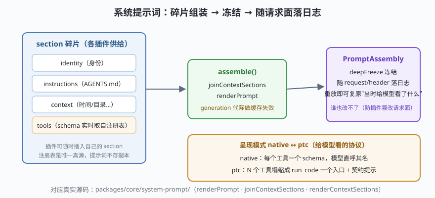

# s04: System Prompt —— 组装出来的，不是写死的

[s03](../s03_session_log/) → **s04** → [s05_tool_pipeline](../s05_tool_pipeline/) → ...

> dsh 的系统提示词（`packages/core/system-prompt`）是一个**投影**：身份、AGENTS.md 指令、上下文（时间/目录/git 状态）、工具 schema……每个碎片来自不同的插件，每一步请求时重新组装，组装结果冻结后随 `request/header` 落日志。
>
> **Harness 层**：提示词组装 —— 模型看到的世界是怎么拼出来的。

---

## 问题

1. **提示词谁说了算？** 内核写死一段开场白，插件就只能在旁边贴补丁；各插件想往里加自己的片段（时间、目录、技能说明），怎么有序共存？
2. **工具列表和提示词怎么不脱节？** 会话中途注册了一个新工具（比如 MCP 刚连上），凭什么保证下一次请求模型就能看到它？
3. **怎么复盘"模型当时到底看到了什么"？** 评测一个 badcase 时，只看模型输出不够，得知道它当时拿到的完整请求面。

---

## 解决方案



| 机制 | mini 版 | dsh 真实实现 |
|------|---------|--------------|
| **section 碎片** | `[{ name, render }]` 有序拼接 | `renderContextSections` / `joinContextSections` / `renderPrompt`（agent-loop 每步调用） |
| **工具面无副本** | tools section 实时调用注册表渲染 | `ctx.systemPrompt` 把 `ctx.tools` 的 schema 实时接进提示词；注册表以 `tools/change` 事件广播变更 |
| **代际缓存** | `generation` 只在注册表变化时 bump | `session-projection(-cache)` 的投影缓存思路 |
| **冻结 + 落日志** | `deepFreeze(assembly)` | `@deepseek-ai/dsh-util-values` 的 `deepFreeze`；canonical header 随请求落 `request/header` |
| **呈现模式** | native / ptc 两种渲染 | `core/tools` 的 presentation（native/ptc/both）；ptc 塌缩提示 `PTC_ONLY_INSTRUCTION`（tools 包 :51） |

---

## 工作原理

`code.mjs` 四个场景：

**场景 1（不同作用域 → 不同提示词）**：coder 的注册表里有 `read_file`/`edit_file`，组装出的工具面就是这两个——提示词是作用域的函数，不是全局常量。

**场景 2（注册表变了，提示词跟着变）**：中途注册 `web_search` 后 `invalidate()`（对应 dsh 的 `tools/change` 事件），generation 从 0 到 1，下一次 `assemble()` 就带上新工具。**注册表是唯一真源，提示词不存副本**——不会出现"注册表里有、提示词里没有"的漂移。

**场景 3（冻结防篡改）**：组装结果 deepFreeze，任何插件想改 `asm.text` 都会被拒绝。这是 dsh 反复出现的手法：**跨插件共享的对象一旦定型就不许再改**，谁想改就走事件流程重新生成——否则一个插件的"小优化"会污染所有插件的共同输入。

**场景 4（ptc 塌缩）**：呈现模式决定工具怎么"被模型看见"。ptc 模式把 N 个工具收拢进 `run_code` 一个入口，并在提示词里明确"别直呼其他工具"。dsh 的注释说得直白：**让模型靠被拒绝才学会就太晚了**——协议变化与提示词同步演化，而不是各改各的。

**跑一跑**（零依赖，离线）：

```bash
node code.mjs
```

---

## 对照真实源码

| mini 实现 | dsh 真实代码 | 学习点 |
|-----------|-------------|--------|
| `createAssembler` | `packages/core/system-prompt/`（`PromptAssembly` 类型） | 组装器与 assembly 分离：算一次、冻结、到处用 |
| tools section | `packages/core/tools/src/index.ts`（`ctx.systemPrompt` 联动） | 提示词与注册表不各自记副本 |
| `invalidate()` 代际 | `packages/session/session-projection-cache/` | 投影缓存按代际失效，不做文本 diff |
| `deepFreeze` | `@deepseek-ai/dsh-util-values`（`agent.ts` 顶部 import 可见） | 冻结是插件体系的礼貌：共享物不可变 |
| `renderPtcTools` | `core/tools/src/index.ts` :51 `PTC_ONLY_INSTRUCTION`、`ptc.ts`（`createRunCodeTool`） | PTC 塌缩：工具面 → 代码运行时的协议收敛 |

> `core/agent-instructions`（AGENTS.md 装载）、`context/file-reference`、`context/time-context` 这些包就是"往组装器里插 section"的现成范例——想加自定义上下文，照它们的结构写插件即可。

---

## 自测

1. 为什么工具 schema 要"实时来自注册表"而不是组装时快照一份？两个场景推演一下。
2. `deepFreeze` 冻住的是组装结果。如果某个插件确实想改提示词，dsh 的体系里正确的姿势是什么？
3. ptc 模式下模型调 `read_file` 会发生什么？这个设计的收益和代价各是什么？

下一课 [s05_tool_pipeline](../s05_tool_pipeline/)：模型点了工具名之后，执行前后的四拍流水线与"模型序提交"。
