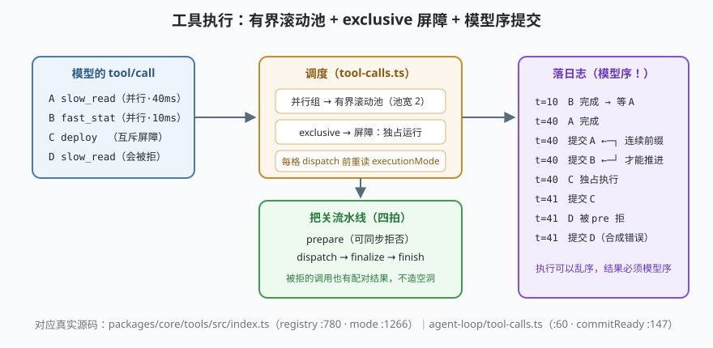

# s05: 工具流水线 —— 注册表、四拍把关与模型序提交

[s04](../s04_system_prompt/) → **s05** → [s06_llm_adapter](../s06_llm_adapter/) → ...

> 模型报出一串工具名之后，真正的工作才开始。dsh 把这一段拆成两个协作面：`ToolRuntime`（注册与呈现，`core/tools`）+ 调度器（执行，`agent-loop/tool-calls.ts`）。
>
> **Harness 层**：工具执行 —— 作用域注册、把关流水线、并发调度、提交顺序。

---

## 问题

1. **一步里模型要了 5 个工具，全串行太慢，全并发又会互相踩**（两个都在 `git commit`？）。并发度谁定、互斥谁说了算？
2. **工具结果落日志的顺序听谁的？** 如果第 2 个调用先完成先落日志，日志顺序与模型调用顺序错位，重放和引用就全乱了。
3. **被拒的工具调用怎么收场？** 权限闸门在执行前拒绝了一个调用，如果日志里只有 `tool/call` 没有配对的 `tool/result`，重放就出现空洞。
4. **工具从哪来？** 内置的、MCP 接进来的、插件注册的、某次会话临时的——如果各自一张表，可见性和生命周期就是灾难。

---

## 解决方案



| 机制 | mini 版 | dsh 真实实现 |
|------|---------|--------------|
| **作用域分层注册表** | layers 按 scope 合并，局部遮蔽全局 | `core/tools` 的 `ScopedLayers`；`register` :1027 |
| **executionMode** | `tool.mode ?? 'parallel'`，dispatch 前重读 | `executionMode` :1266；注册表变化影响**未开始**的调用 |
| **四拍流水线** | pre（同步拒否）/ around / post | `ToolRuntime` :780 门面：prepare → dispatch → finalize → finish |
| **滚动池 + 屏障** | 连续 parallel 共享池（宽 2），exclusive 独占 | `runGroup` :122 的 fillPool → Promise.race → commitReady |
| **模型序提交** | `commit()` 只推进连续前缀 | `commitReady` :147："执行可以乱序，结果必须模型序" |

---

## 工作原理

`code.mjs` 三个场景：

**场景 1（作用域分层）**：`draft_helper` 只注册在 `session#1` 层，session#2 沿作用域链合并时看不到它——s04 的提示词工具面、这里的可见性、s01 的 ctx 树，是同一套作用域思想的三次落地。

**场景 2 + 3（把关与调度）**：四个调用 `[A 慢·并行, B 快·并行, C 互斥, D 被拒]` 的完整旅程：

```
t=10  B 完成 ─┐  A 还没好，提交指针卡在 0 —— 等待
t=40  A 完成 ─┴→ 提交 A → 提交 B（连续前缀推进）
t=40  C 独占执行（屏障：并行组全部提交后才轮到它）
t=41  C 被 pre 拒 → 合成错误结果落日志
t=41  D 被 pre 拒（secret 标记）→ 合成错误结果落日志
```

三个不变量在输出里全部可见：

1. **`tool/result` 的日志顺序 = 模型 `tool/call` 的顺序**（A,B,C,D），哪怕 B 比 A 早 30ms 完成；
2. **exclusive 是屏障**：C 之前没有并发，C 之后才继续；
3. **被拒的调用也有配对结果**（`ok:false` 的合成结果）——日志永不出现悬空的 `tool/call`，abort 场景同理（dsh 会给未开始的调用补写 "aborted before dispatch"）。

**跑一跑**（零依赖，离线）：

```bash
node code.mjs
```

---

## 对照真实源码

| mini 实现 | dsh 真实代码 | 学习点 |
|-----------|-------------|--------|
| `ScopedToolRegistry` | `core/tools/src/index.ts`（`ScopedLayers`、`register` :1027） | 内置/MCP/插件工具同一张表，作用域定可见性 |
| `executionMode` | 同上 :1266 | parallel/exclusive 是调度输入，注册表可中途改判 |
| `createPipeline` | 同上 :1332 `execute`、四拍门面 :789 | prepare 同步拒否的调用不进并发池 |
| `executeToolCalls` | `agent-loop/tool-calls.ts` :60 | 分组循环 + 有界滚动池 |
| `commit()` | 同上 :147 `commitReady` | 连续前缀推进——"模型序提交"不变量 |
| 被拒/被弃的调用 | 同上 :238-242 `appendSkippedToolCall` | abort 补合成错误结果，重放永远合法 |
| 弱表管执行期状态 | 同上 :797-803（WeakMap/WeakSet） | 上下文、取消态按执行对象挂靠，结束自动回收 |

> 另一个值得留意的点：ptc 模式（s04 场景 4）下所有工具收进 `run_code`，这里的调度就只剩一个互斥调用——**执行协议与呈现协议是配套设计**。

---

## 自测

1. 为什么"执行可以乱序、提交必须模型序"？如果按完成序提交，坏掉的是下游的什么能力？
2. exclusive 调用前后的并行组，为什么必须等屏障组提交完才能开跑？这和数据库的什么概念同构？
3. pre 拒否和工具内部抛错，在日志上的表现有什么不同？为什么两者都必须有配对的 `tool/result`？

下一课 [s06_llm_adapter](../s06_llm_adapter/)：模型调用这一跳的适配缝——流式、重试与 token 计量。
