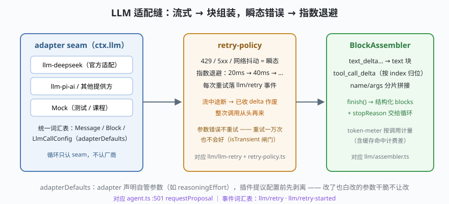

# s06: LLM 适配缝 —— 流式、重试与 token 计量

[s05](../s05_tool_pipeline/) → **s06** → [s07_subagent](../s07_subagent/) → ...

> s02 里模型调用只有一行 `model.generate(request)`。dsh 把这一跳拆成一条可替换的插件带（`packages/llm/`）：适配器 seam、流式块组装、重试策略、token 计量各自成包——"换厂商"不是改代码，是换插件。
>
> **Harness 层**：模型调用 —— 对接现实世界的一跳。

---

## 问题

1. **模型是流式回来的**：文本增量、工具调用的 name/arguments 分片交错到达。谁把它们拼成结构化消息？
2. **网络会抖**：429、5xx、连接重置。哪些错误值得重试？流收到一半断了怎么办？
3. **有些参数插件不该碰**：适配器自管的参数（比如 reasoningEffort），插件改了也会在下一跳被适配器覆盖回去——怎么让"改了也白改"的参数根本不进插件的视野？
4. **成本要可见**：一次会话烧了多少 token，缓存命中怎么计，得有统一的计量口。

---

## 解决方案



| 组件 | mini 版 | dsh 真实实现 |
|------|---------|--------------|
| **适配器 seam** | `adapter.stream(call)` 异步生成器 | `llm/llm` 的词汇表 + `ctx.llm`；`llm-deepseek` / `llm-pi-ai` 是现成实现 |
| **块组装** | `BlockAssembler`：delta → 结构化 blocks | `llm/llm/src/assembler.ts`（`BlockAssembler` 导出可见） |
| **重试** | 只重试瞬态错误；指数退避；落 `llm/retry` 事件 | `llm/llm/src/retry-policy.ts` + `llm/llm-retry`；`LlmError` + `errorChain` |
| **计量** | 近似 token 数按调用累计 | `llm/token-meter`（精确口径，含缓存命中计费差） |
| **自管参数剥离** | `requestProposal(config, adapter)` | `agent.ts` :501 `prepareRequest` → `requestProposal`（:40 区域） |

---

## 工作原理

`code.mjs` 的关键设计走读：

**第 1 点：assembler 在重试环内**。流中途断掉，已收的 delta 全部作废，整次调用从头再来——宁可重来也不要半成品消息。"日志里没有悬空流"（s02 的不变量）靠的就是这个纪律。

**第 2 点：重试只针对瞬态错误**。`isTransient` 闸门放行 429/5xx/网络抖动；参数错误重试一万次也不会好，直接抛。每次重试落一条 `llm/retry` 事件——监控面板上的重试率就是这条事件喂出来的。

**第 3 点：adapterDefaults 剥离**。适配器声明 `{ reasoningEffort: true }` = "这参数归我管"。`requestProposal` 在插件提议下一跳配置前把它删掉：

```js
function requestProposal(config, adapter) {
  const proposal = { ...config }
  if (adapter.adapterDefaults?.reasoningEffort) delete proposal.reasoningEffort
  return proposal
}
```

这是 dsh 反复出现的治理思路：**与其让插件改一个会被覆盖的值，不如让它根本看不见**。

**第 4 点：真适配器只是 seam 的另一个实现**。代码里附了 `DeepSeekAdapter`（fetch + SSE 解析，约 30 行）——设了 `DEEPSEEK_API_KEY` 就真流，没设就 Mock，**其余代码零改动**。这就是"换厂商 = 换插件"的体感。

**跑一跑**：

```bash
node code.mjs                              # 离线：Mock 流 + 两次 429 重试
DEEPSEEK_API_KEY=sk-... node code.mjs      # 追加一段真实 DeepSeek 流式调用
```

---

## 对照真实源码

| mini 实现 | dsh 真实代码 | 学习点 |
|-----------|-------------|--------|
| `BlockAssembler` | `packages/llm/llm/src/assembler.ts`（同名导出） | delta 按 index 归位，finish 产出 blocks + stopReason |
| `RetryPolicy` | `llm/llm/src/retry-policy.ts`、`packages/llm/llm-retry/` | 瞬态判定 + 退避 + `llm/retry(-started)` 事件 |
| `LlmError` 语义 | `llm/llm/src/error.ts`（`LlmError extends HarnessError`）、`errorChain` | 错误链可追因，重试判定基于链而非字符串 |
| `requestProposal` | `core/agent-loop/src/agent.ts`（:501 `prepareRequest` 内） | adapter 声明 `LlmCallConfigAdapterDefaults` |
| `DeepSeekAdapter` | `packages/llm/llm-deepseek/`、`deepseek-llm-api-extensions`（wire 扩展） | 官方适配器 + DeepSeek API 专属扩展的落点 |
| `TokenMeter` | `packages/llm/token-meter/` | 计量口径与计费（缓存命中价差）绑定 |

---

## 自测

1. 为什么 assembler 必须放在重试环内？"流收到一半断掉"如果只重试剩余部分，会引入什么不一致？
2. `adapterDefaults` 剥离解决了什么问题？如果不剥离，插件社区会发生什么样的事故？
3. token 计量为什么必须做成独立包而不是散在适配器里？（提示：s02 的统计口径不变量）

下一课 [s07_subagent](../s07_subagent/)：把整个 agent loop 当作工具递给模型——子代理提供方。
