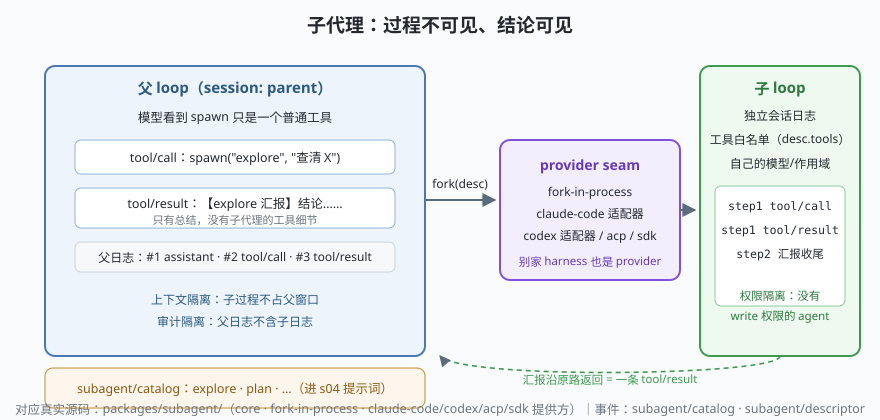

# s07: 子代理 —— 把整个 loop 当作一个工具

[...](../s06_llm_adapter/) → **s07** → [s08_compaction](../s08_compaction/) → ...

> dsh 的 `subagent` 域把"多 agent"翻译成一个朴素的动作：给模型一个叫 `spawn` 的普通工具，参数是 agent 类型 + 任务描述，返回值是子代理的**汇报**。子代理用哪个引擎跑，由**提供方（provider）**决定——dsh 自带 fork-in-process，甚至内置了把 **Claude Code / Codex 当子代理**的适配器（`subagent-claude-code`、`subagent-codex`）。
>
> **Harness 层**：子代理 —— 上下文隔离、权限隔离、审计隔离。

---

## 问题

1. **子任务的过程污染主对话**：让主 agent 自己去读 20 个文件来"查清 X"，20 个工具结果全堆进主上下文，窗口爆炸。
2. **多 agent 框架的经典泥潭**：任务板、消息总线、编排器……为了"派个活"引入一整套分布式系统。
3. **能力边界怎么划？** 探查型子代理不该有写权限，可它和主 agent 共享工具表。
4. **审计怎么不丢？** 子代理干过什么必须可回溯，但又不能混进父日志。

---

## 解决方案



| 机制 | mini 版 | dsh 真实实现 |
|------|---------|--------------|
| **spawn 就是工具** | `spawn({ type, task })` → tool/result | `tool-subagent` / `tool-subagent-control` 包 |
| **类型目录** | `catalog.registerType(...)` | `subagent/catalog` / `subagent/descriptor` 事件；模型选择策略 `subagent/model-selection-policy` |
| **提供方 seam** | `provider.spawn(desc)` | `subagent-fork-in-process` / `subagent-claude-code` / `subagent-codex` / `subagent-acp` / `subagent-dsh-sdk` |
| **隔离三件套** | 子日志独立 + 工具白名单 + 汇报制 | 子会话独立日志与作用域；`descriptor.tools` 白名单 |
| **团队协作（进阶）** | —— | `experimental/agent-team`（roster、任务板、mailbox） |

---

## 工作原理

`code.mjs` 走读：

**第 1 点：对模型而言，子代理毫无特殊性**。父代理的模型脚本里，`spawn` 和 `read_file` 长得一模一样——都是 tool/call + tool/result。**多 agent 的全部复杂性被 provider seam 收编在工具实现背后**，不需要新的提示词协议。

**第 2 点：三条边界在 `spawn` 里显式划定**：

```js
const childLog = []                                    // ① 审计隔离：子日志独立
const childTools = desc.tools.map(...)                 // ② 权限隔离：白名单
for await (const partial of provider.spawn(desc, ...)) // ③ 上下文隔离：只传汇报
```

演示里父代理收到的 tool/result 只有一句"【explore 汇报】……（子日志 4 条事件，独立留存）"——子代理读过的文件、调过的工具，**一个字节都没进父上下文**。

**第 3 点：provider 是完整的 agent 引擎缝**。`fork-in-process` 在本进程内跑一个独立会话的子 loop；换成 `subagent-claude-code` 提供方，同一句 `spawn("explore", ...)` 就变成调用 Claude Code CLI 去干活——对父代理完全透明。这也是学习 dsh 最值得体感的一点：**harness 的边界可以套 harness**。

**跑一跑**（零依赖，离线）：

```bash
node code.mjs
```

---

## 对照真实源码

| mini 实现 | dsh 真实代码 | 学习点 |
|-----------|-------------|--------|
| `SubagentCatalog` | `packages/subagent/`（catalog/descriptor 事件） | agent 类型进提示词（接 s04 的 tools section） |
| `ForkInProcessProvider` | `subagent/subagent-fork-in-process/`、`-in-process-driver`、`-spawn-in-process` | 本进程 fork 的三种粒度 |
| 外部引擎适配 | `subagent/subagent-claude-code/`、`subagent-codex/` | 别家 CLI 被包成 provider 的契约层 |
| 跨进程提供方 | `subagent-acp/`（Agent Client Protocol）、`subagent-dsh-sdk/` | ACP 协议与 SDK 服务的接入位 |
| `spawn` 工具 | `tool-subagent/`、`tool-subagent-control/` | spawn 之外还有控制类工具（查询/中止） |
| 团队模式 | `experimental/agent-team/` | roster / 任务板 / mailbox：多代理长协作的实验场 |

> 何时用子代理：子任务"查证型、可丢弃、结论可压缩"（探索代码库、批量审阅）。何时不用：需要与用户持续交互的步骤——子代理的用户界面不在你手里。

---

## 自测

1. "过程不可见、结论可见"救的是哪个资源？如果父代理确实需要某个子代理的中间结果，正确的姿势是什么？
2. `descriptor.tools` 白名单和 s05 的作用域分层是什么关系？
3. 把 Claude Code 当子代理时，`subagent-claude-code` 适配器要消化哪些差异？（提示：进程边界、流格式、会话持久化、审批语义）

下一课 [s08_compaction](../s08_compaction/)：上下文逼近窗口上限时，dsh 怎么"打扫房间"。
