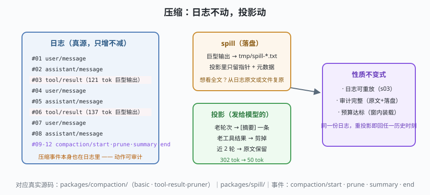

# s08: Compaction —— 日志不动，投影动

[...](../s07_subagent/) → **s08** → [s09_sandbox_approval](../s09_sandbox_approval/) → ...

> 长会话迟早撑爆窗口。dsh 的压缩（`packages/compaction/` + `packages/spill/`）没有违背 s03 的铁律，而是把它用到极致：**日志一条不减，压缩的是"下一次请求从日志投影出什么"**——四个阶段（start / prune / summary / end）全部落事件，压缩本身也是可审计的历史。
>
> **Harness 层**：上下文管理 —— 窗口预算、剪枝、摘要、落盘。

---

## 问题

1. **巨型工具输出占窗口**：一个 137 tok 的 CVE 报告列表，模型真正需要的信息不到 5 tok，却永久占据上下文。
2. **早期轮次价值衰减**：10 轮之前的对话，模型几乎不再引用，却按原文计费。
3. **压缩常见做法是"改历史"**：直接删消息、改文件。历史被改，审计、回放、评测全部失真——而且删错了无法恢复。
4. **什么时候压？** 不压会爆，压早了丢信息。

---

## 解决方案



| 阶段 | 动作 | dsh 真实实现 |
|------|------|--------------|
| **spill** | 超大工具输出原文落盘（`tmp/spill-*.txt`），投影只留指针 | `packages/spill/`（大输出落盘） |
| **compaction/start** | 记录预算与压缩前 token 数 | `compaction/start` 事件 |
| **compaction/prune** | 近 N 轮之外的工具结果剪出投影 | `compaction-tool-result-pruner` 包；`compaction/prune` 事件 |
| **compaction/summary** | 更早的消息折叠成一条摘要事件 | `compaction-basic`；`compaction/summary` 事件 |
| **compaction/end** | 记录压缩后 token 数与是否达标 | `compaction/end` 事件 |

核心句式：**日志（真源）永远完整——回放、审计、重投影不受影响**。想看被压缩的原文？日志原文还在，落盘文件还在。

---

## 工作原理

`code.mjs` 演示一条完整的因果链：

```
302 tok（预算 120，超了）
  → spill：两个巨型工具输出落盘，投影改显指针
  → prune：第 1 轮的工具结果剪出投影
  → summary：第 1 轮对话折叠成 [摘要] 一条
  → 50 tok ✓ 回到预算内
```

三个关键认识：

**第 1 点：压缩是投影层的事**。`projectContext` 多了三条跳过规则（`summarized` / `spilled` / `pruned` 的 payload 标记）——事件本身一个字段都没删，只是投影不再渲染它们。s03 的"同一日志重放 N 次得 N 个相同状态"升级为"**重投影即回到任一历史时刻的上下文形态**"。

**第 2 点：spill 是"指针不是删除"**。原文在落盘文件里，也在日志 payload 里。模型需要全文时，正确的姿势是用工具按指针读回——窗口里常驻的只有指针（约 30 tok）。

**第 3 点：压缩动作自己也有事件**。`compaction/start·prune·summary·end` 四条事件进了日志——哪一秒压的、压了多少、压完多少，全部可查。评测"压缩前后模型表现差异"时，这就是现成的对齐点。

**跑一跑**（会真实写 `tmp/` 并在结束时清理）：

```bash
node code.mjs
```

---

## 对照真实源码

| mini 实现 | dsh 真实代码 | 学习点 |
|-----------|-------------|--------|
| `projectContext` 跳过规则 | `packages/session/session-projection/` | 投影定义统一注册，压缩规则只是多一种 fold |
| `spill()` | `packages/spill/` | 落盘指针的元数据（行数/token）直接服务于"要不要读回"的决策 |
| prune 阶段 | `packages/compaction/compaction-tool-result-pruner/` | 工具结果是最先被剪的——信息密度最低 |
| summary 阶段 | `packages/compaction/compaction-basic/` | 摘要生成走同一套 llm seam（s06） |
| 四阶段事件 | `session/src/known-event-types.ts` 词汇表 | `compaction/start·prune·summary·end` 全部在册 |

> 与另一层上下文治理的分工：**缓存锚点**（提示词前缀稳定，对接 s04）与**压缩**（窗口内装载）是两件事——前者省钱，后者保命。对照阅读 [context-handbook](../../../context-handbook/Context与记忆系统手册.md) 的三层压缩章节，可以看到通用方法论与 dsh 实现的一一对应。

---

## 自测

1. "日志不动，投影动"如果反过来（直接删日志），s02 的哪些不变量会连锁崩塌？
2. 为什么 prune 先剪工具结果而不是消息？信息密度怎么算？
3. 模型在压缩后想看某个被 spill 的报告全文，完整的调用链是什么？（提示：指针 → 工具 → 落盘文件）

下一课 [s09_sandbox_approval](../s09_sandbox_approval/)：权限闸门与沙箱——"能做"与"该做"的分界线。
