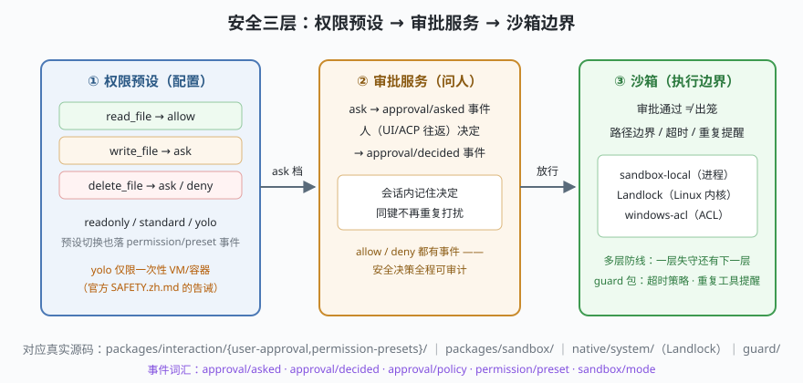

# s09: 沙箱与审批 —— "能做"与"该做"的分界线

[...](../s08_compaction/) → **s09** → [s10_profile_assembly](../s10_profile_assembly/) → ...

> agent 能调工具，不代表它**该**调。dsh 的安全域（`packages/interaction/` + `packages/sandbox/` + `native/system/`）把这件事拆成三层，每层都有事件为证：权限预设（配置）、审批服务（问人）、沙箱边界（执行期兜底）。
>
> **Harness 层**：安全 —— 权限、审批、沙箱、审计。

---

## 问题

1. **"要不要问人"不能写成散落的 if**：每个工具自己判断，很快没人说得清哪些动作会碰用户。
2. **问人太频繁也没法用**：同一路径问 10 次，用户会开始无脑点"允许"——审批疲劳。
3. **审批通过 ≠ 安全**：模型说"写 a.txt"，审批过了，但执行时路径被拼成 `/etc/hosts` 呢？
4. **安全决策怎么审计？** 出事之后要能回答：谁、什么时候、批准了什么。

---

## 解决方案



| 层 | mini 版 | dsh 真实实现 |
|----|---------|--------------|
| **① 权限预设** | `readonly` / `standard` / `yolo` 三档查表 | `interaction/permission-presets`；切换落 `permission/preset` 事件 |
| **② 审批服务** | `approval/asked` → 人决定 → `approval/decided`；会话内记住 | `interaction/user-approval`、`tool-ask-user`；guard 包的重复工具提醒 |
| **③ 沙箱边界** | pre 钩子做路径边界检查 | `sandbox` / `sandbox-local` / `sandbox-policy`；Linux 用 `native/system` 的 Landlock launcher（内核级），Windows 用 `sandbox-windows-acl`（ACL） |

dsh 的调用链位置：审批服务接在 s05 流水线的 pre 位（`prepare` 可同步拒否）；沙箱在**执行期**继续兜底——**多层防线，一层失守还有下一层**。

---

## 工作原理

`code.mjs` 三个场景对应三种命运：

**场景 A（readonly 预设）**：`write_file` 直接 `deny`——**不问人**。风险等级明显高过预设的动作，问都不要问，直接拒。`approval/policy` 事件记录这次自动裁决。

**场景 B（standard 预设 + 会话记忆）**：第一次写 `a.txt` 走 `ask` → `approval/asked` 事件 → 人同意 → `approval/decided` 事件 + 记住这个键；第二次同一键直接放行（不打扰）；新路径 `b.txt` 又问。**审批疲劳的解药是按"键"记忆，而不是全局放行**。

**场景 C（沙箱兜底）**：审批通过后，执行前还有路径边界检查——`/etc/hosts` 越出工作目录，沙箱拒绝。演示里是 pre 钩子级检查；dsh 的纵深在下面还有进程隔离、Landlock 内核层、Windows ACL——**应用层检查可以被绕过，内核层不会**。

**审计轨迹**：把三个场景的事件连起来看——每一次 `asked`/`decided`/`policy` 都有名有姓。"谁在什么时候批准了什么"就是这张事件表。

**跑一跑**（零依赖，离线；"人类"由脚本扮演）：

```bash
node code.mjs
```

---

## 对照真实源码

| mini 实现 | dsh 真实代码 | 学习点 |
|-----------|-------------|--------|
| `PRESETS` | `packages/interaction/permission-presets/` | 预设是配置不是代码；`permission/preset` 事件可切换 |
| `ApprovalService` | `packages/interaction/user-approval/`（`ctx.get('approval')` 经 seam 注入工具系统） | s05 的 tools 包就 import 这个 seam——安全是服务不是钩子 |
| `asked/decided` 事件 | `session/src/known-event-types.ts` 词汇表 | 审批流全程事件溯源 |
| `sandboxGuard` | `packages/sandbox/sandbox-policy/`、`sandbox-local/` | 策略层与执行层分离 |
| Landlock | `native/system/`（独立构建与发布脚本） | 内核级兜底，应用层不可绕过 |
| 重复工具提醒 | `packages/guard/repeat-tool-reminder/`、`timeout-policy/` | 失控循环的软性护栏 |
| SAFETY 文档 | 仓库 `SAFETY.zh.md` | "实验性软件、未经安全审计、先上 VM"——官方口径 |

---

## 自测

1. 审批记忆为什么按 `tool:path` 键记而不是全局"允许写文件"？举一个全局放行会出事的场景。
2. 有了应用层沙箱检查，为什么还要 Landlock/ACL？各自的威胁模型是什么？
3. 把这套三层映射到 Web 部署形态（`dsh web`），第 ② 层的"人"变成什么？（提示：ACP 往返 / 审批 UI）

最后一课 [s10_profile_assembly](../s10_profile_assembly/)：同一棵插件树，怎么装出 CLI、Web、桌面、SDK 四种形态。
