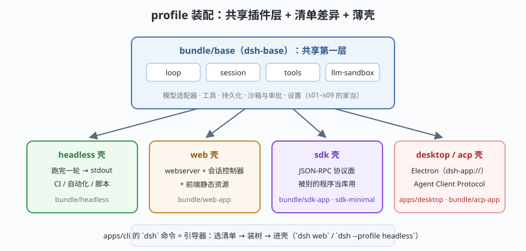

# s10: Profile 装配 —— 同一棵插件树，装出四种产品

[...](../s09_sandbox_approval/) → **s10（收官）**

> 学完 s01–s09，手上有了一整套插件：内核树、循环、日志、提示词、工具流水线、模型 seam、子代理、压缩、审批沙箱。收官课回答 dsh 最有辨识度的问题：**同一个内核，怎么同时是 CLI、Web 应用、桌面应用和 SDK 服务？**
>
> dsh 的答案：**profile 只是插件清单的差异 + 一个薄壳**。没有 fork 的代码库，只有不同的清单。

---

## 问题

1. **一个 harness 要长成产品矩阵**：命令行用户要一次性跑完退出；浏览器用户要 HTTP + 会话管理；桌面用户要 Electron；第三方开发者要程序化 API。四套代码？维护成本爆炸。
2. **形态差异容易渗进内核**：一不小心，Web 的会话控制器就长进了循环里，CLI 的 stdout 打印就混进了工具层。

---

## 解决方案



| 层 | 职责 | dsh 真实包 |
|----|------|-----------|
| **共享第一层** | 模型适配器、工具、持久化、沙箱与审批、设置、凭据 | `bundle/base`（dsh-base） |
| **增量组合包** | 各形态的差量插件 | `bundle/headless` / `web-app` / `sdk-app` / `sdk-minimal` / `acp-app` |
| **薄壳** | 形态的"最后一步"：stdout / http / JSON-RPC / Electron | `apps/cli` 的 profile 引导、`host/webserver`、`api/gateway` |
| **引导器** | 选清单 → 装树 → 进壳（`dsh web` / `--profile headless`） | `apps/cli`、`boot/app-boot`、`boot/cmdline` |

---

## 工作原理

`code.mjs` 用**同一份** loop/session/tools 插件装了三个内核：

**headless 壳**：`run(input)` 跑完一轮打印退出——CI 和自动化的形态。对应 dsh 里"headless = base 的增量最小"。

**web 壳**：同一个 `loop` 实例外套 `http.createServer`，`POST /turn` 真实可调（演示里起在随机端口、用 fetch 打了一圈）。会话事件挂在 web 内核的 session 上——**真实 dsh 的 `api/session-controller` 接管的就是这个位置**。

**sdk 壳**：async 迭代器当 API——被别的程序当库用。对应 `bundle/sdk-app` 的 JSON-RPC 协议面（协议换掉传输，思想一致）。

演示的对照表就是结论：

```
headless: [session, tools, loop]
web     : [session, tools, loop] + http 壳   ← loop 是同一份
sdk     : [session, tools, loop] + 迭代器壳
```

**跑一跑**（会临时起一个本地 http 服务，演示完即关）：

```bash
node code.mjs
```

---

## 对照真实源码

| mini 实现 | dsh 真实代码 | 学习点 |
|-----------|-------------|--------|
| `sharedPlugins` | `packages/bundle/base/`（官方文档口径：web/headless/sdk/acp 共享第一层） | 形态差异不许下沉进共享层 |
| `createWebKernel` | `bundle/web-app/` + `host/webserver/` + `api/session-controller` | HTTP 壳薄到只有"路由 → 会话 → loop" |
| `createSdkKernel` | `bundle/sdk-app/`、`sdk-minimal/`、`packages/sdk/`（client/protocol/server） | SDK = 协议化的程序化壳 |
| profile 引导 | `apps/cli/`、`packages/boot/app-boot/`、`boot/cmdline/` | `dsh web` 只是"选了 web 清单的引导" |
| 桌面形态 | `apps/desktop/`（Electron，`dsh-app://` 无端口）、`desktop-host` | 连桌面应用也没 fork 内核 |
| 预设与人格 | `preset/agent-presets/`、`preset/persona/` | agent 能力集合也是装配项 |

---

## 收官自测

1. 为什么形态差异"不许下沉进共享层"？举一个 Web 需求污染循环代码的典型事故。
2. 四种形态里，哪两种能共享同一个会话日志文件？哪一种天然隔离？
3. 回看 s01 的自测第 2 题——现在你能完整回答"没有特权内核"靠什么保证了吗？

---

## 学完之后去哪

1. **真源码重走一遍**：按 [阅读指南](../../阅读指南.md) 的四条精读路线，把 s01–s10 的每个 mini 实现换成真包——先读 `study-cn-comments` 分支的中文导读注释，再回上游验证。
2. **跑真的 dsh**：`docs/cookbook/` 里有官方菜谱；记住 SAFETY 的告诫，VM/容器里玩。
3. **横向对照**：同一张图里比较 [Claude Code 的循环](../../../01-claude-code/架构拆解.md) 与 dsh 的循环——一个把工具面做到极致，一个把组装面做到极致。
