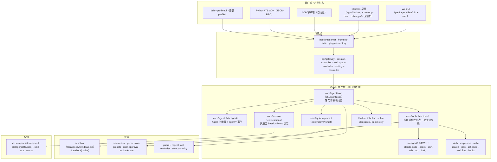

# DeepSeek Harness（dsh）架构拆解

> 生成日期：2026-09-11 ｜ 仓库 `deepseek-harness/` @ `c291e79`（v0.1.5-rc.2，MIT，developer preview）
>
> 本文以**官方文档 + 实际包结构/源码文件**为双重证据：官方文档见 `docs/architecture.zh.md`、`docs/agent-lifecycle.zh.md`（仓库自带中文版，质量极高），代码位置见各节引用。凡引用官方原文观点处已标注文档路径。

## 1. 一句话总览

dsh 是一个**没有特权内核的插件化 agent harness**：运行时就是一棵 Cordis 插件树——模型适配器、工具注册表、会话日志、沙箱、甚至 agent loop 本身都是可替换插件；内核循环（`core/agent-loop`）只做一件事：把 inbox 里的输入变成"轮次/步骤"，每步"组装提示词 → 流式请求模型 → 把关执行工具 → 把一切以仅追加事件写入会话日志"。

## 2. 总体架构图



## 3. "一切皆插件"：Cordis 与装配体系

### 3.1 Cordis 模型

官方定义（`docs/architecture.zh.md` 开头）：**插件向共享上下文贡献服务、类型化事件和可逆的副作用**。产品每一部分都是插件——模型适配器、工具注册表、会话日志、agent loop——因此每个都可从配置替换；**"不存在需要打补丁的特权内核：扩展 dsh 的方式是把插件挂载到其他插件旁边，而各项注册都是副作用，会在其插件卸载时撤销。"**

核心服务键（`docs/architecture.zh.md` 核心包表）：

| ctx 键 | 包 | 职责 |
|---|---|---|
| `ctx.sessions` | `packages/core/session` | 仅追加的 `SessionEvent` 日志和内存存储 |
| `ctx.systemPrompt` | `packages/core/system-prompt` | 提示词片段与工具 schema 组装 |
| `ctx.tools` | `packages/core/tools` | 作用域化工具注册表 + 把关的执行流水线 |
| `ctx.agents` | `packages/core/agent` | `Agent` 接口、活跃 agent 注册表、`agent/*` 事件 |
| `ctx.agentLoop` | `packages/core/agent-loop` | 默认驱动器（`Agent` 接口的唯一具象实现） |
| `ctx.llm` | `packages/llm/llm` | 消息/流式词汇表与适配器 seam |
| `ctx.webhookRuntime` | `packages/webhook/webhook` | 已认证 webhook 投递与 Session 创建 |

扩展点还包括（同文档"新行为的归属位置"表）：`ctx.shell`、`ctx.terminals`、`ctx.commands`、`ctx.jobs`、`ctx.fs`、`ctx.sandbox`、`ctx.goals`、`ctx.agentTeams`、`ctx.sessionTitle`、`ctx.sessionProjections`。

### 3.2 profile / 组合包 / patch：运行时的组装方式

（依据 `docs/architecture.zh.md` "Profile 与组合包" 与 `apps/cli/README.zh.md`）

- 运行中的 `dsh` 是**一棵按序叠加的插件树**：启动时先按 profile 列出的顺序应用各 bundle 的 patch，再应用 profile 的 `cordis.patch.yml`，再 home 级 `$DSH_HOME/cordis.patch.yml`，最后 `--patch` overlay。一条 patch 按 id 定位条目并**替换其整个 config**，或插入新条目。
- 内置 profile：`web`、`headless`、`sdk`、`sdk-minimal`、`acp`（另有保留给 Electron 的 `desktop`）。
- `dsh-base`（`packages/bundle/base`）是 web/headless/sdk/acp 的共享第一层：模型适配器、工具、持久化、沙箱与审批策略、设置、凭据、遥测；`dsh-web-app` 等在其上追加形态特定插件。
- `sdk-minimal` 是刻意例外：一份**完全显式**的 SDK 配置树，不应用 dsh-base。
- 自省工具：`dsh --profile web --dump-config` 打印最终配置树——**读 dsh 的第一课：先 dump，再读代码**。

## 4. 轮次与步骤：内核循环

dsh 把 agent 循环拆成两级：**步骤（step）= 一次模型请求 + 它调用的工具；轮次（turn）= 零个或多个步骤**，在领取首条输入前打开、在不再欠任何工作时关闭（`docs/architecture.zh.md#turn-flow`）。

### 4.1 流程（官方 turn-flow，`docs/architecture.zh.md`）

```text
turn/start
  claim next-step input plus one queued message
  assemble prompt sections + tool schemas; project runtime context
  -> agent/pre-step                   reject | enter(messages, startsRequestSeries?)
     reject, or a first enter rewritten empty -> close the turn with no step
     step/start
     agent/request -> prepareCall (cancellation commits neither system nor users)
     reconcile system/message using the prepared call capability
     append entered messages as user/message; log request/header and request/context as needed
     derive and freeze model history from the log
     stream the bound prepared call -> llm/stream -> agent/assistant-stream start
       agent/assistant-stream chunk*
       assistant/message | assistant/attempt -> agent/assistant-stream end
     tool/call* -> tools/pre-execute -> tools/execute -> tools/post-execute -> tool/result*
     step/end
     tools owe another request, or next-step input arrived -> claim -> next step
  -> agent/turn-stopping
turn/end
```

要点解读：

1. **`agent/pre-step` 是权柄所在**（waterfall 事件）：监听器可以改写或拒绝已领取消息；首次领取被拒或为空时，**关闭一个不含步骤的轮次**。压缩插件正是挂在这里（见第 6 节）。
2. **请求构造与提交分离**：`agent/request` → `prepareCall()` 先解析路由（provider/model），随后才提交系统提示词与用户消息；**任一异步阶段取消都不会提交二者**。
3. **模型历史从日志派生**（"derive and freeze"）：请求不是从内存列表拼的，而是从会话日志投影并冻结（见第 5 节）。
4. **流式双通道**：`llm/stream`（waterfall）产 `StreamChunk*`，实时经 `agent/assistant-stream`（进程本地 start/chunk/end）给 UI；settlement 时提交为持久的 `assistant/message` 或仅日志的 `assistant/attempt`。
5. **工具流水线三段式**：`tools/pre-execute → tools/execute → tools/post-execute`，然后 `tool/result`；执行顺序由 executionMode 分类：并行安全调用最多叠 `maxParallelToolCalls`（默认 10）个，"独占调用单独运行并构成排序屏障"（`packages/core/agent-loop/README.zh.md`）。
6. **事件域三分**（`docs/architecture.zh.md#events`）：会话事件（持久）、`agent/*`（实时协调：inbox、步骤、状态、请求、验证、续跑）、能力事件（`fs/*`、`tools/*`、`telemetry/*` 只挂策略/适配器，避免导入循环）。

### 4.2 inbox 语义

输入经统一 inbox 到达驱动器；`agent/inbox/spliced` 是规范化事件——插入（`inserted`）、编辑、移除、领取（`claimed`，纯删除）、取消（`discarded`）都按同一组 splice 坐标回放；**"注入的上下文会留在 inbox 中，直到另一条消息将其唤醒"**（`docs/architecture.zh.md`）。`MessageId` 在两个待处理列表之间唯一。

## 5. 会话日志：唯一真源

（依据 `docs/architecture.zh.md#会话日志` 与 `docs/agent-lifecycle.zh.md`）

- **仅追加**的 `SessionEvent` 日志是"模型所见上下文的来源"，`deriveMessages()` 从中投影模型历史。
- **"模型可见即已记录"是运行时不变量**：抵达模型请求的一切都必须能从日志重建。因此"新增一项模型可见输入就需要新增一个会话事件"（扩展 `SessionEventMap`）。
- `assistant/message` 嵌入产生其组装内容的**精确紧凑带时间 stream**；失败/重试/取消/stream error 到达 settlement 时记录为 `assistant/attempt`（不进入模型历史）；进程在 settlement 前硬中断则不留下持久 attempt stream。
- **持久事件类别**：`turn/*`、`step/*`、`system/message`、`user/message`、`assistant/message`、`assistant/attempt`、`tool/*`。
- **格式版本与迁移**：`packages/session/session-format-v0-to-v1`、`v1-to-v2`、`v2-to-v3` 每个包只负责单步迁移；JSONL v0 用 `session.jsonl[.zstd]`，v1+ 用 `session.vN.jsonl[.zstd]`；已提交 generation 绝不重命名/替换/删除（`docs/architecture.zh.md`）。
- **投影 seam**：`packages/session/session-projection` 提供 `ctx.sessionProjections`——增量折叠已提交事件，host 消费方 `stateOf()` 读类型化状态，`snapshot()` 取客户端裁剪视图；agent loop 注册共享的 `turnBoundary` 状态。
- 衍生产品：fork、恢复、transcript、遥测、持久化全部从这些持久 settlement 派生；`session-title*` 系列负责会话标题（多策略：首个 prompt / 全 prompt / LLM）。

## 6. 上下文、提示词与压缩

- **提示词组装**（`packages/core/system-prompt`）：每次步骤"组装 prompt sections + tool schemas"；系统提示词以**按节点协调**方式写入历史——空渲染文本会清除所有生效系统节点；具备缓存前缀能力的路由可在缓存前缀后追加非空更新（`docs/architecture.zh.md` 轮次流程末段）。
- **模型可见上下文的扩展方式**：`agent.inject()`（落到下一次获准请求）、`packages/context/`（agent-instructions=AGENTS.md 注入、file-reference、session-reference、time-context、tmux-context）。
- **压缩**（`packages/compaction/`）：`dsh-compaction-basic` 在派生请求前通过 `agent/pre-step` 处理压力；`agent/request-error` 仅用于规范上下文溢出。触发后先执行**工具结果剪枝**（`compaction-tool-result-pruner`），再选择摘要；恢复发生在仍打开的步骤内，只有剪枝或摘要推进 **surface replacement generation** 时才重试（`docs/agent-lifecycle.zh.md` 末段）。
- **spill**（`packages/spill`）：大输出外溢存储，配合 `util/output-retention`。
- 手动入口：`command-compact`（slash 命令）。

## 7. 工具系统

- **注册**（`packages/core/tools`）：`ctx.tools` 上的作用域化注册表；schema 体系含 `schema.ts`、`json-schema.ts`、`ts-types.ts`、`py-types.ts`、`ptc.ts`（对应为 TS/Python 生成类型、程序化工具调用形态）；工具 schema 会加入提示词组装。
- **执行**：`tools/pre-execute → tools/execute → tools/post-execute` 瀑布式把关；executionMode 分类决定并行/独占；`maxParallelToolCalls` 默认 10。
- **原子工具注册表**（工具散落在能力域中，命名 `tool-*`，见 `阅读指南.md` 第 3 节）：文件（tool-fs、tool-fs-search、tool-str-replace-editor、tool-present）、shell（tool-bash/-persistent、tool-pwsh）、terminal、todo、plan、goal、web（搜索三家 provider + fetch）、skill、lsp、jobs、workflow（含 tool-ralph）、subagent、session-query、ask-user。
- **工具即能力 seam 的 Consumer**：例如把 `ctx.fs`/`ctx.subprocess` 提供方指向远程沙箱（e2b/远程执行），Bash、PTY、LSP 就**一起被搬过去**，无需 provider 专用 fork（`docs/architecture.zh.md#能力-seam`）。

## 8. 子代理与 Agent Teams

- **subagent 提供方**（`packages/subagent/`）在同一个接口之后差异极大（官方原文）：从新建子 agent（`subagent-spawn-in-process`）、进程内 fork（`subagent-fork-in-process`）、SDK 驱动（`subagent-dsh-sdk`），到**把一个轮次委派给另一个产品**——`subagent-claude-code`、`subagent-codex`（跨产品协作适配器），以及 `subagent-acp`。
- 控制面：`tool-subagent`、`tool-subagent-control`；驱动器：`subagent-in-process-driver`。
- **Agent Teams（实验性）**：`packages/experimental/agent-team` 在可继续 subagent 之上提供持久 roster、任务板和 mailbox（`ctx.agentTeams`）。

## 9. 安全与审批

- **沙箱**（`packages/sandbox/`）：`sandbox`（接口）、`sandbox-local`（本地实现）、`sandbox-policy`（策略）、`sandbox-windows-acl`（Windows ACL）；Linux 侧有原生 Landlock launcher（`native/system/`，pnpm-workspace 注释明确其定位）；shell 侧配套 `bash-sandbox`/`pwsh-sandbox`。远程沙箱由 `e2b/`（e2b、fs-e2b、subprocess-e2b）提供。
- **审批与权限**（`packages/interaction/`）：`permission-presets`（权限预设）、`user-approval`（审批流）、`tool-ask-user`、`user-questions`、`commands`。
- **guard**（`packages/guard/`）：`repeat-tool-reminder`（重复调用提醒）、`timeout-policy`。
- **官方立场**（`SAFETY.zh.md`）：实验性、未审计；"沙箱、审批提示与权限控制可以降低风险，但不保证隔离"；建议最小权限、一次性 VM/容器、备份文件、不暴露敏感凭据。

## 10. MCP / Web / 技能 / 钩子等扩展面

| 能力 | 包 |
|---|---|
| MCP 客户端 | `packages/mcp/mcp-client`（配合用户指南 `docs/user/guide/mcp-memory.zh.md` 的"记忆 MCP 服务器"覆盖层） |
| Web | `web/web-search-deepseek`、`web-search-exa`、`web-search-perplexity`、`web-fetch-http`、`tool-web` |
| 技能 | `skill/skill`、`skill/skill-filesystem`、`skill/skill-badge`、`tool-skill` |
| 后台与调度 | `jobs/`（tool-jobs）、`schedule/`（会话内 Schedule）、`workflow/`（tool-workflow、worker-thread 执行）、`webhook/webhook-github`（GitHub 评审 webhook，见 `docs/user/guide/github-review.zh.md`） |
| **钩子兼容层** | `hooks/hook-protocol`、`hooks/hooks-claude-code`、`hooks/hooks-codex`——直接兼容 Claude Code 与 Codex 的钩子生态 |
| 插件扩展插件 | `extensions/tool-cordis` + `cordis-host-runner`/`cordis-client-runner`（运行期 Cordis 工具） |
| 设置/凭据/存储 | `settings/`（settings、settings-file）、`credentials/`（authorization、credentials-local）、`storage/`（json/sqlite/domain）、`attachment/` |
| 代码运行 | `code-runtime/`（worker-thread 沙箱执行）、`experimental/code-runtime-python` |
| LSP | `lsp/`（tool-lsp） |

## 11. 产品形态与宿主层

- **CLI/profile**（`apps/cli`，bin `dsh`）：唯一受支持的 Node 应用启动器；SDK 与 ACP 都是 profile 而非独立可执行命令（`apps/cli/README.zh.md`）。
- **Web 形态**：`host/webserver` + `host/frontend-static` 提供服务器与静态资源；`api/gateway`、`api/session-controller`、`api/workspace-controller(-files)`、`api/settings-controller` 构成 RPC 面；前端由 `packages/client/` 下 **60+ 个 `ui-*` 组件包**（ui-chat、ui-conversation、ui-trajectory、ui-tool、ui-plan、ui-approval、ui-settings-*、ui-sidebar-*、ui-slots、ui-renderer…）组装。Web Session-follow adapter 是 `agent/assistant-stream` 实时事件**唯一的远程消费方**（`docs/architecture.zh.md`）。
- **桌面形态**（`apps/desktop` + `apps/desktop-host`）：Electron 用内置上游 Node 进程启动私有 Desktop Host，加载内置 dsh 后端；经带版本的分帧字节管道（一元 RPC、Remote stream）+ Node IPC 生命周期控制 + `dsh-app://` 协议到达渲染进程；**不开放 Web server 或 loopback 端口**（`docs/architecture.zh.md#桌面应用`）。
- **SDK**：`sdk/protocol`、`sdk/server`、`sdk/client`；Python 运行时 wheel 把 `dsh` CLI 打包为 `deepseek-harness-sdk-runtime-<platform>-<arch>`，默认以 `dsh --profile sdk` 启动（`docs/architecture.zh.md`）。
- **ACP**：`acp/acp` + `bundle/acp-app`，`dsh --profile acp` 以 stdio 为自动化客户端服务。

## 12. 端到端时序：从 `dsh web` 到一条回复

1. `dsh web`（= `--profile web`）→ `boot/app-boot` 初始化 `$DSH_HOME/profiles/web`，按 "bundles → profile patch → home patch → --patch" 叠加出最终插件树（`dsh --dump-config` 可预览）。
2. 插件依次加载：`dsh-base`（llm-deepseek 适配器、工具、sandbox-policy、凭据、遥测…）+ `dsh-web-app`（webserver、api gateway、client 静态资源…）；每个插件的注册都是可逆副作用。
3. 浏览器打开 `http://127.0.0.1:3080`；前端 `client/web` 经 `api/gateway` 连接；会话创建走 `ctx.agents.create()`（agent-loop 的 `AgentFactory`），会**在会话日志里打开一个 turn**。
4. 用户发消息 → `agent.followup()` → inbox splice（`agent/inbox/inserted`）→ 唤醒驱动器 → `turn/start`。
5. 驱动器领取下一步输入 → `system-prompt/assemble` 组装提示词与工具 schema → `agent/pre-step`（压缩插件在此检查压力）→ `step/start`。
6. `agent/request` → `prepareCall` 解析路由 → 系统提示按节点协调写入 → 用户消息写入 → 从日志派生并冻结请求 → `llm/stream` 流式请求 DeepSeek（`llm-deepseek`）。
7. chunk 实时推给 Web（`agent/assistant-stream`）；结束时提交 `assistant/message`（或失败时 `assistant/attempt`）。
8. 若有工具调用：`tool/call` → `tools/pre-execute`（可在此挂权限/审批策略；sandbox-policy 与 permission-presets 决定是否拦截）→ `tools/execute`（并行安全调用最多 10 个重叠；独占调用为排序屏障；子代理/终端/文件等由对应 provider 执行）→ `tools/post-execute` → `tool/result` 写入日志。
9. 还有欠账（工具结果需要下一轮模型请求）→ 回到步骤 5；否则 `step/end` → `agent/turn-stopping` → `turn/end`。
10. 全程：会话事件落盘 JSONL（zstd）、投影服务同步折叠给 UI、token-meter 计量、telemetry 上报；刷新/恢复后从日志重建一切。

## 13. 设计亮点与局限

**亮点**

1. **零特权内核 + 可逆副作用**：没有"内核补丁"概念，替换能力 = 换一个 provider 插件；patch 分层让企业定制与个人覆盖共存。
2. **会话日志即真源**：模型历史从仅追加日志投影，天然获得可回放、可 fork、可迁移（版本化 session format + 单步迁移包）；"模型可见即已记录"用运行时不变量强制。
3. **事件域分层清晰**：持久会话事件 / 实时 `agent/*` / 能力 seam 事件，扩展点有明确归属表（官方"新行为放哪里"表）。
4. **能力 seam 的杠杆效应**：FS/进程 provider 一换，Bash、PTY、LSP 全体迁移到远程沙箱——这是 Claude Code/Codex 的单体内核不易做到的。
5. **产品形态全覆盖用同一内核**：web/headless/sdk/acp/desktop 只是 profile 组合差异（甚至把 Claude Code/Codex 变成自己的子代理提供方）。
6. **文档与工程规范**：双语文档全量配对（`.i18n.yaml` 机制）、config-catalog 生成、不变量与属性测试（`invariant.ts`、`properties.spec.ts`）、`runtime-diagnostics/invariants`。

**局限 / 代价**

1. **理解成本高**：读 dsh 必须同时掌握 Cordis 范式 + 三层装配（bundle/patch/profile）+ 事件协议；150+ 包的体量对新手不友好（官方文档也建议"让 agent 帮你探索代码库"）。
2. **developer preview**：官方明示会有破坏性变更，接口与包边界仍在演进，不适合作为稳定依赖。
3. **动态装配的调试难度**：运行时行为取决于配置树叠加结果，出了问题先 `--dump-config`；错误源可能在任何一层 patch。
4. **模型生态目前以 DeepSeek 为主**（另有 pi-ai 适配与自定义 provider 文档），跨厂商能力不如 Codex 的多 provider 矩阵成熟。
5. **安全需自负**：官方明确"不保证隔离"，sandbox 仍以本地为主、Windows 用 ACL、远程靠 e2b 一类外部提供方。

## 14. 关键文件索引（精读清单）

| # | 路径 | 一句话 |
|---|---|---|
| 1 | `docs/architecture.zh.md` | 官方架构总纲（Cordis、装配、轮次流程、事件、日志、seam、扩展归属） |
| 2 | `docs/agent-lifecycle.zh.md` | 轮次/步骤完整时序图（含压缩与重试语义） |
| 3 | `docs/cordis-primer.zh.md`、`docs/cordis-tutorial/` | Cordis 入门与教程（前置必读） |
| 4 | `docs/capability-seams.zh.md` | 能力 seam 全图（552 行，字典级） |
| 5 | `packages/core/agent-loop/src/agent.ts` | 驱动器主体（轮次/步骤实现） |
| 6 | `packages/core/agent-loop/src/inbox.ts` | 输入队列与 splice 语义 |
| 7 | `packages/core/agent-loop/src/tool-calls.ts` | 步骤内工具调用调度（并行/独占） |
| 8 | `packages/core/agent-loop/src/assistant-stream.ts` | 流式帧与 settlement |
| 9 | `packages/core/agent-loop/README.zh.md` | 驱动器权威说明（配置项、行为约定） |
| 10 | `packages/core/tools/src/{index,types,schema}.ts` | 工具注册表、类型与 schema |
| 11 | `packages/core/session/` + `docs/subsystems/session.zh.md` | 会话日志与投影 |
| 12 | `packages/session/session-format-v1-to-v2/`（及 v0-to-v1、v2-to-v3） | 会话格式迁移范式 |
| 13 | `packages/compaction/compaction-basic/` | 压力检测、工具结果剪枝、摘要 |
| 14 | `packages/bundle/base/README.zh.md` | dsh-base 如何组装产品第一层 |
| 15 | `apps/cli/README.zh.md` + `apps/cli/src/{args,bin}.ts` | profile/patch/命令语法 |
| 16 | `packages/subagent/subagent-claude-code/`、`subagent-codex/` | 跨产品子代理提供方 |
| 17 | `packages/sandbox/sandbox-policy/` | 沙箱策略 |
| 18 | `packages/hooks/hooks-claude-code/`、`hooks-codex/` | 钩子兼容层 |
| 19 | `packages/host/webserver/` + `packages/api/gateway/` | Web 宿主与 RPC 面 |
| 20 | `SAFETY.zh.md` | 官方安全立场（运行前必读） |
