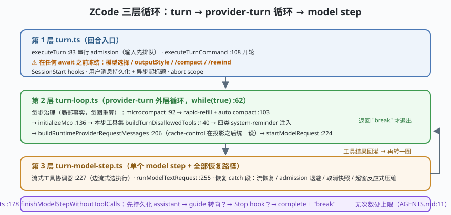

# s01: 三层循环 —— turn、provider-turn 循环与 model step

`s01` → [s02_sqlite_eventsourcing](../s02_sqlite_eventsourcing/) → [s03](../s03_tool_dual_schema/) → ... → [s10](../s10_one_kernel_many_hosts/)

> ZCode 的主循环不是"一个 while 塞所有事"，而是**三层显式分层**：turn（回合入口，做 admission 与冻结）→ provider-turn 外层循环（做每步治理：压缩、工具集、提醒注入）→ 单个 model step（单次模型请求 + 全部恢复路径）。`apps/zcode-cli/AGENTS.md:11` 写明内核公理：**不用 tool call 次数做硬停止**，停止条件全部由语义事件承担。
>
> **Harness 层**：回合编排 —— 谁冻结配置、谁治理上下文、谁执行工具、谁裁决停止。

---

## 问题

1. **用户在循环跑到一半时改了模式/模型怎么办？** 如果每个 step 都重新读一次"当前模式"，就会出现一半 step 用旧配置、一半用新配置的竞态——谁也说不清这轮到底按什么规则执行。
2. **循环什么时候停？** 用"最多 N 次工具调用"做硬上限，长任务必死；没有上限，失控循环烧钱。停止条件该由谁、以什么形式承担？
3. **模型请求失败后从哪恢复？** 流断了、计划模式 admission 忙、上下文超窗——这些失败发生在"单步"内部，如果恢复逻辑长在循环里，循环本体很快变成 5000 行的怪物。
4. **用户中途说"等等，先……"（steering，转向）时怎么插入？** 输入要排队、要在正确的时机被 drain（排空），还不能打断已经开始的工具批。

---

## 解决方案



| 层 | 职责 | ZCode 真实实现 |
|----|------|----------------|
| **第 1 层 turn** | 串行 admission（准入排队）、**在任何 await 之前冻结本轮配置**、SessionStart hooks、用户消息持久化 | `core/src/runtime/methods/turn.ts`：`executeTurn` :83（进队列）、`executeTurnCommand` :108（开轮） |
| **第 2 层 provider-turn 循环** | 每步治理：microcompact、rapid-refill 检查 + auto compact、MCP 初始化、本步工具集、四类 system-reminder 注入、cache-control 设置 | `turn-loop.ts`：`runRegularTurnLoop` :56，`while (true)` :62 |
| **第 3 层 model step** | 单次模型请求 + **全部恢复路径**（流恢复 / admission 退避 / 取消快照 / 超窗反应式压缩）+ 工具批执行 | `turn-model-step.ts`：流式协调器 :227、`runModelTextRequest` :255 |
| **停止裁决** | 持久化 assistant → guide 转向 drain → Stop hook → complete + break | `turn-stop.ts`：`finishModelStepWithoutToolCalls` :178 |

两条全局纪律：

- **配置冻结在 await 之前**（`turn.ts` 的注释标了 ⚠️）：本轮的模型选择、output style、`/compact`/`/rewind` 解析在第一个异步点之前一次性定死——s01 场景 2 会演示"迟到的改模式"被拒收。
- **停止靠语义事件，不靠计数**：取消、权限拒绝、工具超时、输出截断、provider retry 上限、无工具调用、Stop hook——每个都能停，但没有一个是"次数到了"。

---

## 工作原理

`code.mjs` 用约 260 行实现 mini 三层循环，走读四个关键机制：

**第 1 步**：三层各管一件事。`TurnRuntime.turn(input)` 做冻结与排队；`runLoop()` 是外层 while(true)，每圈先跑"治理段"再调一个 model step；`modelStep()` 里 mock 模型返回文本或 tool calls。治理段的一切（压缩、提醒、工具集）都是**每步重算的局部事实**，不是 turn 级常量——对应 `turn-loop.ts` 头注释的原话。

**第 2 步**：冻结。`turn()` 在进入循环前把 `modelSelection / outputStyle / mode` 拍成 frozen 快照（对象被 `Object.freeze`），循环内只能读快照。场景 2 在循环进行中尝试 `runtime.changeMode('yolo')`，得到 `Error: 本轮配置已冻结`，但**下一轮 turn 会接受新配置**——冻结是每回合一次，不是永久。

**第 3 步**：语义停止。mock 模型的工具调用次数本身没有上限；循环在四个点上可能退出：无工具调用（正常收口）、权限拒绝（把 `break` 决定交给裁决器）、用户取消（`AbortSignal` 级联进三层）、guide 消息要求 continue。场景 3 演示权限拒绝直接结束整轮，而不是把错误抛给用户。

**第 4 步**：steering drain。`enqueueSteer()` 把用户中途消息放进队列；外层循环**从第二个 step 起**才 drain 它们（对应 `turn-loop.ts` 头注释"首步专注用户请求本身"）——场景 4 里第 1 步看不到插话，第 2 步开头收到"（转向指令已合入）"。

**跑一跑**（零依赖，离线）：

```bash
node code.mjs
```

预期输出四个场景：一次完整 turn 的分层轨迹 → 迟到的改模式被冻结拒绝 → 权限拒绝触发语义停止（不数次数）→ steering 消息在第二步被 drain。

---

## 对照真实源码

| mini 实现 | ZCode 真实代码（当前检出） | 学习点 |
|-----------|--------------------------|--------|
| `TurnRuntime.turn()` 排队 | `core/src/runtime/methods/turn.ts:83` `executeTurn`（经 `enqueueCancellableRuntimeCommand` 做串行 admission） | 输入即命令，先排队再执行 |
| `freezeTurnConfig()` | 同上 `:108` `executeTurnCommand`，⚠️ 注释标明"在任何 await 之前冻结" | 把竞态消灭在第一个异步点之前 |
| `runLoop()` 治理段 | `core/src/runtime/methods/turn-loop.ts:56` `runRegularTurnLoop`（while(true) :62；压缩 :92、rapid-refill :103、MCP :136、工具集 :140、投影/缓存 :206） | 每步治理都是局部事实，循环本体只做编排 |
| `modelStep()` | `core/src/runtime/methods/turn-model-step.ts`（协调器 :227、请求 :255、恢复 catch 段约 :264-442） | 恢复路径全部收在第 3 层，失败不污染循环 |
| `adjudicateStop()` | `core/src/runtime/methods/turn-stop.ts:178` `finishModelStepWithoutToolCalls` | "先落库再裁决"：guide/hook 要 continue 时 assistant 必须已持久化 |
| 无次数硬上限 | `apps/zcode-cli/AGENTS.md:11`（公理）；循环内只有语义 break | 长程任务的停机契约写在纸上并被代码遵守 |

> 行号以当前检出为准，上游会漂移；本仓多数文件头部带 `[中文导读 · 学习注释]` 块，含 `关键入口：符号 :行号` 锚点，跨分支请一律认符号名。

---

## 自测

1. 为什么配置冻结必须发生在"任何 await 之前"？如果放到 `turn-loop.ts` 每圈开头再冻结，会出现什么具体竞态？
2. `turn-stop.ts` 为什么坚持"先持久化 assistant，再尝试 guide/Stop hook 续跑"？反过来做会破坏什么？
3. 三层拆分后，"上下文超窗"这个事件会先后经过哪几层的哪些机制？（往 s05 想一层：PreRequest 治理 vs reactive 补救）

下一课 [s02_sqlite_eventsourcing](../s02_sqlite_eventsourcing/)：这三层循环跑出的每一步，是怎么被 SQLite 当成"不可改写的事实"记下来的。
