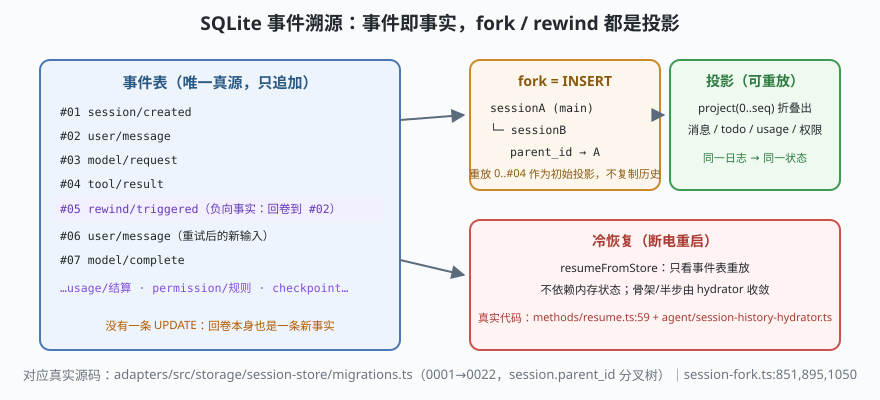

# s02: SQLite 事件溯源 —— 事件即事实，fork 与 rewind 都是投影

[s01](../s01_three_layer_loop/) → **s02** → [s03_tool_dual_schema](../s03_tool_dual_schema/) → ...

> s01 的三层循环每跑一步都产出事件（ModelRequest / tool/result / TurnComplete……）。ZCode 把它们全部写进 `~/.zcode/cli/db/db.sqlite`（`adapters/src/storage/session-store/paths.ts:7`）——**事件即事实（event sourcing，事件溯源）**：会话历史从不被改写，fork（分叉）/rewind（回卷）/checkpoint（检查点）都是对同一份事实做另一次投影。
>
> **Harness 层**：持久化 —— 审计、回放、分叉、恢复的全部地基。

---

## 问题

1. **用户点了"撤销"，历史怎么办？** 常见做法是删消息、改文件——但历史一被改写，审计失真、回放失效，而且"删错了"无法恢复。
2. **想从对话中间分叉出一个"如果当时那样做会怎样"的平行会话**，需要复制多少数据？复制出去的两个会话从此毫无关系，还是保持一棵树？
3. **进程崩溃后重启，会话从哪恢复？** 内存里的状态（未完成的工具批、部分写盘的 assistant 骨架）和库里的事实怎么对齐？
4. **权限规则、"总是允许"这类跨会话状态放哪？** 塞进 JSON 配置文件就会跟会话事实两张皮。

---

## 解决方案



| 机制 | 动作 | ZCode 真实实现 |
|------|------|----------------|
| **追加式事件表** | message / part / session_entry 按序追加，永不 UPDATE 历史 | `adapters/src/storage/session-store/migrations.ts:12` 起 `0001_base_session_store`（session :14、message :41、part :52、session_entry :77） |
| **分叉树** | `session.parent_id` 自引用：fork 是 INSERT 一行新 session，不复制历史 | `migrations.ts` session 表 `parent_id` 列（:17）+ `core/src/runtime/methods/session-fork.ts:851` `createForkedSession`、`:895` `forkConversationFromMessage`、`:1050` `forkStableConversationAtMessage` |
| **检查点/回卷** | checkpoint 是事件流上的指针；rewind 新增事实而不是删除旧事实 | `core/src/runtime/methods/workspace-checkpoints.ts`、`file-rewind.ts`；事件 `CheckpointCreated`（`contracts/src/events/session.events.ts:164`） |
| **usage 结算** | model_usage / turn_usage / tool_usage 三张表落账 | `migrations.ts` `0010_usage_observability`（:394 起） |
| **DWF 日志** | dynamic workflow 的 run/actor/node/event 自成一套 `dwf_*` 表（s08） | `migrations.ts` `0019_dwf_journal`（:799 起） |

> 表数量口径：上游文档记 **31 张表**；本地检出（v3.14.0，`study-cn-comments` 分支）实测迁移 0001→0022、`create table` 语句得到 **23 个独立表名**——上游会继续加迁移，数字随之漂移，看结构不看总数。

---

## 工作原理

`code.mjs` 用约 230 行实现 mini 事件溯源库（纯内存版，接口形状对齐 SQLite 三件套），走读四个关键机制：

**第 1 步**：appendEvent 是唯一写入口。事件 `{seq, type, payload, turnId}` 只追加；`project()` 从头折叠出当前状态（消息列表、todo、usage）。**库里没有任何一条 UPDATE**——场景 4 会尝试"改历史"并展示它其实生成了一条新事件。

**第 2 步**：fork 是 INSERT 不是 COPY。`forkSession(atSeq)` 新建一个 `parent_id` 指向原会话的行，然后**重放**原会话 0..atSeq 的事件作为初始投影。分叉后的两个会话各自追加自己的事实，树通过 `parent_id` 可追溯。场景 2 里 fork 出的分支继续干活，主会话毫发无损。

**第 3 步**：rewind = 负向事实。"用户说撤回"追加一条 `rewind/triggered` 事件，投影器看到它就把状态折叠回 `targetSeq`——**但 rewind 事件本身留在日志里**。审计视图永远是完整的："3 分 20 秒时回卷过一次"也是历史。

**第 4 步**：冷恢复。`resumeFromStore()` 只看事件表重放（对应 `core/src/runtime/methods/resume.ts:59` `resumeFromStore` + `core/src/agent/session-history-hydrator.ts`），不依赖任何内存状态。场景 4 演示把事件表"断电"后交给一个全新 runtime 恢复，投影逐字节一致。

**跑一跑**（零依赖，离线；真实 SQLite 由 better-sqlite3 承担，本课不装依赖，只复刻接口与不变量）：

```bash
node code.mjs
```

预期输出四个场景：追加 + 投影 → fork 树 → rewind 负向事实 → 断电冷恢复逐字节一致。

---

## 对照真实源码

| mini 实现 | ZCode 真实代码（当前检出） | 学习点 |
|-----------|--------------------------|--------|
| `appendEvent()` | `adapters/src/storage/session-store/migrations.ts`（DDL 全集）+ `core/src/runtime` 的 `appendEvent` 调用面 | 唯一写入口：一切状态变化都是事件 |
| session/message/part 表 | 同上 `:12` 起 `0001_base_session_store`（session :14、message :41、part :52、session_entry :77、permission :90、input_history :97） | 分层存储：会话/消息/part 粒度递进 |
| `forkSession()` | `core/src/runtime/methods/session-fork.ts:851` `createForkedSession`、`:895` `forkConversationFromMessage`、`:1050` `forkStableConversationAtMessage`（stable boundary 是防止"分叉点悬在半步中间"的收敛算法） | fork = parent_id + 历史重放 |
| `rewind()` 负向事实 | `core/src/runtime/methods/file-rewind.ts`、`workspace-checkpoints.ts`；事件 `RewindTriggered` / `CheckpointCreated`（`contracts/src/events/session.events.ts:164`） | 回卷不删事实 |
| `resumeFromStore()` | `core/src/runtime/methods/resume.ts:59` + `core/src/agent/session-history-hydrator.ts` | 冷恢复只认事件表 |
| usage 三表 | `migrations.ts` `0010_usage_observability`（:394 起） | 结算按 model/turn/tool 三粒度落账 |

> 行号以当前检出为准，上游会漂移；跨分支请认符号名（`createForkedSession`、`resumeFromStore`、`CheckpointCreated`）。

---

## 自测

1. "fork = INSERT + 重放"为什么比"fork = 复制全部消息行"更省也更不容易错？大会话（几万条 part）时它的代价是什么？ZCode 用什么机制避免每次 fork 都从头重放？（提示：stable boundary / 锚点投影）
2. rewind 事件留在日志里，模型下一次请求会看到它吗？投影器应该怎么处理"对用户可见"与"对模型可见"的差异？
3. `turn-stop.ts` 坚持先持久化 assistant 再裁决——如果没有这条纪律，s02 的哪条不变量会第一个崩掉？

下一课 [s03_tool_dual_schema](../s03_tool_dual_schema/)：模型报出的工具调用，凭什么被信任——zod 与 JSON Schema 的双轨校验，以及"边流式边执行"的准入闸门。
