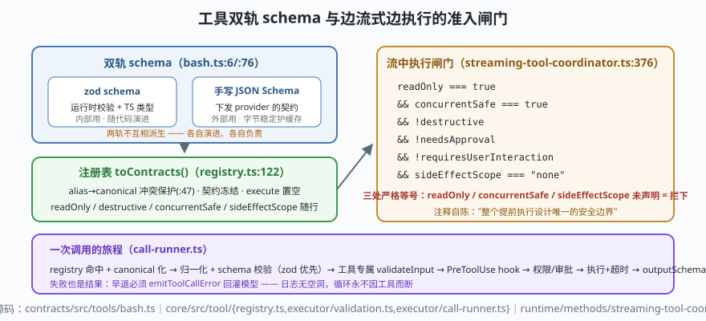

# s03: 工具双轨 schema —— zod 校验、契约下发与边流式边执行

[s02](../s02_sqlite_eventsourcing/) → **s03** → [s04_permission_lattice](../s04_permission_lattice/) → ...

> 模型报出的工具调用是**不可信输入**。ZCode 的工具面有三道工程决策：**双轨 schema**——zod 管运行时校验与 TS 类型，**下发给 provider 的却是手写 JSON Schema**（`contracts/src/tools/bash.ts:6,76`）；**声明即契约**——`toContracts()` 把 `readOnly / destructive / concurrentSafe / sideEffectScope` 等声明投影给权限系统与调度器（`core/src/tool/registry.ts:122`）；**边流式边执行**——模型还在吐 tool call 时，满足声明的只读工具已经开跑（`streaming-tool-coordinator.ts:376` 的准入闸门）。
>
> **Harness 层**：工具信任链 —— 校验、契约投影、流中执行闸门。

---

## 问题

1. **一份 schema 两种消费者，为什么要拆成两轨？** zod 能生成 JSON Schema，为什么不直接 `zodToJsonSchema` 一把梭？
2. **模型给了不存在的工具/坏参数怎么办？** 抛异常给模型还是回灌结构化错误？抛出去循环就断了。
3. **模型一边流式输出、一边等工具结果，时间都花在排队上**——哪些工具敢在流中提前跑？判断标准写在哪里才不会被"提前执行"变成绕过审批的后门？
4. **别名（Agent↔Task）让调用名和注册名不一致**，权限、日志、事件应该认哪个名字？

---

## 解决方案



| 机制 | mini 版 | ZCode 真实实现 |
|------|---------|----------------|
| **双轨 schema** | `inputZod`（运行时校验）+ `inputJsonSchema`（下发 provider）两个独立字段 | `contracts/src/tools/bash.ts`：zod `:6`、`BashInputJsonSchema = toToolJsonSchema(...)` `:76`；`core/src/tool/executor/validation.ts` 先试 runtime schema 再退 JSON Schema |
| **声明即契约** | `toContracts()` 冻结投影，`execute` 字段显式置空 | `core/src/tool/registry.ts:122` `toContracts`：`providerVisible !== false` 才输出，跨 provider 边界不能带函数 |
| **别名路由** | `alias→canonical` 表，register 时拒绝对别名覆盖 canonical | `registry.ts:47` `register`（canonical 优先 + 冲突保护）；`core/src/tool/compat.ts`（`Agent`↔`Task`、`ApplyPatch`↔`Write/Edit`） |
| **流中执行闸门** | `shouldExecuteDuringStream()` 六条件全过才跑 | `streaming-tool-coordinator.ts:376`：`readOnly === true && concurrentSafe === true && !destructive && !needsApproval && !requiresUserInteraction && sideEffectScope === "none"`——三个严格等号（readOnly / concurrentSafe / sideEffectScope）未声明即拦下 |
| **错误回灌** | 校验失败合成 `{ok:false,error}` 落日志，不抛出 | `call-runner.ts` 头注释："早退（registry miss、schema 失败）都必须 emitToolCallError，否则 V4 tool row 会永久停在 inputStreaming" |

**为什么双轨**：zod schema 是给 Node 内部用的（运行时校验 + TS 类型推导），而下发给 provider 的 JSON Schema 要跨进程、跨版本、要字节级稳定（prompt cache 对前缀敏感）。两个消费者对"同一份真相"有相反的演进速度——内部可以随代码重构，外部契约一变就烧缓存。手写 JSON Schema 是"把外部契约当 API 对待"。

---

## 工作原理

`code.mjs` 用约 240 行走读四个机制：

**第 1 步**：双轨注册。`defineTool()` 同时收 `validate`（mini 版用函数模拟 zod `safeParse`）与 `jsonSchema`，二者**不互相派生**。演示：同一工具的 jsonSchema 写错一个字段名，zod 校验照常通过——两轨独立，谁也不会偷偷修谁。

**第 2 步**：契约投影。`toContracts()` 只输出 `providerVisible` 的工具，投影对象被冻结、`execute` 被置空。演示里尝试改投影对象的 `readOnly` 得到 TypeError——**契约一旦发出就不可变**，权限系统读的就是它。

**第 3 步**：流中闸门。Mock 模型流式吐出四个 tool call：`read_file`（声明全绿→立即开跑）、`bash`（sideEffectScope:"workspace"→等流结束）、`read_file` 带 needsApproval（→等）、未注册工具（→等）。关键演示：一个**忘了声明** `concurrentSafe` 的工具被闸门拒绝——undefined 即 false，"未知即不跑"。

**第 4 步**：错误回灌。对不存在工具的调用、参数校验失败的调用，`runToolCall` 合成 `{ok:false, error}` 事件并落日志——场景里模型收到错误后下一轮自行纠正。没有一条异常逃出工具层，循环永不因工具而断。

**跑一跑**（零依赖，离线）：

```bash
node code.mjs
```

预期输出四个场景：双轨独立 → 契约冻结不可改 → 流式闸门放行/拦截轨迹 → 两次失败都以回灌结果收场。

---

## 对照真实源码

| mini 实现 | ZCode 真实代码（当前检出） | 学习点 |
|-----------|--------------------------|--------|
| `defineTool()` 双轨 | `contracts/src/tools/bash.ts:6`（zod）与 `:76`（`toToolJsonSchema`，手写 JSON Schema 下发） | 内外部契约分离演进：外部要字节稳定护缓存 |
| `validateToolInput()` | `core/src/tool/executor/validation.ts`（先 runtime schema，失败退 `validateJsonSchemaValue`，抛 `ToolExecutionFailed`） | 双轨在执行端也有优先级 |
| `toContracts()` | `core/src/tool/registry.ts:122`（`providerVisible !== false` 才输出、execute 显式置空、`readOnly/destructive/concurrentSafe/sideEffectScope` 全部随行） | 契约投影 = 权限与调度的唯一输入源 |
| `register()` 别名保护 | 同上 `:47`（拒绝对别名覆盖 canonical）；`core/src/tool/compat.ts`（Agent↔Task、ApplyPatch↔Write/Edit） | canonical 在注册层维护，不是查询层猜 |
| `shouldExecuteDuringStream()` | `core/src/runtime/methods/streaming-tool-coordinator.ts:376`（六条件闸门，`:374` 注释"唯一的安全边界"） | 审批绝不被"提前执行"绕过 |
| 错误回灌 | `core/src/tool/executor/call-runner.ts` 头注释（早退必须 `emitToolCallError`，否则 V4 tool row 停在 inputStreaming） | 失败也是结果：日志无空洞（同 s02 的不变量） |

> 行号以当前检出为准，上游会漂移；跨分支请认符号名（`toContracts`、`shouldExecuteToolDuringStream`、`toToolJsonSchema`）。

---

## 自测

1. 如果把手写 JSON Schema 换成 `zodToJsonSchema(zodSchema)` 自动生成，最先坏掉的三个场景是什么？（提示：字节稳定性、prompt cache、provider 侧的既有契约）
2. 流中闸门为什么要求"任何一项未声明（undefined）都判 false"，而不是"默认当作安全"？这个默认值如果反了，s04 的哪条不变量会连锁崩塌？
3. 别名调用（模型报 `Task`，实际跑 `Agent`）在事件日志里应该记哪个名字？为什么 canonical 化必须发生在把关链的最前面？

下一课 [s04_permission_lattice](../s04_permission_lattice/)：这把闸门之上，五值模式与 alwaysAsk 通道织成的权限格子。
