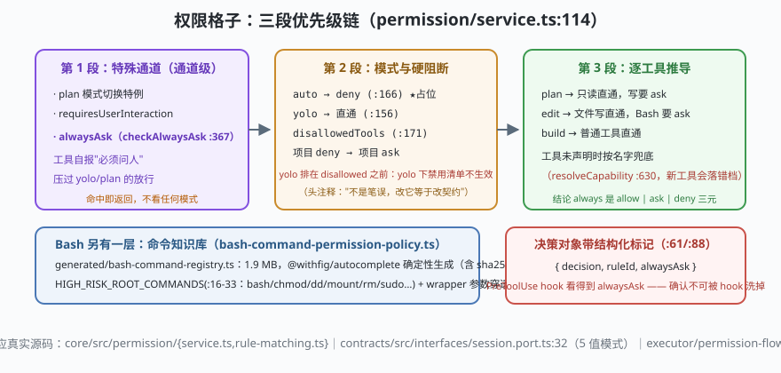

# s04: 权限格子 —— 五值模式、alwaysAsk 通道与命令知识库

[s03](../s03_tool_dual_schema/) → **s04** → [s05_context_budget](../s05_context_budget/) → ...

> 权限不是"一个布尔值放不放行"。ZCode 把它织成一张格子：**5 值协作模式**（`plan | build | edit | yolo | auto`，`contracts/src/interfaces/session.port.ts:32`，没有 acceptEdits/bypassPermissions）× **工具自声明**（`sideEffectScope` 等，s03 的契约投影）× **项目/会话规则**，最后压成 `allow | ask | deny` 三元结论。其中最有想法的一格：**`alwaysAsk`（工具自报"必须问人"）是独立通道——压过 yolo 的放行，却压不过硬阻断**（`core/src/permission/service.ts:114,367`）。
>
> **Harness 层**：安全模型 —— 应用层格子的细度决定 agent 敢开多快。

---

## 问题

1. **"yolo 全放"模式下，某些工具还是必须问人**（比如会动终端状态的工具）——模式直通怎么不把这类工具一起放掉？
2. **反过来，"必须问人"的工具遇到了硬阻断**（项目规则明确 deny / 配置禁用清单），确认窗口还该弹吗？谁赢？
3. **`rm -rf` 这种高危命令能不能免批？** 只读判断如果靠手写白名单，几千个 CLI 命令根本列不完。
4. **hook 能不能把一次确认"洗掉"？** PreToolUse hook 拿到决策对象，如果把 `ask` 改成 `allow`，审批就形同虚设。

---

## 解决方案



| 机制 | mini 版 | ZCode 真实实现 |
|------|---------|----------------|
| **三段优先级链** | 特殊通道（plan 切换 / requiresUserInteraction / alwaysAsk）→ 策略层（yolo / auto / disallowed / 项目 deny+ask）→ 逐工具推导（plan / edit / build） | `permission/service.ts:114` `checkPermission`（链段划分见文件头注释） |
| **alwaysAsk 通道** | 命中即 ask，且压过 yolo；但先重跑 auto / disallowed / 项目 deny | `service.ts:367` `checkAlwaysAsk`（:364 注释："ask 压过所有放行分支"） |
| **yolo 与 disallowed 的次序** | yolo 直通排在 disallowed 之前——yolo 下禁用清单不生效 | `service.ts:156` vs `:171`（头注释明说"这不是笔误，改它等于改契约"） |
| **auto 占位即拒绝** | 未实现的档位直接 deny，绝不"没规则=放行" | `service.ts:166` `mode.auto.unimplemented` |
| **决策带结构化标记** | 决策对象 `{decision, ruleId, alwaysAsk}`，hook 只能附加不能洗掉 | `service.ts:61,88`（alwaysAsk 标记供 PreToolUse hook 判断"这个确认不可被抹掉"） |
| **命令知识库** | 内置一张"只读命令表"（mini 版 40 条），解析命令行首段后查表 | `tool/handlers/bash-command-permission-policy.ts` + `handlers/generated/bash-command-registry.ts`（1.9 MB，由 `@withfig/autocomplete` 确定性生成，`HIGH_RISK_ROOT_COMMANDS` :16-33） |

**能力回退的代价**：工具没声明 capability 时按名字硬编码集合判风险（`service.ts:630` `resolveCapability` 兜底）——新工具 / MCP 工具会落错档。s03 的"声明即契约"在权限层的对应物。

---

## 工作原理

`code.mjs` 用约 250 行实现 mini 权限内核，走读四个机制：

**第 1 步**：三段链。`checkPermission()` 严格按顺序走三段：通道（plan 切换特例 / requiresUserInteraction / alwaysAsk）→ 策略（auto deny → yolo 直通 → disallowedTools → 项目 deny → 项目 ask）→ 逐工具推导（plan/edit/build 各自的直通与要求）。顺序即语义：`yolo` 在 `disallowed` 之前不是 bug——演示里 yolo 模式下 `disallowedTools:['bash']` 不生效，要禁用得用项目 deny 规则。

**第 2 步**：alwaysAsk 通道。场景 2 用一个声明 `alwaysAsk:true` 的 `terminal_write` 工具：yolo 模式下它仍被 ask——通道压过策略；但换到项目 deny 规则下它被 deny——通道压不过硬阻断。决策对象带 `alwaysAsk:true` 标记，hook 收到它就知道"这个确认不可抹掉"。

**第 3 步**：命令知识库。`parseCommand()` 解析命令首段 → 查内置只读表（`git status`、`ls`、`node --version`…40 条）→ `git status` 在 yolo 之外的模式免批；`rm` 命中 `HIGH_RISK_ROOT_COMMANDS` 永远 ask；`sudo rm` 命中 wrapper 穿透规则同样 ask。

**第 4 步**：失败路径。`auto` 模式直接 deny（占位档位不能被理解成"没有规则=放行"）；hook 尝试把 `ask` 改 `allow` 被决策对象的冻结 + `alwaysAsk` 标记双重拦截——这是"权限洗白"防御的 mini 版（同伴消息降权的完整规则见 `core/src/system-reminder/incoming-message.ts:6`）。

**跑一跑**（零依赖，离线）：

```bash
node code.mjs
```

预期输出四个场景：三段链逐格判定轨迹 → alwaysAsk 对 yolo 与 deny 的两种结果 → 命令知识库三种判定 → auto 占位 deny + hook 洗白被拒。

---

## 对照真实源码

| mini 实现 | ZCode 真实代码（当前检出） | 学习点 |
|-----------|--------------------------|--------|
| `checkPermission()` 三段链 | `core/src/permission/service.ts:114`（链段划分见文件头 `[中文导读]` 注释） | 顺序即语义：通道 → 策略 → 推导 |
| `checkAlwaysAsk()` | 同上 `:367`（:357 注释："工具自报 alwaysAsk 时的判定：ask 压过所有放行分支"） | 独立通道，不与模式混淆 |
| yolo 直通次序 | 同上 `:156`（yolo）与 `:171`（disallowedTools）——头注释明说 yolo 下配置禁用清单不生效 | "不是笔误，改它等于改契约" |
| auto 占位 | 同上 `:166` `mode.auto.unimplemented` | 未实现的档位 = deny，不是默认放行 |
| 规则匹配 | `core/src/permission/rule-matching.ts`（`wildcardToRegExp`）；主体提取 `command\|url\|file_path\|path\|pattern` | 规则落 SQLite `permission` 表按 project_id |
| 命令知识库 | `core/src/tool/handlers/bash-command-permission-policy.ts`（`HIGH_RISK_ROOT_COMMANDS` :16-33）+ `handlers/generated/bash-command-registry.ts`（1.9 MB 确定性生成，头部含 sha256） | 六家独一份：把 CLI 手册编译成权限数据 |
| 审批流 | `core/src/tool/executor/permission-flow.ts:41` + `approval-gate.ts` | 读项目规则 → checkPermission → hook 覆盖 → 审批弹窗 |

> 行号以当前检出为准，上游会漂移；跨分支请认符号名（`checkPermission`、`checkAlwaysAsk`、`resolveCapability`）。

---

## 自测

1. `alwaysAsk` 为什么设计成"压过放行、压不过阻断"，而不是最高优先级？如果它压过 deny，会出什么事故？
2. yolo 模式下 `disallowedTools` 不生效——这个"反直觉"次序的价值是什么？如果你在实现里"顺手修正"了它，哪些用户的工作流会被破坏？
3. 命令知识库为什么用"确定性生成的 1.9 MB 数据 + sha256 + registry:check 守门"，而不是运行时让模型自己判断"这条命令只读吗"？

下一课 [s05_context_budget](../s05_context_budget/)：权限拦住了不该做的事，上下文预算则要保证窗口里装得下该做的事——三层压缩与 rapid-refill 熔断。
