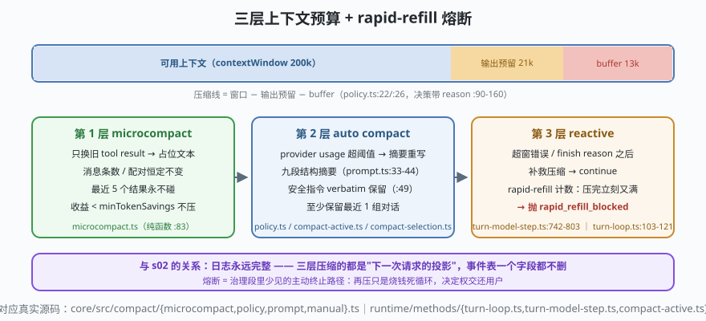

# s05: 上下文预算 —— microcompact → auto compact → reactive 三层防御与熔断

[s04](../s04_permission_lattice/) → **s05** → [s06_hooks_trust](../s06_hooks_trust/) → ...

> 长会话迟早逼近窗口上限。ZCode 的答案不是"一种压缩"，而是**三层预算 + 一道熔断**，全部长在 s01 的治理段里：**microcompact**（`compact/microcompact.ts`）只把旧工具结果换成占位文本，不动历史结构；**auto compact**（`compact/policy.ts`）用 provider usage 判阈值，超了就摘要重写；**reactive compact**（`turn-model-step.ts:742-803`）在真的超窗报错之后补救；若"刚压完立刻又满"，**rapid-refill 断路器**（`turn-loop.ts:103-121`）直接抛错交还用户——压缩不能变成烧钱死循环。
>
> **Harness 层**：窗口治理 —— 在"信息完整"与"装得下"之间做显式取舍。

---

## 问题

1. **窗口就那么大，钱却按 token 算**：10 轮前一个 4000 tok 的文件读取，模型早不需要原文，却每轮照付。
2. **压缩=改历史？** 直接删消息会破坏 s02 的"事件即事实"——摘要这件事怎么才能不碰日志？
3. **压缩阈值怎么定？** 阈值太低浪费信息，太高会连"生成摘要本身要用的输出空间"都留不出来。
4. **什么情况下压缩会失效？** 一轮塞进去的信息量本身就超窗——压完立刻又满，无限压缩循环怎么断？

---

## 解决方案



| 层 | 时机 | 动作 | ZCode 真实实现（当前检出） |
|----|------|------|--------------------------|
| **microcompact** | 每步请求前 + 回合中途（PreRequest / MidTurn） | 只把**旧 tool result** 换成 `[Old tool result content cleared]`，消息条数与 tool_use/tool_result 配对恒定 | `compact/microcompact.ts`（占位前缀 :27，`maybeLocalMicrocompactMessages` :83，最近 N 个永不碰） |
| **auto compact** | 每步请求前（治理段） | `shouldAutoCompact`（带 reason）→ 摘要请求重写历史投影 | `compact/policy.ts`（输出预留 `21_000` :22、buffer `13_000` :26、连续失败 3 次熔断 :163）；执行 `runtime/methods/compact-active.ts` |
| **reactive** | 超窗错误 / finish reason 之后 | 补救压缩，然后 continue | `turn-model-step.ts:742-803` |
| **rapid-refill 熔断** | 压缩后立即又逼近阈值 | 抛 `rapid_refill_blocked`，把决定权交还用户 | `turn-loop.ts:103-121`（:113 注释："再压只是烧钱死循环"） |

**预算怎么算**：`contextWindow 200k` − `输出预留 min(maxOutput, 21_000)` − `buffer 13_000` 才是"该开始压缩"的线；阈值分 `thresholdPercent` 与"距上限只剩 buffer"两路（`policy.ts:90-160`，决策带 reason 落事件）。

**摘要提示词的显式安全约束**：`compact/prompt.ts:49` 两次要求**安全相关指令必须 verbatim（逐字）保留**——"压缩会削弱安全边界"被当成设计约束写进提示词，六家里最明确的一家。

---

## 工作原理

`code.mjs` 用约 250 行实现 mini 三层预算，走读四个机制：

**第 1 步**：预算账本。`estimateTokens()` 按字符估（对应 `compact/manual.ts` 的本地估算，真实版还会把 toolCall 入参计入——旧估算漏算的坑）；`shouldMicrocompact()` / `shouldAutoCompact()` 各自返回 `{should, reason}`——**决策必须带理由**，理由会落事件可审计。

**第 2 步**：microcompact 的三条纪律。场景 1 的消息数组经过 `microcompact()`：旧 tool result 被换占位文本，但 (a) 消息**条数不变**，(b) 最近 `keepRecent=2` 个结果**永不碰**，(c) 收益低于 `minSavings` 直接不压（避免"为了 100 tok 制造一条边界事件"）。

**第 3 步**：auto compact 的摘要契约。场景 2 超阈值触发 `autoCompact()`：mock 摘要器按九段结构产出摘要（Primary Request / Errors & Fixes / Pending / Current Work…），安全指令逐字保留——演示里用户说过"绝不 push 到 main"，摘要原样带走这句话。

**第 4 步**：reactive + 熔断。场景 3 模拟"超窗错误 → reactive 压缩 → 下一请求成功"；场景 4 模拟"压完立刻又满"：`evaluateRapidRefill()` 计数连续 refill，达到上限就抛 `CompactRapidRefillError`——循环终止而不是无限压缩。**这是治理段里少见的主动终止路径**。

**跑一跑**（零依赖，离线；摘要器是 Mock，真实版走同一套模型请求缝）：

```bash
node code.mjs
```

预期输出四个场景：三条纪律逐条可见 → 摘要保留安全指令原文 → reactive 补救成功 → 熔断抛错终止。

---

## 对照真实源码

| mini 实现 | ZCode 真实代码（当前检出） | 学习点 |
|-----------|--------------------------|--------|
| `shouldAutoCompact()` | `core/src/compact/policy.ts:90-160`（决策带 reason；`AUTOCOMPACT_BUFFER_TOKENS=13_000` :26、输出预留 `21_000` :22、连续失败熔断 :163） | 阈值是"窗口−输出−buffer"的差值题 |
| `microcompact()` | `core/src/compact/microcompact.ts`（`MICROCOMPACT_CLEARED_TOOL_RESULT_PREFIX` :27、默认参数 :14-29、纯函数入口 :83） | 换占位文本不换结构：tool_use/result 配对恒定 |
| 摘要请求 | `core/src/compact/prompt.ts`（九段结构 :33-44；安全指令 verbatim :49、:40） | 压缩的安全边界写进提示词 |
| 执行链 | `core/src/runtime/methods/compact.ts:184`、`compact-active.ts`、`helpers/compact-selection.ts`（保留最近组） | 摘要走同一模型缝；至少留最近 1 组 |
| reactive 补救 | `core/src/runtime/methods/turn-model-step.ts:742-803` | 超窗错误/finish reason 之后才走 |
| rapid-refill 熔断 | `core/src/runtime/methods/turn-loop.ts:103-121`（`evaluateRapidRefill` 传入 autoCompactIfNeeded；`rapid_refill_blocked` 抛错 :121-129） | 熔断判定在"确实需要压缩"那一刻，长 turn 不被误伤 |
| 本地估算 | `core/src/compact/manual.ts:102-112`（字符估算法，注释注明把 toolCall 入参计入） | 估算也是代码：漏算入参就是事故 |

> 行号以当前检出为准，上游会漂移；跨分支请认符号名（`maybeLocalMicrocompactMessages`、`shouldAutoCompact`、`evaluateRapidRefill`）。

---

## 自测

1. microcompact 为什么只动 tool result、不动普通消息？如果它也把旧 user 消息换成占位符，s02 的哪条不变量和模型的哪些能力会一起坏？
2. "输出预留 21k + buffer 13k"这两个数字为什么是**减法**而不是"阈值=窗口的 85%"？输出预留为什么取 `min(maxOutput, 21_000)`？
3. 摘要提示词为什么要求安全指令 verbatim 保留，而不是"概括要点"？改写安全指令会引入什么新的裁量权？

下一课 [s06_hooks_trust](../s06_hooks_trust/)：hook 是比工具更前置的扩展面——7 个事件、exit 2 即阻断，以及"仓库里的 hook 不能自我提权"的信任状态机。
