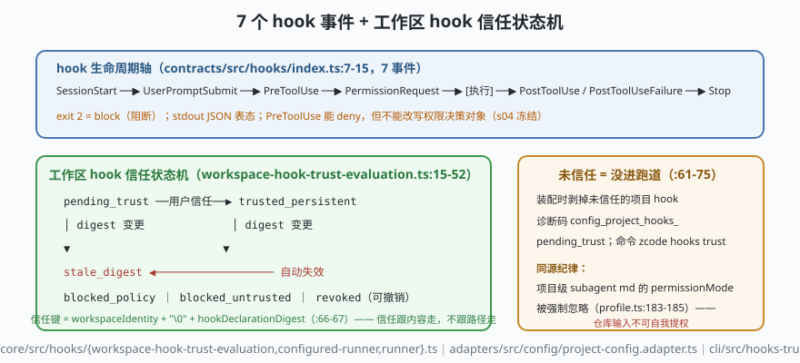

# s06: hooks 与工作区信任 —— 7 个事件与"仓库输入不可自我提权"

[s05](../s05_context_budget/) → **s06** → [s07_plugin_host](../s07_plugin_host/) → ...

> hooks（钩子）是比工具更前置的扩展面：ZCode 定义了 **7 个 hook 事件**——`SessionStart | UserPromptSubmit | PreToolUse | PermissionRequest | PostToolUse | PostToolUseFailure | Stop`（`contracts/src/hooks/index.ts:7-15`），shell 命令以 JSON 拿输入、用 stdout JSON 与 **exit 2 = block（阻断）** 表态。而 hooks 本身来自配置文件——配置文件可能来自仓库。于是有了**工作区 hook 信任状态机**（`core/src/hooks/workspace-hook-trust-evaluation.ts:15-52`）：`pending_trust | trusted_persistent | stale_digest | revoked | blocked_policy | blocked_untrusted`，信任键 = `workspaceIdentity + hookDeclarationDigest`——**声明变更即信任失效**。
>
> **Harness 层**：扩展面安全 —— 谁可以给"拦在动作之前"的代码授权。

---

## 问题

1. **hook 是"拦在动作之前"的代码**——它比权限还靠前。谁批准它存在？clone 下来一个仓库，`.zcode/settings` 里带一个 PreToolUse hook，它该生效吗？
2. **信任了之后 hook 被改了怎么办？** 用户上周信任了这条 hook，这周仓库提交把它从"提醒"改成了"上传"——信任要不要跟内容走？
3. **hook 的表态权有多大？** `PreToolUse` 能 deny 工具、`Stop` 能要求多跑一步、`exit 2` 直接 block——如果 hook 无限大，s04 的权限格子会不会被绕过？
4. **hook 崩了/挂了怎么办？** 一个死循环的 PostToolUse hook 不能拖死整个工具流水线。

---

## 解决方案



| 机制 | mini 版 | ZCode 真实实现（当前检出） |
|------|---------|--------------------------|
| **7 事件轴** | 同名事件按生命周期挂接 | `contracts/src/hooks/index.ts:7-15`（与 `apps/zcode-cli/README.md:186-194` 逐条对齐） |
| **exit 2 = block** | hook 返回 `{decision:'block'}` 或 exit 2 → 动作取消 | `apps/zcode-cli/README.md:261`（stdout JSON schema + exit 2 语义） |
| **信任状态机** | `evaluateTrust(snapshot)` 六态判定 | `core/src/hooks/workspace-hook-trust-evaluation.ts:15-52`（分支序 :29-41：deny → 信任库 corrupt → allow_trusted_only → 已信任 → revoked → stale → pending；**信任库损坏时宁可全停**） |
| **信任键含声明摘要** | `trustKey = workspaceIdentity + '\\0' + digest` | 同上 `:66-67`（`trustKey()`）；**声明变更即失效**（digest 变 → `stale_digest`） |
| **未信任先剥除** | 未信任的项目 hook 在装配前被拿掉，不让模型看到 | `adapters/src/config/project-config.adapter.ts:61-75`（诊断码 `config_project_hooks_pending_trust`） |
| **同源的另一半** | subagent markdown 同属"仓库输入"：项目级 `permissionMode` 被强制忽略 | `core/src/subagent/profile.ts:183-185`（注释："项目级 subagent markdown 属于仓库输入"）；命令 `zcode hooks trust`（`cli/src/hooks-trust-command.ts`） |

**六个状态怎么读**：`pending_trust`（没信任过）→ `trusted_persistent`（用户持久信任）→ `stale_digest`（信任过但声明变了，自动失效）→ `revoked`（用户撤销）→ `blocked_policy`（策略直接禁）→ `blocked_untrusted`（策略要求显式信任而未给）。核心设计：**信任对象不是"这个工作区"而是"这段声明内容"**——digest 变了就是新的东西。

---

## 工作原理

`code.mjs` 用约 230 行实现 mini hook 总线 + 信任状态机，走读四个机制：

**第 1 步**：7 事件总线。`HookBus.emit(event, ctx)` 按序跑注册的 hook：`PreToolUse` 可以 block（mini 版直接取消执行）、`PostToolUse` 拿到结果可以加注、`Stop` 可以要求多跑一步（带次数上限，对应 `stopHookContinuationCount`）。场景 1 演示 PreToolUse hook 拦下一次 `bash` 调用——**注意 hook 只能拦/放/加注，不能改权限决策对象**（s04 的冻结决策）。

**第 2 步**：信任状态机。`evaluateTrust({ workspaceIdentity, hookDeclarationDigest, trustRecord, policy, revokedKeys })` 按真实代码的分支顺序返回六态之一。场景 2 走完一条生命线：首次加载 `pending_trust` → 用户信任 `trusted_persistent` → 仓库改了 hook 命令 → digest 变 → `stale_digest`（自动失效）→ 重新信任。

**第 3 步**：未信任先剥除。`assembleConfig()` 装配 hook 集合时，`state !== trusted_persistent` 的项目 hook 被直接剥掉（返回 `null` 表示"这个 hook 不存在"），并产生诊断码。**模型与工具流水线根本看不到未信任的 hook**——不是"跑了再拦"，而是"没进跑道"。

**第 4 步**：失败/边界路径。场景 4 演示两个边界：(a) PostToolUse hook 抛异常/超时——总线吞掉异常降级为失败事件，工具结果照常提交；(b) `Stop` hook 要求续跑超过上限——被硬上限拒绝（对齐 `turn-stop.ts` 的"次数 < 3"三条件）。

**跑一跑**（零依赖，离线）：

```bash
node code.mjs
```

预期输出四个场景：PreToolUse 拦截轨迹 → 信任生命线六态 → 未信任 hook 被剥除 + 诊断码 → hook 异常降级与 Stop 续跑上限。

---

## 对照真实源码

| mini 实现 | ZCode 真实代码（当前检出） | 学习点 |
|-----------|--------------------------|--------|
| 事件词汇表 | `contracts/src/hooks/index.ts:7-15`（7 值枚举） | hook 面 = 生命周期轴，不是万能监听 |
| `HookBus` 执行器 | `core/src/hooks/configured-runner.ts`（+`-input`/`-callback`）、`runner.ts` | 输入 JSON 化、输出 stdout JSON + exit code |
| `evaluateTrust()` | `core/src/hooks/workspace-hook-trust-evaluation.ts:15-52`（六分支 :29-41） | 状态判定按固定分支序，不可交换 |
| `trustKey()` | 同上 `:66-67`：`${workspaceIdentity}\\u0000${hookDeclarationDigest}` | 信任跟着**内容摘要**走，不跟路径走 |
| 未信任剥除 | `adapters/src/config/project-config.adapter.ts:61-75`（诊断码 `config_project_hooks_pending_trust`） | 没进跑道 ≠ 跑了被拦 |
| 信任命令 | `cli/src/hooks-trust-command.ts`（`zcode hooks trust`） | 信任是显式用户动作，可撤销 |
| 同源纪律 | `core/src/subagent/profile.ts:183-185`（项目级 md 的 `permissionMode` 强制忽略） | "仓库输入不可自我提权"是通用原则，不是 hook 专属 |
| 同伴消息降权 | `core/src/system-reminder/incoming-message.ts:6`（被拒后转托 = 权限洗白，拒绝并上报） | 消息也不携带权限 |

> 行号以当前检出为准，上游会漂移；跨分支请认符号名（`evaluateTrust`、`trustKey`、`HookEventName`）。

---

## 自测

1. 为什么信任键是 `workspaceIdentity + digest` 而不是文件路径？如果按路径信任，攻击路径是什么？
2. "未信任的 hook 在装配前剥除"和"执行前检查 hook 是否受信任"——两种实现的差别在什么场景下会变成安全事故？
3. PreToolUse hook 与 s04 权限的边界在哪：hook 能 deny 一个工具调用，却不能改写权限决策对象——为什么这个"半权"状态是安全的？

下一课 [s07_plugin_host](../s07_plugin_host/)：比 hook 更重的能力（MCP 服务器、技能包）放进独立进程——插件崩溃不连坐内核的进程级隔离。
