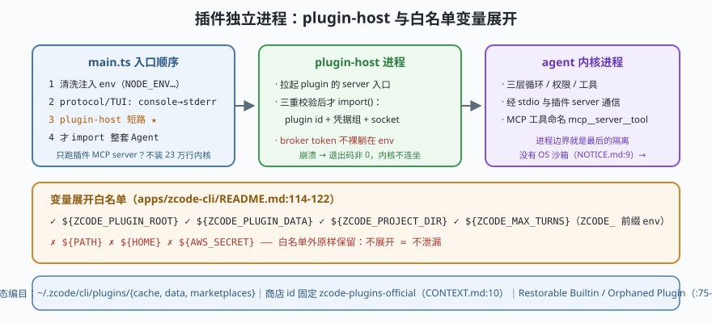

# s07: 插件独立进程 —— plugin-host、白名单变量展开与不连坐内核

[s06](../s06_hooks_trust/) → **s07** → [s08_dynamic_workflow](../s08_dynamic_workflow/) → ...

> hook 是"拦一下"，插件是"长期驻留"——MCP 服务器、技能包、自定义命令都由插件携带。ZCode 让插件跑在**独立的 plugin-host 进程**：`main.ts` 在加载整套 Agent 之前先判断 `__zcode-plugin-host` 短路（`cli/src/main.ts` 的 `isPluginHostInvocation`，:60-65 注释解释为何**不能**先加载 Agent），插件崩了内核只损失一个 MCP 服务器，不连坐。加上**变量只展开 `ZCODE_` 前缀环境变量**的白名单（`apps/zcode-cli/README.md:114-122`），插件拿到的是"声明过的环境"，不是整台机器。
>
> **Harness 层**：进程级隔离 —— 用进程边界替 OS 沙箱站岗（ZCode 没有 OS 沙箱，见 s04/NOTICE.md）。

---

## 问题

1. **插件代码和内核同一个进程，谁先崩？** 一个 MCP 服务器内存泄漏、一个插件死循环——如果它们和 agent 内核同进程，整个会话陪葬。
2. **插件描述文件里写 `${env.SOMETHING}`，展开到什么程度？** 全量展开等于把用户全部环境变量（含密钥）递给插件。
3. **`plugin-host` 模式下还要不要装整套 Agent？** 只想跑插件的 MCP server，为它加载 23 万行内核是浪费还是风险？
4. **插件从哪来、更新了怎么办？** 商店（marketplace）与本地缓存的安装态怎么区分"官方内置/商店版本/孤儿插件"？

---

## 解决方案



| 机制 | mini 版 | ZCode 真实实现（当前检出） |
|------|---------|--------------------------|
| **入口短路** | `argv[0]==='__zcode-plugin-host'` 时直接进宿主模式，不 import Agent | `cli/src/main.ts`（`isPluginHostInvocation`；头注释：broker token 不裸躺在 env，恢复是"最后一道宿主边界"） |
| **宿主进程职责** | 拉起 plugin 的 server 入口，转发 stdio | `cli/src/plugin-host-command.ts`（`runPluginHostCommand`：校验 plugin id + 凭据组后才 `import()`） |
| **变量白名单** | 只展开 `${ZCODE_*}` 与 `${ZCODE_PLUGIN_ROOT}` 等固定变量 | `apps/zcode-cli/README.md:114-122`：`${ZCODE_PLUGIN_ROOT\|ZCODE_PLUGIN_DATA\|ZCODE_PROJECT_DIR\|user_config.*}`，**只展开 `ZCODE_` 前缀环境变量** |
| **manifest 契约** | `plugin.json` 字段校验，缺字段拒绝装载 | `.zcode-plugin/plugin.json`，字段 `name/version/description/author/license/skills/commands/mcpServers/userConfig`（`apps/zcode-cli/README.md:73-110`、根 `CONTEXT.md:61-63`） |
| **安装态编目** | 区分 builtin / marketplace / orphan | 安装目录 `~/.zcode/cli/plugins/{cache,data,marketplaces}`；商店 id 固定 `zcode-plugins-official`（`CONTEXT.md:10`）；Restorable Builtin / Orphaned Plugin（`CONTEXT.md:75-81`） |

**为什么进程隔离在这里格外重要**：`NOTICE.md:9` 明说**没有 OS 沙箱**——s04 的权限格子管"模型调什么"，管不了"插件进程自己想干什么"。进程边界 + 白名单变量 + 凭据不进 env，是内核能给出的最后几层"软隔离"。

---

## 工作原理

`code.mjs` 用约 220 行实现 mini plugin-host，走读四个机制：

**第 1 步**：入口分流。`main(argv)` 模拟 `main.ts` 的顺序：清洗环境 → 判断 plugin-host 短路（**不加载 Agent**）→ 否则加载完整 Agent。场景 1 对比两条路径的"加载清单"：宿主模式只加载插件运行时。

**第 2 步**：manifest 校验 + 变量展开。`loadPlugin()` 先验 `plugin.json` 字段（缺 `license`/`name` 拒绝），再展开 `${ZCODE_*}` 变量——场景 2 里 `${PATH}`、`${HOME}` 被原样留下（白名单外不展开），`${ZCODE_PLUGIN_ROOT}` 与 `${ZCODE_MAX_TURNS}` 正常展开。**未展开的引用 = 插件拿不到 = 信息不泄漏**。

**第 3 步**：凭据边界。宿主从进程内 capture 恢复 broker token 的条件是三重校验（plugin id 权威写入 + 完整凭据组 + canonical socket），任一不匹配就在 `import()` 之前拒绝——场景 3 演示被替换的 server path 被拒之门外（对齐 `plugin-host-command.ts` 头注释的威胁模型：capture 的存在不能证明当前 server 可信）。

**第 4 步**：失败/边界路径。场景 4：插件 server 抛异常——宿主进程退出码非 0，**内核进程照常响应**（mini 演示用 try/catch 模拟进程边界）；外加一个 orphan 插件（缓存里有、manifest 缺）被编目为 `orphaned` 而不是崩溃。

**跑一跑**（零依赖，离线）：

```bash
node code.mjs
```

预期输出四个场景：两种入口的加载清单 → 变量展开白名单逐项结果 → 三重校验拒绝伪造 server → 插件崩溃与孤儿编目。

---

## 对照真实源码

| mini 实现 | ZCode 真实代码（当前检出） | 学习点 |
|-----------|--------------------------|--------|
| `main(argv)` 分流 | `cli/src/main.ts`（清洗 env → protocol/TUI stderr 边界 → plugin-host 短路 → `await import("./run.js")`） | 入口顺序就是安全顺序 |
| `runPluginHost()` | `cli/src/plugin-host-command.ts`（`isPluginHostInvocation`、`runPluginHostCommand`；头注释写明"恢复 bearer token 是最后一道宿主边界"，任一校验不匹配在 import 前拒绝） | 先验身份再加载不受信模块 |
| manifest + 变量 | `apps/zcode-cli/README.md:73-122`（plugin.json 字段、`${ZCODE_*}` 白名单） | 白名单外不展开 = 不泄漏 |
| 安装态 | `CONTEXT.md:10,13-19,61-63,75-81`（Official Marketplace id、Builtin vs CDN、Restorable/Orphaned） | 插件也是"编目资产"，不是散文件 |
| 宿主拉起内核 | `packages/services/src/zcode-agent/zcodeAgentProcessManager.ts`（桌面经 stdio 拉起 app-server，:369/:386 一带） | 内核/宿主/插件三层进程各归其位 |

> 行号以当前检出为准，上游会漂移；跨分支请认符号名（`isPluginHostInvocation`、`runPluginHostCommand`）。

---

## 自测

1. `main.ts` 为什么必须**先判断 plugin-host 再加载 Agent**？顺序反了会损失什么（启动延迟之外还有安全面）？
2. 变量白名单"只展开 `ZCODE_` 前缀"防的是哪类泄漏？如果插件 manifest 里写 `${ANTHROPIC_API_KEY}`，用户环境里真有这个变量，会发生什么？
3. 插件进程崩溃时用户看到什么？对比"插件与内核同进程"的失败模式，说明进程边界的价值。

下一课 [s08_dynamic_workflow](../s08_dynamic_workflow/)：插件是"预打包的能力"，dynamic workflow 则让模型**现场写程序**——写出来的代码凭什么能跑？一条"静态分析 → 白名单 → 受限 realm"的信任链。
