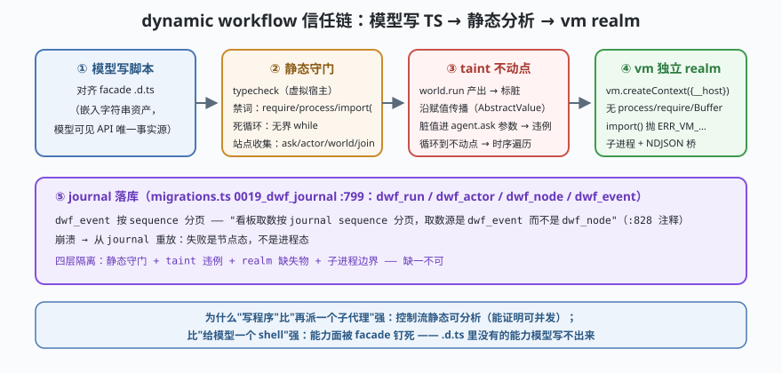

# s08: dynamic workflow —— 模型写 TS、静态分析守门、vm realm 受限执行

[s07](../s07_plugin_host/) → **s08** → [s09_provider_catalog](../s09_provider_catalog/) → ...

> 子代理是"再派一个人"，dynamic workflow（动态工作流，DWF）是"让模型写一段程序"。ZCode 独有的第三种编排形态：主 agent 对着一份 **TS facade**（`.d.ts` 是模型可见 API 的唯一事实源，`dynamic-workflow/README.md`）写脚本 → 编译器做**typecheck + 站点收集 + taint 不动点（污点分析）+ 时序遍历**（`analysis/interpret.ts`）→ 子进程里 `vm.createContext` 建**独立 realm**——裸 vm context 天然没有 `process/require/Buffer/fetch`，只注入 `__host`（`dynamic-workflow-runtime/src/child-source.ts` 头注释）→ NDJSON 桥回宿主，journal 落 `dwf_*` 表。
>
> **Harness 层**：模型产码的信任链 —— 静态可验证、运行受限域、失败可回放。

---

## 问题

1. **模型写的代码凭什么能跑？** 直接 `eval` 等于把权限格子（s04）整个送出去；完全不让写，编排能力又退化回"多派几个子代理"。
2. **静态分析要拦什么？** 脚本里 `import('node:fs')`、`while(true)`、引用未声明变量——哪些在编译期就该死，哪些留到运行期？
3. **"脏值"怎么追？** `world.run` 的结果（外部世界的观察值）流进 `actor.ask` 的参数（要发给别的模型的指令）——这条数据流要不要拦？怎么在"写循环"里追？
4. **realm 里有什么、没什么？** `vm.createContext` 的沙箱天然缺 `process/require`——这既是安全特性也是兼容性地雷，边界意识必须显式。

---

## 解决方案



| 环节 | mini 版 | ZCode 真实实现（当前检出） |
|------|---------|--------------------------|
| **facade = 唯一事实源** | `FACADE_DTS` 字符串：模型可见的全部 API | `dynamic-workflow/src/facade/dts.ts`（README："facade .d.ts as an embedded string asset — the single source of truth for the model-facing API"） |
| **静态守门** | 白名单 API + 禁词扫描（`require/process/import` 即拒绝）+ 死循环检测（无界 while） | `dynamic-workflow/src/compiler/compile.ts`（虚拟宿主 typecheck）；`analysis/sites.ts`（ask/actor/world-read/join 站点收集） |
| **taint 不动点** | `taintFixpoint()`：`world.run` 产出标脏，经变量赋值传播，脏值进 `agent.ask` 判违例，循环到不动点 | `analysis/interpret.ts`（"taint fixpoint, then one temporal walk"）、`analysis/domain.ts`（AbstractValue） |
| **受限 realm** | `node:vm` `createContext({__host})`：无 process/require/fetch；`import()` 抛 ERR_VM_DYNAMIC_IMPORT_CALLBACK_MISSING | `dynamic-workflow-runtime/src/child-source.ts` 头注释 + `harness.ts`（spawn + NDJSON 桥 :238） |
| **可回放 journal** | 每个节点调用追加 journal 行，崩溃后可重放 | `migrations.ts` `0019_dwf_journal`（:799 起，`dwf_run/actor/node/event`；注释："看板取数按 journal sequence 分页"） |

**为什么"写程序"更优**：与"再派一个子代理"比，脚本的**控制流是静态可分析的**（能证明"这些 ask 互相独立，可以并发"）；与"给模型一个 shell"比，**能力面被 facade 钉死**（.d.ts 里没有的能力模型写不出来）。

---

## 工作原理

`code.mjs` 用约 260 行走读整条信任链（这是全课程最"真"的一课：受限求值器直接用 Node 内置 `vm`）：

**第 1 步**：facade。`FACADE_DTS` 声明模型仅有的三个能力：`agent.ask(actor, prompt)`、`world.run(tool, args)`、`workflow.log(msg)`。**能写出什么由 .d.ts 决定**——这不是文档，是编译器的输入。

**第 2 步**：静态守门（编译期就该死的）。`staticCheck(script)` 扫描：禁词（`require`/`process.`/`import(`/`eval`/`Function`）即拒绝；`while (true)` 无 `break` 拒绝。演示两段恶意脚本被编译期拦截——**它们根本没进运行期**。

**第 3 步**：taint 不动点。`taintFixpoint(script)` 做两件事：(a) 站点收集——列出所有 `world.run` / `agent.ask` 调用；(b) 污点传播——`world.run` 的返回值标记为脏（外部观察值不可信），沿赋值传播，脏值作为 `agent.ask` 的 prompt 参数即判违例（防注入：外部数据不能变成给其他模型/子代理的指令）。循环到不动点（演示里跑 3 轮直到无新违例）。

**第 4 步**：vm realm 受限执行。`runInRealm(script, host)` 用 `vm.createContext({ __host, ...安全 intrinsics })`：脚本里读 `process` 得 `undefined`、`require` 抛错、`import()` 被禁。合法脚本（fan-out 并发三个 ask + 一次 world.run）正常跑完，`__host` 的每次调用都留轨迹。**边界场景**：脚本抛错 → realm 捕获 → journal 记为失败节点 → 宿主拿到结构化错误而不是进程崩溃。

**跑一跑**（零依赖，离线；仅用 Node 内置 `vm`，用于教学演示 realm 隔离思想，非安全边界）：

```bash
node code.mjs
```

预期输出五个阶段：facade 与守门拦截 → 恶意脚本编译期死亡 → taint 不动点追踪污值 → 合法工作流在 realm 内跑出 host 调用轨迹 → 失败节点落 journal。

---

## 对照真实源码

| mini 实现 | ZCode 真实代码（当前检出） | 学习点 |
|-----------|--------------------------|--------|
| `FACADE_DTS` | `apps/zcode-cli/packages/dynamic-workflow/src/facade/dts.ts`（README :1-30 讲包边界：纯库，无 I/O） | 模型可见 API 的唯一事实源是 .d.ts |
| `staticCheck()` | `dynamic-workflow/src/compiler/compile.ts`（virtual-host typecheck）+ `analysis/facade-misuse.ts`（authoring diagnostics 9001/9003-9006） | 诊断在编译期：脚本根本没进运行期 |
| `taintFixpoint()` | `dynamic-workflow/src/analysis/interpret.ts`（"taint fixpoint, then one temporal walk, then minting the AnalysisCore"）+ `domain.ts` + `taint.ts` | 数据流用不动点求解，控制流用时序遍历 |
| 站点收集 | `analysis/sites.ts`（一次 checker-driven walk 收集 ask/actor/world-read/join 站点） | "能并发什么"是从站点图推的，不是猜的 |
| `runInRealm()` | `dynamic-workflow-runtime/src/child-source.ts`（头注释：裸 vm context 天然没有 process/require/Buffer/fetch，只注入 `__host`；跨 realm 收敛防原型污染；`import()` 抛 ERR_VM_DYNAMIC_IMPORT_CALLBACK_MISSING）+ `harness.ts:238`（spawn 入口文件，NDJSON 桥；Windows 命令行 32K 上限故写成入口文件） | 沙箱"缺什么"本身就是安全设计 |
| journal | `adapters/src/storage/session-store/migrations.ts:799` 起 `0019_dwf_journal`（`dwf_run/actor/node/event`；:825 注释"dwf_* 自成一套，与既有 workflow 机制彼此独立"） | 失败可回放 = 长任务的停机契约 |

> 行号以当前检出为准，上游会漂移；跨分支请认符号名（`analyzeWorkflowScript`、`createWorkflowProgram`、`childMain`）。**免责**：本课的 `vm` 用法是教学演示，真实 DWF 的隔离还叠加了子进程边界、NDJSON 协议白名单与 journal 审计——四层缺一不可。

---

## 自测

1. 为什么 facade 用**嵌入字符串的 .d.ts** 而不是运行时的 JS 对象注册表？（提示：typecheck 发生在哪个环节、模型"看得见"的是什么）
2. taint 不动点为什么必须**循环到不动点**而不是单遍扫描？构造一个两遍扫描会漏掉的污点传播。
3. 裸 vm realm 里 `process === undefined`——这同时是安全特性和兼容性地雷。真实实现的"跨 realm 收敛"（所有值在 context 内构造）防的是什么攻击？

下一课 [s09_provider_catalog](../s09_provider_catalog/)：内核和沙箱都稳了，最后一环是"连谁"——20 个模板、3 种 api.type 的目录驱动 provider 系统。
