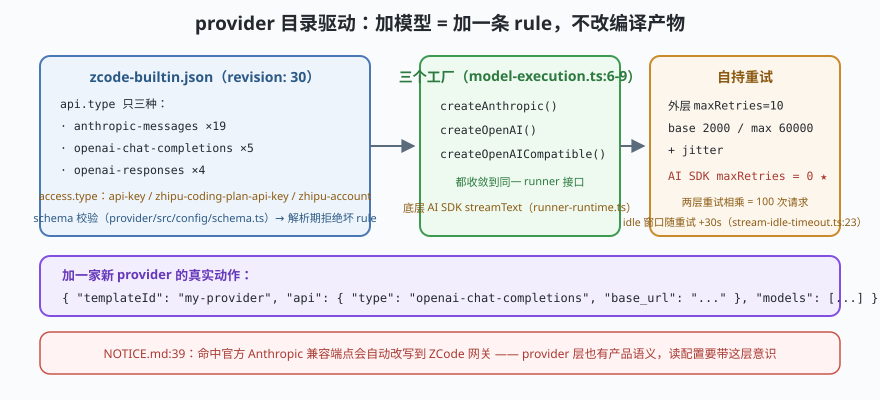

# s09: provider 目录驱动 —— 20 个模板、3 种 api.type 与自持重试

[s08](../s08_dynamic_workflow/) → **s09** → [s10_one_kernel_many_hosts](../s10_one_kernel_many_hosts/) → ...

> 模型适配层最常见的死法是"每接一家新模型，改一遍适配代码"。ZCode 的答案是**目录驱动（catalog-driven）**：所有内置 provider 都是一条条 **rule（模板）**，写进 `config/provider/zcode-builtin.json`（本地检出 `revision: 30`：**19 条 anthropic-messages + 5 条 openai-chat-completions + 4 条 openai-responses**）——**加新 provider = 往目录加一条 rule**，适配代码只有三个工厂（`adapters/src/model/model-execution.ts:6-9`：`createAnthropic / createOpenAI / createOpenAICompatible`，底层是 AI SDK 的 `streamText`）。配套的是**自持重试**：`retry-policy.ts` 默认 `maxRetries 10 / base 2000ms / max 60000ms / jitter`，并**把 AI SDK 自身的 `maxRetries` 关成 0**——两层重试相乘是指数事故。
>
> **Harness 层**：模型接缝 —— 换模型不换内核，重试不翻倍。

---

## 问题

1. **新模型接进来，代码要动多少？** 如果适配逻辑散在循环里，每家模型一套 if，内核很快变成兼容层考古现场。
2. **重试为什么会翻倍？** AI SDK 内部有重试，外层再包一层 → 10×10=100 次请求，费用与雪崩双杀。
3. **流停滞了怎么办？** 网络半死不活，流挂着不吐字——固定的 idle 超时会在重试链上自我制造超时。
4. **provider 配置从哪来？** 代码注册是编译期决定；而 provider 的端点、鉴权方式、模型列表都会随时间变。

---

## 解决方案



| 机制 | mini 版 | ZCode 真实实现（当前检出） |
|------|---------|--------------------------|
| **目录 + 模板** | `CATALOG`：条目只声明 `{templateId, api, base_url, models}` | `config/provider/zcode-builtin.json`（`revision: 30`；api.type 三种：anthropic-messages 19 / openai-chat-completions 5 / openai-responses 4；access.type：api-key / zhipu-coding-plan-api-key / zhipu-account） |
| **schema 校验入口** | `parseCatalog()`：zod 风格逐条校验再放行 | `packages/provider/src/config/schema.ts`（`parseZCodeBuiltinProviderConfigMap` 等一族入口，:33 起） |
| **三工厂适配** | `createProvider(api)` 三分支，没有第四个 if | `adapters/src/model/model-execution.ts:6-9`（`createAnthropic/createOpenAI/createOpenAICompatible`）+ `runner-runtime.ts`（AI SDK `streamText/generateText`） |
| **自持重试** | `retryWithPolicy()`：外层 10 次、指数退避 + jitter；适配层 `maxRetries:0` | `adapters/src/model/retry-policy.ts`（`DEFAULT_RETRY_OPTIONS` :25 起，jitter :26）+ `runner-options.ts:92,150`（把 AI SDK 的 maxRetries 关 0） |
| **流停滞看门狗** | `idleTimeout(retryNumber)`：每重试一次放宽 30s | `adapters/src/model/stream-idle-timeout.ts`（`:23` 的 `baseTimeoutMs + retryNumber × 30_000`，注释解释"慢起来的 provider 重试后更容易慢"）；默认值 `600_000` 定义在 `contracts/src/config/index.ts:284` |

**加一家新模型的真实动作**：在 `zcode-builtin.json` 加一条 rule（选一个已有 `api.type` 模板、填 base_url 与模型名）——没有代码改动，没有新分支。`access.type` 区分三种鉴权（普通 API key / 编码套餐 key / 账号态）。

---

## 工作原理

`code.mjs` 用约 230 行走读四个机制：

**第 1 步**：目录解析。`CATALOG` 五条 rule（mini 版示意），`parseCatalog()` 逐条校验：`api` 必须是三种之一、`models` 非空——坏条目**在解析期报错**，不在请求期爆。场景 1 演示一条 `api: "gemini"` 的坏 rule 被拒。

**第 2 步**：三工厂。`createProvider(api)` 只有三条分支（anthropic-messages / openai-chat-completions / openai-responses），每条返回同一个 `call()` 接口——内核（s01 的循环）只认这个接口。场景 2 用同一份内核代码分别打三个 mock 端点。

**第 3 步**：自持重试。`retryWithPolicy()` 实现 `maxRetries=10` 的指数退避 + jitter；关键演示是**双层重试相乘**的反例：适配层自己的 `maxRetries=3` × 外层 10 = 指数级请求。场景 3 打一个"前两次失败"的 mock 端点，展示退避序列 `[2s,4s,8s…]`（mini 版用毫秒）与最终成功；再打开"内层重试"开关看请求次数乘法。

**第 4 步**：流停滞 + 失败路径。`idleWatchdog(retryNumber)`：idle 窗口随重试放宽（`base + n×30s`，mini 版 n×30ms）；场景 4 演示一个"越重试越慢"的流——固定窗口的看门狗会在第 2 次重试误杀，放宽窗口的看门狗等到了数据。这是 `stream-idle-timeout.ts:23` 那行 `+30_000` 的全部理由。

**跑一跑**（零依赖，离线；端点全部 Mock）：

```bash
node code.mjs
```

预期输出四个场景：坏 rule 解析期被拒 → 同一内核打通三种 api → 重试退避序列与双层重试反例 → 放宽式看门狗 vs 固定式看门狗。

---

## 对照真实源码

| mini 实现 | ZCode 真实代码（当前检出） | 学习点 |
|-----------|--------------------------|--------|
| `CATALOG` + `parseCatalog()` | `config/provider/zcode-builtin.json`（revision :3）+ `packages/provider/src/config/schema.ts:33-71`（zod schema 与一族 parse 入口） | 配置即目录：加 provider = 加 rule |
| `createProvider()` | `apps/zcode-cli/packages/adapters/src/model/model-execution.ts:6-9`（三工厂）+ `runner-runtime.ts`（AI SDK `streamText`） | 适配面收敛到 3，扩展走目录 |
| 自持重试 | `adapters/src/model/retry-policy.ts`（`DEFAULT_RETRY_OPTIONS`：base/max/jitter）+ `runner-options.ts`（AI SDK `maxRetries: 0`，:92/:150 一带） | 两层重试必须只留一层 |
| 流停滞看门狗 | `adapters/src/model/stream-idle-timeout.ts`（`baseTimeoutMs + retryNumber × 30_000` :23；`isModelStreamIdleTimeoutError` :39）+ 默认值 `contracts/src/config/index.ts:284`（600_000） | 退避链上超时窗口要跟着退 |
| 失败归类 | `adapters/src/model/failure-classifier.ts`（区分"网络死了"与"模型还在想"） | 分类决定"能不能重试、值不值得重试" |
| CDN 物化 | `packages/provider-node/src/zcode-builtin-download.ts`（目录从 CDN 拉取/物化） | 目录是数据不是代码，才能远端演进 |

> 行号以当前检出为准，上游会漂移；跨分支请认符号名（`parseZCodeBuiltinProviderConfigMap`、`createAnthropic`、`isModelStreamIdleTimeoutError`）。另见 `NOTICE.md:39`：命中官方 Anthropic 兼容端点会自动改写到 ZCode 网关——provider 层也有产品语义，读配置时要带着这层意识。

---

## 自测

1. "三工厂 + 目录 rule"与"每家一个适配类"相比，扩展新 provider 时各自要改什么？哪种更容易在 review 里看出风险？
2. 双层重试相乘（10×10）具体坏在哪三条：费用、延迟、还是上游雪崩？为什么 ZCode 选择关掉**内层**（AI SDK）的重试而不是外层？
3. 流停滞看门狗为什么要随重试次数放宽窗口？如果不放宽，一个"每 610 秒才吐一个字"的慢端点会在第几次重试被误杀？

下一课 [s10_one_kernel_many_hosts](../s10_one_kernel_many_hosts/)：收官——同一个内核怎么同时变成 TUI、桌面、Web、SDK 和手机远控。
