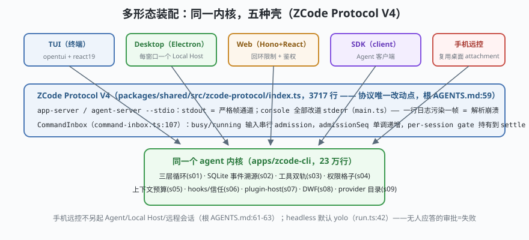

# s10: 多形态装配 —— 同一内核，TUI / 桌面 / Web / 手机远控

[s09](../s09_provider_catalog/) → **s10**（收官）

> 全课程的地基到屋顶都搭完了：三层循环（s01）、事件溯源（s02）、工具信任链（s03）、权限格子（s04）、上下文预算（s05）、hook 与信任（s06）、插件进程（s07）、模型产码（s08）、provider 目录（s09）。收官课回答最后一个问题：**这套内核怎么同时装进五种壳**？答案是 ZCode Protocol V4：协议类型只落 `packages/shared/src/zcode-protocol/index.ts`（3717 行，**协议唯一改动点**，根 AGENTS.md:59），宿主与内核经 **stdio 帧通道**通信，`CommandInbox` 把 busy/running 期间已接受的输入做**串行 admission（准入）**（`bootstrap/src/zcode-protocol-v4/command-inbox.ts:107`）。
>
> **Harness 层**：产品分形 —— 内核不感知宿主，宿主不感知循环。

---

## 问题

1. **五种宿主五种输入节奏**：TUI 是键击、Web 是 HTTP 请求、手机是远控事件——输入怎么统一进入"串行 admission"而不打架？
2. **stdout 被 console.log 污染一帧**，协议解析当场崩溃——进程内任何依赖的一行日志都能弄死会话，边界画在哪？
3. **手机远控要不要另起一个 Agent？** 另起就有两份会话状态；复用桌面会话，断线恢复怎么做？
4. **headless 场景（`zcode -p "..."`）权限确认弹给谁？** 无人应答的审批等价于什么？

---

## 解决方案



| 机制 | mini 版 | ZCode 真实实现（当前检出） |
|------|---------|--------------------------|
| **协议唯一改动点** | `protocol.ts` 一个文件定义全部帧类型 | `packages/shared/src/zcode-protocol/index.ts`（3717 行；根 AGENTS.md:59"协议改动只落这里"） |
| **stdio 帧通道** | `FrameChannel`：JSON 帧 + `console` 改道 + 完整性校验 | `cli/src/main.ts`（console→stderr 边界）；`app-server`/`agent-server --stdio`（`run.ts:525-533`） |
| **CommandInbox 串行 admission** | `handle()` 逐条准入、admissionSeq 单调递增、busy 时排队或拒绝 | `bootstrap/src/zcode-protocol-v4/command-inbox.ts:107`（:139 固定锁序；:64 `admissionSeq`；per-session gate 持有到 settle） |
| **宿主拉起内核** | `spawnHost()`：宿主进程起子进程跑内核 | `packages/services/src/zcode-agent/zcodeAgentProcessManager.ts`（:369/:386 经 stdio 拉起 app-server；每窗口一个 window-scoped Local Host，根 AGENTS.md:61-63） |
| **手机远控复用** | phone 宿主 attach 到既有 host，**不另起内核/会话** | 根 AGENTS.md：attachment 语义；`desktop-continuous`（实时链路）与 `web-remote-replayable`（恢复链路）两种语义必须区分 |
| **headless 语义** | `-p` 模式默认 yolo，审批请求直接失败 | `cli/src/run.ts:42`（`DEFAULT_HEADLESS_PROMPT_MODE="yolo"`）、`:494`；与 s04 呼应 |

---

## 工作原理

`code.mjs` 用约 240 行搭一座 mini 五宿主装配台，走读四个机制：

**第 1 步**：一内核多宿主。`Kernel` 类是 s01-s05 的浓缩（三层循环 + 事件表），**不 import 任何宿主代码**；`attachHost(host)` 把宿主的 `onEvent/onFrame` 挂进事件出口。演示同一内核实例先后服务 TUI / Desktop / Web 三个宿主——事件逐帧广播，互不知晓彼此。

**第 2 步**：帧通道卫生。`FrameChannel.write()` 之前拦截 `console.log`（mini 版直接改写输出目标）：真实代码在 `main.ts:30-35` 把 console 全部改道 stderr——场景 2 演示"一个依赖随手 console.log"在边界处被截住，stdout 帧流零污染。

**第 3 步**：CommandInbox。`Inbox.handle(cmd)`：逐条串行 admission，`admissionSeq` 单调递增；同 session 的第二条命令在第一条 settle 前被挂起（mini 版返回 `queued`）。场景 3 连发三条命令：accepted → queued → settled 后按准入序执行——**输入即命令，命令全序**，这是"多宿主不打架"的全部机制。

**第 4 步**：失败/边界路径（收官必考）。两个：(a) **帧污染**——绕过 FrameChannel 直接往 stdout 写一帧，协议解析崩溃，演示为什么 stderr 边界是"宿主协议能成立的前提"；(b) **headless 审批**——`-p` 模式下权限模式默认 `yolo`，需要审批的工具调用无人应答即失败退出：演示一次被拒调用如何变成结构化错误而非挂死。

**跑一跑**（零依赖，离线）：

```bash
node code.mjs
```

预期输出四个场景：三宿主共享一内核的事件轨迹 → console 改道保护帧流 → 命令串行 admission 序列 → headless 审批失败路径。

---

## 对照真实源码

| mini 实现 | ZCode 真实代码（当前检出） | 学习点 |
|-----------|--------------------------|--------|
| `Kernel` | `apps/zcode-cli/packages/core/src/runtime/`（s01-s05 的全部锚点） | 内核不感知宿主：宿主只是事件订阅者 |
| `protocol.ts` | `packages/shared/src/zcode-protocol/index.ts`（3717 行） | 协议类型与运行时校验的唯一改动点（根 AGENTS.md:59） |
| `FrameChannel` | `cli/src/main.ts`（console→stderr，:30-35 一带）+ `run.ts:525-533`（`app-server`/`agent-server --stdio`） | stdout 是严格帧通道：一行日志都不能漏进去 |
| `Inbox` | `bootstrap/src/zcode-protocol-v4/command-inbox.ts:107`（`handle` :117、固定锁序 :139、`admissionSeq` :162-164） | 输入即命令；同 session 串行 admission |
| `spawnHost()` | `packages/services/src/zcode-agent/zcodeAgentProcessManager.ts`（:369/:386 拉起 app-server） | 桌面/Web/手机共享同一内核进程 |
| 手机远控 | 根 `AGENTS.md:61-63`（attachment 复用桌面 Host；`desktop-continuous` vs `web-remote-replayable`） | 不另起 Agent/Local Host/远程会话 |
| headless 默认 | `cli/src/run.ts:42`（yolo）+ s04 的权限链 | 无人应答的审批 = 失败，不是挂起 |

> 行号以当前检出为准，上游会漂移；跨分支请认符号名（`CommandInbox`、`handle`、`zcodeAgentProcessManager`）。

---

## 自测

1. 为什么"协议类型只落一个文件"值得写进 AGENTS.md 当纪律？如果 Desktop 团队和 Web 团队各自扩展协议类型，六个月后会发生什么？
2. CommandInbox 的 admissionSeq 为什么必须在 **admission（准入）时**分配而不是执行时？想象两条命令并发准入时 UI 上的顺序错乱。
3. 手机远控复用桌面 Host 而不是另起内核——省掉的是哪些东西？断线恢复为什么必须区分 `desktop-continuous` 与 `web-remote-replayable` 两种链路？

---

## 学完之后去哪

十课走完，你已经从"能跑"走到"吃透"的入口。接下来三条路：

1. **精读真源码**：按 [架构拆解](../../架构拆解.md) 第 14 节的 30 条精读清单逐条回 `ZCode/` 核对——本课程每课的"对照真实源码"表就是那 30 条的展开。建议先读 ★ 条目（`turn.ts` / `turn-loop.ts` / `turn-model-step.ts` / `permission/service.ts` / `compact/*`），再读 ★★（`dynamic-workflow`）。
2. **横向对照**：同一张地图去走 [03-deepseek-harness](../../../03-deepseek-harness/analysis_deepseek_harness/)（组装面极致：一切皆插件）、[01-claude-code](../../../01-claude-code/)（工具面极致）、[02-codex](../../../02-codex/)（OS 沙箱极致）。四家对照着读，"agent harness 设计空间"才会立体起来。
3. **动手改一版**：挑一个 mini 实现加需求——给 s03 的闸门加一种声明、给 s04 的格子加一档模式、给 s05 加第四层压缩策略——然后在真源码里找到对应改动点，评估它的取舍。通用方法论延伸见 [context-handbook](../../../context-handbook/Context与记忆系统手册.md) 与 [eval-handbook](../../../eval-handbook/Agent评测与质量工程手册.md)。
