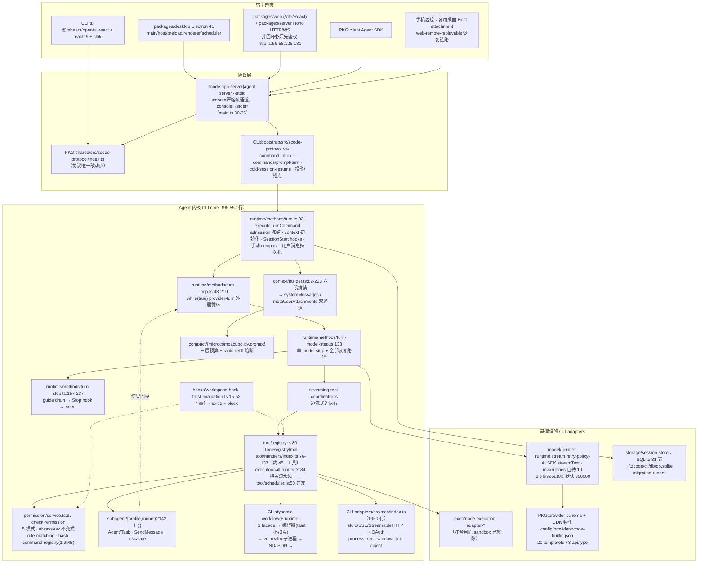

# ZCode 架构拆解

> 生成日期：2026-09-22 ｜ 仓库 `ZCode/` @ `872ad96`（v3.14.0，Apache-2.0，pnpm monorepo，Node 24.14.0）
>
> 证据口径：`【实证】`= 直接读到的源码行（本文所有行号已逐一核对）；`【文档】`= README / AGENTS / NOTICE 的声称。
>
> 路径缩写：`CLI:` = `apps/zcode-cli/packages/`，`PKG:` = `packages/`。
>
> ⚠️ **行号坐标约定**：本文全部行号指**上游 `main` 分支的原始树**（本地 `git checkout main` 或 `git show main:<路径>` 即可对上）。学习注释分支 `study-cn-comments` 在每个文件顶部插了 13-16 行文件头块，所以**同一符号在该分支上会整体下移十几到几十行**——那是注释造成的位移，不是文档过期。跨分支跳转请一律认符号名（`executeTurnCommand`、`checkAlwaysAsk`、`runRegularTurnLoop`），别认行号。

## 1. 一句话总览

ZCode 是**一个把 agent 内核塞在"内嵌第二 workspace"里的多形态产品**：内核循环显式分三层（turn → provider-turn 外层循环 → 单个 model step），会话与事件全部落在 SQLite（31 张表、事件即事实源），安全模型是"5 值权限模式 + 项目级规则匹配 + 工具自声明副作用范围 + 逐次审批"而**没有任何操作系统沙箱**，宿主（Electron / Web / SDK / 手机远控）通过 ZCode Protocol V4 走 stdio 帧通道复用同一个内核。

## 2. 总体架构图



## 3. 仓库分层：一个"内嵌第二 workspace"的产品

- **四组 workspace**（`pnpm-workspace.yaml:1-5`）：`packages/*`、`apps/zcode-cli`、`apps/zcode-cli/packages/*`、`apps/zcode-cli/tools/*`。`apps/zcode-cli` 有自己的 `pnpm-lock.yaml`/`turbo.json`/`.release-it.json`/`skills-lock.json`——**它是被整体嵌进来的独立工程**（有自己的 `README.md`、`AGENTS.md`、发布链），不是普通子包。读 ZCode 时必须同时持有两套坐标系。
- **依赖方向被脚本约束**【实证】：`architecture-policy.yaml` 声明 16 个模块与 `global:{maxFileLines:400, maxContractLines:300, maxPublicMethods:12, forbidCycles:true, forbidDeepImports:true, managedOnly:true, exceptions:[]}`；执行器 `scripts/architecture/index.mjs` 实现层级方向违规（`:186-227`）、禁环（`:281`）、深导入拦截（`:252`）、契约规模（`:146-181`）、`.architecture-baseline.json` **违规指纹棘轮**（`:75-83`、`:282-303`）。配套还有 `pnpm architecture:context <module>`（有界阅读包）与 `.agents/skills/architecture-governance`。
- **但约束目前只覆盖一小块**【实证】：`architecture-policy.yaml:26-28` 只有 `storage` 是 `managed:true`（其余 15 个是 `managed:false` 的 legacy 存量），而 `managedOnly:true` 意味着检查**只对 managed 模块生效**。更直接的证据：`.oxlintrc.json:6` 把 `max-lines` 设为 `["error", {max:400,…}]`，`:57-64` 的 `ignorePatterns` 里**包含 `apps/zcode-cli` 整棵子树**——也就是 agent 内核本体不受这条 400 行 lint 约束。实测 `CLI:core/src` 非测试 .ts 超 400 行的有 52 个（`session-fork.ts` 1487、`steering.ts` 1403、`subagent.ts` 915、`adapters/src/mcp/index.ts` 1950）。
- **`harness/` 是 SSH 联调容器**，不是 agent harness：只有 `harness/remote/{Dockerfile,build.sh,README.md}`（ubuntu:22.04 + sshd + root/dev 账号，README 两行 `docker run -p 2222:22` + `ssh-copy-id`）。
- **`third-party/` 是合规材料目录**（`inventory.json` 逐文件 sha256、`copied-components.json` 记录 shadcn/ai-elements 派生、`upstream/*.txt` 78 份许可证原文、`native-search/sources.json` 记 bfs 4.1.1 / ugrep 7.8.4 / ripgrep 预编译归档哈希），**没有 vendor 源码**。

## 4. 入口与进程模型

**bin 链**【实证】：`CLI:cli/package.json:6-8` `"bin":{"zcode":"./dist/zcode.cjs"}`；源码真实入口 `CLI:cli/src/main.ts:14` `void main()`。发行包统一入口是 `bin/zcode.mjs`（`scripts/build-zcode.mjs:202`），无参进 TUI、`--web` 起 Web（`README.md:86`【文档】，与 `run.ts` 分流一致【实证】）。

`main.ts` 做的四件进程级收口：

1. `:22` 清洗 shell 注入的 `NODE_ENV`/代理/证书变量；
2. `:30-35` **protocol/TUI 模式把 console 全部改道 stderr**，以免污染 stdout 帧通道（这条是宿主协议能成立的前提）；
3. `:60-65` `plugin-host` 短路，避免为了跑插件而加载整套 Agent；
4. `:77-82` 再 `await import("./run.js")` 进入命令分流。

`run.ts` 分流【实证】：`:486-517` `--prompt`/`--target` → `runPrompt`（`:494` `mode ?? DEFAULT_HEADLESS_PROMPT_MODE`，`:42` = **`"yolo"`**）；`:518-569` `help|version|agent-server|app-server|doctor|login|logout|commands|plugins|skills|tui`；`:525-533` `app-server`/`agent-server` 走 `--stdio`；`:44-52` `--surface terminal|desktop`、`--browser-use headless` + `--browser-executable`。

**多形态如何共享一个内核**【实证+文档】：Desktop 经 stdio 拉起 app-server（`PKG:services/src/zcode-agent/zcodeAgentProcessManager.ts:369,386`），协议类型与运行时校验只落 `PKG:shared/src/zcode-protocol/index.ts`（根 `AGENTS.md:59`）；**每窗口一个 window-scoped Local Host**、本地 workspace 共享它，远程 workspace 由窗口内连接注册表管理；**手机远控复用桌面已有 Host attachment**，不另起 Agent/Local Host/远程会话；`desktop-continuous`（实时链路）与 `web-remote-replayable`（恢复链路）两种语义必须区分（根 `AGENTS.md:61-63`）。已接受的 busy/running 输入由内核的 `CommandInbox` 串行 admission，Renderer 只留未提交草稿与 pending optimistic overlay（`:65`）。

**ACP / IDE 插件：未找到现役实现**——只剩退役注释与遗留目录名（`PKG:desktop/src/main/exportLogs.ts:747` "ACP runtime 目录已退役"、`PKG:services/src/session/claude-native/persistImportedClaudeTask.ts:83` "legacy ACP 下线"）。

## 5. 主循环：三层，不是两层

```text
【第 1 层】Turn 入口                                    CLI:core/src/runtime/methods/turn.ts
  :70  executeTurn ──经 enqueueCancellableRuntimeCommand 做串行 admission
  :93  executeTurnCommand
  :103-107  ⚠️ 在任何 await 之前冻结本轮 model selection / outputStyle / `/compact` / `/rewind` 解析
  :128 createTurnAbortScope（父 signal 级联 + dispose）
  :215-224 首轮 ensureContextInitialized ｜ 每步 rebuildContextPrefix
  :227-238 SessionStart hooks
  :240-257 手动 compact
  :503-541 用户消息持久化 + 提前异步生成标题
  :561-609 组装 loopState
  :614 runRegularTurnLoop ────────────────────────────┐
  :647-714 TurnComplete 事件、usage 结算、turnNumber++、│
             rebuildProjection()、调度 session memory 提取 │
  :715-740 catch → createTurnFailureError + 目标暂停 + guide 回投队列

【第 2 层】外层 provider-turn 循环                       turn-loop.ts:43-219  while(true)
  :48   throwIfTurnAborted
  :55-65  ⚠️ 从第二个 model step 起才 drain 后台 subagent / workflow 结果与 runtime command 队列
  :67-74  microcompactIfNeeded（phase = PreRequest / MidTurn）
  :77-102 evaluateRapidRefill + autoCompactIfNeeded
        （"rapid_refill_blocked" 直接抛错 :91-98；命中 compact 记轮次 :99-102）
  :105-108 initializeMcp
  :109-119 组装本步工具集（buildTurnDisallowedTools :221-238：
        定时任务执行轮硬摘掉 automation 写工具，防模型改自己的任务定义）
  :120-167 注入 plan_mode_exit / runtime_mode / todo_reminder / output_style 四类 system-reminder
  :168-186 buildRuntimeProviderRequestMessages(applyCacheControl:true)
        ⚠️ cache-control 必须在 user 顺序投影「之后」统一设置
  :187-192 TurnMachine.startModelRequest
  :205-217 调单步 → 返回值 "break" 才退出

【第 3 层】单个 model step                               turn-model-step.ts:88/133
  :175-191 先落 assistant 骨架 + step-start part
  :193-207 ModelRequest 轨迹（刻意不含自动续写提示 :196）
  :209  createStreamingToolCoordinator（边流式边把 tool call 排进执行）
  :235-262 runModelTextRequest：onStreamSnapshot / onStreamReasoningDelta /
        onStreamTextDelta / onStreamToolCall
  :264-442 catch 段（全部恢复路径，见本节末）
  :444-450 usage 累计与 cache-hit
  :452 extractToolCallsFromResult
  :474-481 classifyOutputTokenContinuation
  :500-547 超窗 finish reason 优先识别 + suspicious-empty 收口
  :551-584 持久化 reasoning/text part
  :645-646 drain(executableToolCalls) 取已在流式期间跑完的结果
  :647-706 输出截断续写（最多几轮，超上限抛 model_output_limit_exceeded）
  :708-716 无工具调用 → finishModelStepWithoutToolCalls
  :718-732 有工具 → executeToolCallsForModelStep

【停止裁决】turn-stop.ts:157-237
  先持久化 assistant → :195 drainInlineGuideForNextRequest 有 steer/guide 就 "continue"
  → :201 runStopHooks 可要求多跑一步（stopHookContinuationCount 计数上限）
  → 否则 turnMachine.complete + "break"
```

**要点与差异**：

1. **"冻结在 await 之前"**（`turn.ts:103-107`）：本轮用哪个模型、哪种 output style、有没有 `/compact`/`/rewind`，在任何异步点之前一次性定死——避免"用户在 await 期间改了 mode，一半步骤用新配置"。这是很多 agent 会踩的竞态。
2. **后台结果只在第二步之后 drain**（`turn-loop.ts:55-65`）：首步专注用户请求本身，从第二个 model step 起才把后台 subagent / workflow 的结果与 runtime command 队列合入。
3. **没有工具次数硬上限**【实证】：循环里不存在次数 break，`toolCallCount` 只用于日志 iteration 与重复调用检测——与 `CLI:zcode-cli/AGENTS.md:11` 的声明一致。停止条件全部由"语义事件"承担：取消、权限拒绝、工具超时、输出截断、provider retry 上限、无工具调用、Stop hook。
4. **恢复路径密度是六家里最高的之一**（`turn-model-step.ts:264-442`）：流恢复 `recoverFromModelFailure`（`:277-288`，`streaming-recovery.ts:14,21` `STREAM_RECOVERY_MAX_RETRIES=10`）、"Start Plan admission busy" 专用退避 `[1s,2s]`（`:289-355`）、**取消时把快照持久化并把 partial 写回内存历史以防冷热不一致**（`:368-394`）、上下文超限走反应式 compact（`:429-440` + `:742-803`，含 rapid-refill 熔断）。
5. **重试完全自持**【实证】：`CLI:adapters/src/model/retry-policy.ts:13-16` 默认 `maxRetries 10 / base 2000ms / max 60000ms / jitter`，且 `runner-options.ts:92,150` **把 AI SDK 自身的 `maxRetries` 关成 0**——避免两层重试相乘。流停滞看门狗：默认值常量 `DEFAULT_MODEL_STREAM_IDLE_TIMEOUT_MS = 600_000` 定义在 `CLI:contracts/src/config/index.ts:284`（配置键 `modelStream.idleTimeoutMs`，`apps/zcode-cli/README.md:248`），解析在 `CLI:adapters/src/model/stream-idle-timeout.ts:7-23`——**注意 `:23` 的 `baseTimeoutMs + retryNumber × 30_000`：每重试一次就把 idle 窗口放宽 30 秒**，因为慢起来的 provider 在重试后更容易慢，固定窗口会在退避链上自我制造超时。抛错由 `isModelStreamIdleTimeoutError`（`:39`）识别，归类进 `failure-classifier.ts:35`，从而区分"网络死了"与"模型还在想"。
6. **取消 UX**：`CLI:core/src/runtime/helpers/turn-errors.ts:59-81` `createTurnAbortScope`（父 signal 级联 + dispose）、`:83` `throwIfTurnAborted` 抛 `TurnCancelled`；TUI 提示 `esc to interrupt`（`CLI:i18n/src/locales/en-US.ts:83`）。

## 6. 工具系统

**注册表** `CLI:core/src/tool/registry.ts:30` `ToolRegistryImpl`：`register` 带 alias 覆盖保护与 canonical 优先（`:34-71`）；`toContracts():104-129` 生成 provider 可见契约，字段含 `capability / executionMode / readOnly / destructive / concurrentSafe / maxOutputBytes / timeoutMs / needsApproval / sideEffectScope / permission / resultBudget`。别名机制见 `core/src/tool/compat.ts:1-6`（`Agent`↔`Task`、`ApplyPatch`↔`Write/Edit`）。

**内置清单**（`CLI:core/src/tool/handlers/index.ts:76-137`，门控 `registerBuiltInTools:195-269`，`embeddedSearchEnabled` 时隐藏 Glob/Grep `:205-210`）【实证】：

| 组 | 工具（定义位置） |
|---|---|
| 文件 | `Read` read.ts:468、`Write` write.ts:214、`Edit` edit.ts:257、`Glob` glob.ts:88、`Grep` grep.ts:143 |
| 执行 | `Bash` bash.ts:449、`js`(node_repl) node-repl.ts:368（默认关，由 browser-use 插件开 `:184-186`） |
| 网络 | `WebFetch` webfetch.ts:199、`WebSearch` websearch.ts:133（+ provider 原生 `web_search` `:158`） |
| 任务 | `TodoRead/TodoWrite` todo.ts:77/134、`CronCreate/List/Update/Delete` cron.ts:189/253/297/349、`OffPeakCreate/List` off-peak.ts:186/237 |
| 规划/交互 | `EnterPlanMode/ExitPlanMode` plan-mode.ts:110/157、`AskUserQuestion` ask-user-question.ts:76、`submit_result` submit-result.ts、`escalate` escalate.ts:98 |
| 子代理 | `Agent` agent.ts:227、`Task` agent.ts:292、`TaskOutput` :87、`TaskStop` :100、`ReadSessionContext` :150、`SendMessage` send-message.ts:88、`RespondToCoordinator` :55 |
| 技能 | `Skill` skill.ts:81 |
| 工作流 | `CreateWorkflow` :308、`AmendWorkflow` :247、`SaveWorkflow` :250、`ListSavedWorkflows` :112、`ListModels` :133、`EvalWorkflowSnippet` :246、`ListWorkflowRuns` :137、`GetWorkflowRun` :194、`ResumeWorkflowRun` :178、`ResolveWorkflowQuestion` :135 |

**双轨 schema**【实证】：zod 用于运行时校验与 TS 类型（`CLI:contracts/src/tools/bash.ts:5,33`），**下发给 provider 的是手写 JSON Schema**（`toToolJsonSchema` bash.ts:7,74；`CLI:core/src/tool/json-schema.ts`）。`executor/validation.ts:9-56` 先试 zod `safeParse`（runtimeOutputSchema），再退到 JSON Schema 校验，失败抛 `ToolExecutionFailed`。

**把关顺序**（`executor/call-runner.ts:65 → :84 executeToolCallImpl`）：

```text
registry 查找；空名/未注册 → 错误回灌模型（:116-152）
→ 读 mode（:149）
→ 输入归一化 + schema 校验（:158-186）
→ 工具专属 validateInput —— 刻意前置于 hook（:187-200，原因写在注释里）
→ runPreToolUseHooks（executor/hook-flow.ts:16）
→ resolveToolPermission（permission-flow.ts:41）
     读项目规则 :69-84 → checkPermission :86-91 → hook 决策覆盖 :92
     → memory 文件特例 :93-100 → allow 直通 :123 → deny 早退 :128
     → resolveToolApproval（approval-gate.ts:36）→ 发 permission_requested + PermissionRequest hook（:160-169）
→ 执行 + 超时（executor/timeout.ts:93 ToolDeadline / executeWithTimeout）
→ outputSchema 校验 → PostToolUse / PostToolUseFailure hook（hook-flow.ts:125/159）
→ 结果序列化 / 预算裁剪（result-serialization.ts、tool-result-media-persistence.ts）
```

并发由 `core/src/tool/scheduler.ts:50` `ToolScheduler` + `READ_ONLY_TOOLS:233` 决定；批量入口 `executor/batch-runner.ts:24/56`。

**MCP**【实证】：用官方 SDK `@modelcontextprotocol/client`（`CLI:adapters/src/mcp/index.ts:1-19`，全文 1950 行），stdio / SSE / StreamableHTTP 三传输 + 完整 OAuth（`oauth-*.ts`、`official-auth.ts`）+ **进程树治理**（`process-tree.ts`、`windows-job-object.ts`——Windows 上子进程不孤儿化）。工具命名 `mcp__<server>__<tool>`（`core/src/mcp/name.ts:3-12`）；配置在 `~/.zcode/cli/config.json` 的 `mcp.servers`（`apps/zcode-cli/README.md:141-179`）；每轮 loop 起点 `initializeMcp`（`turn-loop.ts:105`）。

## 7. 权限与沙箱

### 7.1 五个模式，其中一个是占位

【实证】`CLI:contracts/src/interfaces/session.port.ts:32`：

```ts
export type CollaborationMode = "plan" | "build" | "edit" | "yolo" | "auto";
```

**没有** `acceptEdits` / `bypassPermissions`（Claude Code 的两档在这里被拆成 `edit` 与 `yolo`）。`auto` **尚未实现**：`CLI:core/src/permission/service.ts:140-146` 直接 deny，错误码 `mode.auto.unimplemented`、原因 `"Auto mode is reserved but not implemented yet"`（另一处 `:339-346` 同样）。

### 7.2 `checkPermission` 优先级链（`permission/service.ts:97-231`）

```text
plan 模式切换特例(:104) → requiresUserInteraction(:112)
→ alwaysAsk 独立通道(:131 → :333-392)        ★ 关键不变式
→ yolo 直通(:136)
→ disallowedTools(:149) → 项目 deny(:158) → 项目 ask(:167)
→ plan(:176 → :404-446) → 项目 allow(:180)
→ WebFetch 预批(:189) → workflow 草稿免确认(:202)
→ allowedTools(:217) → edit(:226 → :518-532) → build(:230 → :452-516)
```

**`alwaysAsk` 的设计是这里最有想法的一处**：ask **压过 yolo / plan 的放行**，但**压不过硬阻断**——所以 `:339-372` 会先重跑 auto / disallowed / 项目 deny，再查会话级 allow（`:365`）与"本会话 own 的 workflow 修订"（`:378`），最后才 ask；决策对象带结构化 `alwaysAsk` 标记（`:70-75`），使 PreToolUse hook **无法把一个确认"洗掉"**。会话级 "Always allow" 只存内存（`:88`），重启即失效。

能力回退：工具未声明时按**名字硬编码集合**判风险（`:559-581` `isReadOnlyTool`/`isWriteTool`/`isDestructiveTool`）——新工具或 MCP 工具会落错档，这是声明式设计的代价。

### 7.3 规则匹配语义

`rule-matching.ts` 的 `wildcardToRegExp`；主体提取在 `service.ts:283-298`，依次取 `command | url | file_path | path | pattern | patch_text`（WebFetch 特例走 `webFetchRuleSubjects`）；匹配语义 `:307-320`：`前缀:*`（要求后接空格/Tab）、`*` 通配、全等；`Write` 可被 `Edit` 规则命中（`:264-267`）；CUA 保留 key 只有宿主验证过的 capability group 才匹配（`:274-279`）。规则落库在 SQLite `permission` 表按 `project_id`（`adapters/src/storage/session-store/migrations.ts:90`；`core/src/tool/executor/permission-rules-persistence.ts:14-27,47-50`）。

**Bash 另有一整套**【实证】：`handlers/bash-command-parser.ts` 解析命令 → `bash-command-rule-evaluator.ts:13` 评估 → 底座是 **1.9 MB 的命令知识库** `handlers/generated/bash-command-registry.ts`，由 `@withfig/autocomplete@2.692.3` **确定性生成**（头部注释含 sha256 与 `loadSpecNodes=522`；生成器 `apps/zcode-cli/scripts/generate-bash-command-registry.mjs:15-19`；校验 `pnpm --dir apps/zcode-cli registry:check`，见 `apps/zcode-cli/package.json:11`）。只读命令免批与建议规则在 `bash-command-permission-policy.ts`，其中 `HIGH_RISK_ROOT_COMMANDS`（`:16-33`：bash/chmod/dd/mount/rm/sudo…）与 wrapper 参数穿透（`:34-`）。**六家里只有它把 CLI 手册编译成了权限数据**（Claude Code 是手写前缀白名单，Codex 走内核策略，OpenCode 用 tree-sitter + arity 字典）。

### 7.4 沙箱：**没有，且有四处独立证据**

1. 【文档】`NOTICE.md:9`："当前共享 Agent 执行适配器不提供默认的操作系统沙箱；工作目录、工作区身份、Git worktree、浏览器页面隔离和 Node REPL 的运行上下文，均不应被当作所有工具的系统级隔离保证。"
2. 【实证】全仓 grep `seatbelt|landlock|bubblewrap|sandbox-exec|firejail` **零命中**（已实测）。
3. 【实证】`Bash` 仍保留 `dangerouslyDisableSandbox` 参数（`CLI:contracts/src/tools/bash.ts:64-69`），但它只流进 telemetry 与 exec 选项（`handlers/bash.ts:298,428-431`）——**参数只剩记账作用，语义误导**。
4. 【实证】`CLI:adapters/src/exec/node-execution-adapter-run.ts:276-277` 注释自陈"…是 protected-resource sandbox 时代的行为…**sandbox 撤除后**…"，说明曾实现后移除。

路径边界同样是软的：`CLI:core/src/tool/path-policy.ts:36` 注释"Current release **intentionally does not hard-block** paths outside workspaceRoot"。**结论：ZCode 的安全边界 = 模式 + 规则 + 审批 + 工具声明，全部在应用层；OS 层为零。** 与 Codex（Seatbelt/Landlock/Windows 双轴）、OpenClaw（Docker/Podman/SSH 六后端，虽默认关）、OpenCode（也无 OS 沙箱）对照，ZCode 与 OpenCode 处在同一档，且它比 OpenCode 多了一个"曾经有、现已撤除"的历史包袱。

## 8. 上下文、提示词与三层压缩

### 8.1 system prompt 拼装（`CLI:core/src/context/builder.ts:82-223`）

段序带注释，六组：

```text
① CLI/产品前缀(:104，workflowActor 子代理跳过)
② 稳定身份 / custom prompt / workflow actor 身份 —— 三选一，互斥冲突时抛错(:93-97)
③ 动态段：desktop(:132) → behavior(:137) → session guidance(:143) → memory(:152)
        → env info(:158) → output style(:161) → context management(:167) → git context(:169)
④ skills 段(:179-187，仅当 Skill 工具在场)
⑤ meta-user：AGENTS.md / 项目记忆(:190-197) + 当前日期(:199)
⑥ custom sections(:205)
→ orderSectionsForInjection(:207) 按 injectionTarget 分流成
  systemMessages 与 metaUserAttachments 两条通道（:213-214, :327-348）
```

段实现在 `context/sections/`（cli-prefix / identity / dynamic-sections / env-info / memory / skills / desktop / current-date / request-user-context / workflow-actor）。**"system 消息 vs meta-user 附件"双通道**是它区别于其余五家的具体设计：能进 system 的进 system，不能的以 user 附件形态注入，同时用 `injectionTarget` 声明，而不是硬编码。

**AGENTS.md 加载**【实证】：`CLI:adapters/src/context/index.ts:24` `DEFAULT_PRIORITY_FILES=["AGENTS.md"]`、`:25` `DEFAULT_MAX_BYTES=100KB`、`:45-55` `resolveUserInstructions`，用户级 `~/.zcode/AGENTS.md`（`:233-239`）；`/init` 写 workspace AGENTS.md，且会**拒绝覆盖已有 `.zcode/AGENTS.md`/`.agents/AGENTS.md`**（`CLI:bootstrap/src/builtin-prompt-command.ts:21,56-65`）。每轮额外提醒在 loop 里注入（`turn-loop.ts:120-167`）。

**prompt cache 是显式管理的**：builder 每段可带 `cacheHint:"stable"`（`:114`），loop 在 provider 可见投影**之后**统一设置 cache-control（`turn-loop.ts:168-186` + `helpers/provider-request-messages.ts:302-313`），另有 `--force-mcs` 中期 system 投影开关（`run.ts:43` 的 scope 校验）。

### 8.2 三层压缩

| 层 | 位置 | 策略 |
|---|---|---|
| **microcompact** | `CLI:core/src/compact/microcompact.ts:11-28` | 只把旧 tool result 换成 `[Old tool result content cleared]`，**不动历史消息**：`keepRecentToolResults=5`、`thresholdRatio 0.9`、`buffer 2000`、`minTokenSavings 256`、可压工具白名单（Read/Bash/Grep/Glob/WebFetch/WebSearch/Edit/Write/ApplyPatch）。调用点 `turn-loop.ts:69`，phase = PreRequest / MidTurn |
| **auto compact** | `compact/policy.ts:8-14`，决策 `shouldAutoCompact:90-160`（带 `reason`） | `contextWindow 200k`、输出预留 `min(maxOutput, 21_000)`、`AUTOCOMPACT_BUFFER_TOKENS 13_000`、`thresholdPercent 100`、**连续失败 3 次熔断**。执行链 `runtime/methods/compact.ts:184`、`compact-active.ts:75`、`compact-summary-model-request.ts`、选择/保留 `helpers/compact-selection.ts:36-54`（至少留最近 1 组）、落库 `compact-persistence.ts` |
| **reactive compact** | `turn-model-step.ts:742-803` | 超窗错误 / finish reason 之后补救，配 **rapid-refill 断路器**（`turn-loop.ts:77-102`，`"rapid_refill_blocked"` 直接抛错而非无限压缩） |

**摘要提示词**（`compact/prompt.ts:15-56`）：强制"纯文本、禁调工具"（`:1-11`）+ **9 段结构**（Primary Request / Key Concepts / Files & Code / Errors & Fixes / Solving / All user messages / Pending / Current Work / Optional Next Step），并两次强调**安全相关指令必须逐字保留**（`:26`、`:40`）。这一条是六家里把"压缩会削弱安全边界"当显式设计约束写得最清楚的。

**token 计量**：本地估算在 `compact/manual.ts:102-112`（字符/除数，注释说明**并把 toolCall 入参计入**——旧估算漏算）；provider usage 在 `methods/turn-model-step-usage.ts`、`usage-observability.ts`、快照 `context-usage.ts:119`；输出预算 `model-token-limits.ts`；持久化表 `model_usage` / `turn_usage` / `tool_usage`。

## 9. 会话与持久化

**SQLite 是唯一真源**【实证】：CLI 库路径 `CLI:adapters/src/storage/session-store/paths.ts:7` = `~/.zcode/cli/db/db.sqlite`（与 `NOTICE.md:58` 一致）。31 张表见 `migrations.ts:10-393`：`session`（含 `parent_id` 分叉树、`permission`、`time_compacting`、`time_archived`、`summary_diffs`、`revert`，`:14-36`）、`message`、`part`、`session_entry`(`:77-88`)、`permission`（project 级 `:90`）、`input_history`、`local_setting`、`session_input`、`session_target`、`model_usage`/`turn_usage`/`tool_usage`、`todo`、`workflow_definition/run/activity/event`、`session_task_link`、`dwf_run/node/event/actor`。迁移器 `migration-runner.ts` + `migrations/*.ts`。

**事件即事实**：`CLI:contracts/src/events/session.events.ts`（`ModelRequest` / `ModelComplete` / `TurnComplete` / `TurnError` / `CheckpointCreated`…），写入 `appendEvent`，冷恢复 `runtime/methods/resume.ts:59 resumeFromStore` + `agent/session-history-hydrator.ts`。**模型 I/O 轨迹目录**：`~/.zcode/cli/rollout`（生产）/ `debug`（开发）（`CLI:bootstrap/src/app/paths.ts:13-15`）——没有测试网的情况下这是最重要的可观测入口。

**fork / 回卷**【实证】：`methods/session-fork.ts:851 createForkedSession`、`:895 forkConversationFromMessage`、`:1050 forkStableConversationAtMessage`、`:1371 forkSourceMessagesForSession`；工作区级 `workspace-checkpoints.ts:133 forkWorkspaceFromCheckpoint`、`file-rewind.ts:94 applyWorkspaceFileRewind`；用户入口 `/fork [latest|checkpointId]`、`/rewind`（`CLI:i18n/src/locales/en-US.ts:66,70`）。Desktop 侧数据根 `~/.zcode`（`ZCODE_DATA_BASE_DIR` 可覆盖，`PKG:services/src/paths.ts:11-41`），目录编目在 `storage/domain/storageCatalog.ts:80-115`（`cli/sessions`、`cli/artifacts`、`cli/agents`、`git-checkpoint-index`…）。历史导入：`PKG:services/src/session/claude-native/`（11 文件，JSONL 解析/导入/修复）。

## 10. 子代理、同伴协议与 dynamic workflow

### 10.1 subagent

`Agent` 工具（`handlers/agent.ts:227`）与别名 `Task`（`:292`）；入参含 `subagent_type`、`run_in_background`（`CLI:contracts/src/tools/agent.ts:21,27`）；权限组 `permission:"subagent"`、`sideEffectScope:"session"`、`readOnly:true`（agent.ts:229-248）。

内建 profile 两个：`general-purpose`（`subagent/general-purpose.ts:3-24`，提示词明写"完成后回传简明报告，调用方会转述给用户"）与只读 `Explore`（`explore.ts:7`；`profile.ts:67-78` 限工具 `Bash,Glob,Grep,Read,WebFetch,WebSearch,TodoWrite`）。

**定义格式 = markdown + frontmatter**：解析器 `subagent/profile-frontmatter.ts:1-38`（**自研宽松 YAML，不用 gray-matter**）；字段 `name/description/model/color/permissionMode/maxTurns/memory/tools/disallowedTools/skills/background/injectAgentsMd/mcpServers`（`profile.ts:180-223`）。★ **项目级 md 的 `permissionMode` 被强制忽略**（`profile.ts:183-185` 注释："项目级 subagent markdown 属于仓库输入"；同规约见 `bootstrap/src/subagents.ts:120`）——**防的是"仓库自带一个 agent 定义就给自己提权"**，这一条比 OpenCode/Claude Code 的对应实现更明确。发现目录（`bootstrap/src/subagents.ts:52-56,140`）：用户 `<storage>/agents`、项目 `<cwd>/.zcode/agents`、插件 `<plugin>/agents/<name>.md`。

runner `subagent/runner.ts`（**2142 行**）支持前台/后台与"前台超时自动后台化"（`:147-160`、`:302-320`），后台结果经 `drainPendingRuntimeCommandsForActiveLoop` 回到主 loop（`turn-loop.ts:56`）；注册表 `runtime-task/registry.ts`，控制工具 `TaskOutput` / `TaskStop`。

### 10.2 同伴协议与"权限洗白"防御

跨会话协作工具：`SendMessage`（收件人 `agent_<uuid>`，`CLI:contracts/src/tools/send-message.ts:13`）、`RespondToCoordinator`、`escalate`、`submit_result`。**peer 消息被显式降权**：`CLI:core/src/system-reminder/incoming-message.ts:6` 规定同伴请求不得改权限/AGENTS.md、**不得当成用户批准**、"被拒后转托 = 权限洗白，要拒绝并上报"。六家里只有它和 OpenClaw（`queue.md:46-47` operator 上限保留）把"权限不能随消息委派而漂移"写成明文规则。

### 10.3 dynamic workflow：ZCode 独有的第三种形态

【文档】`CLI:dynamic-workflow/README.md:1-30` 自述："纯库：主 agent 对着写的 TS facade + 从脚本恢复严格性的编译器（typecheck、schema 合成、依赖推断、site identity、**taint 不动点 + 时序遍历**）"。【实证】`CLI:dynamic-workflow-runtime/README.md:3,32` + `src/child-source.ts:15-17`、`:274-280`：子进程里 `vm.createContext` 建**独立 realm**——裸 vm 天然没有 `process/require/Buffer/fetch`，只注入 `__host`；parent↔child 走 NDJSON；`harness.ts:31` 用 `child_process.spawn`。生产驱动（actor 会话、SQLite journal、工具接线）在 `CLI:bootstrap` 的 `script-workflow-*` 与 `dwf_*` 表。模型侧工具是第 6 节那 10 个 `*Workflow*`。

**为什么这条值得单列**：Claude Code / OpenCode / DeepSeek Harness 的编排能力都停在"派子代理"这一层；ZCode 让模型**写程序**，再用静态分析（含 taint 不动点）决定哪些节点能并发、哪些是脏的，最后在受限 realm 里跑。这既比 prompt 编排可验证，又比"给模型一个 shell"可控——是六家里对"agent 如何结构化表达长任务"给出的最独特答案。

## 11. 扩展面

| 能力 | 位置 | 关键事实 |
|---|---|---|
| **hooks（7 事件）** | `CLI:contracts/src/hooks/index.ts:7-15` | `SessionStart \| UserPromptSubmit \| PreToolUse \| PermissionRequest \| PostToolUse \| PostToolUseFailure \| Stop`（与 `apps/zcode-cli/README.md:186-194` 逐条对齐）；执行器 `core/src/hooks/configured-runner.ts`(+`-input`/`-callback`)、`runner.ts`；stdout JSON schema 与 **`exit 2 = block`**（README:261） |
| **工作区 hook 信任状态机** | `core/src/hooks/workspace-hook-trust-evaluation.ts:15-52` | `pending_trust \| trusted_persistent \| stale_digest \| revoked \| blocked_policy \| blocked_untrusted`；信任键 = `workspaceIdentity + hookDeclarationDigest`（`:66-67`），**声明变更即失效**；未信任前项目 hook 配置被剥掉（`adapters/src/config/project-config.adapter.ts:61-75`，诊断码 `config_project_hooks_pending_trust`）；命令 `zcode hooks trust`（`cli/src/hooks-trust-command.ts`） |
| **plugins** | `apps/zcode-cli/README.md:73-122` + `CONTEXT.md` | `.zcode-plugin/plugin.json`，字段 `name/version/description/author/license/skills/commands/mcpServers/userConfig`；变量 `${ZCODE_PLUGIN_ROOT\|ZCODE_PLUGIN_DATA\|ZCODE_PROJECT_DIR\|user_config.*}`，**只展开 `ZCODE_` 前缀环境变量**（`:114-122`）；商店 `zcode-plugins-official`（`CONTEXT.md:10`），安装态 `~/.zcode/cli/plugins/{cache,data,marketplaces}`；内置 browser-use / document-skills / skill-creator / zcode-guide 默认开，ios-simulator / android-emulator / restore-legacy-sessions 默认关（`:51`）；**插件跑在独立 `plugin-host` 进程**（`cli/src/plugin-host-command.ts`；`main.ts:62-65` 注释解释为何不能先加载 Agent） |
| **skills** | `adapters/src/skills/roots.ts:6-10,39-53,96-105` | `SKILL.md`；发现根 = `~/.zcode/skills`、`~/.agents/skills`，以及从 cwd 逐级上溯到 git root 的 `.zcode/skills` + `.agents/skills`，**合并而非 fallback**，同层 `.zcode` 优先。仓库自带 8 个开发 skill 在 `.agents/skills/`（agent-browser、ai-elements、architecture-governance、dep-refs、dogfood、electron、feature-boundary-planner、react-best-practices） |
| **slash 命令** | `CLI:i18n/src/locales/en-US.ts:57-74` | 内建 `/help /login /logout /compact /expert /dwf /fork /mcp /mode /model /new /resume /rewind /skill /goal`；自定义命令 markdown 根 `.zcode/commands` + `.agents/commands`（`adapters/src/commands/roots.ts:96-105`）、`zcode commands list`、展开 `cli/src/custom-command-expand.ts` |
| **themes** | `PKG:ui/src/styles.css:461,606` | 4 套 `light \| dark \| zai-light \| zai-dark`（默认 zai-dark，`ui/src/store/index.ts:257`），受 `DESIGN.md` 约束 |
| **provider / 模型** | `config/provider/zcode-builtin.json`（`revision:30`） | **目录驱动 + 模板，不是代码注册**：20 个 templateId（zai-api、zai-standard-api、bigmodel-api、anthropic、openai、deepseek、minimax、moonshot-kimi、qwen-alibaba-model-studio-cn/intl、xai、xiaomi-mimo、openrouter、opencode-go-{chat,messages,responses}、opencode-zen-{chat,messages,responses}）；`api.type` 只 3 种：`anthropic-messages`(19) / `openai-chat-completions`(5) / `openai-responses`(4)；`access.type` = `api-key \| zhipu-coding-plan-api-key \| zhipu-account`。zod schema `PKG:provider/src/config/schema.ts:33-71`，CDN 拉取/物化 `PKG:provider-node/src/zcode-builtin-download.ts`；真正发请求在 `CLI:adapters/src/model/model-execution.ts:6-9`（`createAnthropic/createOpenAI/createOpenAICompatible`）+ `runner-runtime.ts:1`（AI SDK `streamText/generateText`）；CLI 侧 legacy kind enum `bootstrap/src/app/legacy-cli-model-config.ts:48`。**加新 provider = 往模板目录加一条 rule** |

## 12. 端到端时序：从 `zcode -p "修这个 bug"` 到回复

1. `bin/zcode.mjs` → `dist/zcode.cjs` → `CLI:cli/src/main.ts:14`：清洗注入变量（`:22`）、**console 改道 stderr**（`:30-35`）、判断是否 `plugin-host` 短路（`:60-65`）→ `await import("./run.js")`。
2. `run.ts:486-517` 识别 `--prompt` → `:494` `mode ?? "yolo"`（⚠️ headless 默认全放）→ `runPrompt` 装配一次性宿主（不起 TUI），经 `CommandInbox` 提交输入。
3. `turn.ts:70 executeTurn` 排队做串行 admission → `:93 executeTurnCommand`：`:103-107` **在任何 await 之前**冻结 model selection / outputStyle / `/compact` / `/rewind`；`:128` 建 abort scope；`:215-224` 初始化 context；`:227-238` SessionStart hooks；`:503-541` 持久化用户消息并异步起标题生成。
4. `turn-loop.ts:43` 进入 provider-turn 循环：microcompact（`:67`）→ rapid-refill 检查 + auto compact（`:77`）→ `initializeMcp`（`:105`）→ 组装本步工具集（`:109`，定时任务轮硬摘 automation 写工具）→ 注入四类 system-reminder（`:120`）→ 构造 provider 请求消息并在最后统一设 cache-control（`:168`）。
5. `context/builder.ts:82-223` 六段拼装 → `orderSectionsForInjection` 分流 system / meta-user 双通道。
6. `turn-model-step.ts:175` 先落 assistant 骨架与 `step-start`，`:193` 写 `ModelRequest` 轨迹（到 `~/.zcode/cli/rollout`），`:209` 建流式工具协调器，`:235` 发起 `runModelTextRequest`；`CLI:adapters/src/model/runner-runtime.ts` 经 AI SDK 打到 `config/provider/zcode-builtin.json` 解析出的端点（命中官方 Anthropic 兼容端点时按 `NOTICE.md:39` 改写到 ZCode 网关）。
7. 流式吐 chunk：`onStreamReasoningDelta/onStreamTextDelta` 回投影（TUI 或 stdio 帧 → 宿主 → UI）；`onStreamToolCall` 立即进协调器排队。
8. 每个 tool call 走 `call-runner.ts:84` 全流水线：schema 校验（zod→JSON Schema）→ 工具专属 `validateInput`（前置于 hook）→ PreToolUse → `checkPermission`（`alwaysAsk` 压过 yolo 放行，但 `disallowedTools`/项目 deny 压过它）→ 需要审批时 `permission_requested` 事件（headless 下即失败退出，因为无人应答）→ 执行 + `ToolDeadline` 超时 → outputSchema 校验 → PostToolUse → 结果序列化并按 `maxOutputBytes`/`resultBudget` 裁剪，大结果落 artifact 只回摘要。
9. `:645` drain 已流式跑完的工具结果 → `:708` 若无工具调用则 `finishModelStepWithoutToolCalls` → `turn-stop.ts:157`：有 steer/guide 则 continue；Stop hook 可要求多跑一步；否则 `turnMachine.complete` + `"break"`。
10. 若 :474 判定输出被截断需要续写 → 最多几轮，超上限抛 `model_output_limit_exceeded`；若 :500 判定超窗 → 反应式 compact（含 rapid-refill 熔断）后 continue。
11. 若 `Agent`/`Task` 工具被调用：`subagent/runner.ts` 建子会话（`session.parent_id`），项目级 md 的 `permissionMode` 被强制忽略；后台化的结果在 `turn-loop.ts:56` 从第二个 step 起 drain 回主循环。若 `CreateWorkflow` 系：dynamic-workflow 编译器静态分析脚本，`vm.createContext` 子进程执行，NDJSON 回桥，状态记进 `dwf_*` 表。
12. `turn.ts:647-714`：`TurnComplete` 事件、usage 结算（`model_usage`/`turn_usage`/`tool_usage`）、`turnNumber++`、`rebuildProjection()`、调度 session memory 提取；异常走 `:715-740` `createTurnFailureError` + 目标暂停 + guide 回投。
13. 全程落 `~/.zcode/cli/db/db.sqlite`；宿主侧经 `PKG:shared/src/zcode-protocol/index.ts` 定义的事件看到一切。

## 13. 设计亮点与局限

**亮点**

1. **`alwaysAsk` 是不可被模式抹掉的独立通道**（`permission/service.ts:131,333-392`）：yolo 与 plan 的放行都要先让给它，而 `disallowedTools` / 项目 deny / auto 又压得过它；决策对象带结构化标记（`:70-75`）让 PreToolUse hook 无法把确认洗掉。**比 Claude Code 的 `bypassPermissions`（整层直通）与 Codex 的 sandbox+approval 二元都更细一格。**
2. **把 CLI 手册编译成权限知识库**：`@withfig/autocomplete` → 1.9 MB 确定性 registry（含 sha256）+ `registry:check` 守门，用于 Bash 只读免批与建议规则。
3. **三层上下文预算 + 熔断**：microcompact 只清旧工具结果不动历史 → auto compact 用 provider usage 覆盖字符估算（13k buffer / 21k 输出预留 / 3 次失败熔断）→ reactive compact + **rapid-refill 断路器**；摘要提示词显式要求"安全类指令逐字保留"（`compact/prompt.ts:26,40`）。
4. **dynamic workflow：让模型写 TS 再静态分析**。facade 的 `.d.ts` 是模型可见 API 的唯一事实源，编译器做 typecheck / 站点图 / taint 不动点，运行在 `vm.createContext` 独立 realm 的子进程里经 NDJSON 桥回宿主。**六家里独一份**，比"再派一个子代理"结构化，比"给模型一个 shell"可控。
5. **架构治理可执行化**：`architecture-policy.yaml` + `scripts/architecture/index.mjs`（层级方向、禁环、禁深导入、契约 300 行/12 方法、**baseline 指纹棘轮**）+ `pnpm architecture:context <module>` 有界阅读包 + 配套 skill。这是"给 agent 读的仓库"少见的真落地。
6. **显式管理 prompt cache 锚点**：每段 `cacheHint:"stable"`、cache-control 在投影之后统一设置、`--force-mcs` 开关。
7. **会话 = 数据库 + 可分叉可回卷 + 同伴协议降权**：`session.parent_id` + workspace checkpoint + file rewind + stable fork boundary；`incoming-message.ts:6` 把"被拒后转托 = 权限洗白"写成规则。
8. **中文一手文档 + 中文注释**：`NOTICE.md` 那份"AI 声称已完成不构成事实或授权证明"的风险表述，是六家里最诚实的一页。

**局限 / 坑**

1. **没有 OS 沙箱**（四处独立证据，见第 7.4 节），且 `Bash` 仍暴露 `dangerouslyDisableSandbox` 参数——**只剩记账，语义误导**。
2. **写文件不受 workspace 边界硬拦**（`path-policy.ts:36` 注释明确"有意不硬拦"）：安全完全压在模式 + 规则 + 审批上，审批一旦无人（headless）就等价于放开。
3. **headless 默认 `yolo`**（`run.ts:42,494`）：`zcode -p "..."` 不带 `--mode` 即放行普通工具，脚本化集成最容易踩；`auto` 模式仍是 deny 占位（`service.ts:140-146`）。风险等级缺省靠按名字硬编码集合（`:559-581`），**新工具/MCP 工具会落错档**。
4. **测试几乎未随源码发布**：`git ls-files` 只有 4 个 `*.test.ts(x)`，**没有任何 `package.json` 含 `"test"` 脚本**（实测），与 `CLI:zcode-cli/AGENTS.md:9` "测试 case 很关键"直接矛盾，行为回归无法自动验证。
5. **400 行规则形同装饰**：`.oxlintrc.json:57-64` 的 `ignorePatterns` 把 `apps/zcode-cli` 整棵子树排除在外，`architecture-policy.yaml` 16 模块里只有 `storage` 一个 `managed:true` 且 `managedOnly:true` ⇒ 治理只覆盖新增/迁移完的那一小块。`CLI:core/src` 有 52 个非测试文件超 400 行。
6. **一手文档缺 agent 内核部分**：`DESIGN.md` 是 UI 规范、`CONTEXT.md` 只讲插件商店，loop/compact/permission/subagent **没有 spec**，只有代码注释；另有两处悬空链接（`README.md:139` → `third-party/README.md` 不存在、`config/README.md` → 不存在的 `docs/`）与漂移的 `NOTICE.md` 行号锚点。
7. **产品化耦合**：命中官方两个 Anthropic 兼容端点会**自动改写到 ZCode 网关且无逐次确认**（`NOTICE.md:39`），provider 目录来自 CDN；纯离线自托管需额外配 `ZCODE_BASE_URL` / `ZCODE_BUILTIN_PROVIDER_CONFIG_FILE`（`README.md:128-134`）。
8. **两套坐标系**：`apps/zcode-cli` 是内嵌的第二 workspace（自己的 lock/turbo/release），`harness/` 又不是 agent harness——第一次读极易走错门。

## 14. 关键文件索引（精读清单）

| # | 路径:行 | 一句话 |
|---|---|---|
| 1 | `README.md:16-20,206-219` | 三种产品形态与目录职责的官方地图 |
| 2 | ★ `apps/zcode-cli/AGENTS.md:7-101` | **内核设计公理**：无硬 tool 上限、I/O 收敛 adapter、工具副作用声明、traceId 层级、错误冒泡 |
| 3 | `architecture-policy.yaml:1-58` + `scripts/architecture/index.mjs:132-303` | 模块治理如何变成可执行检查（含 baseline 棘轮） |
| 4 | `NOTICE.md:9-30` | 权限模式默认值、无 OS 沙箱、Computer Use 占位等安全事实 |
| 5 | `CLI:cli/src/main.ts:14-108` | 可执行入口、stdout/stderr 边界、plugin-host 短路 |
| 6 | `CLI:cli/src/run.ts:42,486-569` | headless 默认 yolo 与命令分流 |
| 7 | `CLI:i18n/src/locales/en-US.ts:10-74` | 唯一完整的 flags + slash 命令清单 |
| 8 | ★ `CLI:core/src/runtime/methods/turn.ts:93-260,503-740` | Turn 生命周期 |
| 9 | ★ `CLI:core/src/runtime/methods/turn-loop.ts:43-238` | **外层 provider-turn 循环** |
| 10 | ★ `CLI:core/src/runtime/methods/turn-model-step.ts:133-355,640-803` | 单步请求 + 全部恢复路径 |
| 11 | `CLI:core/src/runtime/methods/turn-stop.ts:157-237` | "继续还是停"的唯一裁决点 |
| 12 | `CLI:core/src/runtime/methods/turn-tools.ts` + `streaming-tool-coordinator.ts` | 工具批派发与边流式边执行 |
| 13 | `CLI:core/src/tool/registry.ts:30-147` | 注册表 + alias 冲突保护 + 契约投影 |
| 14 | `CLI:core/src/tool/handlers/index.ts:76-269` | 内置工具全清单与注册门控 |
| 15 | ★ `CLI:core/src/tool/executor/call-runner.ts:65-200` | 单次调用的把关顺序 |
| 16 | `CLI:core/src/tool/executor/permission-flow.ts:41-170` | 权限 → 审批 → 事件的完整流 |
| 17 | ★★ `CLI:core/src/permission/service.ts:97-231,307-392,452-516,559-581` | 权限内核与 `alwaysAsk` 不变式 |
| 18 | `CLI:core/src/tool/handlers/bash-command-permission-policy.ts:1-120` + `generated/bash-command-registry.ts:1-8` | 命令知识库驱动的免批与建议规则 |
| 19 | ★ `CLI:core/src/context/builder.ts:82-223,327-348` | system prompt 段序与双通道装配 |
| 20 | `CLI:adapters/src/context/index.ts:24-100,233-239` | AGENTS.md 发现与 100 KB 上限 |
| 21 | ★ `CLI:core/src/compact/{policy,microcompact,prompt}.ts` | 阈值、microcompact、摘要提示词全文 |
| 22 | `CLI:core/src/runtime/methods/compact-active.ts:75-200` + `helpers/compact-selection.ts:25-90` | 压缩执行与保留算法 |
| 23 | `CLI:adapters/src/storage/session-store/migrations.ts:10-120,230-393` | 31 张表的真实结构 |
| 24 | `CLI:core/src/runtime/methods/session-fork.ts:851-1100` | fork 与 stable boundary 语义 |
| 25 | ★ `CLI:core/src/subagent/profile.ts:60-230` + `profile-frontmatter.ts` + `runner.ts:140-330` | 子代理定义、**项目级提权拦截**、前后台调度 |
| 26 | ★★ `CLI:dynamic-workflow/README.md:1-30` + `dynamic-workflow-runtime/src/child-source.ts:1-60,260-290` + `harness.ts:1-40` | **ZCode 最独特机制** |
| 27 | `CLI:adapters/src/model/{runner-runtime,retry-policy,runner-stream}.ts` + `stream-idle-timeout.ts:32` | 自持重试与流停滞判定 |
| 28 | `CLI:adapters/src/mcp/index.ts:1-60` + `core/src/mcp/name.ts` | MCP 三传输 + OAuth + 进程树治理 |
| 29 | `CLI:contracts/src/hooks/index.ts` + `core/src/hooks/workspace-hook-trust-evaluation.ts:15-80` | 7 个 hook 事件与工作区 hook 信任状态机 |
| 30 | `CLI:core/src/system-reminder/incoming-message.ts:6` | 同伴消息降权与"权限洗白"防御 |
