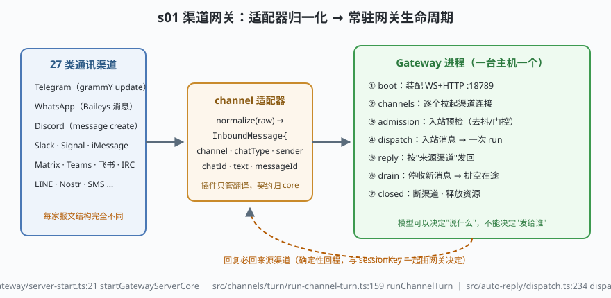

# s01: 渠道网关 —— 没有人在键盘前的入口

`s01` → [s02_session_key](../s02_session_key/) → [s03](../s03_lanes_writer_fence/) → ... → [s10](../s10_pairing_rate_limits/)

> OpenClaw 不是 coding CLI：它的宿主是**一台常开机器 + 27 类通讯渠道 + 一组配对设备**（`package.json:10` 自述 "Multi-channel AI gateway"，bundled 渠道 id 清单在 `src/channels/bundled-channel-ids.generated.ts:11`）。入站是消息事件而不是人类敲的 prompt——所以它第一件做成基础设施的事就是**渠道网关**：适配器只管翻译，网关管生命周期。
>
> **Harness 层**：渠道网关 —— 入站归一化 + 常驻进程生命周期。

---

## 问题

1. **27 家平台，27 种报文形状**：Telegram 的 update 嵌套 `message.chat.id`、WhatsApp(Baileys) 用 `remoteJid` 和 `@g.us` 后缀、Discord 用雪花 id 和 `guild_id`。如果 core 的路由、门控、prompt 装配要认识每一种形状，每接一个新渠道就要改一遍内核。
2. **入站消息可能随时是坏的**：报文缺字段、渠道插件半路挂掉、甚至来自没注册过的渠道。一条坏消息不能炸掉一台 7×24 常驻的进程。
3. **回复发给谁？** coding CLI 的回复天生就在终端里。而这里一条消息可能来自 WhatsApp 私聊、Discord 群或 Slack 线程——如果让模型自己决定"发给谁"，一个被注入的模型就能把私密内容转发到陌生渠道。
4. **常驻进程怎么体面地退场？** 网关一关，在途对话、渠道连接、SQLite 写事务都在半空中。不能靠 Ctrl-C 让消息变成孤儿。

---

## 解决方案



| 机制 | mini 实现 | OpenClaw 真实实现 |
|------|-----------|-------------------|
| 统一入站契约 | `makeInboundMessage()` 冻结的归一化形状 | 渠道插件产出统一 turn 输入（`docs/plugins/sdk-channel-plugins.md:19-37` 定 core/插件职责切分） |
| 适配器只管翻译 | `TelegramAdapter.normalize()` 等 3 个 mock | `extensions/<channel>/` 每家一个插件；core 不 import 任何渠道实现 |
| 入站预检 | `acceptTurn()` 里 unknown-channel / normalize-error 直接丢弃 | `src/channels/turn/run-channel-turn.ts:159` `runChannelTurn`（规范化→admission→dispatch 管道） |
| 消息变 run | `mockAgent` + 回复按 `this.adapters` 路由回来源 | `src/auto-reply/dispatch.ts:234` `dispatchInboundMessage`；回复必回来源渠道（`docs/channels/channel-routing.md:10-13`） |
| 生命周期状态机 | boot → channels-up → accepting → draining → closed | `src/gateway/server.ts:20` `startGatewayServer` → `src/gateway/server-start.ts:21` `startGatewayServerCore`；关停预算 `gateway-shutdown-budget.mjs`（drain 315s + reserve 10s） |

---

## 工作原理

`code.mjs` 四个场景：

**场景 1（装配）**：三个适配器注册进 `MiniGateway.adapters`（这张 Map 就是"回复路由真源"）；重复 id 直接抛错——同一渠道不能有两个主人。

**场景 2（归一化）**：三份异形报文各自过 `normalize()`，产出完全同形的 `InboundMessage`（冻结对象，下游改不动）。注意发送端字段名天差地别，归一化后 core 只认 `channel/chatType/senderId/chatId/text`。回复由网关按 `adapters.get(msg.channel)` 发回来源渠道——模型从头到尾没出现在路由决策里。

**场景 3（admission 拒绝）**：`nostr` 渠道没注册、WhatsApp 报文缺 `key` 字段翻译必炸——两种都只记日志丢弃，网关状态健康。这就是"一条坏消息不能炸常驻进程"。

**场景 4（drain 关停）**：`stop()` 顺序是先 `draining`（拒收新 turn）→ 排空在途 → 逐个 `disconnect()` → `closed`。断连接放在排空之后，是因为排空期间可能还要往渠道发"我处理完了"。

**跑一跑**（零依赖，离线）：

```bash
node code.mjs
```

预期输出：启动日志 + 重复注册报错（边界路径）→ 三条消息的 dispatch/reply 日志 → 两条丢弃日志 + `网关仍健康` → drain 序列 + `final state = closed`。

---

## 对照真实源码

| mini 实现 | OpenClaw 真实代码 / 文档 | 学习点 |
|-----------|--------------------------|--------|
| `MiniGateway` 状态机 | `src/gateway/server.ts:20` `startGatewayServer` → `src/gateway/server-start.ts:21` `startGatewayServerCore`（两文件都短，必读） | 一台主机一个 Gateway = 一个信任边界 |
| 启动链 | `openclaw.mjs`（bin）→ `src/entry.ts:326` `runMainOrRootHelp` → `src/cli/gateway-cli/run.ts:1146` `runGatewayCommand` → `:1073` `startGatewayServer` | 引导层零依赖 `*.mjs`：加载完整 CLI 之前就能解析端口/token |
| `ChannelAdapter.normalize` | `extensions/telegram/`、`extensions/whatsapp/`、`extensions/discord/` 各自的插件实现 | 插件只拥有 Config/DM Security/Pairing/Outbound/Threading（`docs/plugins/sdk-channel-plugins.md:19-37`） |
| `acceptTurn` 预检管道 | `src/channels/turn/run-channel-turn.ts:159` `runChannelTurn`（`:30-200` 是规范化/admission/dispatch 管道） | 门控发生在变 run 之前：未知 DM 发送者在这里被发配对码并丢弃（s05 接棒） |
| "回复必回来源渠道" | `docs/channels/channel-routing.md:10-13` + `src/auto-reply/dispatch.ts:234` `dispatchInboundMessage` → `src/auto-reply/reply/get-reply.ts:279` `getReplyFromConfig` | 模型可以决定"说什么"，不能决定"发给谁" |
| 渠道 id 清单 | `src/channels/bundled-channel-ids.generated.ts:11`（生成物勿手改） | bundled 渠道共 27 个；`src/gateway/server-channels.ts` 持有各渠道连接 |
| drain 预算 | `gateway-shutdown-budget.mjs`（根目录，drain 315s + reserve 10s + supervisor margin 5s） | 关停顺序是常驻进程的契约，不是实现细节 |

> 行号以当前检出为准，上游会漂移：本地检出是 `study-cn-comments` 注释分支，被注文件头插了说明块，行号相对上游 main 下移十几行；跳转请认符号名（`startGatewayServerCore`、`runChannelTurn`、`dispatchInboundMessage`）。

---

## 自测

1. 适配器为什么只被允许"翻译"，而不允许自己实现 send/edit/react？如果 WhatsApp 插件私自实现了转发，破坏的是架构文档里哪条边界？
2. 场景 3 里"未注册渠道的消息"和"翻译失败的报文"都被丢弃了。它们在真实实现里分别对应 `runChannelTurn` 管道的哪一步？为什么都要求"记日志但不炸进程"？
3. "回复必回来源渠道"在 mini 实现里靠 `this.adapters` 这张 Map 保证。想一层：sessionKey（s02）和这张 Map 是什么关系——回复路由的信息是从哪一步开始跟着消息走的？

下一课 [s02_session_key](../s02_session_key/)：归一化之后，消息靠什么语法归到同一个会话。
