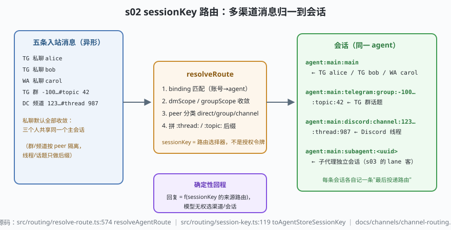

# s02: sessionKey 路由 —— 多渠道消息归一到会话

[s01](../s01_channel_gateway/) → **s02** → [s03_lanes_writer_fence](../s03_lanes_writer_fence/) → ...

> s01 把异形报文归一化了，但 agent 的工作记忆只有"会话"这一个单位。OpenClaw 用一段**确定性拼接的字符串** sessionKey（会话路由选择器）决定"哪些消息共享同一段历史"：私聊默认收敛到 `agent:<agentId>:main`，群/频道按 peer 隔离，线程/话题做后缀（`docs/channels/channel-routing.md:38-70`）。它同时被 s03 的 lane 当作串行化分组键——**key 错一个字符，串行化就失效**。
>
> **Harness 层**：会话路由 —— 输入归一 → 会话归属 → 确定性回程。

---

## 问题

1. **私聊要不要共享历史？** 助理默认"主人只有一个我"：三个渠道私聊同一 agent，默认收敛进同一个主会话（上下文连续）；但多人共用网关时，`alice` 和 `bob` 的对话混在一起就是事故。收敛策略得可配置。
2. **群、频道、线程、话题怎么算"同一个会话"？** 群聊必须隔离（群 A 的历史不能漏给群 B）；Slack/Discord 线程是群的子对话；Telegram 论坛话题嵌在群里。粒度拼错，要么泄上下文，要么把一条线聊成碎片。
3. **回复发给哪条会话的哪个渠道？** s01 说"回复必回来源渠道"，可当同一会话先后来自 WhatsApp 和 Telegram 时，"来源"到底是哪个？回复路由必须与会话绑定且确定。
4. **拿到 sessionKey 算不算拿到权限？** 字符串可猜测、可转发。如果"知道 key"就能往会话里塞消息，路由语法本身就成了攻击面。

---

## 解决方案



| 机制 | mini 实现 | OpenClaw 真实实现 |
|------|-----------|-------------------|
| key 语法 | `buildSessionKey()`：dmScope/groupScope/peerKind/后缀 | `docs/channels/channel-routing.md:38-70`（语法权威页）；`src/routing/resolve-route.ts:96` `buildAgentSessionKey` |
| peer 分类 | direct → 收敛 or `:dm:`；group/channel → 隔离 | `src/routing/peer-kind-match.ts` |
| 路由解析入口 | `SessionStore.resolve()`：算 key + 归会话 + 记来源路由 | `src/routing/resolve-route.ts:574` `resolveAgentRoute`、`:89` `resolveInboundLastRouteSessionKey` |
| 会话侧规范化 | `norm()` trim+小写 | `src/routing/session-key.ts:119` `toAgentStoreSessionKey`、`:160` `classifySessionKeyShape` |
| 确定性回程 | `replyTarget()` 读会话记下的"最后投递路由" | `docs/channels/channel-routing.md:10-13`（回复必回来源渠道） |
| 子代理独立会话 | key 形态 `agent:<id>:subagent:<uuid>`（表内备注） | `src/sessions/session-key-utils.ts` 的 `isSubagentSessionKey`（经 `session-key.ts:27-35` 转出） |

---

## 工作原理

`code.mjs` 四个场景：

**场景 1（私聊收敛与换挡）**：默认 `dmScope: 'main'` 下，telegram:alice、whatsapp:carol、telegram:bob 三条私聊全部落到 `agent:main:main`——这是"个人助理"的默认世界观：主会话就是"我"，跨渠道上下文天然连续；切到 `per-peer`，同一批消息变成三个互不相同的会话。收敛策略是配置而不是硬编码，且**只影响共享上下文**（门控与回复路由仍按来源）。

**场景 2（群隔离 + 后缀）**：群/频道按 `<channel>:group|channel:<id>` 隔离；Telegram 话题 `:topic:42` 内嵌、Discord 线程 `:thread:987654` 追加——与文档示例逐字符一致（`agent:main:telegram:group:-1001234567890:topic:42`）。

**场景 3（两条边界）**：① 攻击者能拼出和主会话一模一样的 key，但这毫无意义——sessionKey 是路由选择器**不是授权令牌**（trust-model.md），"谁能触发"由 s05 的 dmPolicy/白名单在 admission 判；② 回复目标 = 会话记录的"最后投递路由"，模型无权改道。

**场景 4（失败路径）**：故意写一个忘了规范化的拼接器，`agent:Main:Telegram:group:-100` 与严格版不相等——同一群聊被切成两个会话，而 s03 的 lane 按**字符串相等**分组，串行化随之失效。

**跑一跑**（零依赖，离线）：

```bash
node code.mjs
```

预期输出：主会话三合一历史 + per-peer 三分离 → 两个后缀 key 的断言通过 → "拒绝（真正的机制在 s05）" → 规范化漂移的对照行。

---

## 对照真实源码

| mini 实现 | OpenClaw 真实代码 / 文档 | 学习点 |
|-----------|--------------------------|--------|
| `buildSessionKey` | `src/routing/resolve-route.ts:96` `buildAgentSessionKey`、`:574` `resolveAgentRoute` | 渠道账号→agent 的 binding 映射也在这一跳（`src/routing/bindings.ts`） |
| `norm()` 规范化 | `@openclaw/normalization-core/agent-id` + `session-key.ts` 顶部的 normalize 工具 | key 按字符串相等分组，规范化是串行化的前提 |
| peer 分类 | `src/routing/peer-kind-match.ts` | direct/group/channel 三类决定收敛语法 |
| dmScope/groupScope | `docs/channels/channel-routing.md:38-56` | `main`（默认收敛）/`per-peer`/`per-channel-peer`；群可 `groupScope: "main"` 全并入 |
| 线程/话题后缀 | `docs/channels/channel-routing.md:58-70`（示例 key 与 s02 场景 2 逐字符一致） | `:thread:`/`:topic:` 是后缀语法，不换会话主体 |
| key 形状分类 | `src/routing/session-key.ts:160` `classifySessionKeyShape`、`:97` `toAgentRequestSessionKey`、`:140` `resolveAgentIdFromSessionKey` | 请求侧/store 侧两套 key 互转，形状分类是防漂移的校验层 |
| 回程钉定 | `docs/channels/channel-routing.md:10-13` + `src/auto-reply/reply/get-reply.ts:279` `getReplyFromConfig` | 回复路由与会话一起被持久化，"模型无权选渠道" |

> 行号以当前检出为准，上游会漂移：本地为 `study-cn-comments` 注释分支，被注文件行号相对上游 main 下移十几行；跳转认符号名（`buildAgentSessionKey`、`resolveAgentRoute`、`classifySessionKeyShape`）。

---

## 自测

1. 默认 `dmScope: "main"` 下，`alice` 能看到 `bob` 的私聊历史。这在什么产品定位下是对的、什么部署下是事故？文档建议用什么配置隔离（再想一层：隔离上下文之后，门控和回复路由变了吗）？
2. 为什么 Telegram 话题要"内嵌"在群 key 里、而 Discord 线程"追加"后缀？如果统一都用追加，`groupScope: "main"` 语义会发生什么混乱？
3. 场景 5 的规范化漂移会在 s03 造成"同一会话两条 run 并跑"。串行化失效的具体链条是什么？（提示：lane 分组键 = 字符串相等）

下一课 [s03_lanes_writer_fence](../s03_lanes_writer_fence/)：同一个会话被连续轰炸时，谁先谁后、谁写得了历史。
