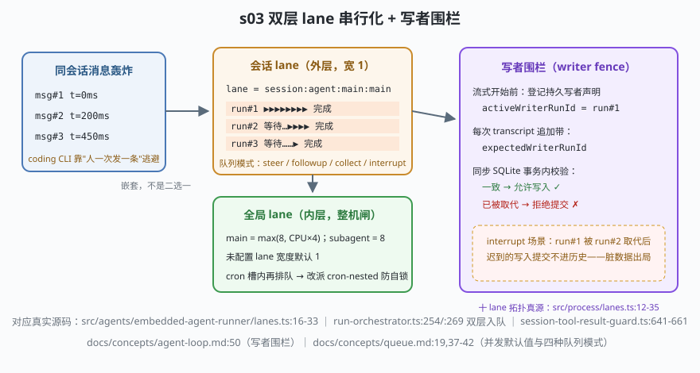

# s03: 双层 lane 与写者围栏 —— 无人值守的并发纪律

[s02](../s02_session_key/) → **s03** → [s04_tool_pipeline](../s04_tool_pipeline/) → ...

> "同一会话被连续多条消息轰炸"在 OpenClaw 是**一等问题**（coding CLI 靠"人在键盘前一次只发一条"逃避了它）。官方答案分三层：**双层 lane**（lane = 车道/串行队列，会话闸嵌套全局闸）、**四种队列模式**（steer 转向 / followup 排队 / collect 合并 / interrupt 打断）、**写者围栏**（writer fence：被取代的 run 提交不进脏数据，`docs/concepts/agent-loop.md:50`）。
>
> **Harness 层**：并发纪律 —— 同会话串行、整机限流、历史唯一写者。

---

## 问题

1. **同会话并发写**：三条消息几乎同时到达同一会话，各自触发一轮带工具调用的 run。没有纪律的话，两轮 run 交错写同一份 transcript——历史出现半新半旧的拼贴，任何重放/审计都失效。
2. **整机资源失控**：会话串行了，但 100 个群 × 每群 1 条并发还是能压垮机器。"每个会话自己排队"解决不了"全网关同时跑多少 run"。
3. **被取代的 run 怎么收场？** interrupt 模式 abort 旧 run 换新 run 上——但旧 run 可能已经流式产出了一半、甚至还有一次 transcript 追加在半路上。它的"迟到写入"提交进去，就是脏数据。
4. **排队者的权限听谁的？** 一条消息排队 20 分钟后终于开跑，这期间发送者权限被改了——按谁的算？

---

## 解决方案



| 机制 | mini 实现 | OpenClaw 真实实现 |
|------|-----------|-------------------|
| 会话 lane（外层，宽 1） | `resolveSessionLane()` → `session:<key>` | `src/agents/embedded-agent-runner/lanes.ts:16-20`（同文件 `:23-33` `resolveGlobalLane`） |
| 全局 lane（内层，整机闸） | `enterGlobal()` 按 `LANE_WIDTH` 封顶 | `src/process/lanes.ts:12-35` 十个静态 lane 登记表；并发默认值 `docs/concepts/queue.md:19`（未配置=1，main=max(8,CPU×4)，subagent=8） |
| 双层嵌套入队 | `enqueue(sessionLane, work)` 内 `enterGlobal()` | `src/agents/embedded-agent-runner/run-orchestrator.ts:254/:269` `enqueueSession(enqueueGlobal(...))` |
| 队列模式 | 场景 3 演示 steer 注入"下一个模型边界" | `docs/concepts/queue.md:37-42` + `src/channels/inbound-debounce-policy.ts`（默认 steer + 500ms debounce + cap 20） |
| 写者围栏 | `claimWriter()` + `append()` 同步校验 `expectedWriterRunId` | `src/agents/session-tool-result-guard.ts:641-661`（`:6` 关键不变量：guard 路径必须同步，写事务里不许 await） |
| 权限不随排队漂移 | （mini 未展开，见自测 3） | `docs/concepts/queue.md:46-47`：排队/委派保留已认证 operator 与原始 scope 上限 |

---

## 工作原理

`code.mjs` 四个场景：

**场景 1（同会话轰炸 + 整机闸）**：三条 run 同时 `Promise.all` 发射，外层会话 lane 用"链尾续接"强制串行——总耗时 ≥ 三段 work 之和（141ms），transcript 追加顺序与发射顺序严格一致。并发默认值与官方一致：`main = max(8, CPU×4)`、`subagent = 8`、未配置 lane 默认 1——会话闸管"谁先谁后"，全局闸管"总共放几个"。

**场景 2（steer）**：run#A 流式进行中收到新消息，不排队而是**注入正在跑的运行时**——已启动的工具跑完、未启动的顺序调用可跳过、在下一次模型决策前 steer 可见。transcript 里能看见 `（已吸收 steer: "…"）`。

**场景 3（失败路径：写者围栏）**：`run#old` 已声明写者，`interrupt` 让 `run#new` 取代；`run#old` 迟到的追加被同步校验拒绝——`writer-fence: 声明已是 run#new`。幽灵 run 连声明都没有，同样被拒。

**场景 4（十 lane 拓扑 + 防死锁）**：静态 lane 全名单（main/system-agent/cron/cron-nested/hook-dispatch/background/subagent/active-memory/nested…）；cron 槽内再触发 agent run 时改派 `cron-nested`——排回 cron 就是等自己，永久自锁。动态 `session:<key>` lane 永不进静态清单，防诊断快照无界膨胀。

**跑一跑**（零依赖，离线）：

```bash
node code.mjs
```

预期输出：串行耗时可证 + 默认值表 → steer 注入出现在 transcript → 三行围栏裁决（旧/新/幽灵）→ lane 全名单 + cron 改派。

---

## 对照真实源码

| mini 实现 | OpenClaw 真实代码 / 文档 | 学习点 |
|-----------|--------------------------|--------|
| `resolveSessionLane` / `resolveGlobalLane` | `src/agents/embedded-agent-runner/lanes.ts:16-33`（23 行文件，性价比最高的精读点之一） | 纯命名映射：同会话永远算出同一个 lane 名，幂等 |
| 十 lane 登记表 | `src/process/lanes.ts:12-35` `CommandLane` + `:39` `STATIC_COMMAND_LANES` | 诊断清单闭合：动态 lane 不进表，快照不膨胀 |
| 双层入队 | `src/agents/embedded-agent-runner/run-orchestrator.ts:199-200`（求两条 lane 名）、`:254`/`:269`（嵌套入队）；`:254` 处还有"先等本会话推迟维护"的注释——会话闸等自己的维护，不占全局槽 | 嵌套而非二选一；等待在 global 之前是有意为之 |
| steer/collect/interrupt | `docs/concepts/queue.md:37-42` + `src/channels/inbound-debounce-policy.ts` | 默认 steer、500ms debounce（防抖）+ cap 20、drop "summarize" |
| 写者围栏 | `src/agents/session-tool-result-guard.ts:641-661`（`transcriptRunId` 本地镜像 + 供料点）、`docs/concepts/agent-loop.md:50` | 跨进程由 Gateway 状态目录锁兜底（`openclaw agent --local` 也抢不走） |
| 三条事件流 | `src/agents/embedded-agent-subscribe.ts:57` `subscribeEmbeddedAgentSession` | tool / assistant / lifecycle 三流桥接，超时与卡死三态见 `agent-loop.md:195-238` |
| cron 防死锁改派 | `src/agents/embedded-agent-runner/lanes.ts:29-31`（`src/agents/lanes.ts` 的 `resolveCronAgentLane` 同语义双写） | wait-edge 权威清单在 `src/process/command-queue.capacity-groups.ts` |

> 行号以当前检出为准，上游会漂移：本地为 `study-cn-comments` 注释分支，被注文件行号相对上游 main 下移十几行；跳转认符号名（`resolveSessionLane`、`enqueueGlobal`、`claimWriter` 对应真身的 `activeWriterRunId` 声明链）。

---

## 自测

1. 为什么会话闸必须嵌套在全局闸**外面**（先排会话队、再抢整机槽），而不是反过来？提示：看 run-orchestrator.ts:254 那条"先等本会话推迟维护"的注释——如果全局槽被本会话维护占着会发生什么？
2. 写者围栏为什么要求校验发生在**同步** SQLite 事务里（根 AGENTS.md：写事务里不许有 await）？如果校验和提交之间夹了一次事件循环调度，竞态窗口里会发生什么？
3. 排队消息的权限"不随排队漂移"（queue.md:46-47）：一条来自 operator A 的消息排队期间 A 被降权，开跑时它仍按 A 原来的 scope 上限执行。这个设计保护的是什么、牺牲的是什么？对照 collect 模式"多渠道合并成一轮"想想。（顺带想一层：cron 槽内再触发 agent run 为什么要改派 `cron-nested`——放宽并发数会破坏哪条不变量？）

下一课 [s04_tool_pipeline](../s04_tool_pipeline/)：run 开跑之前，模型这次能看到哪些工具——八层配置单调收窄。
