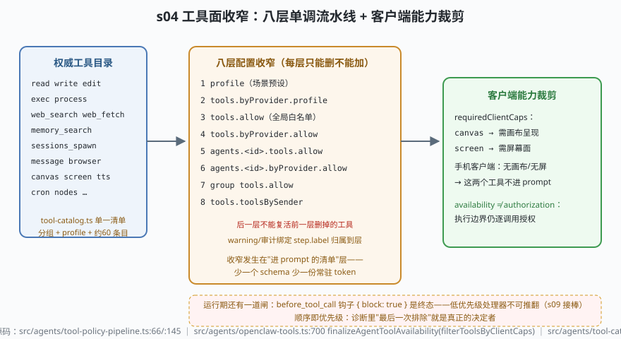

# s04: 工具面收窄 —— 八层单调流水线与客户端能力裁剪

[s03](../s03_lanes_writer_fence/) → **s04** → [s05_security_gates](../s05_security_gates/) → ...

> run 开跑前的第一个问题：模型这次能看到哪些工具？OpenClaw 的答案是**收窄发生在"进 prompt 的清单"层**——少一个 schema 就少一份常驻 token，也少一次误用面。收窄分两处、别混为一谈：**八层配置单调收窄**（`src/agents/tool-policy-pipeline.ts:66`，数组字面量顺序即优先级，每层只能删不能加）+ **装配期客户端能力裁剪**（`src/agents/openclaw-tools.ts:700`，手机没有画布，canvas 就不进手机 prompt）。官方口径见 `docs/tools/index.md:47-49`："模型只看到穿过 profile、allow/deny、provider 限制、沙箱状态、渠道权限与插件可用性之后活下来的工具"。
>
> **Harness 层**：工具面 —— 单一权威目录、单调收窄、能力裁剪、运行期终态闸。

---

## 问题

1. **约 60 个内置工具不可能全给所有场景**：群聊助理不需要 `read/edit/exec`，手机客户端没有画布去呈现 `canvas`。全量下发等于让模型天天对着用不上的 schema 烧 token、顺手试试不该试的工具。
2. **收窄配置散落多处会打架**：全局 `tools.allow`、每 agent 的 `tools.allow`、provider 维度、群维度、发送者维度——如果各层独立生效，A 层删掉的工具被 B 层的 allow 写回来怎么办？"谁说了算"必须只有一个答案。
3. **出问题时不知道怪谁**：模型缺了某个工具，运维面对的是"八层配置的交集"——诊断必须能指出"是哪一层把它删掉的"。
4. **配置收窄挡不住运行期的动态裁决**：清单给了 `exec`，但这一次调用的上下文（发送者、会话、是否沙箱）可能有别的说法。

---

## 解决方案



| 机制 | mini 实现 | OpenClaw 真实实现 |
|------|-----------|-------------------|
| 权威目录 | `CATALOG`（12 条 mini 工具，分组+profiles+caps，注册即冻结） | `src/agents/tool-catalog.ts:38` `ToolProfileId`、`:69` 起 `CORE_TOOL_DEFINITIONS`（约 60 条）、preset 段在文件尾 |
| profile 预设 | `toolsForProfile()`：messaging 无 fs/runtime | tool-catalog 的 `minimal/coding/messaging/full`（`docs/tools/index.md:79-100` 分类表） |
| 八层单调收窄 | `buildPipelineSteps()` + `applyToolPolicyPipeline()` | `src/agents/tool-policy-pipeline.ts:66` `buildDefaultToolPolicyPipelineSteps`、`:145` `applyToolPolicyPipeline` |
| 排除审计 | `audit` 数组：每个被删工具记 `step.label` | 真实实现同样按 `step.label` 归属 warning/审计事件（`tool-policy-pipeline.ts:5` 关键不变量） |
| 客户端能力裁剪 | `filterToolsByClientCaps` + `finalizeAgentToolAvailability`（终化即冻结） | `src/agents/openclaw-tools.ts:700`；`requiredClientCaps` 定义于 `src/agents/tools/common.ts:38/:64`；终化器在 `src/agents/agent-tool-availability.ts` |
| 运行期终态闸 | 场景 4 的钩子链：`{block:true}` 后低优先级不再运行 | `src/agents/agent-tools.before-tool-call.policy.ts:117` `runBeforeToolCallHook`（`:99` agent-loop.md：block 终态不可推翻） |

---

## 工作原理

`code.mjs` 四个场景：

**场景 1（profile 预设）**：`messaging` 下模型可见 `web_search/message/memory_search/cron`——文件与执行工具**整个消失**，而不是"试了再被拒"。

**场景 2（八层流水线 + 失败路径）**：全局 allow → agent allow → sender allow 三层依次削，排除审计逐条绑定到层名（`process ← 被层 [tools.allow] 排除`…）。然后验证核心不变量：profile 层删掉 `read` 后，细层 allow 名单里写回 `read` 也无效——**允许集是交集，后层不能复活前层的删除**。

**场景 3（客户端能力裁剪）**：同一份配置，桌面客户端看到 12 个工具，手机看到 10 个（canvas/screen 需要 `requiredClientCaps`）。注意裁剪与配置收窄正交，且"可用性 ≠ 授权"——这里只决定进不进 prompt。

**场景 4（运行期终态闸）**：`exec` 调用被 `security-guard` 钩子 `{block:true}` 阻断后，更低优先级的 `lazy-logger` 根本没运行——终态裁决不可被推翻，这是 s09 钩子时序的预告。

**跑一跑**（零依赖，离线）：

```bash
node code.mjs
```

预期输出：messaging 四件套 → 十行排除审计 + "写回 read 也无效" → 桌面/手机两份清单 → `read` 放行、`exec` 终态阻断。

---

## 对照真实源码

| mini 实现 | OpenClaw 真实代码 / 文档 | 学习点 |
|-----------|--------------------------|--------|
| `CATALOG` 冻结条目 | `src/agents/tool-catalog.ts`（分组 `:55-66` 一带、条目 `:69` 起、preset 在文件尾） | 单一权威清单：分组/条目/preset 都在这一个文件 |
| profile 收窄 | 同上；`docs/tools/index.md:47-49` | "messaging 的模型看不到任何文件工具"在源码注释里就有点名 |
| 八层流水线 | `src/agents/tool-policy-pipeline.ts:66`（steps 数组）、`:145`（apply） | 由粗到细：profile → provider profile → allow → provider allow → agent → agent provider → group → sender |
| 层归属审计 | 同文件头注释（诊断与 warning 绑定 `step.label`，不许合并成无主人汇总） | 顺序换了，诊断归因也就错了 |
| 客户端能力 | `src/agents/openclaw-tools.ts:700` + `src/agents/tools/common.ts:38` | `requiredClientCaps` 是工具条目属性；进程 flag 不许替远端客户端回答 |
| 钩子包装 | `src/agents/openclaw-tools.ts` 的 `wrapToolWithBeforeToolCallHook` + `src/agents/agent-tools.before-tool-call.policy.ts:117` | 装配期终化 + 运行期钩子是两个时刻 |
| 目录过大怎么办 | `docs/tools/index.md:100`（tool_search / code_mode 代替全量下发 schema） | 大目录不塞 prompt：模型按需检索工具 |

> 行号以当前检出为准，上游会漂移：本地为 `study-cn-comments` 注释分支，被注文件行号相对上游 main 下移十几行；跳转认符号名（`buildDefaultToolPolicyPipelineSteps`、`finalizeAgentToolAvailability`、`runBeforeToolCallHook`）。

---

## 自测

1. 为什么八层的顺序必须是"粗粒度层先削、越具体的层越靠后"？如果把 `tools.toolsBySender` 挪到第一层，"最后一次排除就是决定者"的诊断语义会变成什么样？
2. "availability ≠ authorization"：配置收窄决定工具不进 prompt，但为什么执行边界仍要逐调用授权？（提示：一个未被收窄的工具，在沙箱、发送者、审批三个维度上仍可能有不同答案——s05 就是这三件事。）
3. 手机客户端不装 canvas 能力时，`canvas` 工具连 prompt 都进不去。如果反过来——把工具留在 prompt 里、只靠运行时拒调用——成本和风险各多出什么？

下一课 [s05_security_gates](../s05_security_gates/)：执行边界上的三道闸——dmPolicy 配对码、两层白名单、exec 审批绑定。
