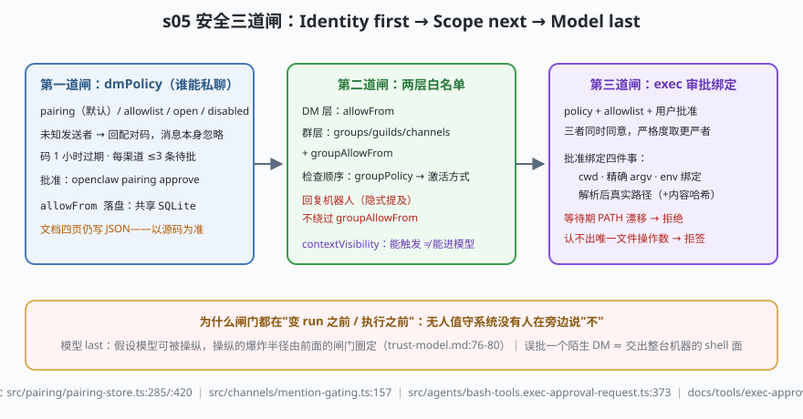

# s05: 安全三道闸 —— 配对码、白名单与审批绑定

[s04](../s04_tool_pipeline/) → **s05** → [s06_unattended_inputs](../s06_unattended_inputs/) → ...

> 无人值守系统的安全设计必须回答：**没有人在旁边说"不"的时候，谁来拒绝？** OpenClaw 的应对顺序三拍（`docs/gateway/security/trust-model.md:76-80`）：**Identity first → Scope next → Model last**。本课走读三道闸：dmPolicy 配对码（谁能私聊）、两层白名单（DM 的 allowFrom + 群的 groupAllowFrom）、exec approvals（沙箱 agent 想上真宿主跑命令时的 policy + allowlist + 用户批准三重同意，且把批准**绑成不可漂移的承诺**）。
>
> **Harness 层**：执行边界 —— 身份、范围、审批三道闸。

---

## 问题

1. **陌生 DM 直接点火**：误批一个陌生人 ≈ 交出整台机器的 shell 面（`SECURITY.md` 的语境）。"先回复再看"不行——回复本身就是执行。
2. **群里的"激活"被当"授权"**：谁能 @机器人 = 谁能让它干活？回复机器人消息算不算激活？激活了但不在名单里的人怎么处理？
3. **"批准过"是一次性的还是持久的？** 用户批准了 `npm test`，半小时后 PATH 上多了一个更早的同名 `npm`——批准的承诺还作数吗？批准 `bash script.sh`，脚本被换了内容呢？
4. **审批能不能被配置放松？** `tools.exec` 配置与 approvals 各说各话时听谁的？

---

## 解决方案



| 机制 | mini 实现 | OpenClaw 真实实现 |
|------|-----------|-------------------|
| dmPolicy 四值 | `dmGate()`：pairing/allowlist/open/disabled | `docs/gateway/security/access-control.md:13-20`（pairing 为默认） |
| 配对码 | `issuePairingCode()`：1h 过期、每渠道 ≤3 待批、批准进 allowFrom | `src/pairing/pairing-store.ts:285` `upsertChannelPairingRequest`、`:420` `approveChannelPairingCode`、`:439` `approveChannelPairingRequest`、`:458` dismiss |
| 审批落盘 | mini 内存 Map | **共享 SQLite**（`pairing-store.ts:13/:296` `runOpenClawStateWriteTransaction`）；遗留 JSON 由 `src/infra/state-migrations.channel-pairing.ts:19` 迁入 |
| 群门控 | `groupGate()`：groupPolicy → 激活 → groupAllowFrom | `src/channels/mention-gating.ts:157` `resolveInboundMentionDecision`、`src/channels/command-gating.ts:20/:49/:71`、`src/channels/direct-dm-guard-policy.ts:39` |
| exec 三重同意 | `mintExecApproval()`：policy+allowlist+用户批准，严格度取更严者 | `docs/tools/exec-approvals.md:12-35`（严格度取更严者在 `:27` 附近的 Note） |
| 审批四绑定 | binding{argv, exePath, exeHash, fileOperand} + `reverifyBeforeLaunch()` | `docs/tools/exec-approvals.md:56-59`（cwd/argv/env/真实路径+内容哈希；PATH 漂移即拒；认不出唯一文件操作数拒签） |

---

## 工作原理

`code.mjs` 四个场景（六个失败路径）：

**场景 1（第一道闸）**：pairing 下未知发送者只拿到配对码话术，消息本身不进 run；批准后放行。失败路径：过期码被拒（1 小时 TTL）、每渠道第 4 条待批请求被拒。

**场景 2（第二道闸）**：`alice` @机器人放行；`eve` **回复**机器人（隐式提及）激活了但不在 `groupAllowFrom` → 拒绝——激活不等于授权，这条正是文档点名的一刀。非激活消息只是"不唤醒"，无需拒绝。

**场景 3（第三道闸）**：`npm test` 三重同意通过，产出绑定 `{argv, exePath, exeHash}`。失败路径：名单在但没用户批准 → 拒；解释器类认不出唯一本地文件操作数 → **拒签**（best-effort 绑定不假装全覆盖）。

**场景 4（最硬的一条）**：执行前重验——PATH 解析到更早的同名可执行文件 → 拒；可写可执行文件内容哈希变化 → 拒。审批是"绑了身份的承诺"，不是"记了个命令前缀"。

**跑一跑**（零依赖，离线）：

```bash
node code.mjs
```

预期输出：配对码签发/批准/两条例外 → 群门控三行裁决（含"回复机器人不构成豁免"）→ 审批一正三反 → 漂移两条拒绝。

---

## 对照真实源码

| mini 实现 | OpenClaw 真实代码 / 文档 | 学习点 |
|-----------|--------------------------|--------|
| `MiniPairingStore` | `src/pairing/pairing-store.ts:217`（读 allowFrom store）、`:285`/:420/:439/:458（增批驳）+ `pairing-challenge.ts` | 配对/白名单/审批是一个 owner 的三张表 |
| SQLite 落盘 | `src/pairing/pairing-store.ts:13` 引入 `runOpenClawStateWriteTransaction` | 官方 docs 四页仍写 JSON——**以源码为准**的活教材 |
| 遗留迁移 | `src/infra/state-migrations.channel-pairing.ts:19` `ALLOW_FROM_SUFFIX` | Doctor 是配置迁移唯一 owner，运行时不留兼容分支 |
| `groupGate` | `src/channels/mention-gating.ts:157` + `command-gating.ts:20/:49/:71` | 检查顺序 groupPolicy → 激活 → 白名单 |
| DM 预加密守卫 | `src/channels/direct-dm-guard-policy.ts:39` `createDirectDmPreCryptoGuardPolicy` | 在解密前就挡掉不该聊的会话 |
| `mintExecApproval` | `src/agents/bash-tools.exec-approval-request.ts:179/:264/:373` + `bash-tools.exec-host-node-policy.ts` | 审批请求按 host（gateway/node）分别注册与裁决 |
| 绑定与重验 | `docs/tools/exec-approvals.md:56-59` | 绑 cwd+精确 argv+env+真实路径（可写文件加内容哈希）；漂移即拒；无唯一操作数拒签 |
| 信任前提 | `docs/gateway/security/trust-model.md:12-22` | 一 Gateway 一信任边界；对抗性用户请分网关 |

> 行号以当前检出为准，上游会漂移：本地为 `study-cn-comments` 注释分支，被注文件行号相对上游 main 下移十几行；跳转认符号名（`approveChannelPairingCode`、`resolveInboundMentionDecision`、`registerExecApprovalRequestForHostOrThrow`）。

---

## 自测

1. pairing 模式下"给陌生发送者回一条配对码"本身也是一次出站回复——为什么这不违反"消息被忽略"？（提示：忽略的是"触发 run 的资格"，回复的是"配对流程话术"；两者在 admission 管道里是两个阶段。）
2. "回复机器人消息（隐式提及）不绕过 `groupAllowFrom`"：如果放开这条，攻击者构造什么最小攻击链？
3. exec 审批为什么要把"可执行文件解析后的真实路径 + 内容哈希"绑进承诺，而不是只记命令前缀？对比"记住 `npm` 前缀就放行"的 allowlist 思路，多出来的这道闸防的是什么？（再往 s06 想一层：cron/webhook 触发的 run 没有物理发送者，第一道闸的"身份"从哪里来？）

下一课 [s06_unattended_inputs](../s06_unattended_inputs/)：cron、webhook、语音唤醒——三类没有人类敲键盘的输入源。
