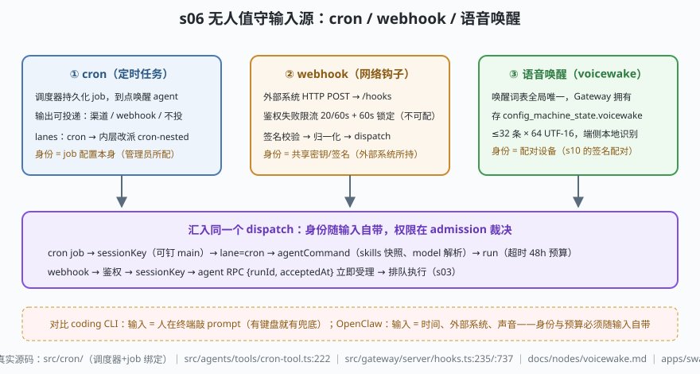

# s06: 无人值守输入源 —— cron、webhook 与语音唤醒

[s05](../s05_security_gates/) → **s06** → [s07_memory_compaction](../s07_memory_compaction/) → ...

> coding CLI 的输入源只有一种：**人在终端敲 prompt**——有键盘就有兜底。OpenClaw 的输入源是"没有人敲键盘"的三类事件：**cron**（定时任务，时间驱动）、**webhook**（网络钩子，外部系统驱动）、**语音唤醒**（voicewake，声音驱动）。它们必须汇入与人类消息完全相同的 dispatch 管道，而且**身份与预算随输入自带**——这是 s05 三道闸在无人值守场景的延伸。
>
> **Harness 层**：无人值守输入 —— 触发源、身份来源、统一 admission。

---

## 问题

1. **"到点干活"谁来叫醒？** 助理要在每天早上 8 点发晨报、在 CI 失败时主动检查——没有人发消息，run 从哪里来？跑到哪条 lane、写进哪个会话？
2. **外部系统敲门**：CI 平台、监控告警要推事件进来。HTTP 端点暴露在公网上，谁都能 POST——怎么区分"我的 CI"和"扫描器"？
3. **声音也是输入**：唤醒词命中之前，麦克风不该产生任何"消息"；命中之后，这段声音的身份是**设备**而不是人——授权按谁算？
4. **身份从哪来？** s05 第一道闸按"发送者"授权，但 cron job 没有发送者、webhook 只有密钥、语音只有设备。

---

## 解决方案



| 机制 | mini 实现 | OpenClaw 真实实现 |
|------|-----------|-------------------|
| cron 调度 | `MiniCronScheduler.tick()`：到点触发 + `deleteAfterRun` | `src/cron/`（约 225 文件：`active-jobs.ts`、`command-runner.ts`、`job-session-bindings.ts`…）；工具侧 `src/agents/tools/cron-tool.ts:222` `createCronTool` |
| cron 的 lane 语义 | `resolveInnerLane()`：内层改派 `cron-nested` | `src/agents/embedded-agent-runner/lanes.ts:29-31`（s03 场景 5 的死锁故事在输入源这侧的体现） |
| webhook 鉴权 | `MiniWebhookEndpoint.accept()`：签名比对 + 失败限流锁定 | `src/gateway/server/hooks.ts:235` `createGatewayHookDispatcher`、`:737` 请求处理器；限流 20/60s + 60s 锁定不可配（`docs/gateway/security/rate-limiting.md`，s10 全表） |
| voicewake 表 | `MiniVoicewakeTable.set()`：≤32 条 × 64 码元、空表回落默认 | `docs/nodes/voicewake.md:9-35`（全局唯一、Gateway 拥有，存 `config_machine_state.voicewake.triggers`，默认 openclaw/claude/computer） |
| 端侧唤醒 | `detectAndRoute()`：命中才产生输入 | `apps/swabble/`（Swift 6.2 守护进程，Speech.framework 端侧本地识别、零网络，默认词 `clawd`/别名 `claude`） |
| 统一 admission | `dispatchAdmission()`：三类输入同一组闸 | `src/channels/turn/run-channel-turn.ts:159` 的 admission 管道 + `src/agents/agent-command.ts`（CLI/RPC 汇聚点） |

---

## 工作原理

`code.mjs` 四个场景：

**场景 1（cron）**：job 每 3 拍触发，内层 run 的 lane 恒为 `cron-nested`——cron 槽被外层定时任务持有，内层排回 cron 就是等自己。job 可钉定 session（`--session main`）与 `--delete-after-run`（一次性提醒）。

**场景 2（webhook，失败路径）**：合法签名 200；连续坏签名累计到 20 次/60s 触发 60 秒锁定，**锁定期间连合法签名也 429**——限流保护的是端点，不是单个请求。

**场景 3（voicewake）**：`"claude 帮我订机票"` 命中默认唤醒词 → 产生输入；未命中的话术不产生任何输入。规范化边界：33 条截到 32、80 字截到 64 码元（按码点切不劈代理对）、全空表回落内置默认。

**场景 4（统一 admission，失败路径）**：人类 DM 没过 dmPolicy、webhook 没过鉴权、语音设备没配对——三类各被自己的身份闸拒绝；cron job 的身份就是管理员写入的 job 配置本身，直接过闸。

**跑一跑**（零依赖，离线）：

```bash
node code.mjs
```

预期输出：两次 tick 触发（lane=cron-nested）→ 429 锁定两连 → 唤醒命中/未命中对照 + 三条规范化边界 → 四行 admission 裁决。

---

## 对照真实源码

| mini 实现 | OpenClaw 真实代码 / 文档 | 学习点 |
|-----------|--------------------------|--------|
| job 生命周期 | `src/cron/`（`docs/automation/cron-jobs.md:12-14`：调度器持久化 job、到点唤醒、可投递渠道/webhook/不投） | `openclaw automations` CLI 管理，`openclaw cron` 是别名 |
| `createCronTool` | `src/agents/tools/cron-tool.ts:222`（模型也能建定时任务） | agent 侧与 CLI 侧共写同一张 job 表 |
| webhook 端点 | `src/gateway/server/hooks.ts:235`/:737 + `docs/plugins/webhooks.md` | HTTP webhook 与进程内钩子（s09）是两套不同机制 |
| voicewake 协议 | `docs/nodes/voicewake.md:9-35`（`voicewake.get/set`、`voicewake.routing.get/set`） | 表全局唯一、Gateway 持久化并广播到所有客户端 |
| swabble | `apps/swabble/README.md:1-10` | launchd 服务、端侧 Speech.framework、`--no-wake` 旁路 |
| 统一入口 | `src/agents/agent-command.ts`（`agent` RPC 立即返回 `{runId, acceptedAt}`） | `agent.wait(runId)` 只等 lifecycle end/error（`docs/concepts/agent-loop.md:20`） |

> 行号以当前检出为准，上游会漂移：本地为 `study-cn-comments` 注释分支，被注文件行号相对上游 main 下移十几行；跳转认符号名（`createCronTool`、`createGatewayHookDispatcher`）。

---

## 自测

1. cron job 的身份是"job 配置本身"。这意味着什么？——如果管理员建了一个 `--session main` 的晨报 job，它写晨报进主会话时，工具权限按谁算？跟 s03 的"权限不随排队漂移"如何对上？
2. webhook 限流是 20 次失败/60 秒且**不可配**，而认证失败限流（10/60s）可配。为什么对外部系统的端点反而更硬？（提示：webhook 的调用方不是"你自己的 CLI"。）
3. 唤醒词表"全局唯一、Gateway 拥有"而不是每设备一份——这个决定防掉了什么问题？（想两层：多设备一致性、以及"谁有权改唤醒词"。）

下一课 [s07_memory_compaction](../s07_memory_compaction/)：跑起来的 run 怎么获得上下文——六个注入文件、分层记忆，以及唯一能改写历史的机制。
