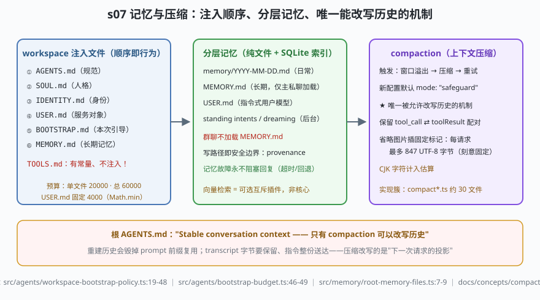

# s07: 记忆与压缩 —— 唯一能改写历史的机制

[...](../s06_unattended_inputs/) → **s07** → [s08_skills_priority](../s08_skills_priority/) → ...

> OpenClaw 的记忆哲学（`docs/concepts/memory-architecture.md:23-46` 五原则）：**纯文件 + 一个 SQLite 索引**，无隐藏状态；难点在写入而非检索；**写路径就是安全边界**；确定性门槛内才轮到模型判断；**记忆故障永不阻塞回复**。上下文治理的两端——六个 workspace 注入文件（顺序即行为、带预算）与 compaction（`docs/concepts/compaction.md`，新配置默认 `mode:"safeguard"`）——共享同一条根 `AGENTS.md` 铁律：**Stable conversation context，只有 compaction 可以改写历史**。
>
> **Harness 层**：上下文与记忆 —— 注入、分层、压缩。

---

## 问题

1. **模型每次开跑只带一个 prompt**：人格、身份、用户画像、长期记忆怎么"随叫随到"？文件该按什么顺序进 prompt——顺序错了，同一 workspace 在 CLI 与 UI 里就是两套优先级，前缀复用也被打断。
2. **注入要花预算**：不设上限的话，一个 3 万字的 USER.md 就能把窗口吃光。全局调大会不会反过来冲垮某个特殊文件的固定帽？
3. **长会话必然溢出**：常见的压缩做法是直接删历史、改 transcript——历史被改，s03 的写者围栏、审计、重放全部失真。
4. **压缩会把工具调用拆开吗？** 折叠掉一个 `tool_call` 却留下它的 `tool_result`（或反之），重放时就是悬空调用。

---

## 解决方案



| 机制 | mini 实现 | OpenClaw 真实实现 |
|------|-----------|-------------------|
| 注入文件唯一真源 | 7 个常量 + `WORKSPACE_BOOTSTRAP_FILENAMES`（TOOLS.md 有名无份） | `src/agents/workspace-bootstrap-policy.ts:19-26`（常量）、`:28-33`（生成集 4 件）、`:41-48`（注入集 6 件，顺序即行为） |
| 记忆文件名 owner | `DEFAULT_MEMORY_FILENAME` 复用 memory 模块常量 | `src/memory/root-memory-files.ts:7-9`（canonical `MEMORY.md`、legacy `memory.md`、修复目录） |
| 预算 | `effectiveFileLimit()`：USER.md 取 `Math.min` 固定帽 | `src/agents/bootstrap-budget.ts:46-49`（单文件 20000、总 60000、USER.md 4000，`docs/concepts/agent-workspace.md`） |
| 分层记忆 | `MiniMemoryLayer.recall()`：群聊不加载 MEMORY.md | `docs/concepts/memory-architecture.md`（日常 `memory/YYYY-MM-DD.md`、长期 MEMORY.md 仅主私聊、USER.md、standing intents、dreaming） |
| 故障不阻塞 | `Promise.race` 超时回退 | 五原则⑤（`memory-architecture.md:44-46`）：每步有超时或回退 |
| compaction | `compact()`：组原子折叠 + 配对保持 + 847B 标记预算 | `docs/concepts/compaction.md:23`（847 UTF-8 字节/请求，刻意固定）、`:26`（safeguard 默认）；实现簇 `src/agents/embedded-agent-runner/compact*.ts`、`compaction-*.ts`（约 30 文件） |

---

## 工作原理

`code.mjs` 四个场景：

**场景 1（注入顺序）**：`AGENTS → SOUL → IDENTITY → USER → BOOTSTRAP → MEMORY` 六件依序进 prompt；`TOOLS.md` 虽有常量却不进注入集——"内核认得这个名字"与"会被读进 prompt"是两件事。

**场景 2（预算边界）**：缺失 4 个文件只打 `missing file` 标记继续；USER.md 写 3 万字也被 4000 的固定帽截住；把全局预算调到 9 位数，USER.md 照样只给 4000——`Math.min` 这行代码就是"调大全局值也放不开 USER.md"的注释本体。

**场景 3（分层记忆 + 失败路径）**：主私聊 recall 拿到长期记忆；群聊按分层规则不加载 MEMORY.md；后台检索模拟卡死 → 超时回退"无记忆继续回复"——原则⑤的体感。

**场景 4（compaction）**：147 tok > 120 预算 → 溢出触发。压缩后 64 tok：老消息按**组**原子折叠（调用与结果同组、永不拆开），图片只插固定标记且全请求标记 ≤847 字节（刻意固定，防估算漂移），投影里无悬空调用。重试成功——而 transcript 真源一个字节没动，改写只发生在"下一次请求的投影"上。

**跑一跑**（零依赖，离线）：

```bash
node code.mjs
```

预期输出：六段注入顺序 → 4010 字符截断（含标记）→ 三行记忆裁决（含超时回退）→ `147→64 tok、39B 标记、配对原子` 的压缩账单。

---

## 对照真实源码

| mini 实现 | OpenClaw 真实代码 / 文档 | 学习点 |
|-----------|--------------------------|--------|
| 常量组 | `src/agents/workspace-bootstrap-policy.ts:19-26` | "别处再抄一份私有列表，会在文件退役时静默漂移"——注释原话 |
| 注入集与生成集 | 同文件 `:28-33`（引导期只凭空写 4 件人格文件） | MEMORY.md/BOOTSTRAP.md 各有产出方，不归 workspace 生成器管 |
| 预算 | `src/agents/bootstrap-budget.ts:46-53`（注释明写 USER.md 的固定帽） | `docs/concepts/agent-workspace.md:106` 的三个数字 |
| 记忆五原则 | `docs/concepts/memory-architecture.md:23-46` | 本课问题的官方答案全在这 24 行里 |
| dreaming / active memory | `docs/concepts/dreaming.md`、`extensions/active-memory/` | 后台 curation pass：把写移出回复热路径 |
| 向量检索 | `extensions/memory-lancedb/`、`memory-core/`、`memory-wiki/` | 可选插件而非核心，且 memory 是唯一互斥插件槽 |
| compaction 实装 | `src/agents/embedded-agent-runner/` 的 `compact*.ts`、`compaction-*.ts` | 溢出 → 压缩 → 重试的编排；`before_compaction/after_compaction` 钩子只观察不裁决（s09） |

> 行号以当前检出为准，上游会漂移：本地为 `study-cn-comments` 注释分支，被注文件行号相对上游 main 下移十几行；跳转认符号名（`WORKSPACE_BOOTSTRAP_FILENAMES`、`effectiveBootstrapFileLimit`、`CANONICAL_ROOT_MEMORY_FILENAME`）。

---

## 自测

1. 注入顺序（AGENTS→SOUL→IDENTITY→USER→BOOTSTRAP→MEMORY）为什么是"行为不是排版"？如果 UI 端自己排了一份顺序，坏掉的恰好是哪条工程约束？（提示：prompt 前缀复用。）
2. compaction 是唯一被允许改写历史的机制。把 s03 的写者围栏、本课的"投影不动真源"、以及"compaction 动作自己也可审计"三条连起来，解释为什么历史永远可重放。
3. 群聊不加载 MEMORY.md——这条分层规则同时服务安全与上下文质量。想一层：如果群聊加载了长期记忆，s05 的哪类攻击变得更顺？（提示：诱导模型把私聊长期记忆说出去。）

下一课 [s08_skills_priority](../s08_skills_priority/)：agent 的"说明书库"从哪加载——七档优先级与同名仲裁。
