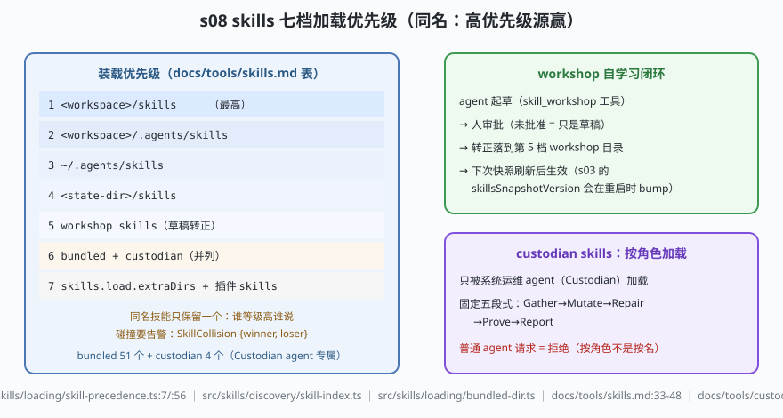

# s08: skills 七档优先级 —— 装载顺序即权限

[...](../s07_memory_compaction/) → **s08** → [s09_hooks_plugins](../s09_hooks_plugins/) → ...

> skill（技能）= 一个带 `SKILL.md` 的说明书包。OpenClaw 自带 51 个 bundled 技能 + 4 个 custodian 技能，用户/插件再叠自己的——**同名必撞**。装载规则七档（`docs/tools/skills.md:33-48`，高优先级在前）：workspace → 项目 → 个人 → 管理态 → workshop → bundled+custodian（并列）→ extraDirs+插件。同名只留一个、碰撞必须告警（`SkillCollision { winner, loser }`，`src/skills/loading/skill-precedence.ts:7/:12`）——**装载顺序即权限**。
>
> **Harness 层**：技能面 —— 七档来源、同名仲裁、角色闸、自学习闭环。

---

## 问题

1. **同一技能名出现在三个地方**：用户在 workspace 改过 `weather`，项目带了一份，bundled 又自带一份。模型看到哪个？如果三个都进 prompt，就是三份互相矛盾的说明书。
2. **运维技能不能让业务 agent 拿到**：`configure-channel`（修渠道配置）这种技能落在安装目录里，但普通对话 agent 绝不该看见它——按什么挡？按名字黑名单吗？
3. **agent 自己写的技能怎么转正？** 让 agent 随手把新技能写进 workspace 等于免审批的代码注入；完全不写则自学习闭环断头。
4. **技能目录什么时候刷新？** 改了 SKILL.md 之后，正在跑的会话用旧版还是新版？

---

## 解决方案



| 机制 | mini 实现 | OpenClaw 真实实现 |
|------|-----------|-------------------|
| 七档来源 | `SOURCES` 表（tier 1-7，bundled/custodian 并列第 6） | `docs/tools/skills.md:33-48`（表格逐档列出，与 mini 逐行对应） |
| 同名仲裁 | `loadSkills()`：tier 升序先到先得，低级被顶 | `src/skills/loading/skill-precedence.ts:56` `mergeSkillRecords` |
| 碰撞告警 | `warnCollisions()` | `src/skills/loading/skill-precedence.ts:7`（类型）/:12（`warnSkillPrecedenceCollisions`） |
| 技能索引/发现 | （mini 未展开，靠 `SOURCES` 遍历） | `src/skills/discovery/skill-index.ts`、`filter.ts`；装载 `src/skills/loading/bundled-dir.ts` 等 |
| 角色闸 | `role: 'custodian'` 才装载第 6 档 custodian 技能 | `docs/tools/custodian-skills.md:11-27`：只被 Custodian 系统运维 agent 加载，固定五段式 Gather→Mutate→Repair→Prove→Report |
| 自学习闭环 | `promote()`：未批准只是草稿，批准落第 5 档 | `docs/tools/skill-workshop.md` + `src/skills/workshop/`（`skill_workshop` 工具） |
| 快照刷新 | （mini 未展开） | `src/skills/runtime/refresh-state.ts` 的 `bumpSkillsSnapshotVersion`（`server-start.ts:45` 重启即 bump） |

---

## 工作原理

`code.mjs` 四个场景：

**场景 1（同名仲裁）**：`weather` 在三个源都出现——workspace(tier 1) 赢；`github` 的 bundled 版赢过插件版(tier 7)。三条碰撞告警逐条给出 winner/loser 及其 tier——运维能看见"谁被谁顶了"。

**场景 2（prompt 顺序）**：技能目录按 tier 升序进 prompt，用户手改的技能排在最前——对模型行为的"话语权"与优先级一致。

**场景 3（失败路径：角色闸）**：普通 agent 装载 5 个技能、看不到 `configure-channel`；切到 `role: 'custodian'` 才装载 custodian 技能（7 个）。**装载即授权**——不进目录，模型连"有这个技能"都不知道（与 s04 的清单层收窄同一思想）。

**场景 4（workshop 闭环）**：agent 起草 `standup-helper` → 未批准只是草稿（不进装载目录）→ 人工批准后落第 5 档 → 重新装载生效。自学习有了闸门，闭环没有断头。

**跑一跑**（零依赖，离线）：

```bash
node code.mjs
```

预期输出：`共装载 5 个` + 三条碰撞告警 → tier 升序目录 → 普通/Custodian 两个视角对比 → 草稿两态与转正后的装载结果。

---

## 对照真实源码

| mini 实现 | OpenClaw 真实代码 / 文档 | 学习点 |
|-----------|--------------------------|--------|
| 七档表 | `docs/tools/skills.md:33-48` | 注意脚注：执行 workspace 的 `skills/`、`.agents/skills/` 追加在整个目录之后，但 workspace 内 `skills/` 优先 |
| `mergeSkillRecords` | `src/skills/loading/skill-precedence.ts:56` | 合并即仲裁：碰撞记录与最终目录同一次遍历产出 |
| 碰撞告警 | 同文件 `:7`/:12 | 告警是运维面：静默顶替会让"我明明改了"变成悬案 |
| 九个子模块 | `src/skills/{config,discovery,library,lifecycle,loading,runtime,security,test-support,workshop}` | discovery/loading/runtime 是主链；security 子模块管技能面安全 |
| bundled 装载 | `src/skills/loading/bundled-dir.ts` | 安装目录的 51 个 SKILL.md 由此进目录 |
| custodian | `docs/tools/custodian-skills.md:11-27`、`src/system-agent/` | 五段式固定流程；技能面按角色收敛 |
| workshop | `docs/tools/skill-workshop.md`、`src/skills/workshop/`、`docs/tools/self-learning.md` | 起草-审批-转正的自学习闭环 |
| 快照刷新 | `src/skills/runtime/refresh-state.ts`（`server-start.ts:45` 每次重启 bump） | 技能目录是快照语义：改文件后靠刷新生效 |

> 行号以当前检出为准，上游会漂移：本地为 `study-cn-comments` 注释分支，被注文件行号相对上游 main 下移十几行；跳转认符号名（`mergeSkillRecords`、`warnSkillPrecedenceCollisions`、`bumpSkillsSnapshotVersion`）。注：技能/插件数量随上游漂移（本检出 51 bundled + 4 custodian，阅读指南记 52 + 4）。

---

## 自测

1. "装载顺序即权限"与 s04 的"收窄发生在进 prompt 的清单层"是同一思想。对比另一种做法——所有技能都进 prompt、靠运行时拦截未授权技能——成本与风险各多在哪？
2. 场景 1 里用户手改的 `weather` 赢了 bundled 版。这是用户主权的好设计，也是攻击面：什么角色能往 tier 1 目录写文件？结合"workspace 不是硬沙箱"（`docs/concepts/agent-workspace.md:16-19`）想想 tier 1 的写入权该攥在谁手里。
3. workshop 闭环为什么坚持"人工审批"这一步？如果放开，s07 的"写路径即安全边界"原则会在哪一环失守？

下一课 [s09_hooks_plugins](../s09_hooks_plugins/)：17 个钩子位的时序与终态裁决，以及 160+ 插件的注册面。
