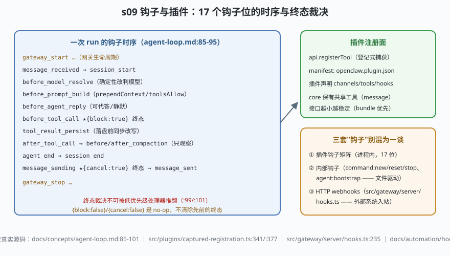

# s09: 钩子与插件 —— 时序即契约，终态即终审

[...](../s08_skills_priority/) → **s09** → [s10_pairing_rate_limits](../s10_pairing_rate_limits/) → ...

> OpenClaw 给插件留了 **17 个钩子位**（`docs/concepts/agent-loop.md:85-95`），覆盖一条消息的全部生命周期；插件工具经**登记式捕获**注册（`src/plugins/captured-registration.ts:377`）。两个语义是骨架：**时序即契约**（钩子按矩阵固定顺序触发）、**终态裁决**——`before_tool_call {block:true}` 与 `message_sending {cancel:true}` 是终审，低优先级处理器不再运行，`{block:false}/{cancel:false}` 是 no-op 不清案底（`:99`/`:101`）。另要分清三套"钩子"：插件钩子矩阵、内部钩子（`command:new/reset/stop`、`agent:bootstrap`，`docs/automation/hooks/`）、HTTP webhooks（`src/gateway/server/hooks.ts`，s06 的入站端点）。
>
> **Harness 层**：扩展面 —— 钩子矩阵、注册面、终态语义。

---

## 问题

1. **插件要在多少个环节插手？** 改模型选择、注入 prompt 前缀、代答、拦工具调用、改写落盘结果、拦出站消息……没有一个统一的"位置清单"，每个插件就都在自己发明的位置上插代码，时序立刻失控。
2. **两个插件抢一个环节**：日志插件和拦截插件都挂了 `before_tool_call`，谁先跑？先到的能赦免后到的吗？
3. **插件能不能"顺手"改内核？** `api.registerTool` 如果是直接调用内核的写操作，插件代码就有能力绕过装配流程。
4. **哪些环节允许裁决、哪些只许围观？** 压缩正在进行时，插件能不能否决压缩？

---

## 解决方案



| 机制 | mini 实现 | OpenClaw 真实实现 |
|------|-----------|-------------------|
| 17 位时序表 | `HOOK_ORDER` 数组（顺序即契约） | `docs/concepts/agent-loop.md:85-95` 钩子矩阵（权威表） |
| 派发 + 终态 | `HookBus.dispatch()`：优先级排序，block/cancel=true 即停 | `:99`（block 终态 + no-op 语义）、`:101`（cancel 终态）；工具侧实装 `src/agents/agent-tools.before-tool-call.policy.ts:117` |
| 登记式注册 | `createPluginApi().registerTool/registerToolMetadata` | `src/plugins/captured-registration.ts:377` `registerTool`、`:341` 元数据版；stub `src/plugins/api-builder.ts` |
| 观察位 | `OBSERVE_ONLY = before/after_compaction` | `agent-loop.md:89`：压缩钩子不重写、不否决 |
| 清单层收窄复用 | ——（s04 的 toolsAllow 正是钩子能带的负载之一） | `agent-loop.md:86`：`before_prompt_build` 可带 `toolsAllow`，空数组=不提交可选工具 |
| 插件形态 | ——（mini 不展开打包） | manifest `openclaw.plugin.json`；code/bundle 两形态，优先 bundle（接口更小更稳定，`VISION.md:86-93`）；本地检出 extensions/ 有 160 个 plugin manifest |

---

## 工作原理

`code.mjs` 四个场景：

**场景 1（装配 + 全时序）**：两个插件经 api 登记（工具 + 元数据两种注册面），一条消息从 `gateway_start` 走到 `agent_end`，`fired` 数组记录的顺序与矩阵逐位一致——想插手某个环节，先确认自己排在谁前面。

**场景 2（block 终态，失败路径）**：`exec` 调用被安全插件（priority 100）`{block:true}` 阻断，优先级 10 的日志处理器**没运行**；`read` 正常放行，两个处理器都跑了。

**场景 3（cancel 终态，失败路径）**：含 `sk-` 密钥的消息在 `message_sending` 被取消——`message_sent` 永远不会触发；正常消息放行。这是"模型说错了话"的最后一道闸。

**场景 4（观察位、no-op 与边界）**：`before_compaction` 只观察（插件想否决压缩？没门）；`{block:false}` 是 no-op——不会"赦免"后续处理器给出的终态（exec 仍被阻断）。收尾对照三套"钩子"：插件钩子矩阵（进程内）、内部钩子（文件驱动）、HTTP webhooks（外部入站）——三套机制三个方向，别混为一谈。

**跑一跑**（零依赖，离线）：

```bash
node code.mjs
```

预期输出：两个插件的登记结果 → 七连钩子时序 → `exec` 终态阻断（日志处理器缺席）→ 密钥拦截两连 → 观察位/no-op 语义 + 三套钩子清单。

---

## 对照真实源码

| mini 实现 | OpenClaw 真实代码 / 文档 | 学习点 |
|-----------|--------------------------|--------|
| 17 位矩阵 | `docs/concepts/agent-loop.md:85-95` | `before_model_resolve` 是模型选择的确定性改判点；`before_prompt_build` 带 `toolsAllow` |
| 终态语义 | 同文档 `:99`/:101 | 终态 + no-op 双语义成对出现，是可组合拦截的前提 |
| 工具侧拦截 | `src/agents/agent-tools.before-tool-call.policy.ts:117` `runBeforeToolCallHook` | `{block:true}` 之后不会再有处理器，也不再有工具执行 |
| 登记式捕获 | `src/plugins/captured-registration.ts:341/:377` | "捕获"= 收集插件声明，装配时统一消费——插件不直改内核 |
| 插件面 stub | `src/plugins/api-builder.ts` | api 是小接口层：`registerTool`/`on`/生命周期挂钩 |
| HTTP webhooks | `src/gateway/server/hooks.ts:235` `createGatewayHookDispatcher` | 第三套机制：外部系统入站（鉴权/限流见 s06/s10） |
| 内部钩子 | `docs/automation/hooks/{event-types,writing-hooks,bundled-hooks}.md` | `command:new/reset/stop`、`agent:bootstrap`——文件驱动，与插件无关 |
| 插件生态 | `extensions/`（本地检出 160 个 plugin manifest）、`docs/plugins/sdk-channel-plugins.md` | 渠道插件声明 `"channels": [...]`，core 保有共享 `message` 工具 |

> 行号以当前检出为准，上游会漂移：本地为 `study-cn-comments` 注释分支，被注文件行号相对上游 main 下移十几行；插件数量亦随上游漂移（阅读指南记 171，本检出 160）。跳转认符号名（`runBeforeToolCallHook`、`registerTool`、`createGatewayHookDispatcher`）。

---

## 自测

1. 终态语义为什么必须配一条 no-op 规则（`{block:false}` 不清案底）？如果没有 no-op 规则，两个插件的"意图冲突"会怎样被错误仲裁？
2. `tool_result_persist` 是"落盘前同步改写"，而 s07 说过历史要可重放。插件改写工具结果不就破坏了审计吗？（提示：改写发生在 transcript 写入点、是持久事实的一部分；对照 s03 的写者围栏想想"谁拥有写权"。）
3. `before_compaction/after_compaction` 只观察不裁决。如果允许插件否决压缩，s07 的"溢出 → 压缩 → 重试"链会在哪一步卡死？

收官课 [s10_pairing_rate_limits](../s10_pairing_rate_limits/)：设备签名配对与六条限流——无人值守系统的最后一道墙。
