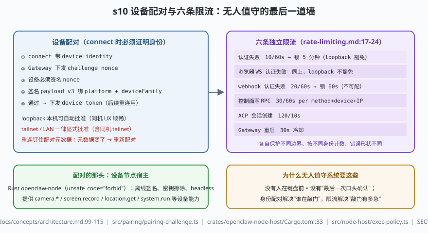

# s10: 设备配对与限流 —— 无人值守的最后一道墙（收官）

[...](../s09_hooks_plugins/) → **s10**

> 无人值守系统的最后一道墙回答两个问题：**谁在敲门**（身份）、**敲门有多急**（预算）。所有 WS 客户端 connect 时带 device identity，Gateway 下发 challenge nonce **必须签名**，签名 payload v3 绑 platform 与 deviceFamily，通过后发 device token、重连钉住配对元数据（`docs/concepts/architecture.md:99-115`）；配合**六条独立限流**（`docs/gateway/security/rate-limiting.md:17-24`）——各护各的边界、各按各的身份计数。配对的那头是 Rust 节点宿主 openclaw-node（headless 无界面常驻，`unsafe_code = "forbid"`，`crates/openclaw-node-host/Cargo.toml:33`）：离线签名、密钥擦除。
>
> **Harness 层**：信任边界 —— 设备身份 + 资源预算 + 收官复盘。

---

## 问题

1. **设备能力是真实点击面**：配对的节点提供 `camera.*`、`screen.record`、`system.run`——没有强身份的设备能力等于把摄像头和 shell 暴露给任何知道端口的人。
2. **"本机豁免"会被浏览器绕过吗？** loopback 豁免让本地 CLI 舒服，但浏览器页面也能从 127.0.0.1 发起 WS——同一 IP，两种信任。
3. **扫描器在敲门**：公网网关必然被扫。认证失败不设防的话，字典攻击只是时间问题；但总闸一刀切又会把正常运维锁死。
4. **十课学完，不变量之间是什么关系？** 一条消息从渠道进来（s01）到回复出去，每一站靠什么不被破坏？

---

## 解决方案



| 机制 | mini 实现 | OpenClaw 真实实现 |
|------|-----------|-------------------|
| challenge 签发/验签 | `mockSign()`（sha256 示意）+ `verifyAndApprove()` | `src/pairing/pairing-challenge.ts`（channel pairing challenge）；设备侧签名 payload v3 绑 platform/deviceFamily（`docs/concepts/architecture.md:99-115`） |
| 元数据钉住 | `pinned` Map：重连比对，漂移即要求重新配对 | 同上（"pins paired metadata on reconnect"） |
| token 下发 | `devtok-…` | 新设备配对后 Gateway 签发 device token 供后续重连 |
| 节点宿主 | （mini 未展开，见 README 对照） | `src/node-host/`（TS）+ `crates/openclaw-node-host/`（Rust，`Cargo.toml:33` forbid unsafe；依赖 ed25519-dalek/hmac/sha2/zeroize） |
| 六条限流 | `RateLimiter` 类 × 6（exempt 钩子表达 loopback 豁免） | `docs/gateway/security/rate-limiting.md:17-24`（表）；`gateway.auth.rateLimit` 可配项 |
| 写 RPC scope | （mini 不展开） | `src/gateway/methods/core-descriptors.ts`（RPC method → scope 声明表，权限入口） |

---

## 工作原理

`code.mjs` 四个场景：

**场景 1（设备配对，三条失败路径）**：本机 loopback 自动批准；远程未批准被拒（tailnet/LAN 也不例外）；坏签名被拒；正确签名拿到 device token；随后同一 token 换 `deviceFamily` 重连 → **元数据漂移要求重新配对**。

**场景 2（loopback 豁免的边界，失败路径）**：CLI 从 loopback 打 12 次认证失败全部豁免；浏览器来源（同一 IP）打到第 11 次 → 429 锁定。豁免按"来源类型"不按"IP"。

**场景 3（逐条限流）**：webhook 认证失败 21 次 → 锁 60s（不可配）；控制面写 RPC 31 次 → 本窗口预算用完（无锁定惩罚，窗口滑动恢复）；30s 内第二次重启 → 拒。ACP 120/10s 按 translator 实例计。

**场景 4（收官复盘）**：十课不变量连成一张网（见输出末尾的表）。

**跑一跑**（零依赖，离线）：

```bash
node code.mjs
```

预期输出：配对五连（含三条失败路径）→ 豁免边界两连 → 三条限流裁决 → 十课不变量总表。

---

## 对照真实源码

| mini 实现 | OpenClaw 真实代码 / 文档 | 学习点 |
|-----------|--------------------------|--------|
| challenge/验签 | `src/pairing/pairing-challenge.ts` + `docs/network.md`（LAN/tailnet 需显式批准） | 本机 loopback 自动批准是 UX 豁免，不是信任升级 |
| 元数据钉住 | `docs/concepts/architecture.md:99-115` | 配对元数据是持久事实：变了就是"另一台设备" |
| 节点宿主（TS） | `src/node-host/`（`exec-policy.ts`、`connection.ts`、`computer-command.ts`） | 节点命令策略：设备能力逐命令过策略 |
| 节点宿主（Rust） | `crates/openclaw-node-host/Cargo.toml:33` `unsafe_code = "forbid"` + `crates/openclaw-gateway-client/` | Rust 只为设备节点存在：离线签名/密钥擦除/headless |
| 六条限流 | `docs/gateway/security/rate-limiting.md:17-24` | 唯一可配的是 `gateway.auth.rateLimit`；其余写死 |
| scope 声明表 | `src/gateway/methods/core-descriptors.ts` | RPC method → scope：控制面权限的入口 |
| 受理边界 | `SECURITY.md:5/:13/:52-53` + `docs/gateway/security/trust-model.md:12-22` | 一 Gateway 一信任边界；prompt injection 被显式排除出漏洞范畴 |
| 部署形态 | `deploy/fly.private.toml:26`（无公网入口部署） | 最后一道墙也可以是"根本没有公网入口" |

> 行号以当前检出为准，上游会漂移：本地为 `study-cn-comments` 注释分支，被注文件行号相对上游 main 下移十几行；跳转认符号名（`verifyAndApprove` 对应真身的 challenge 验签链、`exec-policy`、core-descriptors 的 scope 声明）。

---

## 自测

1. loopback 自动批准是 UX 豁免。场景 2 里浏览器来源同样来自 127.0.0.1 却不豁免——这个"按来源类型豁免"防的是哪类攻击？（提示：恶意网页向 localhost 发请求。）
2. 控制面写 RPC 限流"per method + device + IP"且不可配。为什么按 method 细分而不是对整个控制面设一条总闸？（提示：备份导出和会话写入的合法频率完全不同。）
3. 把 s05 的"误批一个陌生 DM ≈ 交出 shell 面"和本课的设备配对连起来：一条 WhatsApp 私聊消息要变成 `system.run` 落到手机节点上执行，中间隔着哪几道身份闸？

---

## 学完之后去哪

1. **回真源码精读**：按 [架构拆解](../../架构拆解.md) 第 14 节"关键文件索引"的 28 条精读清单走——本课程每课的"对照真实源码"表就是为这条路线铺的路。先读两处"最小真相"：`src/process/lanes.ts`（23 行）与 `src/agents/embedded-agent-runner/lanes.ts`（33 行），性价比最高。
2. **读官方文档四层**：`docs/concepts/architecture.md`（拓扑权威）→ `agent-loop.md`（运行序列+钩子矩阵）→ `docs/gateway/security/trust-model.md`（信任边界）→ `docs/concepts/memory-architecture.md`（记忆五原则）。
3. **横向对照**：把 s03（双层 lane）与 [DeepSeek Harness 的 s05 工具流水线](../../../03-deepseek-harness/analysis_deepseek_harness/s05_tool_pipeline/) 对照——同样是"执行可以乱序、提交必须有序"，一个在 run 层一个在工具调用层；把本课的信任模型与 [AI应用安全手册](../../../security-handbook/AI应用安全手册.md) 的威胁模型章节对照。
4. **动手验证**：`pnpm gateway:dev`（不连渠道先起内核）+ `openclaw doctor`，再回 `../阅读指南.md` 第 6 节看本地运行的全部姿势。

> 免责重申：OpenClaw 是 trusted-operator 的 local-first 基础设施（`SECURITY.md:5`），沙箱默认关闭。本课程是教学用 mini 实现，请勿把演示代码当生产实现。
