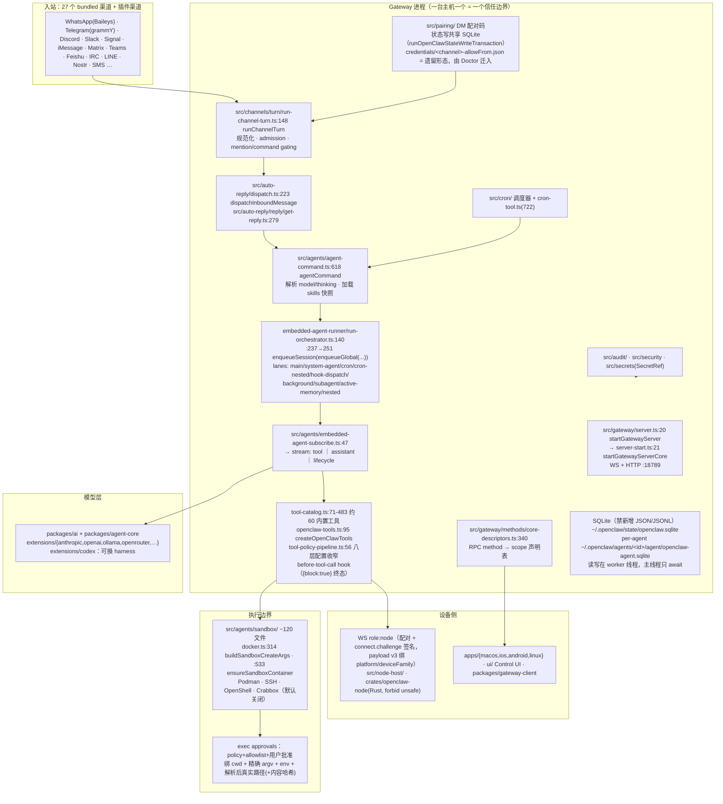

# OpenClaw 架构拆解

> 生成日期：2026-09-22 ｜ 仓库 `openclaw/` @ `a9136469`（v2026.9.5，MIT，pnpm monorepo，TS + 少量 Rust）
>
> 证据口径：`【实证】`= 直接读到的源码行；`【声称】`= 官方文档/README 的叙述（多数已与代码对齐，但请把它当"设计意图"而非"实现事实"）。
>
> **路径缩写**：行文中的短写（如 `run-orchestrator.ts:140`、`tool-catalog.ts`、`pairing-store.ts`）默认相对其在同段首次出现的完整路径（多为 `src/agents/`、`src/gateway/`、`src/channels/`、`src/pairing/` 之一）；第 14 节索引表一律用完整路径。
>
> ⚠️ **行号坐标约定**：本文行号指**上游 `main` 分支的原始树**（`git show main:<路径>` 可核对）。本地学习注释分支 `study-cn-comments` 在每个被注文件顶部插了约 13-16 行文件头块，**这些文件内的行号在该分支上会整体下移十几到几十行**；跳转请认符号名（`runEmbeddedAgentInternal`、`resolveSessionLane`、`createOpenClawTools`）。`docs/`、`README`、`AGENTS.md` 里的行号不受影响（未加注）。

## 1. 一句话总览

OpenClaw 是一个**常驻网关形态的多渠道 agent 运行时**：一个 Gateway 进程持有所有通讯渠道连接与 RPC 面，入站消息经 `runChannelTurn → dispatchInboundMessage → agentCommand → runEmbeddedAgent` 变成一次排队在"每会话 lane + 全局 lane"里的 run，工具执行可选地搬进 Docker/Podman/SSH/OpenShell/Crabbox 沙箱（**默认不搬**），设备能力由配对的 node 提供；它的信任模型是"**trusted gateway, untrusted execution**"（`README.md:20`【声称】）。

## 2. 总体架构图



## 3. 进程与角色：四角色拓扑

`docs/concepts/architecture.md`【声称】把系统切成四个角色，代码里一一对应：

| 角色 | 实现 | 说明 |
|---|---|---|
| **Gateway** | `src/gateway/server.ts:20` → `server-start.ts:21`，`src/cli/gateway-cli/run.ts:1146/1073` | 唯一常驻进程：渠道连接、RPC、调度、状态。**始终留在宿主**（`sandboxing.md:9`【实证：文档明写】） |
| **Channel 插件** | `extensions/<channel>/`（manifest 里 `"channels": ["telegram"]` 声明归属【实证】）+ `src/channels/**` 通用逻辑 | 27 个 bundled id（`src/channels/bundled-channel-ids.generated.ts:11` 起，生成物） |
| **Node（设备）** | `src/node-host/` + `crates/openclaw-node-host`（Rust，`Cargo.toml:5` "Reusable Rust OpenClaw node runtime and headless host"，`unsafe_code="forbid"`） | 提供 `camera.*`、`screen.record`、`location.get`、`canvas.*`、`system.run`；父进程监督器 `node-host-launcher.mjs` 先选运行时再 import config/SQLite |
| **Client（控制台）** | `ui/`（openclaw-control-ui）、`apps/*`、`packages/gateway-client` + `packages/gateway-protocol` | WS 协议有类型化 schema 与运行时校验（`packages/gateway-protocol` 自述【实证】） |

**启动序列**【实证】：`package.json:23` `bin.openclaw = "openclaw.mjs"` → `src/entry.ts:326` `runMainOrRootHelp` → `src/cli/gateway-cli/register.ts:94` → `run.ts:1146` → `:517` `runGatewayCommandOnce` → `:593` 懒加载 server 模块 → `:1073` `startGatewayServer(port, …)`。注意根目录那批 `*.mjs` 引导层存在的理由：**`gateway run` 必须能在加载完整 CLI 之前解析端口/token，并且能在不受支持的 Node 上跑起来做自愈/自更新**（`gateway-run-argv.mjs:1`、`node-runtime-update.mjs:1`、`node-runtime-recovery.mjs:1` 的注释【实证】）。

## 4. 内核循环：一条消息到一次回复

官方序列（`docs/concepts/agent-loop.md:18-24`【声称】，与代码对齐）：

```text
1. `agent` RPC 校验参数 → 解析 session（sessionKey/sessionId）→ 持久化 session 元数据
   → 立刻返回 { runId, acceptedAt }                                  （不阻塞等待完成）
2. agentCommand 跑这一轮：解析 model + thinking/verbose/trace 默认值，
   加载 skills 快照，调 runEmbeddedAgent；若内层没发过，兜底补一个 lifecycle end/error
3. runEmbeddedAgent：用"每会话 lane + 全局 lane"串行化 run，解析 model + auth profile，
   构建 session，订阅 runtime 事件，流式吐 assistant/tool delta，
   强制 run 超时（到期 abort），返回 payloads + usage 元数据
4. subscribeEmbeddedAgentSession 把事件映射成三条流：
   tool → stream:"tool"，assistant delta → stream:"assistant"，
   lifecycle → stream:"lifecycle"（phase: start | finishing | end | error）
5. agent.wait（waitForAgentRun）只等 lifecycle end/error，
   返回 { status: ok|error|timeout, startedAt, endedAt, error? }
```

代码落点【实证】：`src/agents/embedded-agent-runner/run-orchestrator.ts:140` `runEmbeddedAgentInternal`；`:184-185` `resolveSessionLane` / `resolveGlobalLane`；`:237→251` 双层 `enqueueSession(enqueueGlobal(...))`；lane 命名 `src/agents/embedded-agent-runner/lanes.ts:6-19`（session lane 前缀 `session:`，cron 槽位会改派 `cron-nested` 防死锁），全量枚举 `src/process/lanes.ts:2-18`：`main / system-agent / system-agent-inference / cron / cron-nested / hook-dispatch / background / subagent / active-memory / nested`。

**"同会话被连续多条消息轰炸"是 OpenClaw 的一等问题**（三家 coding CLI 基本靠"人在键盘前一次只发一条"逃避）：

- **四种队列模式**（`docs/concepts/queue.md:37-42`【实证：文档明写，配 `src/channels/inbound-debounce-policy.ts`】）：
  - `steer`（默认）：把新消息注入正在跑的运行时——**让已启动的工具跑完、跳过尚未启动的顺序调用、在下一次工具启动或模型决策前让 steer 可见**；已过 launch checkpoint 的并行调用继续跑；Codex app-server 侧收一条批量 `turn/steer`，在下一个模型边界应用；当前 run 不接受 steer 时等它结束。
  - `followup`：不 steer，排队到下一轮。
  - `collect`：静默窗口后合并成**一**轮 followup；若消息属于不同渠道/线程则分别 drain 以保路由。
  - `interrupt`：abort 当前 run，然后跑最新那条。
- **默认参数**（`queue.md:26-32`）：`mode: steer`、内置 500ms debounce（steer/followup/collect 都用）、`cap: 20`、`drop: "summarize"`。
- **并发上限**（`queue.md:19`）：未配置 lane 为 1；`main = max(8, CPU 并行度 × 4)`；`subagent = 8`；整体再被 `agents.defaults.maxConcurrent` 夹一层。
- **写者围栏**（`agent-loop.md:50`【声称+配套代码】）：流式开始前记录持久的 `activeWriterRunId`，每次 transcript 追加/重写都供 `expectedWriterRunId`，**在同步 SQLite 提交事务内校验是否仍是当前声明** ⇒ 被取代的 run 提交不了脏数据。配套 `src/agents/session-tool-result-guard.ts`；`per-agent` 写序由 SQLite writer queue 保证，跨进程由 Gateway 状态目录锁保证（`openclaw agent --local` 也不能抢同一状态目录）。
- **权限不随排队漂移**（`queue.md:46-47`）：Gateway 输入在排队或被委派给子 run 时**保留其已认证 operator 与原始 scope 上限**；collect/steer 要求 operator 来源与工具权限兼容，否则按 FIFO 等待，而不是"借用当前 sender 的权限"。
- **超时预算**（`agent-loop.md:195-202`）：`agent.wait` 30s；`agents.defaults.timeoutSeconds` **172800s（48h）**，`0` 即无限；模型 idle watchdog 云 120s / 自托管 300s；provider HTTP 超时 `models.providers.<id>.timeoutSeconds`。
- **卡死诊断三态**（`agent-loop.md:232-238`）：`session.long_running` / `stalled` / `stuck`；abort 阈值"≥5 分钟且 ≥3× 告警阈值"；stale 会话簿记在恢复门槛通过后立即释放 lane，stalled embedded run 只有过了 abort 阈值才被 abort-drain。

## 5. 工具系统

**单一权威清单**：`src/agents/tool-catalog.ts` —— 分组 `:55-66`（`fs / runtime / web / memory / sessions / ui / messaging / automation / nodes / agents / media`）、条目 `:71-483`、preset（`minimal` / `coding` / `messaging` / `full`）`:540-608`。**约 60 个内置工具**【实证】：

```
ls read write edit apply_patch exec process code_execution secrets
web_search web_fetch x_search
memory_search memory_get
sessions sessions_list sessions_history sessions_search conversations_list
conversations_send conversations_turn sessions_send sessions_spawn sessions_yield
subagents agents_wait agents_list session_status
suggest_task dismiss_task heartbeat_respond
browser screen theme dashboard terminal portal canvas show_widget message
gateway plugins openclaw nodes computer mobile_ui
get_goal create_goal update_goal progress_card ask_user skill_workshop
view_image image_generate music_generate video_generate tts pdf cron
github_identity_status github_publish transcripts
```

装配与把关【实证】：

- `src/agents/openclaw-tools.ts:95` `createOpenClawTools`（`:354` 工具数组字面量），每个工具都过 `finalizeAgentToolAvailability` + `wrapToolWithBeforeToolCallHook`（`:12-18`）。
- 核心编码工具在 `src/agents/core-coding-tools.ts:173` `createCoreCodingTools`（`:38-200` 是工作区守卫）；exec/process 一族散在 `src/agents/bash-tools.exec-*.ts`（host-gateway / host-node / runtime / approval-request / script-preflight / task-tracking 等 **40+ 文件**）。
- 类型 `src/agents/tools/common.ts:58` `AnyAgentTool`，带 `requiredClientCaps`（**客户端能力决定工具可用性**，见 `src/agents/AGENTS.md` "Client Capability Scope"：后端进程 flag 描述的是宿主，不是远端客户端支持什么）、`catalogMode`、`getExecutionTimeoutMs`。
- **schema 用 TypeBox**（`pnpm-workspace.yaml` 里 `overrides.typebox: 1.3.30`【实证】，文档 `docs/concepts/typebox.md`）。
- **工具面收窄分两处发生，别混为一谈**【实证，按 `main` 树核对】：
  - **配置层单调收窄**在 `src/agents/tool-policy-pipeline.ts:56` `buildDefaultToolPolicyPipelineSteps` → `applyToolPolicyPipeline`，默认管线是 **8 个配置层依次收窄**（每层是一个 `policy` + 一个可审计 `label`）：`profile` → `tools.byProvider.profile(<providerProfile>)` → `tools.allow` → `tools.byProvider.allow` → `agents.<id>.tools.allow` → `agents.<id>.tools.byProvider.allow` → `group tools.allow` → `tools.toolsBySender`。**没有 sandbox 层、也没有 provider 限制层**——顺序的意义是"由粗到细，每层只能删不能加"，且 dedupe 后的 warning/audit 事件按层归属。
  - **沙箱状态与插件/客户端可用性**在装配阶段处理，位于 `src/agents/openclaw-tools.ts:95` 的 `finalizeAgentToolAvailability`（同文件 `:12-18` 的 `wrapToolWithBeforeToolCallHook` 负责运行期钩子），而不是管线里的一段。
  - 另有 `tool-allowlist-guard.ts`、`sandbox-tool-policy.ts`、`requester-tool-policy.ts`、`sender-tool-policy.ts`、`inherited-tool-deny.ts` 等守卫散在两侧。
- **钩子终态**：`src/agents/agent-tools.before-tool-call.policy.ts:103` `runBeforeToolCallHook` 返回 `{block:true}` 即终态（`agent-loop.md:99`）。
- 防跑偏：`tool-loop-detection.ts`；**大工具目录不塞满 prompt**：`tool-search*.ts` + `docs/tools/index.md:100` 说明目录过大时改用 `tool_search` / `code_mode`；`tool-schema-quarantine.ts` 隔离异常 schema。

**MCP 是双向的**【实证】：`src/mcp/` 里 `openclaw-tools-serve.ts` + `tools-stdio-server.ts` 把 OpenClaw 自己暴露成 MCP server，`channel-server.ts`/`channel-bridge.ts` 把渠道会话经 MCP 暴露，`plugin-tools-*` 把插件工具经 MCP 暴露；客户端侧是 18 个 `agent-bundle-mcp-*.ts`（manager / lifecycle / materialize / probe / retention / idle-policy）+ `mcp-tool-filter.ts`、`mcp-tool-metadata.ts`、`mcp-codex-tool-approval.ts`。语义区分见 `docs/cli/mcp.md:11-16`："`serve` 是 OpenClaw 作为 server；其余子命令是 OpenClaw 作为自己运行时所用 MCP server 的**客户端注册表**"。

## 6. 渠道与路由

- **职责切分**（`docs/plugins/sdk-channel-plugins.md:19-37`【声称】）：插件只拥有 Config / DM Security / Pairing / Session grammar / Outbound / Threading / Heartbeat typing；**共享 `message` 工具、prompt 装配、外层 sessionKey 形状、通用 `:thread:` 记账与 dispatch 归 core**，渠道不得各自实现 send/edit/react。
- **边界规则**（`src/channels/AGENTS.md:20-48`【实证】）：扩展面一律走 `openclaw/plugin-sdk/*`，禁止直接 import `src/channels/**`；`channel.ts`、`shared.ts`、`channel.setup.ts`、`gateway.ts`、`outbound.ts` 被明确标为**热导入路径**，只为回答静态问题不许拉起整个渠道插件（要用 `channel-api.ts`/`*.runtime.ts` 这类轻接缝，或轻量 bundled artifact，全量插件加载只作 fallback）。
- **回复必回来源渠道，模型无权选渠道**（`docs/channels/channel-routing.md:10-13`【实证：文档明写】）：这是防失控里性价比最高的一条——模型可以决定"说什么"，不能决定"发给谁"。
- **sessionKey 语法**（`channel-routing.md:38-70`）：DM 默认收敛到 `agent:<agentId>:main`，`session.dmScope` 可切 `per-peer|per-channel-peer|per-account-channel-peer`；群 `agent:<id>:<channel>:group:<id>`、频道 `…:channel:<id>`、`session.groupScope: main` 可全并入主会话；Slack/Discord 线程追加 `:thread:<threadId>`，Telegram 话题嵌 `:topic:<topicId>`。`sessionKey` 是路由选择器，**不是授权令牌**（`trust-model.md`）。
- 触发门控：@提及 `src/channels/mention-gating.ts:157` `resolveInboundMentionDecision` + `mention-pattern-policy.ts`；群内发送者 `groupPolicy="allowlist" + groupAllowFrom`；命令授权 `src/channels/command-gating.ts:20/49/71`；DM 预加密守卫 `src/channels/direct-dm-guard-policy.ts:39`；入站去抖 `src/channels/inbound-debounce-policy.ts`；**机器人互聊回环保护** `src/channels/turn/bot-loop-protection.ts` + `docs/channels/bot-loop-protection.md`。

## 7. 权限与安全：Identity first → Scope next → Model last

信任前提先钉死：`docs/gateway/security/trust-model.md:12-15`【实证】**一 Gateway 一信任边界**，支持"单个 operator 或彼此信任的团队（理想是一 OS 用户/主机/VPS 一个边界）"，**不支持互不信任/对抗性用户共享一个 gateway**；要对抗性隔离就得开多个 cell（`docs/gateway/multi-tenant-hosting.md`）。`SECURITY.md:13`：会话归属/可见性/在线状态是**可用性特性，不是安全边界**。威胁应对顺序三拍：`trust-model.md:76-80` **Identity first → Scope next → Model last**。

### 7.1 谁能触发它（sender 授权）

`dmPolicy` 四值：`pairing`（默认）/ `allowlist` / `open` / `disabled`。`pairing` 下未知发送者拿到配对码、**机器人忽略该消息**，码 **1 小时过期、每渠道最多 3 条待批**（`docs/gateway/security/access-control.md:13-20`【声称】）。批准命令 `openclaw pairing approve <channel> <code>`。实现【实证】`src/pairing/pairing-store.ts:196` `readChannelAllowFromStore`、`:272` `upsertChannelPairingRequest`、`:402` `approveChannelPairingCode`、`:421` `approveChannelPairingRequest`、`:440` `dismiss…`，配 `pairing-challenge.ts`、`setup-code.ts`、`join-code.ts`。审批结果**当前写进共享 SQLite**【实证：`src/pairing/pairing-store.ts:13` 引入 `runOpenClawStateWriteTransaction`，`:178`、`:248` 两处写事务，配套 `pairing-store-sqlite.ts`】；`~/.openclaw/credentials/<channel>-allowFrom.json`（非默认账号 `<channel>-<accountId>-allowFrom.json`）是**遗留落盘形态**，由 `src/infra/state-migrations.channel-pairing.ts:19`（`ALLOW_FROM_SUFFIX`）在升级时迁入 SQLite，Doctor 侧 `src/commands/doctor-state-integrity.ts:767` 仍按旧路径做完整性检查。⚠️ **官方文档滞后于代码**：`docs/gateway/security/access-control.md:33`、`docs/channels/pairing.md:142`、`docs/gateway/security/secrets-and-storage.md:47`、`docs/start/setup.md:181` 四页都还写着"approvals write to `credentials/<channel>-allowFrom.json`"——这正是本工作区"以源码为准"原则存在的理由。审批结果与 config allowlist 合并后生效。

**两层白名单**：DM `allowFrom` 与群 `groups`/`guilds`/`channels` + `groupAllowFrom`；检查顺序是 `groupPolicy` → mention/reply 激活，且**"回复机器人消息（隐式 mention）不绕过 `groupAllowFrom`"**（`access-control.md:34-38`）。`contextVisibility = all|allowlist|allowlist_quote`（`:65-78`）把"能触发"和"引用/转发内容能否进模型"分开——这一刀是很多产品会漏的。

### 7.2 设备配对

所有 WS 客户端带 device identity，`connect.challenge` 的 nonce **必须签名**，签名 payload `v3` 还绑 `platform` 与 `deviceFamily`；重连时钉住配对元数据，元数据变化即要求重新配对。本机 loopback 可自动批准，**tailnet 与 LAN（含同主机 tailnet 绑定）仍需显式批准**（`docs/concepts/architecture.md:99-115`、`docs/network.md:39-46`【声称】）。节点命令策略 `docs/nodes/command-policy.md` + `src/node-host/exec-policy.ts`；`gateway.nodes.pairing.autoApproveCidrs` **默认关闭**且只对首次 `role: node` 无 scope 生效，`sshVerify` 默认开启并要求精确设备公钥匹配（`SECURITY.md:52-53` 逐条辩护，防被当漏洞上报）。

### 7.3 命令审批：把"批准"绑成不可漂移的承诺

`docs/tools/exec-approvals.md:12-35`【声称】：exec approvals 是"沙箱 agent 想在真实 host（gateway 或 node）上跑命令"的伴生护栏，**policy + allowlist + 可选用户批准三者同时同意**才执行，且严格程度取 `tools.exec.*` 与 approvals 的**更严者**。`:56-59` 是全文最硬的一段：被批准的命令**绑定 cwd、精确 argv、env 绑定、可执行文件解析后的真实路径（可写文件再加内容哈希）**；审批等待期间 PATH 上若出现更早的可执行文件即拒绝；脚本/解释器类还要绑一个具体本地文件操作数，执行前若漂移即拒绝；**识别不出唯一文件操作数就直接拒绝签发审批背书**。`docs/gateway/sandbox-vs-tool-policy-vs-elevated.md` 区分三件事；`tools.elevated` 是把 `exec` 拉出沙箱的显式逃生口（`sandboxing.md:66`）。

对比另五家：这比"记住一个命令前缀 allowlist"（Claude Code/anon-kode 式）强一个量级，接近 Codex 的"意图绑定"思路但走的是审批而非内核原语。

### 7.4 沙箱

**默认关闭**，由 `agents.defaults.sandbox`（全局）/ `agents.entries.*.sandbox`（每 agent）/ 创建者角色强制策略控制；**Gateway 进程始终留在宿主，只有工具执行迁入沙箱**（`docs/gateway/sandboxing.md:9`【实证：文档原文】，同一页 `:11-13` 的 Note 也坦白："这不是完美的安全边界，但模型犯蠢时能实质限制文件系统与进程访问"）。后端 6 种：Docker（默认）/ Podman / SSH / OpenShell / Crabbox / Crabbox 云租（`:25-29`）。实现 `src/agents/sandbox/` 约 120 文件【实证】：`docker.ts:314` `buildSandboxCreateArgs`、`:533` `ensureSandboxContainer`、`docker-backend.ts:142/148` `create{Docker,Podman}SandboxBackend`、`ssh-backend.ts`、`remote-shell-backend.ts`、`bind-spec.ts`、`mount-plan.ts`、`fs-bridge.ts` + `fs-bridge-path-safety.ts`（容器内外文件桥的路径安全）、`sanitize-env-vars.ts`、`validate-sandbox-security.ts`、`workspace-authority.ts`、`browser.ts` + `browser-network.ts`（沙箱化浏览器 + noVNC）。工具 allow/deny **先于**沙箱规则（`sandboxing.md:64`）。

### 7.5 secrets、限流与审计

- **secrets**：`src/secrets/` + `docs/gateway/secrets.md`，概念上是 SecretRef；`ask_user` / `secrets` 工具让 agent"不看到值地取凭据"（`docs/tools/index.md:89`）。auth profile 存**每 agent 的 SQLite** `~/.openclaw/agents/<id>/agent/openclaw-agent.sqlite`，`docs/concepts/multi-agent.md:33-35` 明确警告：跨 `agentDir` 复用会导致 OAuth 穿透读取。
- **六条独立限流**（`docs/gateway/security/rate-limiting.md:17-24`【实证】）：认证失败 10 次/60s → 5 分钟锁定（loopback 默认豁免，但**浏览器来源 WS 不豁免**）；webhook `/hooks` 认证失败 20/60s + 60s 锁定（不可配）；**控制面写 RPC 30 req/60s per method**（按 method + device + IP，不可配）；ACP 会话创建 120/10s；Gateway 重启 30s 冷却。
- **成本**：`docs/concepts/usage-tracking.md` 只报 provider 官方用量端点（`/usage cost`、`openclaw status --usage`、Control UI Usage 页）；`docs/tools/subagents.md:24-33` 说明子 agent 默认独立上下文与 token 消耗，可用 `agents.defaults.subagents.model` 降档。**未找到统一的"每日/每会话美元预算"强制熔断**（见第 13 节）。
- **审计**：`src/audit/` + `docs/gateway/audit.md`；根 `AGENTS.md` 定性："诊断证据来源可选，**永不用于授权**"。
- **CI 侧静态安全**：`security/opengrep/precise.yml` + `pnpm check:opengrep-rule-metadata`、`.semgrepignore`、`pnpm audit:seams`、`check:assertion-safety`。

## 8. 上下文、记忆与压缩

- **workspace = agent 的家**：默认 `~/.openclaw/workspace`（命名 profile 为 `~/.openclaw-<profile>/workspace`，`OPENCLAW_WORKSPACE_DIR` 覆盖）。`docs/concepts/agent-workspace.md:16-19` 特意强调："这是默认 cwd，**不是硬沙箱**，绝对路径仍能到达宿主别处"。
- **注入文件名唯一真源**【实证】`src/agents/workspace-bootstrap-policy.ts:10-34`：`AGENTS.md`、`SOUL.md`、`IDENTITY.md`、`USER.md`、`BOOTSTRAP.md`、`MEMORY.md`（`TOOLS.md` 常量存在但不在这组里）。注释直接写明设计意图："这些名字的规范顺序是 runtime 校验集、名字 union 与 Control UI 核心文件列表的**唯一来源**；别处再抄一份私有列表，会在某个文件退役时静默漂移。" `MEMORY.md` 名常量来自 `src/memory/root-memory-files.ts:7-9`（含 legacy `memory.md` 与修复目录）。
- **预算**：`bootstrapMaxChars` 默认 20000、`bootstrapTotalMaxChars` 60000、`USER.md` 固定 4000 字符独立上限（`docs/concepts/agent-workspace.md:106`）；`src/agents/bootstrap-budget.ts:46-53` 取 `Math.min(bootstrapMaxChars, USER_BOOTSTRAP_MAX_CHARS)`，注释说明"调大全局值也放不开 USER.md"。缺失文件注入 "missing file" 标记后继续。
- **记忆哲学**（`docs/concepts/memory-architecture.md:11-46`）：**纯文件 + 一个 SQLite 索引**分层；五原则 = ① 无隐藏状态（模型只记得 workspace 文件里写的东西）② 难点在写入而非检索（把 curation 移出回复热路径，交给专门后台 pass）③ **写路径就是安全边界**（内容级扫描挡不住投毒，所以在写入处强制 provenance、用结构化门槛代替事后检测）④ 确定性门槛 + 模型判断只在门槛内 ⑤ **记忆故障永不阻塞回复**（每步都有超时或回退）。分层：日常 `memory/YYYY-MM-DD.md`、长期 `MEMORY.md`（只在主私有会话加载，**群聊不加载**）、`USER.md` 指令式用户模型、standing intents、dreaming（`docs/concepts/dreaming.md`）、active memory。向量检索是**可选插件而非核心**（`extensions/memory-lancedb`、`memory-core`、`memory-wiki`、`active-memory`），且 `VISION.md:102-103` 声明 **memory 是唯一互斥插件槽**，同时只能有一个生效。
- **compaction**（`docs/concepts/compaction.md`）：新配置默认 `mode: "safeguard"`（带摘要质量审计）；保留 `tool_call` 与 `toolResult` 的配对、移动 split point；**CJK 字符计入估算**；摘要器只拿文本，被省略的图片插固定标记且**每次请求最多 847 UTF-8 字节**（`:23`，这个数字是刻意固定大小以避免估算漂移）；溢出错误 → 压缩 → 重试。实现簇在 `src/agents/embedded-agent-runner/` 的 `compact*.ts`、`compaction-*.ts`（约 30 文件）。这与根 `AGENTS.md` "Stable conversation context：只有 compaction 可以改写历史"是同一件事的两端。

## 9. 子代理与多智能体

工具面【实证】：`sessions_spawn` = `src/agents/tools/sessions-spawn-tool.ts:324`（`:381` 处 name，全文 716 行）；`subagents` = `subagents-tool.ts`(605)；`sessions_yield`、`agents_wait`、`agents_list`、`session_status`、跨会话读写 `conversations_list/send/turn`（`conversation-tools.ts`）、`sessions_send`；**swarm（代码并发编排）** = `src/agents/openclaw-tools.swarm.ts:110` `createOpenClawSwarmToolGroups` + `docs/tools/swarm.md`。

语义（`docs/tools/subagents.md:12-22`【声称】）：子 agent 有自己的会话 `agent:<agentId>:subagent:<uuid>`，默认**把结果 announce 回请求方**，每个都登记为 background task，可配嵌套深度；**默认拿不到 session 与 message 工具**——文档原话理由是"让工具面难以被滥用"。

多 agent 与路由：`src/routing/`（`resolve-route.ts`、`session-key.ts`、`bindings.ts`、`peer-kind-match.ts`）+ `docs/concepts/multi-agent.md`（**agent = workspace + agentDir + session store；binding 把渠道账号映射到 agent**；transcript/路由/auth profile 全在 per-agent sqlite，`:21-27`）。`src/system-agent/` + `src/agents/system-agent*` 是 Custodian 系统 agent 槽位。ACP（把外部 coding harness 当 agent 接入）：`src/acp/`、`packages/acp-core`、`extensions/acpx`、`docs/tools/acp-agents.md`。

**默认 peer 面很宽**（`trust-model.md:17`【实证】）：`tools.sessions.visibility` 默认 `all`、`tools.agentToAgent.enabled` 默认 `true` ⇒ 任何未沙箱化的 tool-enabled agent 可以列举/搜索/读取/给**所有 agent 的会话**发消息，包括其他用户的 transcript；沙箱会话默认被夹在自己的 spawn tree 内（限制它作为调用方，但**不向未沙箱 agent 隐藏其 transcript**）。收窄方式文档逐条给了：`visibility: agent|self`、`tools.agentToAgent.allow`、或 `enabled: false`。

## 10. 扩展面：六层

| 层 | 位置 | 关键事实 |
|---|---|---|
| **Skills** | `src/skills/{discovery,loading,lifecycle,config,library,runtime,security,workshop}` | **7 档加载优先级**（`docs/tools/skills.md:39-48`）：`<workspace>/skills` → `<workspace>/.agents/skills` → `~/.agents/skills` → `<state-dir>/skills` → workshop skills → **bundled skills 与 custodian skills 并列第 6** → `skills.load.extraDirs` + 插件 skills。自带 52 个技能包 + 4 个 custodian 技能。`skill_workshop` 工具支持 agent 起草、人审批（`docs/tools/skill-workshop.md`）；`docs/tools/self-learning.md` 讲自学习闭环 |
| **Plugins** | `src/plugins/`、`src/plugin-sdk/`、`extensions/*`（171 个） | 注册面 `api.registerTool`（`src/plugins/captured-registration.ts:377`，元数据版 `:341`；stub `src/plugins/api-builder.ts:25`）；manifest `openclaw.plugin.json`；两种形态 code plugins / bundle plugins（打包 skills+MCP+config），**优先 bundle 形态**因为接口更小更稳定（`VISION.md:86-93`）；`postinstall = scripts/postinstall-bundled-plugins.mjs` |
| **Hooks** | `src/hooks/` + 插件钩子矩阵 | 17 个插件钩子（`docs/concepts/agent-loop.md:63-105`）：`before_model_resolve`、`before_prompt_build`、`before_agent_reply`、`agent_end`、`before_compaction`、`after_compaction`、`before_tool_call`、`after_tool_call`、`before_install`、`tool_result_persist`、`message_received`、`message_sending`、`message_sent`、`session_start`、`session_end`、`gateway_start`、`gateway_stop`。另有 `HOOK.md` 内部钩子（`command:new|reset|stop`、`agent:bootstrap`）与 HTTP webhooks（`src/gateway/server/hooks.ts`、`docs/plugins/webhooks.md`）三套不同东西 |
| **Channels** | `src/channels/` + `extensions/<channel>/` | 27 个 bundled + 插件；契约文档 `docs/plugins/sdk-channel-plugins.md` |
| **Nodes（设备能力）** | `src/node-host/`、`extensions/{device-pair,cua-computer,geolocation,file-transfer}`、`crates/openclaw-node-host` | `connection.ts`、`exec-policy.ts`、`auto-update*.ts`、`computer-command.ts`、`desktop-stream-command.ts`；能力文档 `docs/nodes/{camera,computer-use,device-commands,node-exec,presence,session-hosting}.md` |
| **语音 / 界面** | `src/tts/`、`src/realtime-transcription/`、`src/meeting-bot/`、`src/canvas/`、`extensions/{elevenlabs,azure-speech,deepgram,senseaudio,fish-audio-speech,talk-voice,tts-local-cli,canvas}`、`apps/{macos-mlx-tts,swabble}` | 唤醒词：`apps/swabble/README.md:1-10`（Swift 6.2、macOS 26 Speech.framework **本地端侧**、默认词 `clawd`（别名 `claude`）、launchd 服务）；唤醒词表全局唯一且 **Gateway 拥有**，存 `config_machine_state.voicewake.triggers`，≤32 条 × 64 UTF-16，默认 `openclaw/claude/computer`（`docs/nodes/voicewake.md:9-35`）。Canvas：`src/canvas/{documents,widget-tool,widget-script-syntax,serve.runtime}.ts` + `packages/mermaid-renderer`，宿主路径 `/__openclaw__/canvas/`、`/__openclaw__/a2ui/`（`docs/concepts/architecture.md:18-22`），A2UI bundle 脚本 `canvas:a2ui:bundle`，agent 侧工具 `canvas`/`show_widget`/`screen`/`theme`/`dashboard`/`portal`/`mobile_ui` |

## 11. 端到端时序：从一条 Telegram 消息到回复

1. `openclaw gateway`（`cli/gateway-cli/run.ts:1146→:1073`）→ `startGatewayServerCore`（`server-start.ts:21`）装配 WS+HTTP :18789、`server-channels.ts` 拉起各渠道连接、`cron/` 调度器、SQLite（worker 线程）、`pairing/`。
2. Telegram 收到入站消息 → `extensions/telegram` 归一化 → `src/channels/turn/run-channel-turn.ts:148` `runChannelTurn`：**dmPolicy/groupPolicy 检查 → 配对/allowFrom 校验 → mention 门控（`mention-gating.ts:157`）→ 命令门控（`command-gating.ts`）**；未知 DM 发送者在这里被发配对码并**丢弃**（不进入 run）。
3. 通过 → `src/auto-reply/dispatch.ts:223` `dispatchInboundMessage` → `get-reply.ts:279` 解析斜杠命令/内联动作/directives，算出 sessionKey（默认 DM → `agent:<id>:main`）。
4. `agent` RPC 语义：校验参数、解析 session、持久化 session 元数据、**立刻返回 `{runId, acceptedAt}`**（`agent-loop.md:20`）。
5. `agentCommand`（`agent-command.ts:618`）解析 model + thinking/verbose/trace、加载 skills 快照 → `runEmbeddedAgent`（`run-orchestrator.ts:140`）：`:184-185` 求 `session:<key>` lane 与 `main` lane → `:237→251` 双层入队 → 拿到执行声明。
6. 若该 session 已有 active run：按 `queue.md:37-42` 的模式处理（默认 `steer`，500ms debounce、cap 20、drop summarize）。
7. 声明流式前记录 `activeWriterRunId`（`agent-loop.md:50`）；构建 session、按 `workspace-bootstrap-policy.ts:26-34` 注入 `AGENTS/SOUL/IDENTITY/USER/BOOTSTRAP/MEMORY.md`（预算 `bootstrap-budget.ts:46-53`）；记忆层按会话类型裁剪（群聊不加载 `MEMORY.md`）。
8. 工具面收窄：装配期 `finalizeAgentToolAvailability` 定可用性（含 `requiredClientCaps`——发起这个 run 的客户端能力，例如手机就没有 `canvas`），再由 `tool-policy-pipeline.ts:56` 的八层配置单调收窄（profile → provider profile → `tools.allow` → `tools.byProvider.allow` → agent → agent byProvider → group → sender），`before_tool_call` 钩子可 `{block:true}` 终态。
9. 模型经 `packages/ai` + provider 插件（或 `extensions/codex` harness）流式返回；`embedded-agent-subscribe.ts:47` 把事件映射成 `tool` / `assistant` / `lifecycle` 三条流；`run` 超时（默认 48h）与 idle watchdog（云 120s / 自托管 300s）在跑。
10. 若模型要 `exec`：沙箱关闭时走 host exec 策略；开启时 `sandbox/docker.ts:533` 确保容器、`fs-bridge-path-safety.ts` 桥文件；想上真宿主 → exec approvals（policy + allowlist + 用户批准，且 argv/PATH/cwd/文件哈希四绑，漂移即拒）。若要 `sessions_spawn` → 新会话 `agent:<id>:subagent:<uuid>`，独立 lane `subagent`（并发 8），完成后 announce 回请求方。
11. 每次 transcript 写入带 `expectedWriterRunId` 并在同步事务内校验 ⇒ 被取代的 run 无法提交脏数据；溢出走 compaction（`mode: safeguard`，保 tool_call/toolResult 配对）。
12. lifecycle `end` → `get-reply` 组装回包 → **按原始 sessionKey/渠道确定性回程**（模型无权改道）；`message_sending`/`message_sent` 钩子、`typing` 指示、审计与 usage 记录（`status --usage`）。
13. `agent.wait(runId)`（如被 cron/webhook/UI 调用）返回 `{status, startedAt, endedAt}`。

## 12. 关键设计决策一览（对照另五家）

| 维度 | OpenClaw 的选择 | 为什么只有它这么做 |
|---|---|---|
| 宿主 | 一台常开机器 + 一个 Gateway 进程 | 输入是消息事件，必须 7×24 在线 |
| 输入源 | 27 个 bundled 渠道 + 插件渠道 + cron + webhook + ACP | 无人值守触发 ⇒ 需要 sender 授权与配对码 |
| 并发 | 每会话 lane + 全局 lane 双层串行 + 写者围栏 | 同一会话会被多人同时轰炸 |
| 路由 | 回复必回来源渠道，sessionKey 是路由选择器非令牌 | 剥夺模型的"发给谁"决定权 |
| 工具 | 约 60 内置 + 装配期可用性终化 + **八层配置单调收窄** | 手机/桌面/服务端能干的活不同，但授权仍在执行边界判 |
| 执行 | 默认在宿主；沙箱（6 后端）默认关闭且只搬工具执行 | "不是完美边界，但能挡犯蠢"是官方自述 |
| 命令审批 | policy+allowlist+用户批准，且绑 argv/cwd/真实路径/内容哈希 | 审批承诺不能因 PATH 漂移而失效 |
| 状态 | 一律 SQLite（Kysely 类型 + worker 线程）| 明确禁止再新增 JSON/JSONL/sidecar |
| 上下文 | 6 个 workspace 注入文件 + 预算 + 只有 compaction 能改写历史 | prompt 前缀复用是成本/延迟生命线 |
| 记忆 | 纯文件 + SQLite 索引；向量是可选互斥插件；**写路径当安全边界** | 承认检测挡不住投毒 |
| 设备 | 配对 + 必须签名的 challenge + Rust headless node（forbid unsafe） | 真实摄像头/屏幕/点击能力需要强身份 |
| 界面 | Control UI + 4 个原生 app + canvas/A2UI + 唤醒词 | 它是"住在你生活里"的助理 |

## 13. 设计亮点与局限

**亮点**

1. **信任方向与 coding harness 相反，且被文档写死**：`trusted gateway, untrusted execution`（`README.md:20`）、`Identity first → Scope next → Model last`（`trust-model.md:76-80`）；`SECURITY.md` 用 100+ 行"什么不算漏洞"把 prompt injection 显式排除在漏洞范畴（`:52`、`:93`）——**把责任模型讲清楚，而不是假装能防**。
2. **确定性路由 + 模型无渠道选择权**（`channel-routing.md:10-13`）：这是"能干活的 agent"最便宜有效的护栏；再加 `message_sending` 钩子与 `{cancel:true}` 终态（`agent-loop.md:101`）兜第二层。
3. **写者围栏 + 双层 lane**（`agent-loop.md:50`、`src/process/lanes.ts:2-18`、`lanes.ts:13-17` 的 cron→cron-nested 改派防死锁）：**三家 coding harness 都没有这套东西**，因为它们不需要在无人值守下处理同会话并发写。
4. **审批背书的强绑定**（`exec-approvals.md:56-59`）：绑 cwd + 精确 argv + env + 解析后真实可执行路径(+内容哈希) + 唯一本地文件操作数；PATH 或文件漂移即拒绝，识别不出唯一文件就拒绝签发。
5. **把记忆写路径当安全边界**（`memory-architecture.md:36-39`）+ "记忆故障永不阻塞回复"（`:44-46`）：不承诺检测能力，只承诺写入处强制 provenance 与结构化门槛。
6. **用经济学术语解释架构边界**（`VISION.md:78-84`）：core 的每行 prompt / 每个工具 / 每个 config key 对**所有**宿主收税，插件/skill/渠道/app 不收；"觉得规则挡路时，先检查你插在哪一层"。
7. **工程护栏制度化**：根 + 7 份 scoped `AGENTS.md`、`taxonomy.yaml`(11724 行) → 生成 `docs/maturity/**`、OpenGrep 规则包、`check:database-first-legacy-stores` / `check:wrapper-shadowing` / `audit:seams` lint、`qa/` + maturity + release CI。复杂度已经高到必须用机制而不是靠自觉。

**局限 / 风险**

1. **默认几乎不设防**：沙箱默认关闭（`sandboxing.md:9`）、`tools.sessions.visibility=all` + `agentToAgent.enabled=true`（`trust-model.md:17`）、host exec 默认 `security="full", ask="off"`（`trust-model.md:68`）、群聊文档还推荐 `groupPolicy="open"`（`access-control.md:29`）。**误批一个陌生人 DM ≈ 交出整台机器的 shell 面**。
2. **没有真正的多租户隔离，但产品在推团队共享 Gateway**：官方明说对抗性用户请分网关（`SECURITY.md:5,56`、`trust-model.md:14-22`），同时 `README.md:18`、`VISION.md:17-19` 大力讲"同一个 Gateway，笔记本个人助理或团队共享部署只是配置差异"。**文档立场与信任现实之间的张力，是这个仓库最大的隐患。**
3. **成本无硬上限**：只找到限流与用量展示（`rate-limiting.md:17-24`、`usage-tracking.md`），**未找到美元预算级熔断**；agent 默认超时 172800s = 48h 且 `0` 即无限（`agent-loop.md:198`），子 agent 可嵌套 ⇒ **一条垃圾消息可以点燃几十小时的云端消费**。
4. **失控面被层层削弱但未消除**：Rust node host + `computer` / `mobile_ui` / `browser` / `screen` 工具意味着真实点击面；`SECURITY.md:95` 直接把 browser evaluate、`node.invoke → system.run` 定性为"有意特性，不是漏洞"。
5. **规模与理解成本极端**：`src/agents` 1807 文件、`src/gateway` 1880 文件、`extensions` 171、`docs` 1325 页、`package.json` 143 KB。作为学习材料，"从哪儿读起"比另五家都更依赖本文档。
6. **无中文文档 + 配置兼容策略激进**：`VISION.md:45-52` 声明运行时只读当前 schema、不留长期别名与静默兼容分支，升级靠 `doctor --fix` 重写；`VISION.md:136` 明确暂不做全量翻译，非英语用户只有 glossary 可用。

## 14. 关键文件索引（精读清单）

| # | 路径:行 | 一句话 |
|---|---|---|
| 1 | `README.md:1-120` | 定位、安装、结构图、安全一句总纲 |
| 2 | `VISION.md:1-145` | 项目自述、插件两层"税"模型、不合并清单 |
| 3 | `AGENTS.md`（根，全文） | 设计优先级与硬约束（SQLite、worker 线程、live authority） |
| 4 | `docs/concepts/architecture.md:8-156` | 四角色拓扑与 wire protocol |
| 5 | `docs/concepts/agent-loop.md:18-24,50,195-238` | 运行序列五步、写者围栏、超时与卡死三态 |
| 6 | `docs/concepts/queue.md:19,26-47` | 并发默认值 + 四种队列模式 + operator 上限保留 |
| 7 | `openclaw.mjs:1-120` + `node-version.mjs:5-8` | bin 入口、Node/sqlite 探测与自愈 |
| 8 | `src/cli/gateway-cli/run.ts:500-620,1040-1160` | `runGatewayCommandOnce` → 懒加载 → `startGatewayServer` |
| 9 | `src/gateway/server.ts:1-102` / `server-start.ts:1-158` | 真正的 server 装配点（短，必读） |
| 10 | `src/gateway/methods/core-descriptors.ts:330-360` | RPC method → scope 声明表 |
| 11 | `src/channels/turn/run-channel-turn.ts:30-200` | 一个渠道 turn 的规范化/admission/dispatch |
| 12 | `src/auto-reply/dispatch.ts:223-330` | 入站消息如何变成一次 run |
| 13 | `src/agents/agent-command.ts:81-120,602-728` | CLI 与 RPC 的汇聚点 |
| 14 | `src/agents/embedded-agent-runner/run-orchestrator.ts:140-260` | 双层 lane、session target、admission、abort |
| 15 | `src/agents/embedded-agent-runner/lanes.ts:1-23` + `src/process/lanes.ts:1-33` | **并发拓扑的最小真相**（性价比最高两处） |
| 16 | `src/agents/embedded-agent-subscribe.ts:47-120` | runtime 事件 → 三条流桥接 |
| 17 | `src/agents/openclaw-tools.ts:95-360,440-680` | 内置工具装配与客户端能力过滤 |
| 18 | `src/agents/tool-catalog.ts:55-120,540-608` | 工具分组/条目/preset 权威表 |
| 19 | `src/agents/tool-policy-pipeline.ts:56-180` + `agent-tools.before-tool-call.policy.ts:70-140` | 工具面收窄与 `before_tool_call` 终态 |
| 20 | `src/agents/core-coding-tools.ts:38-200` | read/write/edit/apply_patch 的工作区守卫 |
| 21 | `src/agents/bash-tools.exec-host-node-policy.ts`、`exec-approval-request.ts` | 宿主/节点 exec 审批绑定（安全最密处） |
| 22 | `src/agents/sandbox/docker.ts:314-400,533-620` + `fs-bridge-path-safety.ts` | 沙箱容器参数与路径安全桥 |
| 23 | `src/pairing/pairing-store.ts:196-460` | DM 配对码、批准、allowFrom 落盘 |
| 24 | `src/agents/workspace-bootstrap-policy.ts:10-46` + `bootstrap-budget.ts:27-60` + `src/memory/root-memory-files.ts:1-60` | 上下文注入文件名与预算 |
| 25 | `src/agents/tools/sessions-spawn-tool.ts:324-420` | 子代理派生与 announce 语义 |
| 26 | `SECURITY.md:1-120` + `docs/gateway/security/{trust-model,access-control,rate-limiting}.md` | 官方信任模型与受理边界（写"局限"必读） |
| 27 | `src/channels/AGENTS.md:20-48` + `docs/plugins/sdk-channel-plugins.md:19-37` | 渠道边界与 core/插件职责切分 |
| 28 | `docs/concepts/memory-architecture.md:11-46` + `docs/concepts/compaction.md` | 记忆五原则与压缩契约 |

> 延伸对照：OpenClaw 的 `browser` 工具同赛道"库形态"活样本见 [project-study/03-browser-use.md](../project-study/03-browser-use.md)（browser-use 真机复现，与本文工具面的环境特化取向互补）；总入口见 [project-study/README.md](../project-study/README.md)。
