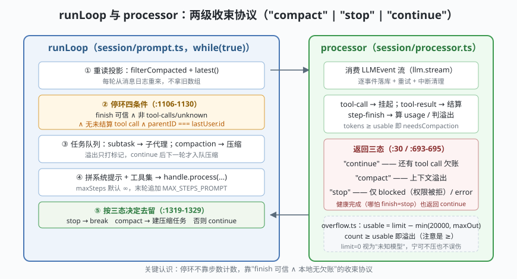

# s01: runLoop 主循环 —— 一轮是怎么被"收束"的

`s01` → [s02_session_store](../s02_session_store/) → [s03](../s03_tool_system/) → ... → [s10](../s10_finale/)

> OpenCode 的招牌设计：**整颗内核是一个 Effect 写成的 HTTP server，而 server 的心脏是 `session/prompt.ts` 里一个 260 行的 `while(true)`**（`runLoop`，上游 dev :1081-1341）。它不数工具调用次数，"继续还是退出"完全由两件事决定：上一条 assistant 的 finish 原因 + 本地有没有未结算的 tool call。
>
> **Harness 层**：agent 主循环 —— 停环判定、子任务分派、压缩延迟、步骤上限。

---

## 问题

你要造一个 agent 主循环，第一天就撞上四个工程问题：

1. **什么时候停？** 模型说"我说完了"就停？有的 provider 报出的 finish 原因根本不可信——带着未完成的 tool call 却返回 `stop`（`prompt.ts` 的英文注释原话直说这一点）。听它的，循环早退，工具结果永远等不到回灌。
2. **循环体里塞多少职责？** 取历史、判退出、分派子任务、触发压缩、拼提示词、调模型——全在同一个 `while(true)` 里，怎么避免变成一锅粥？
3. **上下文溢出了怎么办？** 当场压缩？可"压缩"这个动作自己也要调一次模型，可能把本来就要爆的窗口彻底撑爆。
4. **要不要限制步数？** 上不封顶会烧钱，硬上限会掐死长任务。

---

## 解决方案



OpenCode 的答案是一个**两级收束协议**：

| 机制 | mini 实现 | 真实实现（packages/opencode/src/session/） |
|------|-----------|--------------------------------------------|
| **停环判定** | `shouldStop()` 四条件全满足才 break | `runLoop` :1106-1130：finish 可信 ∧ 非 tool-calls/unknown ∧ `hasToolCalls` 兜底 ∧ assistant.parentID === lastUser.id |
| **processor 三态** | 处理器只回答 `"compact" \| "stop" \| "continue"` | `processor.ts:30` `export type Result = "compact" \| "stop" \| "continue"`（:693-695 判定），break 与否由 runLoop 说了算 |
| **压缩延迟一轮** | 溢出只打标记，`continue` 下一轮再压 | `prompt.ts` :1161-1168：`isOverflow` → `compaction.create({auto:true})` 后 `continue` |
| **步骤上限** | `maxSteps` 默认 `Infinity`，末轮追加"最后一步"提示 | `prompt.ts` :1170-1179 + 末尾 `MAX_STEPS_PROMPT`（来自 `@opencode-ai/core/session/runner/max-steps`） |

---

## 工作原理

`code.mjs` 用约 170 行实现 mini-runLoop，走读五个关键点：

**第 1 步：循环每轮从"重读投影"开始**。不是拿着旧数组继续跑，而是每轮重新从消息日志里过滤出"压缩后视图"、找 `latest`（lastUser / lastAssistant / tasks）。真实代码 :1092-1096 同款——这为 s02 的事件溯源和 s08 的压缩续写留了口子。

**第 2 步：先判退出，再干活**。四条件一个都不能少：

```js
shouldStop() =
  lastAssistant?.finish 存在                 // 有结束原因
  && !['tool-calls','unknown'].includes(...) // 且这个原因可信
  && !pendingToolCalls()                     // 且本地没有未结算的 tool call（兜底）
  && lastAssistant.parentID === lastUser.id  // 且这对 assistant/user 是同一轮的
```

**第 3 步：processor 只管三态，且"stop"不是你以为的那个 stop**。processor（处理器/状态机节点）消费模型的流式事件：遇到 `tool-call` 就落库挂起、`step-finish` 就算 token，最后按真实代码 :693-695 的三行返回——**溢出 → `"compact"`；权限被拒（blocked）或出错 → `"stop"`；其余一律 `"continue"`**。哪怕模型老老实实 finish=stop，processor 也返回 `"continue"`，退出交给 runLoop 循环顶四条件。职责分离，processor 才敢做重试、中断清理这些脏活。

**第 4 步：溢出不当场压**。场景 3 里你会看到：判定溢出后只是打个 `needsCompaction` 标记 `continue`，下一轮循环开头才真正把压缩任务入队——"压缩这个动作自己也耗窗口"是这段设计的全部理由。

**第 5 步：任务队列分派**。压缩、子代理不是"散落在流程里的 if"，而是上一轮落库成 `task` part、下一轮循环开头统一取出的队列（`latest()` 返回 `tasks`）——循环本身就是调度器。

**跑一跑**（零依赖，离线；模型由剧本化 Mock 扮演）：

```bash
node code.mjs
```

四个场景对应四种收束方式：① 正常两步工具轮 → tool-calls 续环 → 回答后循环顶四条件收束；② **provider 说谎**（带 tool call 报 stop）→ `hasToolCalls` 驳回收束，工具结果回灌、模型补答后才停；③ 溢出 → processor 返回 compact → 打标记 continue → 下一轮压缩任务入队；④ maxSteps=1 → 末轮尾部追加 MAX_STEPS_PROMPT（assistant prefill，提示词级约束而非硬闸）。观察打印里的 `判停` 与 `三态` 两行——特别注意场景 1/2 里 finish=stop 之后三态仍是 `continue`：**"stop" 三态只留给权限被拒与错误**，这是 mini 版最容易和真实代码对不上的地方。

---

## 对照真实源码

| mini 实现 | 真实代码位置 | 学习点 |
|-----------|-------------|--------|
| `miniRunLoop` | `packages/opencode/src/session/prompt.ts`（`runLoop`，上游 dev :1081-1341；本检出因导读注释偏移在 :1097） | 单函数 260 行的 `while(true)`——AGENTS.md 风格："Keep things in one function unless composable" |
| `shouldStop()` 四条件 | 同上 ：1106-1130（含 :1103 的 provider 说谎英文注释） | `finish` reason 不可全信，`hasToolCalls` 是本地真相兜底 |
| `processStep()` 三态 | `packages/opencode/src/session/processor.ts` :30（`export type Result`）、:693-695 | processor 只回答 compact/stop/continue，break 归 runLoop |
| `markOverflow` 延迟压缩 | `prompt.ts` :1161-1168 | 溢出不当场压：先 continue，下一轮才入队压缩任务 |
| `mockStream` + 重试位 | `processor.ts` :641-690（`process()`：stream/tap/takeUntil/retry/ensuring） | 真实版还有 `takeUntil(needsCompaction)` 截流与 250ms cleanup 宽限 |
| `usable()/isOverflow()` | `session/overflow.ts` :10/:22（上游 :8-34） | `usable = limit − min(20000, maxOutputTokens)`；判定用 `>=`；limit=0 视为"未知，不压" |

> 行号以当前检出为准，上游会漂移——本仓 `study-cn-comments` 分支在文件头部插了导读块，文件内行号整体下移；跳转请认符号名（`runLoop`、`process`、`usable`、`isOverflow`）。

---

## 自测

1. 停环四条件里，`assistant.parentID === lastUser.id` 防的是什么竞态？（提示：上一轮没收尾时用户又插了一条消息。）
2. 为什么压缩要"下一轮才做"，而不是在判定溢出的那一刻就地执行？
3. 如果让你给 processor 加第四种返回值 `"retry"`，需要在 runLoop 里改什么？真实代码为什么不需要——重试被放在了哪一层？（往 processor 的 `Effect.retry` 看）

下一课 [s02_session_store](../s02_session_store/)：循环每轮"重读投影"的那本账，到底长什么样。
