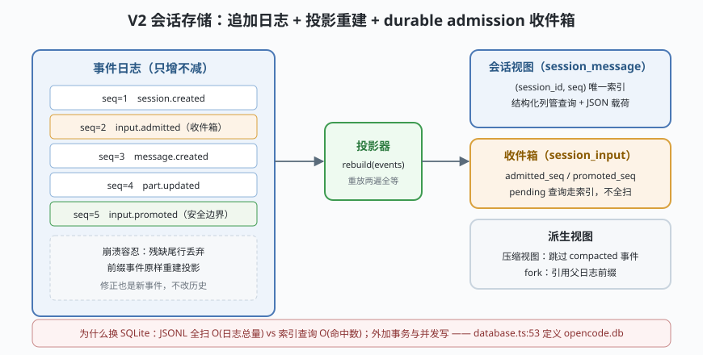

# s02: session 存储 —— 追加日志、投影重建，以及"为什么换 SQLite"

[s01_runloop](../s01_runloop/) → **s02** → [s03_tool_system](../s03_tool_system/) → ...

> OpenCode 的招牌设计之一：**V1/V2 双内核并存**。V1（`packages/opencode/src/session/*`）是当前生产主路径；V2（`packages/core/src/session/*`）把会话重写成"事件溯源 + 投影"，并把持久化从 JSON 文件换成 **SQLite（Drizzle ORM（对象关系映射））**。`specs/v2/session.md` 与仓库根 `CONTEXT.md` 是 V2 语义的权威口径——但读完后要回 V1 核对是否实跑。
>
> **Harness 层**：会话持久化 —— 追加日志、收件箱、投影、换库的理由。

---

## 问题

1. **状态散在文件里，谁来保证一致？** 会话、消息、part（消息片段）、todo 各存各的，崩溃时写了一半怎么办？
2. **用户在模型忙时又发了一条消息，放哪？** 直接追加成 user 消息会污染当前 provider 请求的上下文——那一刻的请求构造已经定型了。
3. **"读历史"越来越慢怎么办？** 打开一个 5000 条消息的会话要全量重放吗？
4. **JSON 文件换 SQLite，图什么？** 一句"数据库更快"说服不了任何人。

---

## 解决方案



V2 的四个关键件（mini 版全部对应实现）：

| 机制 | mini 实现 | 真实实现 |
|------|-----------|----------|
| **追加事件日志** | `append()` 只进不改，崩溃容忍：残缺尾行丢弃 | `packages/core/src/session/sql.ts` `session_message` 表（:120，`seq` 唯一索引，`data` 存 JSON 载荷） |
| **投影（projection）** | `rebuild(events)` 从零重放得状态，重放两次结果全等 | `packages/core/src/session/projector.ts`（投影器）+ `store.ts` |
| **durable admission 收件箱** | `admit()` 先入箱（`promoted_seq=null`），排空时才 `promote()` | `packages/core/src/session/input.ts`（`admit` :41）+ `session_input` 表（sql.ts :141）+ `runner/`（串行 runner，含 `max-steps.ts`） |
| **SQLite + Drizzle** | 场景 4 给出"为什么"的量化对照 | `packages/core/src/database/database.ts:53`（`<data>/opencode.db`）+ `packages/effect-drizzle-sqlite` |

核心句式：**用户输入先落收件箱（admitted），在"安全的 provider-turn 边界"才被提升（promote）为模型可见的 user 消息**——`CONTEXT.md` 的 Admitted Prompt / Prompt Promotion / Session Drain 三个术语干的就是这件事。

---

## 工作原理

`code.mjs` 四个场景：

**场景 1（事件溯源）**：写入 `session.created → message.created → part.updated → ...` 事件流，`rebuild()` 重放两遍——投影逐字段全等。这就是 s01 里 runLoop"每轮重读投影"的地基：**状态永远可以从日志重建，内存里的只是缓存**。

**场景 2（收件箱）**：runner 正忙着时用户又发消息 → `admit()` 只写 `session_input`（`promoted_seq: null`）→ 打印"admitted 但未提升"的中间态 → runner 排空当前步、到达安全边界 → `promote()` 把它变成正式 user 消息。**如果直接追加，正在构造中的 provider 请求就会突然多出一条消息**——这就是"durable admission"要防的事故。

**场景 3（投影读路径）**：压缩视图（`compacted` 的事件投影跳过）+ fork（子会话引用父日志前缀）——s01 的 `filterCompacted` 与 s10 的 fork 在这里只是一种"投影过滤规则"。

**场景 4（为什么换 SQLite，失败/边界路径）**：
- **崩溃容忍**：日志末尾追加半行后重放——残缺尾行被丢弃，前面的事件原样重建（JSONL 的天然优点）；
- **代价显现**：模拟"跨全部会话找 3 条 pending 输入"——JSONL 要扫全部 N 条事件，SQLite 用 `(session_id, promoted_seq)` 索引直达。mini 用操作计数对比 O(N) 全扫 vs O(命中数) 索引查询，这就是 `session_input` 表上那两个索引（sql.ts :157-164）存在的理由。

**跑一跑**（零依赖，离线）：

```bash
node code.mjs
```

---

## 对照真实源码

| mini 实现 | 真实代码位置 | 学习点 |
|-----------|-------------|--------|
| `append()` 事件日志 | `packages/core/src/session/sql.ts` :120 `session_message`（`seq` 唯一索引、`data` JSON 列） | 关系骨架 + JSON 载荷：结构化列管查询，payload 管演化 |
| `rebuild()` 投影 | `packages/core/src/session/projector.ts`、`store.ts` | 同一日志重放 N 次得 N 个相同状态 |
| `admit()/promote()` | `packages/core/src/session/input.ts`（`admit` :41）+ `sql.ts` :141 `session_input` | admitted_seq / promoted_seq 两列就是收件箱的整个状态机 |
| 串行 runner | `packages/core/src/session/runner/`（`index.ts`、`max-steps.ts` 等） | V2 把"排空"做成有持久身份的 runner（Session Drain 语义） |
| 库路径 | `packages/core/src/database/database.ts:53`（`opencode.db`，channel 分支改名） | `OPENCODE_DB` 可指 `:memory:`；迁移在 `database/migration/` |
| V1↔V2 缝合 | `packages/opencode/src/event-v2-bridge.ts`、`packages/opencode/src/config/v2-compat.ts` | 双内核并存：V2 事件桥接进 V1 事件流，config 逐项兼容 |
| 迁移现状 | `specs/storage/remove-opencode-db.md`、`specs/v2/session.md` | 官方自陈迁移未完（legacy wrapper 仍有使用），读 V2 规范要回 V1 核对 |

> 行号以当前检出为准，上游会漂移。另外 `packages/opencode/package.json` 的 `#db` 条件导入映射指向**并不存在**的 `src/storage/db.bun.ts`/`db.node.ts`（迁移遗留），找驱动层请认 `packages/core/src/database/`。

---

## 自测

1. 场景 2 里如果把 `admit()` 直接换成"追加 user 消息"，会破坏哪些正在进行的动作？（提示：provider 请求构造、token 计数、重试重放。）
2. `session_message` 为什么既建 `(session_id, seq)` 唯一索引又建 `(session_id, type, seq)` 普通索引？分别服务哪类查询？
3. 收件箱里一条输入 `admitted_seq=41, promoted_seq=null`，此刻 crash 重启，重放后它该处于什么状态？谁负责把它捞出来？

下一课 [s03_tool_system](../s03_tool_system/)：投影之上，模型看到的工具集是怎么被三层来源和权限共同裁出来的。
