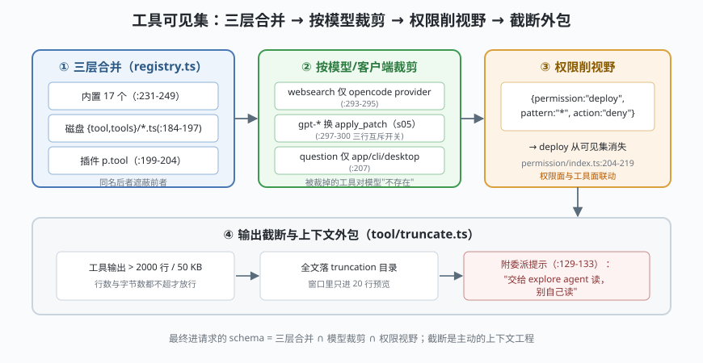

# s03: 工具系统 —— 三层来源、按模型裁剪、截断外包

[s02_session_store](../s02_session_store/) → **s03** → [s04_permission](../s04_permission/) → ...

> OpenCode 的招牌设计：**模型看到的工具集不是一张静态表，而是每次请求前现场算出来的交集**——三层来源（内置 / 磁盘 / 插件）先合并，再按 provider 与模型 id 裁剪（`gpt-*` 用 `apply_patch` 取代 `edit`+`write`，`websearch` 只有自家 provider 才给），最后**全 deny 的权限键直接从模型可见集中消失**（`tool/registry.ts` :293-300 + `permission/index.ts` :204-219）。
>
> **Harness 层**：工具注册与呈现 —— 来源合并、模型裁剪、输出截断。

---

## 问题

1. **工具从哪来？** 内置的、用户丢在 `.opencode/tool/` 里的、npm 插件注册的、MCP 接进来的——如果各自一张表，可见性与生命周期就是灾难。
2. **模型能力差异写在哪？** gpt 系练过 patch 格式、老 gpt-4 没练过；websearch 依赖 opencode 自家的 MCP 网关。这些差异进配置文件，用户就会配出必然失败的组合。
3. **被禁用的工具还该让模型看见吗？** 权限说 deny，如果工具 schema 还在请求里，模型会反复撞墙。
4. **一个 3000 行的构建日志灌进上下文怎么办？** 窗口瞬间爆掉，而模型真正需要的往往只有开头几百行。

---

## 解决方案



| 机制 | mini 实现 | 真实实现（packages/opencode/src/） |
|------|-----------|-----------------------------------|
| **三层合并** | builtin → disk → plugin，同名后者遮蔽前者 | `tool/registry.ts` :184-204：内置清单（:231-249，共 17 个：read、glob（通配文件查找）、grep、bash、edit、write、task…）+ 磁盘 `{tool,tools}/*.{js,ts}` + 插件 `p.tool` |
| **按模型裁剪** | `visible({providerID, modelID, client})` 过滤 | 同上 ：293-300：websearch 仅 opencode provider；`usePatch` 三行互斥开关（s05 展开） |
| **deny 削工具** | 全 deny 的键不进可见集 | `permission/index.ts` :204-219（`visibleTools`）——权限不只是拦截，还改变模型视野 |
| **截断 + 落盘 + 反向引导** | 超限 → 全文落 truncation 目录 → 只回预览 + "交给 explore agent"提示 | `tool/truncate.ts`（默认 2000 行 / 50 KB，:14-15；委派提示 :129-133）+ `tool/tool.ts` :131-144 自动包裹 |

---

## 工作原理

`code.mjs` 四个场景：

**场景 1（三层合并）**：内置 `read`/`bash` + 磁盘工具 `db_query` + 插件工具 `deploy`——`merge()` 沿"builtin → disk → plugin"顺序合并，同名后者遮蔽前者。真实代码里插件工具仍收 Zod schema，在 registry 边界统一转 JSON Schema（:130-137）。

**场景 2（按模型/客户端裁剪）**：同一个注册表，四种请求视野不同——`websearch` 只在 providerID 为 `opencode` 时可见；`question` 只在 client ∈ {app, cli, desktop} 时可见；`execute`（code-mode）要实验旗标。**裁剪发生在 schema 进入请求之前**，模型根本不知道被裁掉的工具存在。

**场景 3（deny 削视野，失败路径的前半段）**：给 `deploy` 配上 `{permission:"deploy", pattern:"*", action:"deny"}` 后，它从模型可见集消失——模型不会撞墙，只会觉得"我从没有过这个工具"。

**场景 4（截断外包，失败路径的落地）**：模拟 3000 行构建日志 → 超过 2000 行上限 → 全文写进 truncation 目录（mini 用内存路径示意）→ 返回前 20 行预览 + 一句提示：*"如果这个 agent 有 task 工具，交给 explore agent 处理，别自己读"*——**用截断机制反向引导模型做上下文外包**，这是 OpenCode 上下文工程密度的一处代表作。

**跑一跑**（零依赖，离线）：

```bash
node code.mjs
```

---

## 对照真实源码

| mini 实现 | 真实代码位置 | 学习点 |
|-----------|-------------|--------|
| `merge()` 三层合并 | `packages/opencode/src/tool/registry.ts` :184-204（内置清单 ：231-249，共 17 个） | 数组顺序即注册顺序；条件项（question/execute/lsp/plan_exit）用展开语法插进同一列表 |
| `visible()` 模型裁剪 | 同上 ：293-300（`usePatch` 判据 ：317 一带）、:207（question 按 client 开关） | provider 行为差异写死在代码里，不是配置偏好 |
| `denyPrune()` | `packages/opencode/src/permission/index.ts` :204-219 | deny 全削工具：权限面与工具面正交但联动 |
| `truncate()` | `packages/opencode/src/tool/truncate.ts`（MAX_LINES=2000，:28 附近；委派提示 ：129-133） | 行数与字节数**都不超**才原样返回——两个阈值各管一类失控 |
| 自动包裹 | `packages/opencode/src/tool/tool.ts` :131-144（`Tool.define`） | 截断对工具作者透明；每小时清 7 天前落盘文件（:53-66） |
| 工具描述 | 各 `tool/*.txt`（如 `tool/read.txt`） | 模型侧描述与代码分离，改提示词不用动逻辑 |

> 行号以当前检出为准，上游会漂移。MCP 工具不在这张表里——它们在 `session/tools.ts:386-470` 单独接入，且**每次调用都 ask 一次**权限（:408），s04 会回到这里。

---

## 自测

1. 为什么 `websearch` 的开关判据是 providerID 而不是模型 id？反过来写（按模型 id）会在什么场景出错？
2. "deny 全削工具"与"deny 拦截调用"用户体验差在哪？如果只做后者，模型最可能出现什么行为？
3. 截断提示让模型"交给 explore agent"——如果当前 agent 恰恰没有 task 工具（比如 deny 了），这条提示会变成什么？设计上该怎么兜底？

下一课 [s04_permission](../s04_permission/)：把场景 3 那条 `{permission, pattern, action}` 规则背后的求值机拆开。
