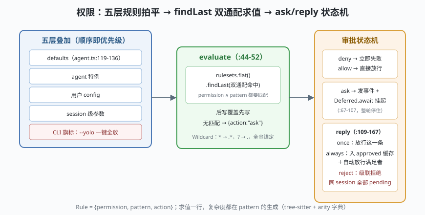

# s04: 权限 —— 一条 findLast 求值式贯穿五层叠加

[s03_tool_system](../s03_tool_system/) → **s04** → [s05_model_shape](../s05_model_shape/) → ...

> OpenCode 的招牌设计：**权限模型极简且正交**。最小单元是 Rule（规则）三元组 `{permission, pattern, action: "allow"|"deny"|"ask"}`（`packages/schema/src/v1/permission.ts:15-21`），求值只有一行语义（`packages/opencode/src/permission/index.ts:44-52`）：把所有 ruleset（规则集）`flat()` 拍平，**`findLast`** 取最后一条**双通配匹配**（permission 与 pattern 都要命中）的规则，无匹配默认 `{action:"ask"}`——**后写覆盖先写**。
>
> **Harness 层**：权限 —— 五层叠加、审批状态机、"未知即弹窗"。

---

## 问题

1. **规则从五处来，谁说了算？** 内建 defaults、agent 特例、用户 config、session 级参数、CLI 旗标——叠加顺序错了，安全形同虚设或处处弹窗。
2. **`bash` 怎么匹配？** 权限 pattern 要区分 `npm run dev` 和 `npm run deploy`，但模型给的命令行是自由文本。
3. **弹窗期间模型怎么办？** 一个 `ask` 审批最多等用户几分钟——模型必须原地挂起，还不能阻塞其他会话。
4. **用户点了 reject，其他排队的审批怎么办？** 放着一个"也许下一个能过"的假象，模型会连环撞墙。

---

## 解决方案



| 机制 | mini 实现 | 真实实现（packages/opencode/src/） |
|------|-----------|-----------------------------------|
| **findLast 双通配求值** | `evaluate(permission, pattern, ...rulesets)` 拍平 + 倒序找最后命中 | `permission/index.ts` :44-52（`?? {action:"ask"}` 兜底） |
| **通配匹配** | `*` → `.*`，`?` → `.`，全串锚定 | `packages/core/src/util/wildcard.ts`（转义正则元字符、win32 大小写不敏感） |
| **五层叠加** | defaults → agent → config → session 依次传入 | `agent/agent.ts` :119-136 默认 ruleset（`"*":"allow"`、`doom_loop:"ask"`、`*.env` ask）；叠加顺序 `defaults → agent 特例 → config → session → CLI` |
| **审批状态机** | `ask()` 挂起 + `reply("once"/"always"/"reject")` | `permission/index.ts` :67-107（`ask`：deny 立即 fail、ask 发事件 + `Deferred.await` 阻塞）、:109-167（`reply`：reject **级联拒绝同 session 全部 pending**，always 写进程内 `approved`） |

---

## 工作原理

`code.mjs` 四个场景：

**场景 1（findLast 语义）**：同一 ruleset 里 `[{*.env: ask}, {*.env: allow}]`——拍平后 `findLast` 取**最后一条**命中规则，后写覆盖先写。**顺序就是优先级**，这就是五层叠加能生效的全部机制。

**场景 2（五层叠加）**：逐层看 `npm test`（bash）与 `read .env` 的判定变化——defaults（`*`:allow、`*.env`:ask）→ agent 特例（bash deny）→ 用户 config（bash allow，覆盖 agent）→ session 级（bash ask，覆盖 config）。每一层都只是"往拍平数组后面追加规则"。

**场景 3（ask/reply 状态机）**：两个审批排队（读 `.env`、跑 `npm run deploy`）→ 用户对前者回 `always` → 同 pattern 的 pending 自动放行；换一条剧情：用户回 `reject` → **同 session 全部 pending 被级联拒绝**（失败路径）——mini 用 Promise + resolve 挂起，就是真实代码里 `Deferred.await` 的原始形态。

**场景 4（未知即弹窗）**：一个从没配置过的权限键（如 `doom_loop`，死循环工具调用检测）没有命中任何规则 → 默认 `{action:"ask"}`。**安全默认值不是 allow 而是 ask**——这是整条求值式最重要的一行兜底。

**跑一跑**（零依赖，离线）：

```bash
node code.mjs
```

---

## 对照真实源码

| mini 实现 | 真实代码位置 | 学习点 |
|-----------|-------------|--------|
| `evaluate()` | `packages/opencode/src/permission/index.ts` :44-52（本检出 ：49 的 `findLast` 行） | 一行求值式；`?? {action:"ask"}` 是"未知即弹窗"的落点 |
| `wildcardMatch()` | `packages/core/src/util/wildcard.ts` | `*`→`.*` 前先转义正则元字符；结尾 `" .*"` 特判成 `"( .*)?"`（"带不带子命令"两种说法都能匹配） |
| 默认 ruleset | `packages/opencode/src/agent/agent.ts` :119-136（`*.env` ask、`*.env.example` allow，注释自陈镜像 gitignore 语义） | defaults 的形态就是产品取向 |
| `ask()` / `reply()` | `packages/opencode/src/permission/index.ts` :67-107 / :109-167 | `State.pending: Map<ID, PendingEntry>` + `approved: Rule[]` 是状态机全部家当 |
| bash pattern 生成 | `packages/opencode/src/permission/arity.ts` :24-161（arity 字典）+ `tool/shell.ts:283-285`（tree-sitter 解析） | pattern 是解析出来的，不是字符串前缀猜 |
| 拒绝的三种形态 | `packages/core/src/v1/permission.ts` :7-31 | `RejectedError` / `CorrectedError`（带用户反馈回灌）/ `DeniedError`（把规则文本回灌模型） |

> 行号以当前检出为准，上游会漂移。另注意：**deny 会改变模型可见工具集**（s03 场景 3）、`--yolo`/`--dangerously-skip-permissions` 在 CLI 层一键全放（`cli/cmd/tui.ts:106-120` 一带）——这是五层之外的第 0 层"总闸"。

---

## 自测

1. 把场景 2 的叠加顺序倒过来（session 级最先、defaults 最后），`npm test` 的判定变成什么？这解释了真实代码为什么把 defaults 放在参数表**第一个**传入。
2. `always` 存进进程内 `approved` 而不是写进用户 config——进程重启后会发生什么？这是缺陷还是刻意的安全取舍？
3. `evaluate` 为什么要求 permission 与 pattern **双通配匹配**而不是只匹配 pattern？（提示：`read` 与 `bash` 是不同的权限键。）

下一课 [s05_model_shape](../s05_model_shape/)：同样的求值式，换成"按模型分叉工具面"的视角。
