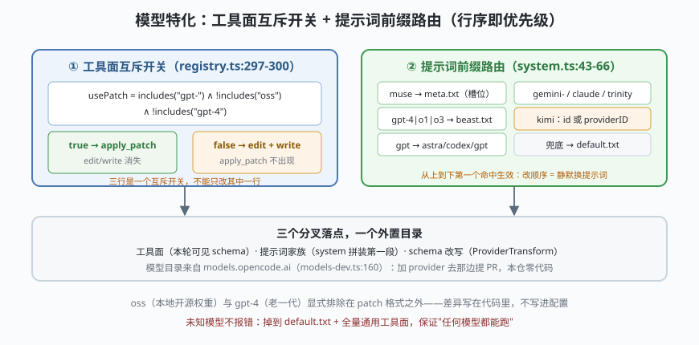

# s05: 模型特化 —— 提示词与工具面如何按模型分叉

[s04_permission](../s04_permission/) → **s05** → [s06_subagent](../s06_subagent/) → ...

> OpenCode 的招牌设计：**provider 的行为差异写在代码里，不写进配置**。两处最有信息量：`tool/registry.ts:297-300` 的三行互斥开关——`gpt-*`（非 oss、非 gpt-4）用 `apply_patch` 取代 `edit`+`write`；`session/system.ts:43-66` 的**前缀路由**——9+ 个 per-model 提示词家族（15 个模板文件在 `session/prompt/`），**行序就是优先级**。
>
> **Harness 层**：模型特化 —— 工具面分叉、提示词家族、schema 改写。

---

## 问题

1. **模型的能力差异是真实的**：gpt 系练过 apply_patch 格式，老 gpt-4 没练过；本地跑的开源权重版（oss）更不吃 patch 格式。一套工具面通吃，必然有一家模型天天输出错格式。
2. **提示词同理**：给新一代 gpt 写的提示词套在老 gpt-4 上，效果反而变差；给 Claude 的表述习惯换到 Gemini 上水土不服。
3. **差异放配置文件行不行？** 用户会"配出必然失败的组合"，support 成本爆炸；而 provider 行为差异本来就是代码事实。
4. **网关改名怎么破？** 第三方网关常把 Moonshot 模型改名，id 里根本没有 `kimi`。

---

## 解决方案



| 机制 | mini 实现 | 真实实现（packages/opencode/src/） |
|------|-----------|-----------------------------------|
| **工具面互斥开关** | `usePatch(modelID)` 三条件；为真时 `apply_patch` 出现、`edit`+`write` 消失 | `tool/registry.ts` :297-300 + 判据 ：317（`includes("gpt-") && !includes("oss") && !includes("gpt-4")`）；工具本体 `tool/apply_patch.ts` |
| **提示词前缀路由** | 有序分支：muse → gpt-4/o1/o3 → gpt(内分 gpt-6/codex) → gemini- → claude → trinity → kimi → default | `session/system.ts` :43-66；15 个模板在 `session/prompt/*.txt`（anthropic/beast/codex/gemini/gpt-astra/gpt/kimi/meta/trinity/default 等） |
| **kimi 双通道匹配** | id 命中或 providerID ∈ {moonshotai, ...} | 同上 ：60-65（注释自陈：第三方网关改名场景，只按 id 会静默掉到 default） |
| **模型目录外置** | （演示只传 modelID/providerID） | `packages/core/src/models-dev.ts:160`：目录来自 `models.opencode.ai`（models.dev 的部署），加 provider 去那边提 PR |
| **schema 按模型改写** | （点题不展开） | `provider/transform.ts`（1909 行：JSON Schema/参数/maxOutputTokens/providerOptions 全按模型改） |

---

## 工作原理

`code.mjs` 三个场景：

**场景 1（工具面分叉）**：四个模型过同一张注册表——`gpt-5.1` 看到 `apply_patch` 而**看不到** `edit`/`write`；`gpt-4o` 与 `gpt-oss-120b` 保住 `edit`/`write`；`claude-*` 不受影响。真实代码的注释特别强调：**三行是一个互斥开关，不能只改其中一行**。

**场景 2（前缀路由 + 顺序敏感性）**：8 个模型 id 走一遍路由表——`muse-glimmer` 拿到带 `{{MODEL_NAME}}` 槽位的 meta.txt、`gpt-4o` 拿 beast、`gpt-6` 拿 astra、`kimi-k2`（provider=moonshotai，id 里没 kimi）靠 providerID 兜住。然后故意把路由表**顺序打乱**重跑：`gpt-4o` 被泛化的 `gpt` 分支截胡，静默拿到错误的家族——**行序就是优先级，改动顺序 = 静默换提示词**（失败路径）。

**场景 3（未知模型兜底）**：一个目录里查无此人的模型 id 落到 `default.txt`——不报错、不猜测，兜底家族保证任何模型都能跑。

**跑一跑**（零依赖，离线）：

```bash
node code.mjs
```

---

## 对照真实源码

| mini 实现 | 真实代码位置 | 学习点 |
|-----------|-------------|--------|
| `usePatch()` | `packages/opencode/src/tool/registry.ts` :297-300、:315-317（含中文导读注释"三行是一个互斥开关"） | 换工具是 provider 行为差异，写死在代码而非配置 |
| `apply_patch` 工具 | `packages/opencode/src/tool/apply_patch.ts` + `apply_patch.txt` | patch 格式工具与 `edit`/`write` 完全同接口，调用方无感 |
| `routeFamily()` | `packages/opencode/src/session/system.ts` :43-66 | `includes` 前缀路由：`gpt-4|o1|o3 → beast` 必须早于泛化 `gpt`；`gpt-6`/`codex` 必须早于兜底 `gpt.txt` |
| 模板文件 | `packages/opencode/src/session/prompt/*.txt`（15 个） | 提示词与代码分离；meta.txt 有 `{{MODEL_NAME}}` 槽位 |
| 拼装顺序 | `packages/opencode/src/session/prompt.ts` :1264-1269（environment + instructions + mcp + skills） | 家族模板只是第一段；s08 展开完整拼装 |
| 模型目录 | `packages/core/src/models-dev.ts:160-258`（TTL 5 分钟缓存 + 后台刷新 + Flock 防竞态） | 加 provider 的官方路径是给 models.dev 提 PR（CONTRIBUTING.md:29-31） |

> 行号以当前检出为准，上游会漂移。另一处按模型分叉在 schema 层：`ProviderTransform.schema` 会对个别模型改写工具 schema（`session/tools.ts:96` 调用），思路与工具面替换一致——**同一模型约束，在工具面、提示词面、schema 面三处各自落地**。

---

## 自测

1. 为什么 `oss` 与 `gpt-4` 要从 patch 格式中显式排除？如果只用 `includes("gpt-")` 一个判据，两类模型分别会出什么事故？
2. `gemini-` 带连字符而 `claude` 不带——真实代码注释说这是为了避开什么？如果自定义模型 id 恰好含 "gemini" 字样会怎样？
3. 给这台 harness 接一个全新模型（如某国产新模型），工具面/提示词面分别要动哪里？什么时候应该选择"什么都不动，让它掉到 default"？

下一课 [s06_subagent](../s06_subagent/)：同一把 runLoop 的递归调用——子代理的权限继承为什么"只继承 deny"。
